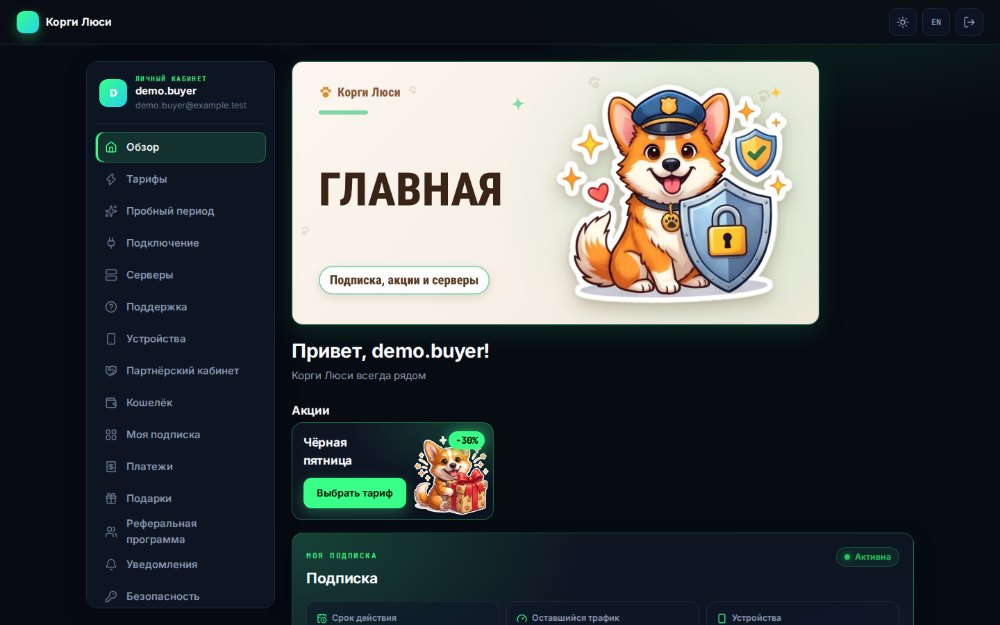
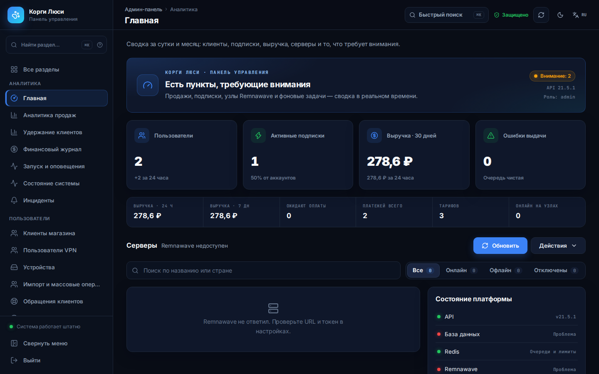

#  VPN Shop by Corgi Lucy

[Русский](README.md) · **English** · [Українська](README.uk.md)

A VPN subscription shop for your Remnawave panel. Customers buy access in Telegram, on the web or in the app. Operators manage the shop with Lucy Admin.

**[Apps](#download-the-mobile-apps)** · [Installation](#install-the-shop) · [Recovery](#updates-and-recovery) · [Screenshots](#screenshots)

## Download the mobile apps

### Android

| What you want to do | Download |
| --- | --- |
| **Shop** · buy or renew a plan and connect | [Download APK](https://github.com/booarkz-cpu/shop-by-boo/releases/latest/download/corgi-lusi-android.apk) · [SHA-256](https://github.com/booarkz-cpu/shop-by-boo/releases/latest/download/corgi-lusi-android.apk.sha256) |
| **Corgi Lucy Client** · connect using a subscription link you already have | [Download APK](https://github.com/booarkz-cpu/shop-by-boo/releases/latest/download/corgi-lusi-client.apk) · [SHA-256](https://github.com/booarkz-cpu/shop-by-boo/releases/latest/download/corgi-lusi-client.apk.sha256) |
| **Lucy Admin** · manage your shop | [Download APK](https://github.com/booarkz-cpu/shop-by-boo/releases/latest/download/corgi-lusi-android-admin.apk) · [SHA-256](https://github.com/booarkz-cpu/shop-by-boo/releases/latest/download/corgi-lusi-android-admin.apk.sha256) |

Signed APKs for Android 8.0 and later. These links follow the latest stable release.

Open the APK on your phone and confirm installation. To verify a download on Linux, save both files to the same directory and run, for example, `sha256sum -c corgi-lusi-client.apk.sha256`.

### iOS

[Release v28.161.0](https://github.com/booarkz-cpu/shop-by-boo/releases/tag/v28.161.0) includes two builds per app. The iPhone and iPad IPA files are **unsigned**. Installing on a device requires iOS or iPadOS 16.0 or later, Apple signing and a suitable provisioning profile. The ZIP contains an app for the Xcode simulator on a Mac.

| App | Files |
| --- | --- |
| **Shop** | [Device IPA](https://github.com/booarkz-cpu/shop-by-boo/releases/download/v28.161.0/corgi_lusi_ios_user_3_9_0_unsigned.ipa) · [SHA-256](https://github.com/booarkz-cpu/shop-by-boo/releases/download/v28.161.0/corgi_lusi_ios_user_3_9_0_unsigned.ipa.sha256)<br>[Simulator ZIP](https://github.com/booarkz-cpu/shop-by-boo/releases/download/v28.161.0/corgi_lusi_ios_user_3_9_0_simulator.zip) · [SHA-256](https://github.com/booarkz-cpu/shop-by-boo/releases/download/v28.161.0/corgi_lusi_ios_user_3_9_0_simulator.zip.sha256) |
| **Lucy Admin** | [Device IPA](https://github.com/booarkz-cpu/shop-by-boo/releases/download/v28.161.0/corgi_lusi_ios_admin_3_9_0_unsigned.ipa) · [SHA-256](https://github.com/booarkz-cpu/shop-by-boo/releases/download/v28.161.0/corgi_lusi_ios_admin_3_9_0_unsigned.ipa.sha256)<br>[Simulator ZIP](https://github.com/booarkz-cpu/shop-by-boo/releases/download/v28.161.0/corgi_lusi_ios_admin_3_9_0_simulator.zip) · [SHA-256](https://github.com/booarkz-cpu/shop-by-boo/releases/download/v28.161.0/corgi_lusi_ios_admin_3_9_0_simulator.zip.sha256) |

On an iPhone, you can also open your shop’s web account in Safari. [Mobile guide](docs/wiki/en/Mobile.md) · [Release signing status](https://github.com/booarkz-cpu/shop-by-boo/releases/download/v28.161.0/mobile-production-status.json).

## Install the shop

Prepare an Ubuntu 24.04 or Debian 12 VPS with root access. Allow roughly 4 vCPUs, 8 GB of RAM and 40 GB of disk to build all the images. Point the hostnames you choose to the server. The installer suggests `api`, `admin`, `app`, `cabinet` and `support`. The server needs inbound TCP ports 80 and 443 for web traffic and certificate issuance. [DNS setup](docs/wiki/en/Domains.md).

### First SSH connection

Connect to your VPS from a terminal. Replace the example IP with your own. On Android, Termux with the `openssh` package works as an SSH client. [Termux guide in Russian](docs/ru/new/TERMUX_GUIDE.md).

```bash
ssh root@203.0.113.10
```

For the first connection, open the VPS console in your hosting provider’s control panel. Display the public host key fingerprints there.

```bash
for key in /etc/ssh/ssh_host_*_key.pub; do
  ssh-keygen -l -E sha256 -f "$key"
done
```

Compare the SHA256 fingerprint for the same key type with the one shown in SSH. If they match, enter `yes`. If they differ, press Ctrl+C and check the server address and fingerprint in the hosting console.

### Install a stable release

Run the following command as root on the VPS. The installer sets up Docker Compose, asks for domains and credentials, and prints the URL and credentials for the first sign-in.

```bash
curl -fsSL https://raw.githubusercontent.com/booarkz-cpu/shop-by-boo/v28.161.0/install.sh -o /root/shop-install.sh &&
  BRANCH=v28.161.0 bash /root/shop-install.sh
```

Check the API, admin panel, Mini App and customer account.

```bash
cd /opt/vpn-shop && bash scripts/doctor.sh
```

Sign in to Lucy Admin at the printed address and enable two-factor authentication. Connect your Remnawave panel and select an Internal Squad for the plan. To take payments, configure your provider and register its notification URL. [Installation](docs/wiki/en/Installation.md) · [Remnawave](docs/wiki/en/Remnawave.md) · [Payments](docs/wiki/en/Payments.md).

## Updates and recovery

**Before an update**, schedule a maintenance window. On a standard installation the following command creates a full encrypted backup. It briefly stops the services that write data.

```bash
cd /opt/vpn-shop && sudo bash scripts/backup.sh
```

Store the `.vpb` bundle and its `.sha256` file off the server. Keep the password separately. Record the installed tag and full commit, or the installation archive’s SHA-256. Then run the updater with the published tag you want to install.

```bash
cd /opt/vpn-shop && sudo env RELEASE_TAG=v28.161.0 bash scripts/update-from-github.sh
```

**To recover**, prepare an isolated host at the same release with empty volumes. Check the SHA-256, decrypt the backup and verify the files against its manifest. Restore the environment, shop database, Support Pro database if included, and uploaded files. Check subscription records, attachments, admin sign-in and `doctor.sh` before switching traffic. [Recovery guide](docs/wiki/en/Backup.md) · [Recovery commands in Russian](docs/ru/BACKUP_CURRENT.md) · [Updating and rolling back](docs/wiki/en/Updates.md).

## Screenshots

| Customer account | Lucy Admin |
| --- | --- |
|  |  |
| Subscription, devices and payments | Sales, customers and support |

The web screens show demonstration data. [Full gallery with Russian captions](screenshots/README.md) · [Android client screens](screenshots/client).

## How the shop works

In a standard deployment, Caddy routes HTTPS requests to the API and web apps. The shop stores orders and subscriptions in PostgreSQL, uses Redis for caching and locks and calls the Remnawave API to grant or renew access.

## Versions and documentation

| Component | Release v28.161.0 | On main |
| --- | --- | --- |
| Shop and Lucy Admin · Android and iOS | 3.9.0 | 3.9.1 |
| Standalone client · Android | 1.10.1 | 1.10.2 |
| Backend · Python / PostgreSQL | 3.14 / 18.6 | 3.15 / 19.0 |

The runtime/API version is `21.5.1`. The shop database migration is `0094_store_subscriptions` and Support Pro is at `0008`. The distribution and apps have separate version numbers. [Release manifest](https://github.com/booarkz-cpu/shop-by-boo/releases/download/v28.161.0/remnawave_vpn_shop_v28_161_0_full_release_manifest.json) · [Changelog](CHANGELOG.md) · [Previous README](https://github.com/booarkz-cpu/shop-by-boo/blob/0bc4385ffbc1073f00cf47612b3b8ca96651b845/README.en.md).

| Task | Where to go |
| --- | --- |
| Understand the deployment | [Architecture](docs/architecture/README.md) · [Docker services, networks and volumes](docs/architecture/CONTAINER_DIAGRAM.md) (Russian) |
| Set up customer services | [Telegram and Mini App](docs/wiki/en/Telegram.md) · [Admin panel](docs/wiki/en/Admin.md) |
| Diagnose an incident or review access | [Troubleshooting](docs/wiki/en/Troubleshooting.md) · [Security](docs/wiki/en/Security.md) · [Report a vulnerability](SECURITY.md) |
| Find an operator guide or check readiness | [English guides](docs/en/guides/README.md) · [Readiness criteria in Russian](docs/ru/MATRIX_COMPLETION_21_5_1.md) |

The [Corgi Lusi VPN Shop Source License 2.9](LICENSE) covers use and distribution. [Third-party notices](THIRD_PARTY_NOTICES.md).

The code and documentation are published for study and demonstration. Operators are responsible for server security, customer data and compliance with local law.
