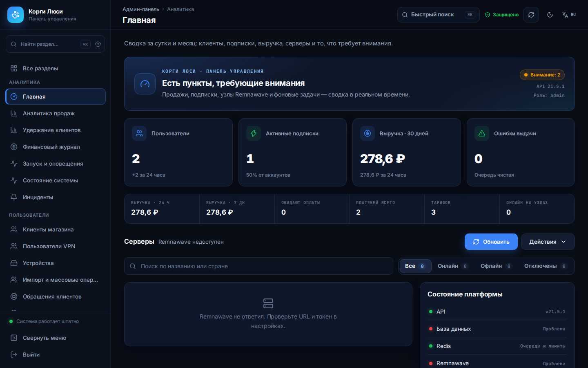
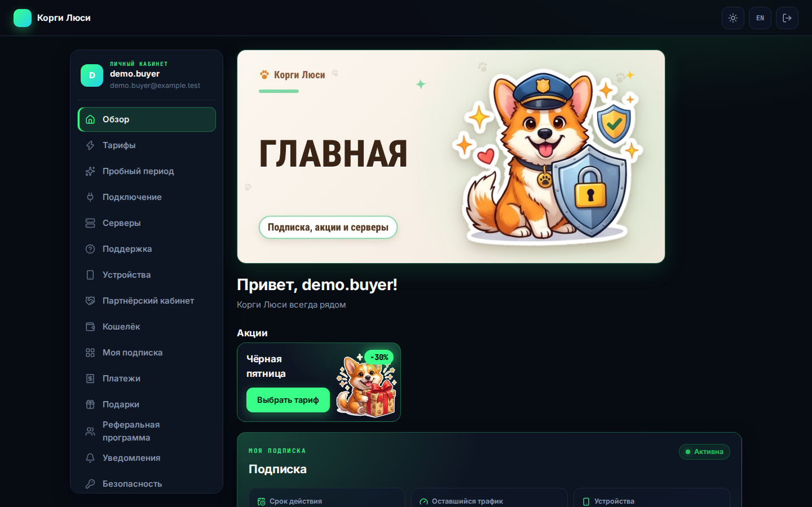
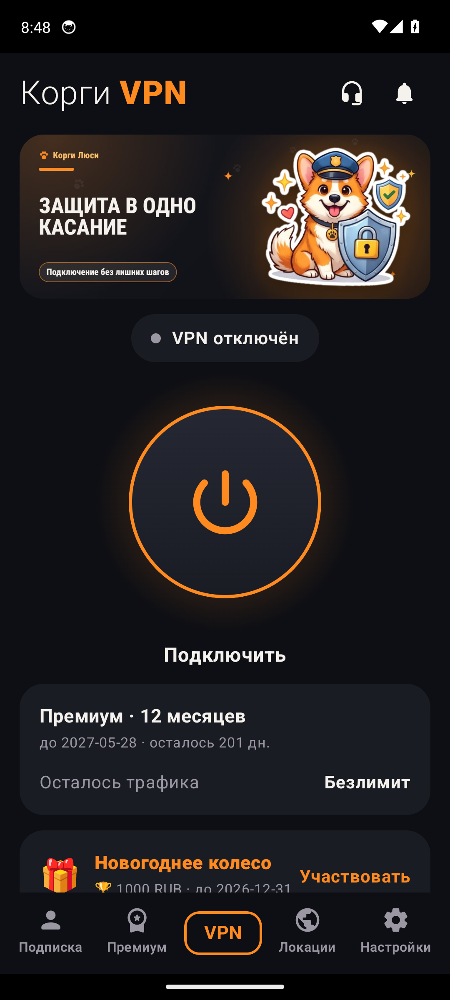
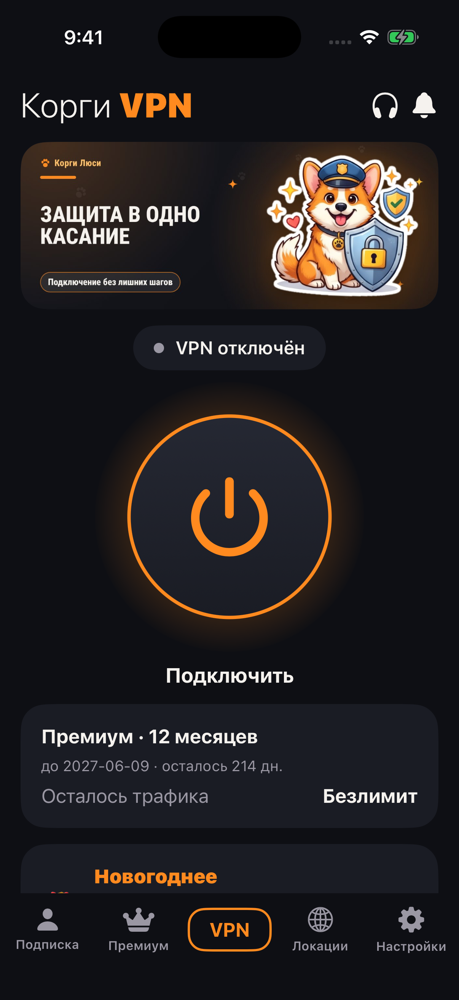

# Corgi Lucy — a VPN subscription shop on Remnawave

[Русский](README.md) · **English** · [Українська](README.uk.md)

> [!WARNING]
> ‼️ **This project is for educational and informational purposes only.** ‼️
> The code and documentation are published for study and demonstration. If you use them, you alone are responsible for complying with the laws of your country and for the security of your servers and customer data. The author gives no warranty and accepts no liability for any use.

> **v28.80.0** — current stable release. Runtime/API `21.5.1`, shop migration `0093_ssh_key_rotation`.

**What it is.** The shop sells VPN subscriptions and grants access in your own Remnawave panel. It:
- takes payments (SBP, cards, crypto, Telegram Stars);
- renews subscriptions and counts traffic and devices;
- runs a Telegram bot, a Mini App, a web cabinet and Android and iOS apps.

Everything is managed from one admin panel, including installing Remnawave and its nodes on your servers.

| | |
| --- | --- |
|  |  |
|  |  |

## Start here

**Download for Android (signed with the shop key):** [customer app — APK](https://github.com/booarkz-cpu/shop-by-boo/releases/latest/download/corgi-lusi-android.apk) · [«Corgi Lusi: client» — a VPN for any subscription, APK](https://github.com/booarkz-cpu/shop-by-boo/releases/latest/download/corgi-lusi-client.apk) · [admin app — APK](https://github.com/booarkz-cpu/shop-by-boo/releases/latest/download/corgi-lusi-android-admin.apk). The links always point to the latest release.

| Task | Document |
| --- | --- |
| Install Remnawave and set up domains | [Owner setup guide](docs/en/OWNER_SETUP_GUIDE.md) |
| Deploy the shop | [Deployment](docs/en/DEPLOYMENT.md) |
| Payments | [Payments](docs/en/PAYMENTS.md) |
| All documentation | [Documentation index](docs/en/DOCUMENTATION.md) · [Wiki](docs/wiki/en/Home.md) |
| What changed | [CHANGELOG](CHANGELOG.md) (Russian) |

Most detailed guides are in Russian — see [DOCUMENTATION_RU](DOCUMENTATION_RU.md).

## Contributing and security

[CONTRIBUTING](CONTRIBUTING.md) · [SECURITY](SECURITY.md) · [LICENSE](LICENSE) · [Third-party notices](THIRD_PARTY_NOTICES.md)
