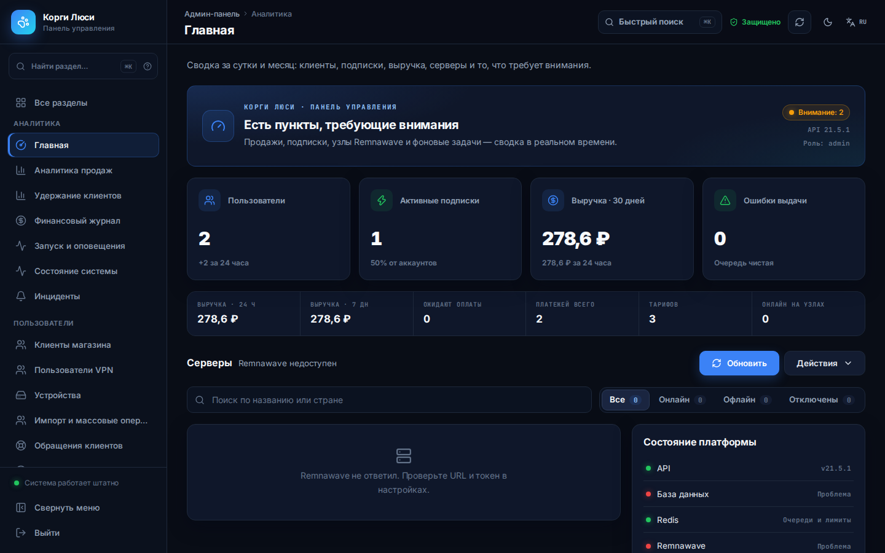

#  VPN Shop by Corgi Lucy

**Русский** · [English](README.en.md) · [Українська](README.uk.md)

Магазин VPN-подписок на базе Remnawave. Клиент покупает доступ в Telegram, на сайте или в приложении. Владелец управляет магазином через Lucy Admin.

**[Приложения](#скачать-мобильные-приложения)** · [Установка](#установить-магазин) · [Восстановление](#обновление-и-восстановление) · [Интерфейсы](#интерфейсы)

## Скачать мобильные приложения

**[Скачать свежие версии приложений](https://github.com/booarkz-cpu/shop-by-boo/releases?q=mobile-v)**. Мобильный выпуск содержит APK, пакеты iOS и SHA-256 для каждого файла. Ниже приведены загрузки из дистрибутива магазина.

### Android

| Что вы хотите сделать | Загрузка |
| --- | --- |
| **Магазин** · выбрать тариф, продлить подписку и подключиться | [Скачать APK](https://github.com/booarkz-cpu/shop-by-boo/releases/latest/download/corgi-lusi-android.apk) · [SHA-256](https://github.com/booarkz-cpu/shop-by-boo/releases/latest/download/corgi-lusi-android.apk.sha256) |
| **Корги Люси: клиент** · подключиться по уже имеющейся ссылке на подписку | [Скачать APK](https://github.com/booarkz-cpu/shop-by-boo/releases/latest/download/corgi-lusi-client.apk) · [SHA-256](https://github.com/booarkz-cpu/shop-by-boo/releases/latest/download/corgi-lusi-client.apk.sha256) |
| **Lucy Admin** · управлять собственным магазином | [Скачать APK](https://github.com/booarkz-cpu/shop-by-boo/releases/latest/download/corgi-lusi-android-admin.apk) · [SHA-256](https://github.com/booarkz-cpu/shop-by-boo/releases/latest/download/corgi-lusi-android-admin.apk.sha256) |

Подписанные APK для Android 8.0 и новее. Ссылки ведут на последний стабильный выпуск.

Откройте скачанный APK на телефоне и подтвердите установку. На компьютере с Linux можно проверить файл в папке загрузки, например командой `sha256sum -c corgi-lusi-client.apk.sha256`.

Если у вас магазин или Lucy Admin версии 3.9.1 и ниже либо клиент версии 1.10.2 и ниже, установите подписанный APK из мобильного выпуска поверх прежнего приложения. Удалять приложение не нужно. Новая версия будет проверять обновления на GitHub в фоне. Android может запросить подтверждение установки.

### iOS

В [выпуске v28.161.0](https://github.com/booarkz-cpu/shop-by-boo/releases/tag/v28.161.0) опубликованы две сборки каждого приложения. Файлы IPA для iPhone и iPad опубликованы **без подписи**. Для установки нужны iOS или iPadOS 16.0 и новее, подпись Apple и подходящий профиль подготовки. ZIP содержит приложение для симулятора Xcode на Mac.

| Приложение | Файлы |
| --- | --- |
| **Магазин** | [IPA для устройства](https://github.com/booarkz-cpu/shop-by-boo/releases/download/v28.161.0/corgi_lusi_ios_user_3_9_0_unsigned.ipa) · [SHA-256](https://github.com/booarkz-cpu/shop-by-boo/releases/download/v28.161.0/corgi_lusi_ios_user_3_9_0_unsigned.ipa.sha256)<br>[ZIP симулятора](https://github.com/booarkz-cpu/shop-by-boo/releases/download/v28.161.0/corgi_lusi_ios_user_3_9_0_simulator.zip) · [SHA-256](https://github.com/booarkz-cpu/shop-by-boo/releases/download/v28.161.0/corgi_lusi_ios_user_3_9_0_simulator.zip.sha256) |
| **Lucy Admin** | [IPA для устройства](https://github.com/booarkz-cpu/shop-by-boo/releases/download/v28.161.0/corgi_lusi_ios_admin_3_9_0_unsigned.ipa) · [SHA-256](https://github.com/booarkz-cpu/shop-by-boo/releases/download/v28.161.0/corgi_lusi_ios_admin_3_9_0_unsigned.ipa.sha256)<br>[ZIP симулятора](https://github.com/booarkz-cpu/shop-by-boo/releases/download/v28.161.0/corgi_lusi_ios_admin_3_9_0_simulator.zip) · [SHA-256](https://github.com/booarkz-cpu/shop-by-boo/releases/download/v28.161.0/corgi_lusi_ios_admin_3_9_0_simulator.zip.sha256) |

На iPhone также можно открыть личный кабинет в Safari по адресу своего магазина. [Мобильные приложения](docs/wiki/ru/Mobile.md) · [Сведения о подписи выпуска](https://github.com/booarkz-cpu/shop-by-boo/releases/download/v28.161.0/mobile-production-status.json).

## Установить магазин

Подготовьте VPS с Ubuntu 24.04 или Debian 12 и доступом root. Для сборки всех образов ориентир — 4 vCPU, 8 ГБ памяти и 40 ГБ диска. Направьте DNS-записи выбранных имён на сервер. Установщик предлагает `api`, `admin`, `app`, `cabinet` и `support`. Для HTTPS нужны доступные извне TCP-порты 80 и 443. [Подготовка DNS](docs/wiki/ru/Domains.md).

### Первый вход по SSH

Подключитесь из терминала к своему VPS, подставив его IP. С телефона Android подойдёт Termux с пакетом `openssh`. [Управление сервером через Termux](docs/ru/new/TERMUX_GUIDE.md).

```bash
ssh root@203.0.113.10
```

При первом подключении проверьте ключ. Откройте консоль этого VPS в личном кабинете хостинга и выведите отпечатки ключей.

```bash
for key in /etc/ssh/ssh_host_*_key.pub; do
  ssh-keygen -l -E sha256 -f "$key"
done
```

Сравните отпечаток SHA256 для того же типа ключа с показанным в SSH. При совпадении введите `yes`. При расхождении нажмите Ctrl+C и проверьте адрес и ключ в консоли хостинга.

### Установка стабильного выпуска

Выполните на VPS от root. Установщик подготовит Docker Compose, запросит домены и параметры доступа, затем выведет адрес и данные для первого входа.

```bash
curl -fsSL https://raw.githubusercontent.com/booarkz-cpu/shop-by-boo/v28.161.0/install.sh -o /root/shop-install.sh &&
  BRANCH=v28.161.0 bash /root/shop-install.sh
```

Проверьте установку. Диагностика обращается к API и проверяет ответы админки, Mini App и кабинета.

```bash
cd /opt/vpn-shop && bash scripts/doctor.sh
```

Войдите в Lucy Admin по выведенному адресу, включите двухфакторную аутентификацию и создайте тариф. Для выдачи доступа подключите панель Remnawave и выберите Internal Squad. Для приёма оплаты укажите параметры выбранного провайдера и адрес уведомлений. [Установка](docs/wiki/ru/Installation.md) · [Remnawave](docs/wiki/ru/Remnawave.md) · [Платежи](docs/wiki/ru/Payments.md).

## Обновление и восстановление

**Перед обновлением** выделите окно обслуживания. На стандартной установке следующая команда создаёт зашифрованную полную копию. На время копирования скрипт приостанавливает службы записи.

```bash
cd /opt/vpn-shop && sudo bash scripts/backup.sh
```

Сохраните `.vpb` и его `.sha256` вне сервера, а пароль — отдельно. Запишите тег и полный коммит установки либо SHA-256 установочного архива. Затем запустите обновление до выбранного опубликованного тега.

```bash
cd /opt/vpn-shop && sudo env RELEASE_TAG=v28.161.0 bash scripts/update-from-github.sh
```

**Для восстановления** подготовьте отдельный сервер той же версии с пустыми томами. Сверьте SHA-256, расшифруйте копию, проверьте манифест, восстановите окружение, базы магазина и подключённого Support Pro, затем файлы. Перед переключением трафика проверьте подписки, вложения, вход администратора и `doctor.sh`. [Команды восстановления](docs/ru/BACKUP_CURRENT.md) · [Резервные копии](docs/wiki/ru/Backup.md) · [Обновление и откат](docs/wiki/ru/Updates.md).

## Интерфейсы

| Кабинет покупателя | Lucy Admin |
| --- | --- |
|  |  |
| Подписка, устройства и платежи | Продажи, клиенты и обращения |

Снимки веб-интерфейсов сделаны на демонстрационных данных. [Галерея с подписями](screenshots/README.md) · [Экраны Android-клиента](screenshots/client).

## Устройство магазина

В стандартной установке Caddy принимает HTTPS и направляет запросы в API и веб-приложения. Магазин хранит заказы и подписки в PostgreSQL, использует Redis для кеша и блокировок и обращается к API Remnawave, чтобы выдать или продлить доступ.

## Версии и документация

| Продукт | Выпуск v28.161.0 | main |
| --- | --- | --- |
| Магазин и Lucy Admin · Android и iOS | 3.9.0 | 3.9.2 |
| VPN-клиент · Android | 1.10.1 | 1.10.3 |
| Backend · Python / PostgreSQL | 3.14 / 18.6 | 3.15 / 19.0 |
| Support Pro · Alembic | `0008` | `0009` |

Версия runtime/API — `21.5.1`. Ревизия базы магазина в выпуске и в основной ветке — `0094_store_subscriptions`. Дистрибутив, исходники основной ветки и версии приложений обновляются раздельно. [Манифест выпуска](https://github.com/booarkz-cpu/shop-by-boo/releases/download/v28.161.0/remnawave_vpn_shop_v28_161_0_full_release_manifest.json) · [История изменений](CHANGELOG.md) · [Предыдущая редакция README](https://github.com/booarkz-cpu/shop-by-boo/blob/0bc4385ffbc1073f00cf47612b3b8ca96651b845/README.md).

| Задача | Материалы |
| --- | --- |
| Разобраться в системе | [Архитектура](docs/architecture/README.md) · [Службы Docker, сети и тома](docs/architecture/CONTAINER_DIAGRAM.md) |
| Настроить обслуживание клиентов | [Telegram и Mini App](docs/wiki/ru/Telegram.md) · [Админ-панель](docs/wiki/ru/Admin.md) |
| Найти причину сбоя или проверить защиту | [Диагностика](docs/wiki/ru/Troubleshooting.md) · [Безопасность](docs/wiki/ru/Security.md) · [Сообщить об уязвимости](SECURITY.md) |
| Проверить готовность и найти инструкцию | [Критерии готовности](docs/ru/MATRIX_COMPLETION_21_5_1.md) · [Каталог документации](DOCUMENTATION.md) |

Условия использования и распространения определяет [Corgi Lusi VPN Shop Source License 2.9](LICENSE). [Сторонние компоненты и лицензии](THIRD_PARTY_NOTICES.md).

Код и документация опубликованы для изучения и демонстрации. За безопасность сервера, данные клиентов и соблюдение местных законов отвечает оператор.
