<div align="center">


# 🐶 VPN Shop by Corgi

**Русский** · [English](README.en.md) · [Українська](README.uk.md)

### Свой VPN-сервис под ключ поверх панели Remnawave

Telegram-бот и Mini App · личный кабинет · приложения Android и iOS · VPN-клиент «Корги Люси» · админ-панель · поддержка · оплата

[](https://github.com/booarkz-cpu/shop-by-boo/actions/workflows/ci.yml)
[](https://github.com/booarkz-cpu/shop-by-boo/actions/workflows/docker.yml)
[](https://github.com/booarkz-cpu/shop-by-boo/actions/workflows/android-client.yml)
[](https://github.com/booarkz-cpu/shop-by-boo/releases/latest)
[](LICENSE)


**[🚀 Установить за 15 минут](#-установка-шаг-за-шагом-для-тех-кто-делает-это-впервые)** · [👀 Как это выглядит](#-как-это-выглядит) · [🧭 Путь клиента](#-путь-клиента-от-start-до-подключения) · [📲 Приложения](#-приложения-android-и-ios) · [❓ Частые вопросы](#-частые-вопросы-новичка) · [📚 Документация](#-документация)

</div>

> [!WARNING]
> ‼️ **Проект создан только в ознакомительных целях.** ‼️
> Код и документация публикуются для изучения и демонстрации. Используя их, вы сами отвечаете за соблюдение законов своей страны, за безопасность серверов и данных клиентов. Автор не даёт гарантий и не отвечает за последствия использования.

> **v28.113.0** — текущий стабильный выпуск. Runtime/API `21.5.1`, миграция магазина `0094_store_subscriptions`, Support Pro `0008` / 3.8, приложения Android и iOS `3.5.0`, «Корги Люси: клиент» `1.8.2`.
> Тег выпуска и версия API — разные числа намеренно: устанавливается `v28.113.0`, `/health` отвечает `21.5.1`.
> Точная карта готовности: [покрытие](docs/ru/WORKSPACE_COVERAGE.md) · [критерии завершения](docs/ru/MATRIX_COMPLETION_21_5_1.md) · [CHANGELOG](CHANGELOG.md).

## 📑 Оглавление

| Раздел | О чём |
| --- | --- |
| [Что это простыми словами](#-что-это-простыми-словами) | что делает магазин, кому он нужен и из чего состоит — без терминов |
| [Как это выглядит](#-как-это-выглядит) | настоящие экраны: бот, Mini App, кабинет, приложения, админка |
| [Что понадобится](#-что-понадобится-перед-началом) | список покупок и подготовок — со сроками и примерными ценами |
| [Установка шаг за шагом](#-установка-шаг-за-шагом-для-тех-кто-делает-это-впервые) | 12 шагов от пустого сервера до первой продажи, с картинками |
| [Путь клиента](#-путь-клиента-от-start-до-подключения) | что видит покупатель от `/start` до включённого VPN |
| [Каждый день](#-каждый-день-что-делает-владелец) | 10 минут в день: где смотреть деньги, клиентов, обращения и сбои |
| [Частые вопросы](#-частые-вопросы-новичка) | «что делать, если…» — самые частые ситуации |
| [Новое в выпусках](#-новое-в-v281110) | последние изменения |
| [О проекте и возможности](#-о-проекте) | подробно: возможности, стек, требования, архитектура |
| [Быстрый старт для опытных](#-быстрый-старт) | одна команда, Docker Compose вручную, локальный стенд |
| [Переменные окружения](#-переменные-окружения) | каждая настройка и где взять значение |
| [Скриншоты всех разделов](#-скриншоты) | каждый раздел админки и кабинета |
| [Оплата](#-как-устроена-оплата) · [Копии](#-резервное-копирование-и-восстановление) · [Команды](#-команды-администратора) · [Диагностика](#-диагностика) | справочники для эксплуатации |
| [Документация](#-документация) · [Лицензия](#-лицензия) · [История выпусков](#-история-выпусков) | всё остальное |

---

## 🐶 Что это простыми словами

Представьте интернет-магазин, который продаёт не вещи, а **доступ к VPN**. Покупатель приходит в Telegram-бота (или на сайт, или в приложение), выбирает тариф — например «1 месяц за 199 ₽», — платит картой, через СБП, криптовалютой или звёздами Telegram, и **через несколько секунд** получает готовую ссылку для подключения. Через месяц магазин сам напомнит продлить, сам спишет деньги с баланса, если клиент разрешил, сам отключит доступ, если оплаты нет.

Вы — владелец этого магазина. Вам не нужно ничего делать руками: выдавать ключи, считать дни, отвечать «где моя подписка». Всё это делает программа. Вы открываете **админ-панель** в браузере и видите: сколько продано сегодня, сколько клиентов, какие серверы работают, кто написал в поддержку. Цены, тексты бота, картинки, тарифы, кассы — всё меняется там же, кнопками, **без программиста**.

Сам VPN (серверы, через которые идёт трафик клиентов) работает на бесплатной панели **[Remnawave](https://github.com/remnawave/panel)**. Магазин — это «надстройка» над ней: он продаёт, а Remnawave раздаёт доступ. Если у вас ещё нет Remnawave — магазин **сам поставит** её на ваш сервер из админки, без консоли.

### Из чего состоит

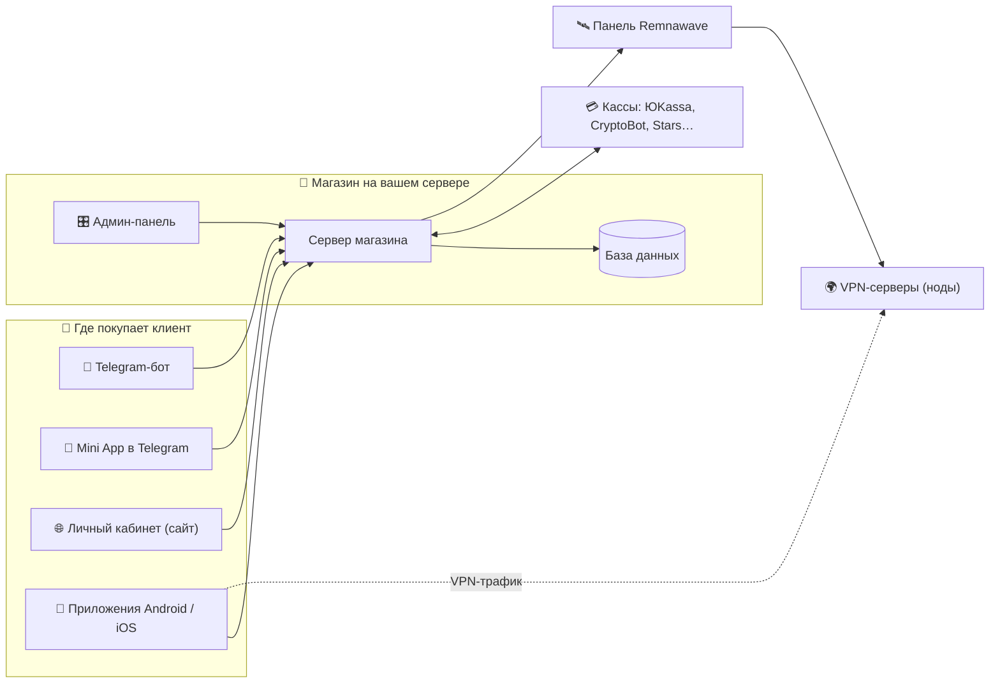

| Часть | Что это такое | Кто ей пользуется |
| --- | --- | --- |
| 🤖 **Telegram-бот** | Бот в Telegram: приветствие, тарифы, оплата, «мой ключ», поддержка | Клиенты |
| 📱 **Mini App** | Мини-сайт, который открывается прямо внутри Telegram по кнопке в боте | Клиенты |
| 🌐 **Личный кабинет** | Обычный сайт: вход по почте или через Telegram, подписка, оплата, устройства | Клиенты |
| 📲 **Приложения Android и iOS** | Приложение магазина: купить, продлить и подключиться одной кнопкой | Клиенты |
| 🐾 **«Корги Люси: клиент»** | Отдельный VPN-клиент для Android: подключается к любой подписке, сам обновляется | Клиенты, кто угодно |
| 🎛 **Админ-панель** | Сайт для вас: продажи, клиенты, тарифы, кассы, серверы, тексты, копии | Вы и ваши помощники |
| 🛰 **Remnawave + ноды** | Панель VPN и серверы, через которые идёт трафик | Магазин (автоматически) |

Всё ставится **одной командой** в Docker на один сервер и обновляется **одной кнопкой** из админки.

## 👀 Как это выглядит

Все картинки ниже — настоящие экраны текущей версии, снятые автоматически (никакого фотошопа). Больше снимков — в разделе [Скриншоты](#-скриншоты).

<table>
<tr>
<td width="25%" align="center"><b>Telegram-бот</b><br>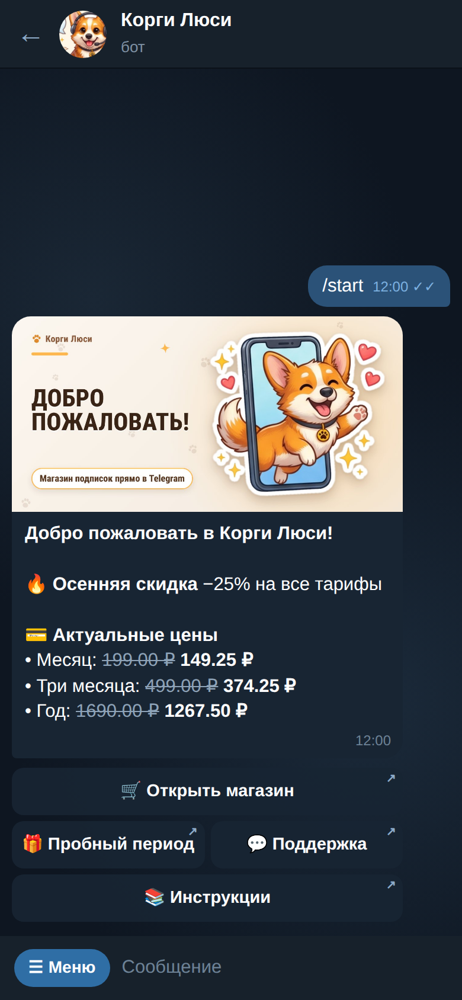</td>
<td width="25%" align="center"><b>Mini App</b><br>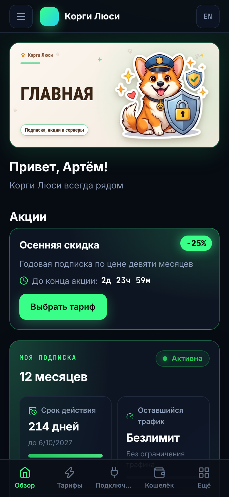</td>
<td width="25%" align="center"><b>Приложение Android</b><br>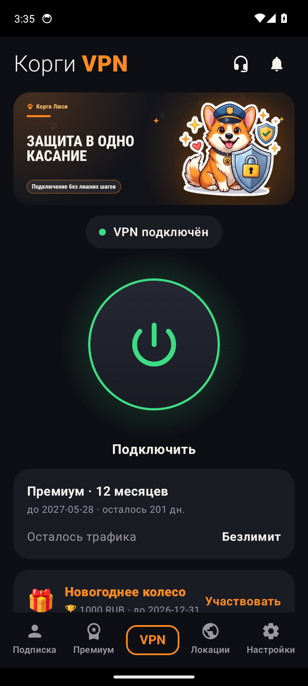</td>
<td width="25%" align="center"><b>Приложение iOS</b><br>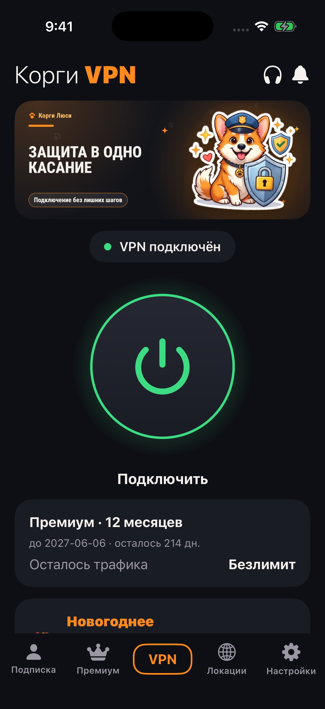</td>
</tr>
</table>

| Админ-панель: главная | Личный кабинет клиента |
| --- | --- |
| 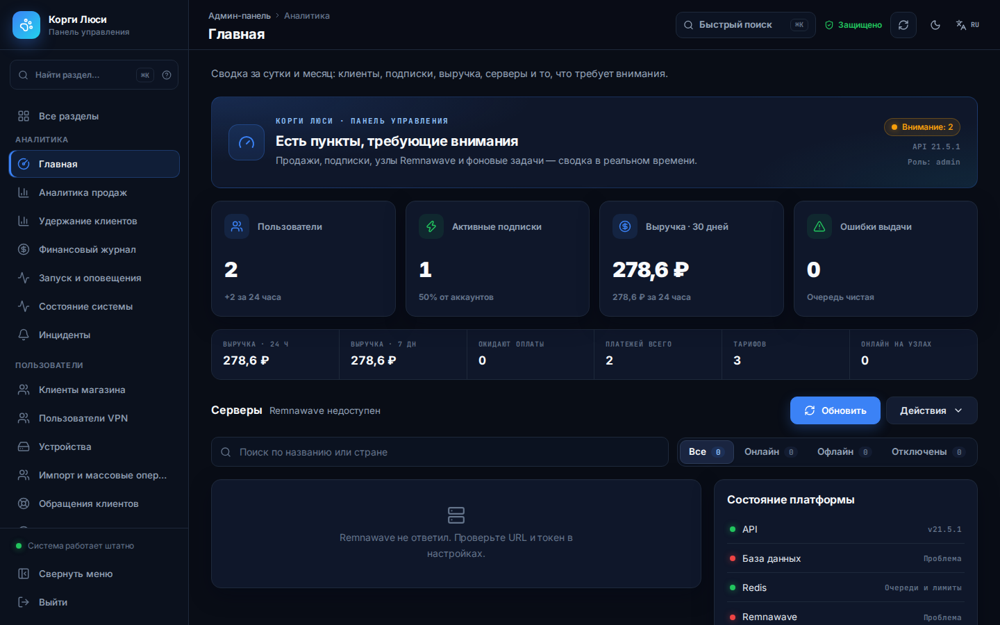 |  |
| **Установка Remnawave из админки** — без консоли | **Тарифы и оплата в кабинете** |
| 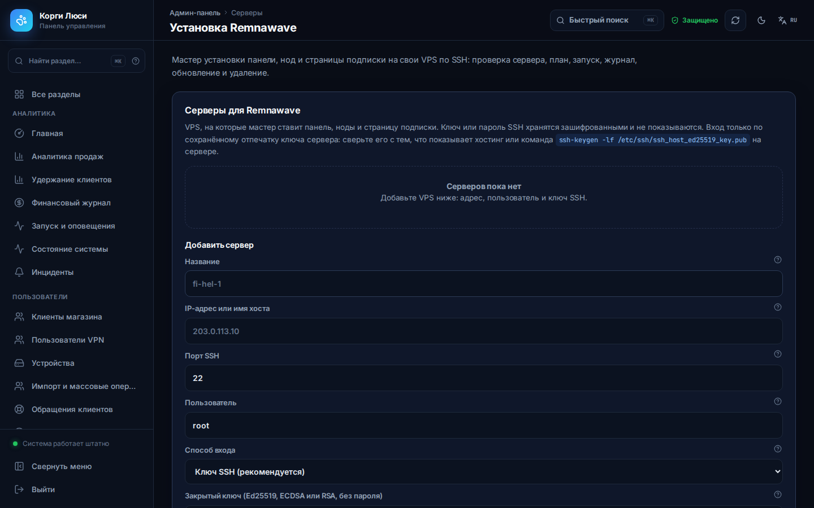 | 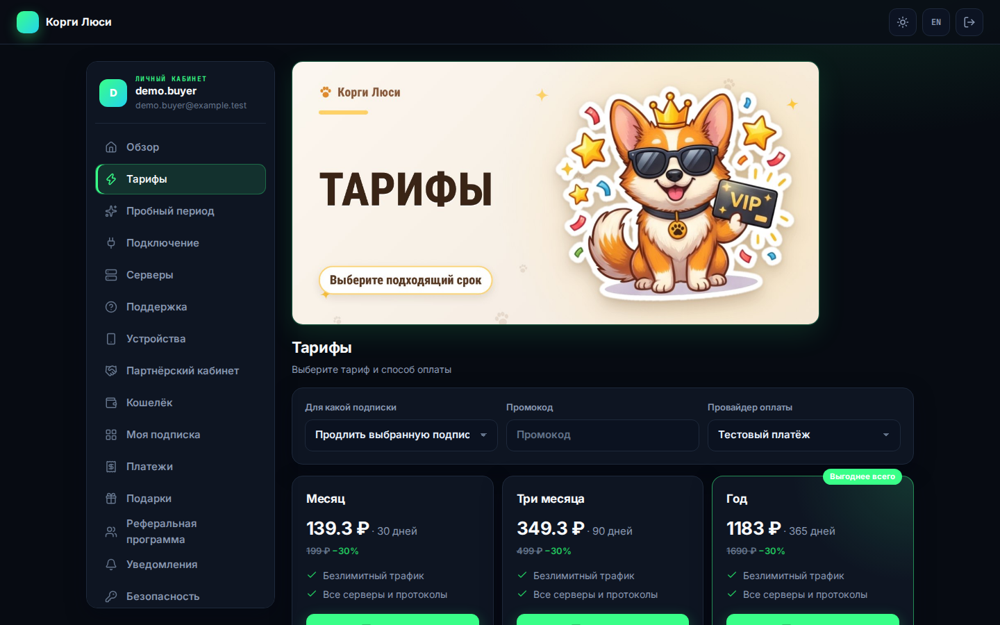 |

## 🧾 Что понадобится перед началом

Прочитайте этот список целиком, прежде чем что-то покупать. Всё можно сделать за один вечер.

| # | Что | Зачем | Где взять | Примерно |
| --- | --- | --- | --- | --- |
| 1 | **Сервер (VDS)** для магазина: Ubuntu 24.04 или Debian 12, **4 ядра, 8 ГБ памяти, 40 ГБ диска** | Здесь будет жить магазин, бот и админка | Любой хостинг VDS (ищите «VDS Ubuntu 24.04») | от 800–1500 ₽/мес |
| 2 | **Сервер для VPN** (можно второй, можно тот же) — 1–2 ядра, 1–2 ГБ памяти, в стране, где нужен выход в интернет | Через него пойдёт трафик клиентов | Любой хостинг в нужной стране | от 300–600 ₽/мес |
| 3 | **Домен** — например `myvpn.ru` | Адреса админки, кабинета и бота | Любой регистратор доменов | от 200 ₽/год |
| 4 | **Telegram-аккаунт** | Создать бота и получать уведомления | У вас уже есть | бесплатно |
| 5 | **Касса** — ЮKassa, CryptoBot, Telegram Stars или другая | Принимать оплату | Личный кабинет кассы (для ЮKassa нужен ИП/самозанятость) | процент с платежа |
| 6 | **Компьютер с терминалом** — Windows (PowerShell), macOS или Linux (Терминал) | Один раз зайти на сервер и запустить установку | Уже есть | — |

> [!TIP]
> **Не знаете, что такое «терминал» и «SSH»?** Это просто окно, куда вы вставляете команду, а сервер её выполняет. На Windows нажмите **Пуск**, наберите `PowerShell`, откройте. На macOS — **Программы → Утилиты → Терминал**. Больше ничего ставить не нужно.

## 🚀 Установка шаг за шагом (для тех, кто делает это впервые)

Двенадцать шагов. В каждом: **что сделать**, **что вы увидите**, если всё получилось, и **что делать, если не получилось**. Не пропускайте шаги и не меняйте порядок.

### Шаг 1. Купите сервер и запишите три вещи

1. На сайте хостинга закажите VDS: **Ubuntu 24.04**, 4 ядра, 8 ГБ памяти.
2. После оплаты хостинг пришлёт письмо. Найдите и **запишите** в блокнот:
   - **IP-адрес** сервера — четыре числа через точку, например `203.0.113.10`;
   - **логин** — почти всегда `root`;
   - **пароль** от сервера.

✅ **Получилось, если:** у вас записаны IP, логин и пароль.
❌ **Нет письма?** Посмотрите в личном кабинете хостинга раздел «Серверы» — там те же данные.

### Шаг 2. Купите домен и направьте его на сервер

1. Купите домен у любого регистратора, например `myvpn.ru`.
2. В панели регистратора найдите раздел **«DNS»** или **«Управление записями»**.
3. Создайте **пять записей типа A**. Каждая запись — это имя и IP вашего сервера из шага 1:

   | Тип | Имя (поддомен) | Значение |
   | --- | --- | --- |
   | A | `api` | IP сервера |
   | A | `admin` | IP сервера |
   | A | `app` | IP сервера |
   | A | `cabinet` | IP сервера |
   | A | `support` | IP сервера |

✅ **Получилось, если:** через 5–30 минут команда `ping api.myvpn.ru` (в PowerShell или Терминале) показывает IP вашего сервера.
❌ **Пишет «не удалось найти узел»?** Подождите ещё — записи DNS иногда расходятся до часа. Проверьте, что имя записи — именно `api`, а не `api.myvpn.ru.myvpn.ru`.

### Шаг 3. Создайте Telegram-бота

1. Откройте в Telegram **[@BotFather](https://t.me/BotFather)** и нажмите **«Start»**.
2. Отправьте команду `/newbot`.
3. Придумайте **имя** (например «Мой VPN») и **адрес** бота, который заканчивается на `bot` (например `my_vpn_shop_bot`).
4. BotFather пришлёт **токен** — длинную строку вида `1234567890:AAH…`. **Скопируйте и сохраните** его.

✅ **Получилось, если:** у вас есть токен, а бот находится по адресу в поиске Telegram.
⚠️ **Никому не пересылайте токен** — с ним можно управлять вашим ботом. Если токен утёк — в @BotFather: `/revoke`.

### Шаг 4. Зайдите на сервер

Откройте PowerShell (Windows) или Терминал (macOS/Linux) и введите — вместо `IP_СЕРВЕРА` подставьте свой IP:

```bash
ssh root@IP_СЕРВЕРА
```

1. На вопрос `Are you sure you want to continue connecting?` напишите `yes` и нажмите Enter.
2. Введите пароль сервера. **Буквы при вводе пароля не видны — это нормально.** Нажмите Enter.

✅ **Получилось, если:** строка изменилась на что-то вроде `root@server:~#`.
❌ **`Permission denied`** — неверный пароль; скопируйте его из письма хостинга заново. **`Connection timed out`** — неверный IP или сервер ещё создаётся (подождите 5 минут).

### Шаг 5. Запустите установку одной командой

Скопируйте **целиком** и вставьте в окно сервера (в PowerShell вставка — правой кнопкой мыши):

```bash
curl -fsSL https://raw.githubusercontent.com/booarkz-cpu/shop-by-boo/v28.113.0/install.sh -o /root/shop-install.sh \
  && BRANCH=v28.113.0 bash /root/shop-install.sh
```

Установщик задаст несколько вопросов. Отвечайте так:

| Вопрос | Что ответить |
| --- | --- |
| Домен | ваш домен из шага 2, без `https://`, например `myvpn.ru` |
| Токен бота | токен из шага 3 |
| Email администратора | ваша почта — это будет логин в админку |
| Цены тарифов | можно нажать Enter — поменяете потом в админке |

Дальше установщик **всё сделает сам**: поставит Docker, создаст случайные надёжные пароли, получит HTTPS-сертификаты и запустит магазин. Это **5–15 минут** — не закрывайте окно.

✅ **Получилось, если:** в конце написано, где админка (`https://admin.ваш-домен`), логин и **пароль администратора**. **Сохраните пароль!**
🔍 **Проверка:** команда `bash /opt/vpn-shop/scripts/doctor.sh` показывает зелёные строки.
❌ **Ошибка про сертификат** — DNS из шага 2 ещё не разошёлся; подождите 15 минут и запустите ту же команду снова (установщик продолжит с места остановки). Другие ошибки — в разделе [Диагностика](#-диагностика).

### Шаг 6. Войдите в админку и включите защиту

1. Откройте в браузере `https://admin.ваш-домен` и войдите почтой и паролем из шага 5.
2. Слева откройте **«Безопасность → Защита и 2FA»** и нажмите **«Включить 2FA»**. Отсканируйте QR-код приложением-аутентификатором (Google Authenticator, Яндекс Ключ, 1Password — любое) и введите 6 цифр.

| Вход в админку | Защита и 2FA |
| --- | --- |
| 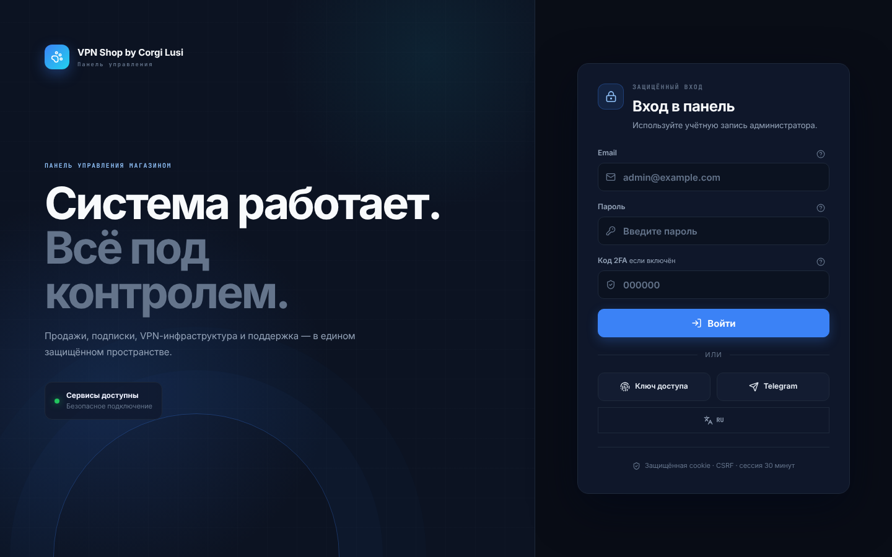 | 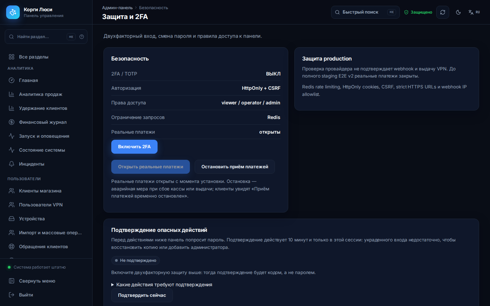 |

✅ **Получилось, если:** при следующем входе админка спрашивает 6 цифр из приложения.
💡 **Зачем:** без 2FA опасные действия (удаление, скачивание копий базы) не выполняются — это защита от угона пароля.

### Шаг 7. Поставьте VPN-панель Remnawave и первый VPN-сервер — кнопками

1. Откройте **«Серверы → Установка Remnawave»** и нажмите **«Добавить сервер»**.
2. Впишите IP вашего VPN-сервера, логин `root` и пароль (или SSH-ключ). Нажмите **«Проверить»** — магазин проверит, что может туда зайти.
3. Выберите **«Панель и нода на одном сервере»** (если сервер один) и впишите домен панели, например `panel.ваш-домен` (для него тоже нужна **запись A** на IP VPN-сервера — как в шаге 2).
4. Нажмите **«Составить план»**. Магазин покажет список шагов, которые он выполнит. Прочитайте и нажмите **«Запустить»**.


✅ **Получилось, если:** все шаги плана зелёные, а **«Серверы → Remnawave: панель»** показывает панель на связи.
❌ **Шаг стал красным?** Ничего страшного: изменения этого шага **откатились сами**, а причина написана прямо в журнале под шагом. Исправьте (чаще всего — DNS ещё не разошёлся или неверный пароль) и нажмите **«Запустить»** снова.

### Шаг 8. Спрячьте VPN-сервер под обычный сайт и включите протоколы

Чтобы VPN было труднее заблокировать, сервер выглядит снаружи как обычный сайт.

1. **«Серверы → SelfSteal»** → выберите шаблон сайта из каталога (22 варианта) или загрузите свой сайт архивом.
2. Там же нажмите **«Проверить»**: магазин посмотрит на сервер «глазами постороннего» по 11 пунктам. Цель — **«в порядке»**.
3. **«Серверы → Установка»** — каталог операций с планом и откатом: «Все протоколы на одной ноде», «Защита ноды», MTProto-прокси для Telegram, российские списки маршрутизации, Cloudflare CDN, свой сервер Psiphon.

| SelfSteal — сайт-маскировка | Установка — каталог операций |
| --- | --- |
| 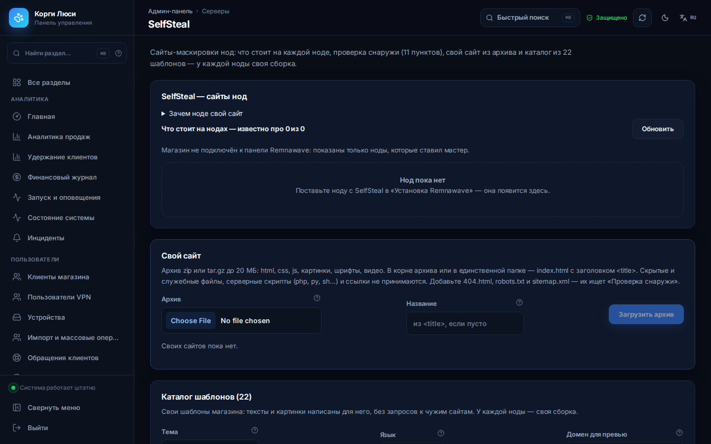 | 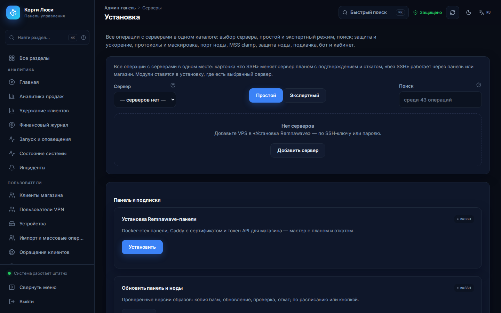 |

✅ **Получилось, если:** проверка SelfSteal показывает «в порядке».

### Шаг 9. Подключите приём оплаты

1. Зарегистрируйтесь в кассе. Проще всего начать с **Telegram Stars** (ничего не нужно, кроме бота) или **CryptoBot** (криптовалюта); для карт и СБП — **ЮKassa** (нужен ИП или самозанятость).
2. В админке: **«Тарифы и оплата → Платёжные агенты»** → выберите кассу → вставьте ключи из личного кабинета кассы → **«Проверить»**.
3. Сделайте **тестовую покупку** сами: напишите своему боту `/start` → «Купить» → оплатите тестовой картой кассы (её номер есть в документации кассы).

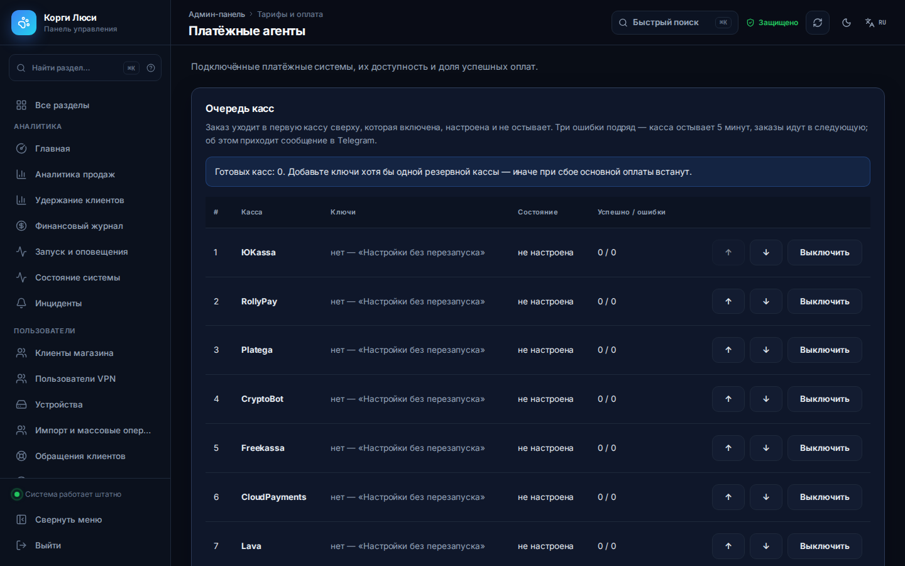

✅ **Получилось, если:** после тестовой оплаты бот прислал ссылку-подписку, а в **«Тарифы и оплата → Платежи»** появился платёж.
📖 **Подробно по каждой кассе:** [чек-лист касс для новичка](docs/ru/ALL_PAYMENT_PROVIDERS_BEGINNER_CHECKLIST.md).

### Шаг 10. Настройте тарифы, тексты и картинки

1. **«Тарифы и оплата → Тарифы»**: название, срок, цена, сколько устройств, лимит трафика. Пробный период — там же.
2. **«Бот и кабинет»**: приветствие бота, кнопки меню, баннеры разделов, тексты кабинета — всё меняется **без перезапуска**.

| Тарифы | Баннеры бота |
| --- | --- |
| 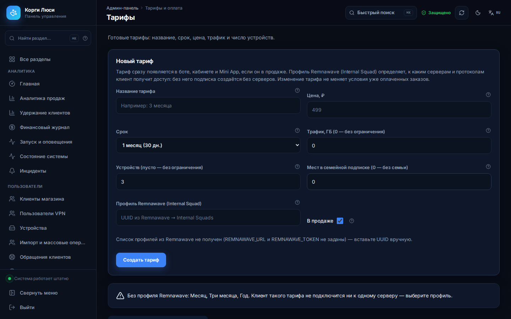 | 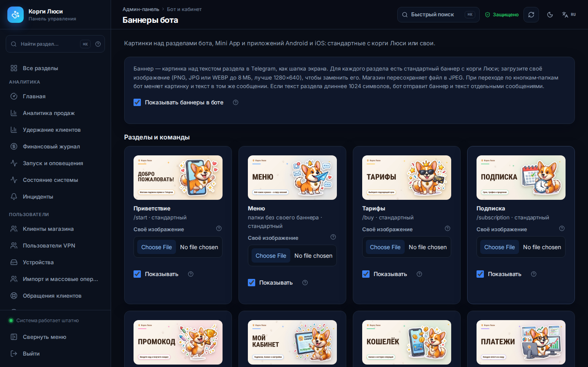 |

✅ **Получилось, если:** бот по `/start` показывает ваши цены и ваш текст.

### Шаг 11. Включите резервные копии

1. **«Безопасность → Резервные копии»**: придумайте **пароль шифрования** (запишите его отдельно!) и включите **«Копия в Telegram»** — каждую ночь копия базы придёт вам в личный чат.
2. **«Серверы → Установка» → «Снапшоты серверов» → «Каждый день»** — копия панели Remnawave и файлов нод.

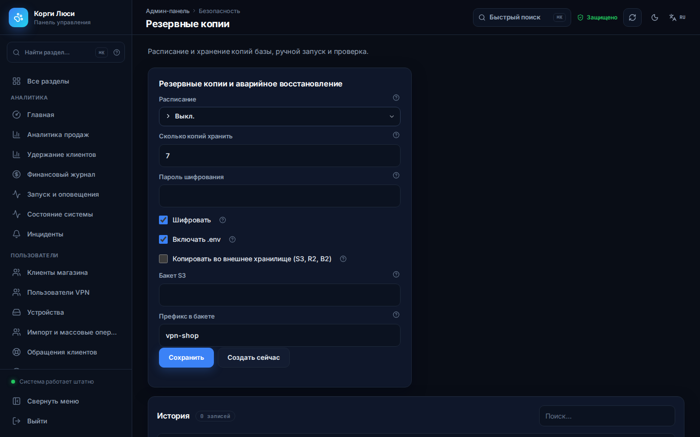

✅ **Получилось, если:** утром в Telegram пришёл файл копии. Проверить восстановление можно в любой момент: [регламент восстановления](#-резервное-копирование-и-восстановление).

### Шаг 12. Обновления — одной кнопкой

1. **«Система → Обновления»** показывает, вышла ли новая версия. Обновление — **одна кнопка**; перед ним магазин сам делает копию, а при ошибке откатывается.
2. Там же **«Автообновление Remnawave»** — панель и ноды обновляются ночью по расписанию.

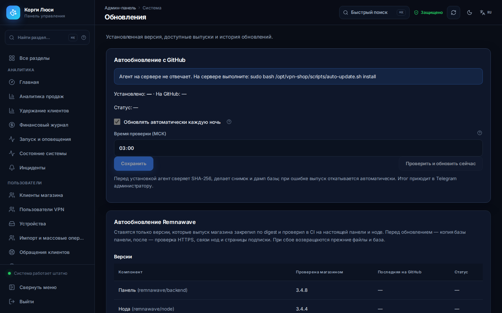

🎉 **Готово!** Магазин работает. Дайте ссылку на бота первому клиенту.

> Застряли на каком-то шаге? Откройте [руководство по запуску](docs/ru/LAUNCH_GUIDE.md) — там каждый шаг расписан ещё подробнее, — или раздел [Частые вопросы](#-частые-вопросы-новичка) ниже.

## 🧭 Путь клиента: от `/start` до подключения

Вот что видит ваш покупатель. Вам не нужно ничего делать — всё происходит само.

| 1. Открывает бота | 2. Выбирает тариф | 3. Платит удобным способом | 4. Подписка в Mini App |
| :---: | :---: | :---: | :---: |
|  | 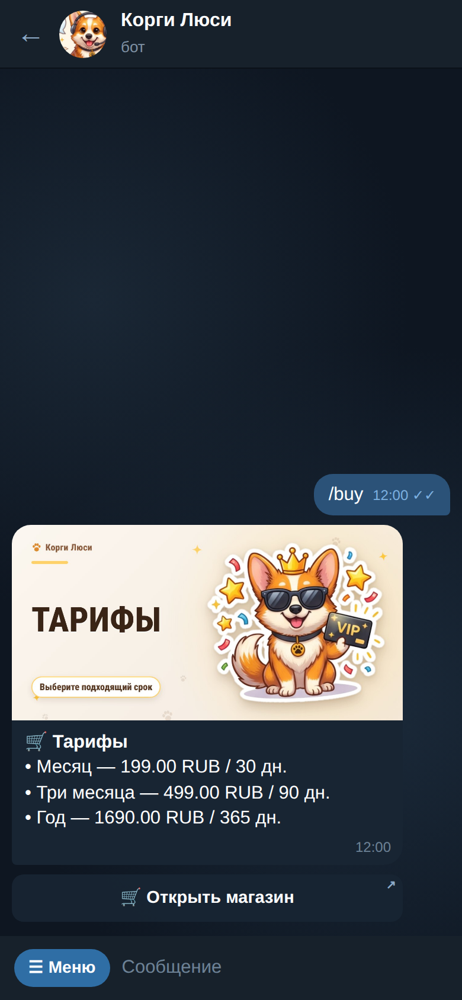 | 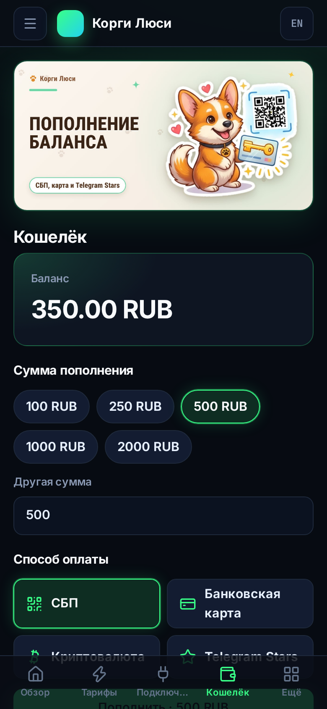 |  |
| Приветствие, цены, акция | Месяц, три месяца, год | СБП, карта, крипта, Stars | Срок, трафик, «Подключить» |

| 5. Ставит приложение | 6. Нажимает одну кнопку | 7. Серверы по странам | 8. Пишет в поддержку |
| :---: | :---: | :---: | :---: |
| 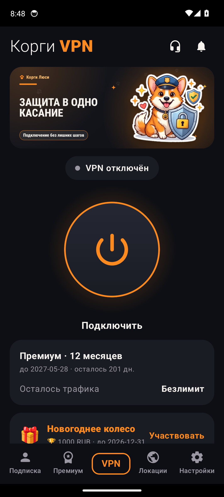 |  | 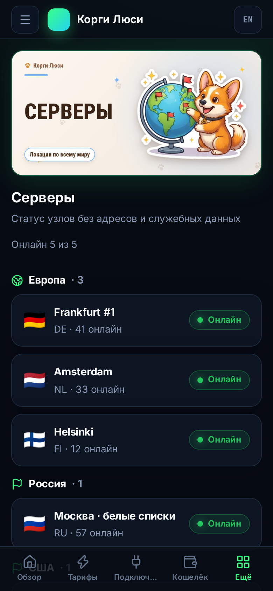 | 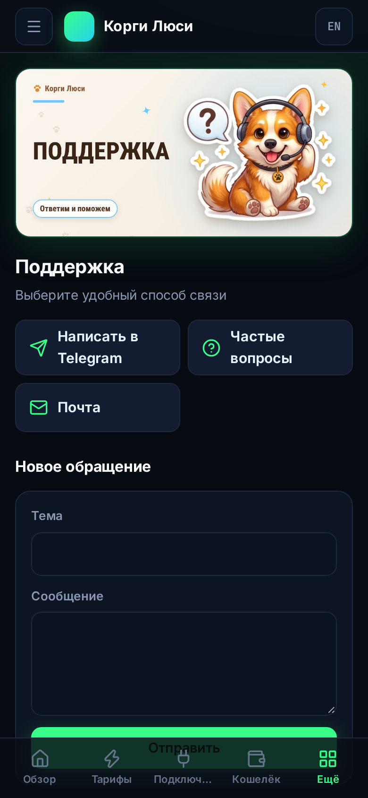 |
| Android, iOS или любой VPN-клиент | VPN включён | Пинг и загрузка | Ответ — в боте |

Если клиент забыл продлить — бот напомнит заранее (по умолчанию за 3 дня). Если оплатил — срок продлится сам. Если кончился трафик — бот предложит докупить.

## 📅 Каждый день: что делает владелец

Обычно хватает **10 минут в день**:

| Что посмотреть | Где | Что делать |
| --- | --- | --- |
| Продажи и выручка за сутки | **«Главная»** | Ничего — просто радуйтесь 🙂 |
| Новые обращения клиентов | **«Пользователи → Обращения клиентов»** | Ответить клиенту |
| Все ли серверы на связи | **«Серверы → Серверы»** | Нода не на связи — проверить её у хостинга |
| Сбои платежей | **«Тарифы и оплата → Платёжные агенты»** | Касса «в резерве» — проверить ключи в кабинете кассы |
| Сбои и предупреждения | **«Аналитика → Запуск и оповещения»**, **«Состояние системы»** | Следовать подсказке у пункта |

Раз в неделю: **«Система → Обновления»** (обычно обновляется само) и **«Аналитика»** — какой тариф продаётся лучше.

## ❓ Частые вопросы новичка

<details>
<summary><b>Можно ли поставить магазин и VPN на один сервер?</b></summary>

Можно: в шаге 7 выберите «Панель и нода на одном сервере». Но для надёжности лучше два сервера: если VPN-сервер заблокируют, магазин продолжит работать, и вы просто добавите новую ноду.
</details>

<details>
<summary><b>Бот не отвечает на /start. Что делать?</b></summary>

1. Проверьте токен в **«Бот и кабинет → Telegram-бот»**.
2. На сервере: `bash /opt/vpn-shop/scripts/doctor.sh` — строка про бота должна быть зелёной.
3. Если меняли токен в @BotFather (`/revoke`) — впишите новый в админке.
</details>

<details>
<summary><b>Клиент оплатил, а подписку не получил.</b></summary>

Откройте **«Тарифы и оплата → Платежи»** и найдите платёж. Если он оплачен, а выдача не удалась (чаще всего Remnawave была недоступна), магазин сам повторяет выдачу по расписанию — подписка придёт, как только панель ответит. Проверьте, что панель на связи: **«Серверы → Remnawave: панель»**.
</details>

<details>
<summary><b>Как поменять цены, не сломав старые подписки?</b></summary>

В **«Тарифы и оплата → Тарифы»** меняйте цену смело: новые цены касаются только новых покупок и продлений. Уже оплаченные дни у клиентов не меняются.
</details>

<details>
<summary><b>VPN-сервер заблокировали. Что делать?</b></summary>

1. **«Серверы → Установка Remnawave» → «Добавить сервер»** — новый сервер в другой стране (шаг 7, только «Нода»).
2. **«Серверы → SelfSteal» → «Проверить»** — убедитесь, что маскировка в порядке.
3. Клиентам обычно ничего делать не нужно: VPN-клиенты обновляют подписку сами и получают новый сервер.
</details>

<details>
<summary><b>Как понять, что всё работает?</b></summary>

На сервере: `bash /opt/vpn-shop/scripts/doctor.sh` — все строки зелёные. В админке: **«Аналитика → Состояние системы»** — проверки базы, бота, касс, Remnawave и фоновых процессов с подсказкой, что исправить.
</details>

<details>
<summary><b>Сколько клиентов выдержит магазин?</b></summary>

Сервер магазина нагружают бот, сайт и база — сам VPN-трафик идёт не через него, а через ноды. Добавляйте ноды по мере роста: **«Серверы → Планирование мощности»** подскажет, когда пора.
</details>

<details>
<summary><b>Где лежит «Корги Люси: клиент» и как его обновлять?</b></summary>

APK — в каждом [выпуске](https://github.com/booarkz-cpu/shop-by-boo/releases/latest) (`corgi-lusi-client.apk`). Приложение обновляется само: раз в сутки по Wi-Fi скачивает новую версию, проверяет её и предлагает установить одной кнопкой.
</details>

Больше ответов — в [справочнике по функциям](docs/ru/FUNCTION_GUIDE.md) и [инструкциях по 30 модулям](docs/ru/modules/README.md).

## 🆕 Новое в v28.113.0

| | |
| --- | --- |
| 🔧 **Смена протокола inbound** | Если транспорт перестал работать у клиентов, inbound переводится на TCP, XHTTP или gRPC в четыре этапа: с журналом, проверкой каждой ноды и возвратом прежнего транспорта одной кнопкой. Раздел «Серверы → Смена протокола». [Подробно](docs/PROTOCOL_SWITCH.md) |

## 🆕 Новое в v28.112.0

| | |
| --- | --- |
| ⚡ **Пул автовыбора** | В списке серверов клиента — одна плитка «⚡ Автовыбор»: узел выбирается по задержке, по нагрузке, по кругу или случайно. Узлы пула можно скрыть из списка. Раздел «Серверы → Пул автовыбора». [Подробно](docs/AUTO_SELECTION.md) |

## 🆕 Новое в v28.111.0

| | |
| --- | --- |
| ⚙️ **Клиент 1.8.2: свежее ядро Xray** | Ядро клиента собрано из AndroidLibXrayLite v26.10.31 (найдено наблюдателем ядра N11). Если GitHub не даёт наблюдателю создать ветку, он теперь открывает задачу «Ядро Xray: …» вместо падения. [Подробнее](docs/ru/RELEASE_V28_111_0.md) |

## 🆕 Новое в v28.110.0

| | |
| --- | --- |
| 🐶 **Клиент 1.8.1: маскот, App Lock, Geek Mode** | Корги Люси на главном экране спит, бежит и радуется вместе с VPN; вход по отпечатку или PIN телефона; редактор сырого JSON Xray для опытных; виджет с маскотом и скоростью. Фаза 3 enterprise-клиента закрыта. [Подробнее](docs/ru/RELEASE_V28_110_0.md) |

## 🆕 Новое в v28.109.0

| | |
| --- | --- |
| 🧩 **Клиент 1.8.0: шторка, Tasker и логи** | Долгое нажатие на плитку в шторке открывает список серверов; управление из Tasker и других приложений (по разрешению); все журналы одним архивом .zip для поддержки. [Подробнее](docs/ru/RELEASE_V28_109_0.md) |

<details>
<summary><b>Новое в прежних выпусках (v28.34.0 – v28.108.0)</b></summary>

### 🆕 Новое в v28.108.0

| | |
| --- | --- |
| 🔎 **Клиент 1.7.4: журнал сети** | Какие домены открывает телефон и куда они идут — через VPN, напрямую или в блок, в реальном времени, с поиском и фильтрами. Включается переключателем, хранится только на телефоне. [Подробнее](docs/ru/RELEASE_V28_108_0.md) |

### 🆕 Новое в v28.107.0

| | |
| --- | --- |
| 📊 **Клиент 1.7.3: статистика и Speedtest** | Трафик по дням за 7 или 30 дней — отдельно через VPN и напрямую; встроенный замер настоящей скорости сервера через туннель (скачивание и отдача). Скорость на главном экране теперь считается всегда. [Подробнее](docs/ru/RELEASE_V28_107_0.md) |

### 🆕 Новое в v28.106.0

| | |
| --- | --- |
| 🏠 **Клиент 1.7.2: доверенные Wi-Fi** | Дома VPN сам встаёт на паузу, а в мобильной сети или чужом Wi-Fi сразу включается снова. Сеть добавляется по имени или кнопкой «Добавить текущую сеть». [Подробнее](docs/ru/RELEASE_V28_106_0.md) |

### 🆕 Новое в v28.105.0

| | |
| --- | --- |
| 🔁 **Клиент 1.7.1: Smart Failover** | Если выбранный сервер перестал отвечать (15–120 с на выбор), клиент сам переключается на самый быстрый другой сервер провайдера и поднимает туннель заново. [Подробнее](docs/ru/RELEASE_V28_105_0.md) |

### 🆕 Новое в v28.104.0

| | |
| --- | --- |
| 🧭 **Клиент 1.7.0: DNS по-взрослому** | Локальный DNS для сайтов, которые идут напрямую, FakeDNS (быстрее первые загрузки, нет утечек DNS), выбор стратегии доменов и порядок своих правил «блок → прокси → напрямую». [Подробнее](docs/ru/RELEASE_V28_104_0.md) |

### 🆕 Новое в v28.103.0

| | |
| --- | --- |
| 📖 **Новый README для новичков** | Двенадцать шагов установки с картинками и «что делать, если не получилось», путь клиента от `/start`, ежедневные 10 минут владельца, частые вопросы; свежие скриншоты всех разделов, бота, Mini App и «Корги Люси: клиент». [Подробнее](docs/ru/RELEASE_V28_103_0.md) |

### 🆕 Новое в v28.102.0

| | |
| --- | --- |
| 🛠️ **Клиент 1.6.2** | Экран «Прокси по приложениям» открывается без сбоя (в 1.6.0–1.6.1 он мог закрыть приложение); проверки клиента в CI снова работают. [Подробнее](docs/ru/RELEASE_V28_102_0.md) |

### 🆕 Новое в v28.101.0

| | |
| --- | --- |
| 🔄 **Клиент обновляется сам** | «Корги Люси: клиент» 1.6.1: раз в сутки по Wi-Fi скачивает новую версию с новым ядром Xray и проверяет её по SHA-256, установка — одним нажатием; geo-файлы обновляются ежедневно; в «О приложении» — сборка ядра и даты проверок. Новое ядро AndroidLibXrayLite само приходит pull request'ом и проходит весь CI. [Подробнее](docs/ru/RELEASE_V28_101_0.md) |

### 🆕 Новое в v28.100.0

| | |
| --- | --- |
| 🐶 **Клиент «Корги Люси» 1.6.0** | Кнопка не подключает на полуудалённых серверах, экран «Прокси по приложениям» с иконками и поиском, прогресс geo-файлов, внешний IP с флагом, мультивыбор, полоски сигнала. [Подробнее](docs/ru/RELEASE_V28_100_0.md) |

### 🆕 Новое в v28.99.0

| | |
| --- | --- |
| 🛰️ **Свой сервер Psiphon** | psiphond на ноде из «Установки»: собирается из исходников Psiphon, OSSH или TLS-OSSH, конфиг клиента — скачать в карточке. [Подробнее](docs/ru/RELEASE_V28_99_0.md) |

### 🆕 Новое в v28.98.0

| | |
| --- | --- |
| ☁️ **Cloudflare CDN** | Трафик нод через XHTTP и домен подписки за Cloudflare — включается и выключается в «Установке», DNS и правило SSL ставятся сами. [Подробнее](docs/ru/RELEASE_V28_98_0.md) |

### 🆕 Новое в v28.97.0

| | |
| --- | --- |
| 🔀 **Смена домена панели** | Новый домен по плану: проверка DNS, копия базы, перезапуск; прежний домен продолжает отдавать подписки клиентам, ссылки в магазине переносятся. [Подробнее](docs/ru/RELEASE_V28_97_0.md) |

### 🆕 Новое в v28.96.0

| | |
| --- | --- |
| 🌙 **Ночное обновление списков** | «Автообновление Remnawave» может в то же ночное окно ставить свежие российские списки блокировок — только там, где они установлены. [Подробнее](docs/ru/RELEASE_V28_96_0.md) |

### 🆕 Новое в v28.95.0

| | |
| --- | --- |
| 🗺️ **Российские списки блокировок** | geoip/geosite с заблокированными в России доменами и адресами на всех нодах — рядом со встроенными, SHA-256 сверяется; в правилах — `ext:ru-geosite.dat:ru-blocked`. [Подробнее](docs/ru/RELEASE_V28_95_0.md) |

### 🆕 Новое в v28.94.0

| | |
| --- | --- |
| ✈️ **MTProto-прокси для Telegram** | Прокси на ноде с маскировкой FakeTLS под выбранный сайт; ссылка `t.me/proxy` для клиентов — прямо в карточке. [Подробнее](docs/ru/RELEASE_V28_94_0.md) |

### 🆕 Новое в v28.93.0

| | |
| --- | --- |
| 🚑 **Экстренное восстановление** | «Восстановить» у снапшота файлов: компоненты возвращаются на сервер, текущие файлы сохраняются и возвращаются при ошибке. [Подробнее](docs/ru/RELEASE_V28_93_0.md) |
| 🧭 **Чек-лист «Анти-РКН»** | Девять пунктов по каждой ноде; у невыполненного — «Исправить». |

### 🆕 Новое в v28.92.0

| | |
| --- | --- |
| 🧰 **Раздел «Установка»** | Все операции с серверами в одном каталоге: защита ноды, MSS clamp, подкачка, подбор SNI, реклама на нодах, снапшоты, опасная зона. [Подробнее](docs/ru/RELEASE_V28_92_0.md) |
| 🐣 **README для новичка** | 10 шагов от пустого сервера до первой продажи — на русском, английском и украинском. |

### 🆕 Новое в v28.91.0

| | |
| --- | --- |
| 🎭 **Раздел «SelfSteal»** | Что стоит на каждой ноде, проверка снаружи по 11 пунктам, свой сайт из архива, каталог из 22 шаблонов — у каждой ноды своя сборка. [Подробнее](docs/ru/RELEASE_V28_91_0.md) |

### 🆕 Новое в v28.90.0

| | |
| --- | --- |
| 🛡️ **Маскировка нод** | Отпечаток браузера (Firefox по умолчанию), все протоколы одной кнопкой, TLS 1.2/1.3. [Подробнее](docs/ru/RELEASE_V28_90_0.md) |
| 🔒 **Порт ноды только для панели** | nftables всегда, на всех нодах сразу; правило снимается само, если панель потеряла ноду. |
| 🐾 **«Корги Люси: клиент» 1.5.0** | Новый главный экран: стрик, статистика, блокировка рекламы, «Поделиться». |
| 📜 **Лицензия 2.9 и автообновления** | Состав проекта и всё взятое извне — в одной таблице; Dependabot для всех манифестов. |

### 🆕 Новое в v28.89.0

| | |
| --- | --- |
| 🛒 **Покупки в Google Play и App Store** | Включаются владельцем; продления и возвраты — по уведомлениям магазинов. [Подробнее](docs/ru/RELEASE_V28_89_0.md) |
| 📱 **Приложения 3.5.0** | Свои правила маршрутов, фрагментация TLS; у клиента «Корги Люси» — свои выпуски `client-v…`. |

### 🆕 Новое в v28.88.0

| | |
| --- | --- |
| ✏️ **Тексты кабинета из админки** | Каждая надпись личного кабинета на трёх языках меняется в «Бот и кабинет → Личный кабинет», без пересборки. [Подробнее](docs/ru/RELEASE_V28_88_0.md) |
| 🌐 **Сайт SelfSteal без переустановки** | Другой сайт-шаблон на домене ноды — одним модулем мастера. |

### 🆕 Новое в v28.87.0

| | |
| --- | --- |
| 🧭 **Свои правила и фрагментация TLS** | В приложении магазина для Android: сайт или адрес — через VPN, напрямую или в блок; фрагментация TLS, когда провайдер мешает. [Подробнее](docs/ru/RELEASE_V28_87_0.md) |
| 💾 **Учения по восстановлению** | Каждый PR: копия → потеря всех данных → восстановление → те же подписки, платежи и администраторы. |

### 🆕 Новое в v28.86.0

| | |
| --- | --- |
| 🔒 **Блок «Приложения» в кабинете** | Убран со страниц входа и регистрации, виден только вошедшему покупателю и выключается в админке. [Подробно](docs/ru/RELEASE_V28_86_0.md) |
| ✅ **Проверки поведения** | Платежи, уведомления после возврата, вход администратора, коды 2FA и вывод средств проверяются вызовом кода, а не поиском строки в исходнике. |

### 🆕 Новое в v28.85.0

| | |
| --- | --- |
| 🐾 **«Корги Люси: клиент» 1.5.0** | Новый главный экран: большая кнопка, карточка сервера раскрывает список серверов с пингом; иконка приложения на выбор, профили маршрутизации. [Скачать APK](https://github.com/booarkz-cpu/shop-by-boo/releases/latest/download/corgi-lusi-client.apk) · [Подробно](docs/ru/RELEASE_V28_85_0.md) |

### 🆕 Новое в v28.84.0

| | |
| --- | --- |
| 🛡️ **Защита и самовосстановление серверов** | fail2ban, обновления безопасности, BBR и SSH только с ваших адресов — одной галочкой в мастере; таймер на сервере сам поднимает упавшие контейнеры; ноды можно выключить, включить и перенести из админки. [Подробно](docs/ru/RELEASE_V28_84_0.md) |

### 🆕 Новое в v28.83.0

| | |
| --- | --- |
| 🐾 **«Корги Люси: клиент» 1.3.0** | Оформление бренда, серверы с поиском и пингом, режим «только прокси» и раздача через хотспот, резервная копия, журналы, схемы `corgi://` — всё настраивается в меню. [Скачать APK](https://github.com/booarkz-cpu/shop-by-boo/releases/latest/download/corgi-lusi-client.apk) · [Подробно](docs/ru/RELEASE_V28_83_0.md) |

### 🆕 Новое в v28.82.0

| | |
| --- | --- |
| 🚀 **Транспорты ноды** | Рядом с TCP + REALITY — xHTTP, gRPC и Hysteria2 одной галочкой в админке: порты, сертификат, профиль, хосты и сквады мастер настроит сам. [Подробно](docs/ru/RELEASE_V28_82_0.md) |

### 🆕 Новое в v28.81.0

| | |
| --- | --- |
| 🔧 **Подписки Remnawave в приложениях** | Android-приложения видят серверы подписки `https://домен/shortUuid`, даже когда панель отвечает в формате Xray JSON. Ссылки Hysteria2 тоже подключаются. [Подробно](docs/ru/RELEASE_V28_81_0.md) |

### 🆕 Новое в v28.80.0

| | |
| --- | --- |
| 🐾 **«Корги Люси: клиент» 1.1.0** | Виджет на рабочем столе, проверка обновлений прямо в приложении, подписка на телевизор с телефона по QR. [Скачать APK](https://github.com/booarkz-cpu/shop-by-boo/releases/latest/download/corgi-lusi-client.apk) · [Подробно](docs/ru/RELEASE_V28_80_0.md) |

### 🆕 Новое в v28.79.0

| | |
| --- | --- |
| 🐾 **«Корги Люси: клиент» — третье приложение** | Отдельный VPN-клиент для Android для любых подписок: ссылки и QR, VLESS/REALITY и другие протоколы, полный JSON Xray, свои маршруты, фрагментация TLS, выбор приложений, плитка, Android TV. [Скачать APK](https://github.com/booarkz-cpu/shop-by-boo/releases/latest/download/corgi-lusi-client.apk) · [Подробно](docs/ru/RELEASE_V28_79_0.md) |

### 🆕 Новое в v28.78.0

| | |
| --- | --- |
| 🔐 **Вход в панель Remnawave через магазин** | Своя замена TinyAuth: страницы панели открываются кнопкой «Открыть панель» только администраторам магазина с 2FA, каждый вход в журнале, отзыв сеансов сразу закрывает панель. API магазина и подписки работают как раньше. [Подробно](docs/ru/RELEASE_V28_78_0.md) |
| ✅ **Вся админка под тестами** | Каждое из 314 действий админки, которые что-то меняют, проверено тестом; 30 из 30 модулей — PASS. По ходу исправлены ошибки ролей, скидок, подарочных карт и журнала действий. |
| 🧭 **Скрытые разделы снова открываются** | «Командный центр», «Карточка клиента», «Интеграции», «События» и другие разделы без пункта меню открываются по ссылке и переведены на русский. |

### 🆕 Новое в v28.77.1

| | |
| --- | --- |
| 🔧 **Исправление выпуска** | В v28.77.0 не попали Android-приложения: проверка подписи не видела отпечаток в выводе нового apksigner. Исправлено — подписанные APK снова в выпуске, постоянные ссылки на скачивание заработали. [Подробно](docs/ru/RELEASE_V28_77_1.md) |

### 🆕 Новое в v28.77.0

| | |
| --- | --- |
| 📲 **Скачать Android по прямой ссылке** | Этап 18: в каждом выпуске — [клиент](https://github.com/booarkz-cpu/shop-by-boo/releases/latest/download/corgi-lusi-android.apk) и [админка](https://github.com/booarkz-cpu/shop-by-boo/releases/latest/download/corgi-lusi-android-admin.apk), подписанные ключом магазина; CI не выпустит APK с чужим ключом. Адрес API вшивается в приложения — вводить его не нужно. |
| 🛡 **Встроенный VPN проверяется по-настоящему** | Тест на эмуляторе: без VPN проверочная страница недоступна, с VPN открывается только через туннель Xray, после отключения — снова нет. Продление после истечения и разблокировка после возврата проверены на живой панели Remnawave. |
| 🧰 **Remnawave без терминала** | Журналы контейнеров (пароли скрыты), запуск, перезапуск и остановка панели и нод, записи DNS у Bunny и Gcore, страница подписки Orion. |

### 🆕 Новое в v28.76.0

| | |
| --- | --- |
| 📱 **Приложения на Swift 6** | Этап 17: iOS-приложения клиента и администратора, расширения туннеля и push собираются в режиме Swift 6 со строгой проверкой многопоточности. Исправлены две гонки данных: в диагностике «Не работает VPN» и в картинках push. [Архитектура iOS](docs/ru/new/IOS_ARCHITECTURE.md) |
| 🖼 **Все разделы на свежих скриншотах** | Админка переснята целиком (84 скриншота, номера разделов сохраняются), телефонные версии и светлая тема, кабинет, Mini App, бот, Android и iOS. Тест в CI следит, чтобы у каждого раздела был скриншот. |
| 📚 **Руководства владельца** | Установка Remnawave с нуля, настройка доменов, API мобильных приложений, архитектура Android и iOS, выбор движка VPN. Краткая версия — на английском и украинском. [Установка Remnawave](docs/ru/new/REMNAWAVE_INSTALLATION_GUIDE.md) |

### 🆕 Новое в v28.75.0

| | |
| --- | --- |
| 🔐 **Подтверждение опасных действий** | Этап 16: восстановление из копии, изменение администраторов, применение ключей, возврат денег, терминал ноды, запуск плана на серверах и другие опасные действия требуют кода 2FA или пароля. Подтверждение действует 10 минут в одной сессии. [Подробнее](docs/ru/new/RBAC.md#подтверждение-опасных-действий-step-up) |
| 🗝 **Смена SSH-ключей серверов** | Кнопка «Сменить ключ» в «Установке Remnawave»: свой ключ Ed25519 на каждый сервер, проверка входа новым ключом, прежний ключ магазина удаляется, пароль больше не хранится. [Секреты](docs/ru/new/SECRETS_MANAGEMENT.md) |
| 🕵️ **История безопасности и журналы** | Входы и неудачные попытки с IP, подтверждения, роли, 2FA, терминал — в «Сессиях»; сообщение в Telegram о подборе пароля; журналы контейнеров в браузере без секретов; новые метрики и правила Prometheus. [Мониторинг](docs/ru/new/REMNAWAVE_MONITORING.md) |

### 🆕 Новое в v28.74.0

| | |
| --- | --- |
| 🔄 **Автообновление Remnawave** | Этап 15: панель, ноды и страница подписки обновляются из админки — ночью по расписанию или кнопкой для выбранных установок. Ставятся только версии, проверенные выпуском магазина в CI; перед обновлением — копия базы панели, при сбое — откат файлов и базы. [Подробнее](docs/ru/new/AUTO_UPDATE.md) |
| 🗄 **Копия базы панели в магазине** | Копия базы Remnawave забирается с сервера панели, шифруется ключом магазина и хранится в его резервных копиях — потеря сервера панели не теряет её базу |
| 🤖 **Automation Center** | Один экран со всей автоматикой: автообновления магазина и Remnawave, релизы на GitHub, версия панели, копии, worker, оповещения и сводка состояния системы. [Подробнее](docs/ru/new/AUTOMATION_CENTER.md) |

### 🆕 Новое в v28.73.0

| | |
| --- | --- |
| 💳 **Кассы проверены по коду** | Этап 14: у каждой кассы сверены заказ, подпись уведомления, сумма и подтверждение у самой кассы, возвраты и автоплатежи. Новый контрактный тест прогоняет все кассы реестра: чужой заказ и другая сумма отклоняются, неподтверждённая оплата не выдаётся, повторное уведомление не выдаёт второй раз. [Что реализовано](docs/ru/new/PAYMENT_INTEGRATION.md) |
| 🧾 **Журнал уведомлений касс** | «Кассы → Журнал уведомлений» и карточка в мобильных админках: принятые уведомления с заказом, суммой и ошибкой, отклонённые — неверная подпись, другая сумма, касса не подтвердила оплату |
| ⚖️ **Юридические документы** | Проекты публичной оферты, политики конфиденциальности и правил пользования по законодательству РФ на трёх языках, с вашими реквизитами. Записываются выключенными — перед публикацией их проверяет юрист. [Подробнее](docs/ru/new/LEGAL_DOCUMENTS.md) |

### 🆕 Новое в v28.72.1

| | |
| --- | --- |
| 🛠 **Исправлен модуль IPv6** | После «выключить → включить» сервер снова получает свой глобальный IPv6-адрес; если адрес не вернулся, шаг сообщает об этом и откатывается. [Заметки к выпуску](docs/ru/RELEASE_V28_72_1.md) |

### 🆕 Новое в v28.72.0

| | |
| --- | --- |
| 🌍 **Бот на трёх языках** | Бот отвечает на русском, английском или украинском — по языку Telegram клиента. [Подробнее](docs/ru/new/TELEGRAM_MINI_APP.md) |
| ✏️ **Тексты бота из админки** | Каждое сообщение и кнопка бота меняются в «Telegram-бот → Тексты бота»; бот применяет их в течение минуты. [Заметки к выпуску](docs/ru/RELEASE_V28_72_0.md) |

### 🆕 Новое в v28.71.0

| | |
| --- | --- |
| 🤖 **Telegram-бот из админки** | Токен бота меняется в «Настройках без перезапуска» — бот переподключается сам за 15 секунд. «Состояние системы» показывает, что бот действительно на связи с Telegram. [Подробнее](docs/ru/new/TELEGRAM_GUIDE.md) |
| 📋 **Меню команд и проверка** | Меню команд на русском, английском и украинском, тестовое сообщение, удаление чужого webhook, ошибки бота — в разделе «Telegram-бот». [Заметки к выпуску](docs/ru/RELEASE_V28_71_0.md) |

### 🆕 Новое в v28.70.0

| | |
| --- | --- |
| 🎭 **SelfSteal в мастере установки** | Нода выглядит как обычный сайт: Caddy на ноде получает сертификат её домена и отдаёт сайт-шаблон, Xray REALITY отправляет туда всех без ключей; профиль и хост мастер создаёт в панели. [Подробнее](docs/ru/new/REMNAWAVE_EXTENSIONS.md) |
| 🧰 **Модули серверов** | IPv6, ядро Xray выбранного релиза с проверкой SHA-256, WARP Native, NetBird, Xray Checker с результатами и уведомлениями — планом с подтверждением и откатом. [WARP и NetBird](docs/ru/new/WARP_NETBIRD.md), [Xray Checker](docs/ru/new/XRAY_CHECKER.md) |
| 🔀 **Серверный роутинг** | Мост с ноды входа на ноду выхода и правила для российских адресов — через API панели. [Подробнее](docs/ru/new/SERVER_ROUTING.md), [заметки к выпуску](docs/ru/RELEASE_V28_70_0.md) |

### 🆕 Новое в v28.69.0

| | |
| --- | --- |
| 🧩 **Менеджер расширений Remnawave** | Профили конфигурации нод с конструктором VLESS + REALITY, плагины нод, правила ответов подписки, шаблоны и клиентский балансировщик. [Подробнее](docs/ru/new/REMNAWAVE_EXTENSIONS.md), [заметки](docs/ru/RELEASE_V28_69_0.md) |

### 🆕 Новое в v28.55.0

| | |
| --- | --- |
| 📋 **Версия в разделе «Обновления»** | Админ-панель показывала заглушку «корпоративный контур» вместо установленной версии; теперь версия берётся из ответа `/api/admin/github-update` (`current_tag`). |
| 📚 **Документация автообновления** | Добавлены [AUTO_UPDATE.md](docs/AUTO_UPDATE.md), [AUTO_UPDATE_SECURITY.md](docs/AUTO_UPDATE_SECURITY.md), [AUTO_UPDATE_TROUBLESHOOTING.md](docs/AUTO_UPDATE_TROUBLESHOOTING.md) и [AUTO_UPDATE_TESTING.md](docs/AUTO_UPDATE_TESTING.md): архитектура, расписание, модель угроз, 19 сценариев отказа. |

### 🆕 Новое в v28.54.0

| | |
| --- | --- |
| 🛡 **Фильтр рекламы и детский режим** | Клиент включает блокировку рекламы или детский режим в кабинете, боте (`/filter`) или приложении. Владелец семьи включает детский режим участнику. Фильтр работает на нодах — сразу на всех устройствах. [Подробнее](docs/modules/dns_filter_geoip_ripe.md) |
| 🗺 **Регионы клиентов** | С бесплатным ключом MaxMind география клиентов показывает регионы внутри стран (база GeoLite2 обновляется раз в неделю) |
| 🇷🇺 **Доступность из России через RIPE Atlas** | API и ноды проверяются с зондов российских провайдеров. Блокировка запускает те же оповещения и резервные адреса, что и собственные пробы |

### 🆕 Новое в v28.53.0

| | |
| --- | --- |
| ⚡ **Проверка скорости в приложениях** | Клиент проверяет скорость в разделе локаций: загрузка через текущее подключение и отклик. Из замеров складывается карта скорости серверов у реальных клиентов, о медленных серверах раз в день приходит сообщение. [Подробнее](docs/modules/speed_and_forecast.md) |
| 📈 **Прогноз нагрузки нод** | По росту дневных пиков онлайна видно, через сколько дней нода упрётся в свой лимит. Предупреждение приходит заранее |

### 🆕 Новое в v28.52.0

| | |
| --- | --- |
| ⭐ **Оценка поддержки и NPS** | После ответа оператора клиент ставит оценку от 1 до 5, низкие оценки сразу приходят вам. Раз в квартал клиенты отвечают, порекомендуют ли вас. В админке — оценки по операторам, NPS по месяцам и комментарии. [Подробнее](docs/modules/feedback_digest_cohorts.md) |
| 🗞 **Еженедельная сводка** | По понедельникам в Telegram: выручка к прошлой неделе, новые и ушедшие клиенты, кассы и ноды, оценки и один совет на неделю |
| 📊 **Когорты** | Какая доля клиентов каждого месяца первой оплаты остаётся через 1, 3, 6 и 12 месяцев и сколько денег принесла когорта — в целом и по источникам привлечения |

### 🆕 Новое в v28.51.0

| | |
| --- | --- |
| 🏅 **Уровни лояльности** | Бронза, Серебро, Золото — по стажу или сумме оплат. Уровень даёт кешбэк на баланс, скидку на покупку и автопродление и бонусные дни при переходе. Клиент видит уровень и путь к следующему в кабинете, в боте (`/level`) и в приложениях. [Подробнее](docs/modules/loyalty.md) |
| ❄️ **Заморозка в приложениях** | Заморозить и разморозить подписку теперь можно и в приложениях Android и iOS |

### 🆕 Новое в v28.50.0

| | |
| --- | --- |
| ❄️ **Заморозка подписки** | Клиент ставит оплаченную подписку на паузу вместо отмены — в кабинете или командой `/freeze` в боте. VPN выключается, оплаченные дни сохраняются, срок сдвигается. Лимиты на срок и число заморозок в год задаёт владелец. [Подробнее](docs/modules/freeze_and_dunning.md) |
| 🔁 **Повторные попытки автопродления** | Если банк отклонил списание, магазин повторяет его по вашему расписанию, держит VPN включённым на время попыток, сообщает клиенту о каждом отказе и при нехватке на карте продлевает с баланса |

### 🆕 Новое в v28.49.0

| | |
| --- | --- |
| 🛡 **Антифрод платежей** | Правила против подбора карт, новых аккаунтов с крупной суммой, множества аккаунтов с одного адреса и клиентов с чарджбэками, плюс стоп-лист. Действуют и на пополнение кошелька; о проверках и отказах приходит сообщение. [Подробнее](docs/modules/payment_fraud.md) |
| 📈 **Нагрузка на реальном сервере и отчёт об учениях** | Workflow «Load live» нагружает k6 ваш API только запросами на чтение, ступенями. Каждое еженедельное учение резерва заканчивается отчётом в Telegram |

### 🆕 Новое в v28.48.0

| | |
| --- | --- |
| 🏢 **Корпоративные тарифы** | Компания покупает места на тарифе с пулом устройств. Её администратор приглашает сотрудников по ссылке и распределяет устройства, у каждого сотрудника свой доступ. Счёт на юрлицо с реквизитами; после отметки об оплате доступ всех сотрудников продлевается. [Подробнее](docs/modules/corporate.md) |

### 🆕 Новое в v28.47.0

| | |
| --- | --- |
| 📡 **Страница статуса** | Публичная страница `/status`: регионы, оплата и события. Если все серверы страны недоступны, событие открывается автоматически, и подписчики получают новости о сбое и восстановлении в Telegram и push. Подписаться можно в кабинете, Mini App или командой `/status` |
| 🌍 **Цены по странам** | Скидка или наценка либо точная цена тарифа для выбранных стран, и кассы региона первыми в очереди. Цена в списке тарифов совпадает с ценой при оплате. [Подробнее](docs/modules/status_and_regional_pricing.md) |

### 🆕 Новое в v28.46.0

| | |
| --- | --- |
| 🔁 **CloudPayments: возвраты и автопродление** | Возврат одной кнопкой через API, без кабинета кассы и без риска вернуть дважды. Автопродление сохранённой картой CloudPayments, теперь не только через ЮKassa. [Подробнее](docs/modules/billing_and_taxes.md) |

### 🆕 Новое в v28.45.0

| | |
| --- | --- |
| 🩺 **Здоровье касс** | Регулярная проба ключей каждой кассы: неработающая касса сама выходит из очереди и возвращается, когда проба снова пройдёт. Отчёт «уведомление не пришло», «лучшая касса первой» по конверсии, workflow боевой приёмки, у каждой кассы свой модуль. [Подробнее](docs/modules/gateway_health.md) |

### 🆕 Новое в v28.44.0

| | |
| --- | --- |
| 💝 **Tribute** | Пополнение кошелька донатом в Telegram: кнопка в кошельке кабинета и Mini App. Подписанное уведомление Tribute зачисляет сумму клиенту с этим Telegram-аккаунтом, каждый донат — один раз. [Подробнее](docs/modules/billing_and_taxes.md) |

### 🆕 Новое в v28.43.0

| | |
| --- | --- |
| 💳 **Кассы Cashera и ParityPay** | Карта и СБП через Cashera и ParityPay. Подлинность уведомлений проверяется, перед выдачей магазин ещё раз сверяет платёж в API кассы. Подписи AuraPay и ParityPay считаются по значениям ровно в том виде, в каком их прислала касса. [Подробнее](docs/modules/billing_and_taxes.md) |

### 🆕 Новое в v28.42.0

| | |
| --- | --- |
| 🗺 **Карта клиентов** | «География клиентов» показывает векторную карту: страны закрашены по числу клиентов за сутки, 7 или 30 дней, при наведении видны название и число. В мобильных админках — строка «Страны за 7 дней» в карточке сессий |

### 🆕 Новое в v28.41.0

| | |
| --- | --- |
| 💳 **Кассы AuraPay и Anore** | Карта и СБП через AuraPay и Anore. Уведомления подписаны HMAC-SHA256. Перед выдачей магазин ещё раз проверяет платёж в API кассы. Обе кассы встают в очередь касс и в выбор способа оплаты; ключи — в «Настройки без перезапуска». [Подробнее](docs/modules/billing_and_taxes.md) |

### 🆕 Новое в v28.40.0

| | |
| --- | --- |
| 💳 **Кассы WATA и Antilopay** | Карта и СБП через WATA и Antilopay. Уведомления подписаны RSA: магазин проверяет подпись и перед выдачей ещё раз проверяет платёж в API кассы. Обе кассы встают в очередь касс и в выбор способа оплаты. Ключи — в «Настройки без перезапуска». [Подробнее](docs/modules/billing_and_taxes.md) |

### 🆕 Новое в v28.39.0

| | |
| --- | --- |
| 💳 **Кассы Pal24 и Mulen Pay** | Карта и СБП через PayPalych (Pal24) и Mulen Pay: подписанные уведомления, повторная проверка платежа в API кассы перед выдачей, место в очереди касс и в выборе способа оплаты. Ключи — в «Настройки без перезапуска». [Подробнее](docs/modules/billing_and_taxes.md) |

### 🆕 Новое в v28.38.0

| | |
| --- | --- |
| 🪞 **Прослойка подписки** | Клиенты обновляют подписку через ваш домен, магазин забирает её у панели: блок устройств по HWID с заглушкой, правила заголовков по приложению, доп. ключи по скваду, вторая подписка, журнал запросов и версии клиентов. [Подробнее](docs/modules/subscription_proxy.md) |
| 🔀 **Вебхуки и журнал изменений** | Пересылка вебхуков панели на несколько адресов, «кто менял пользователя» — магазин или извне, лента событий подписок |
| 🛰 **Сессии и аномалии** | IP, провайдеры и страны клиентов по нодам, правила аномалий, «Сейчас онлайн», сброс соединений, география клиентов |
| ⏱ **Срок с первого подключения** | Подписка начинает тратиться, когда клиент впервые подключился; грейс через ограниченный сквад |
| 📊 **Трафик и запросы к панели** | Трафик по дням и серверам в админке, кабинете и приложениях; кто и как часто ходит в API панели |
| 🔑 **Ключи и WireGuard** | Ключи подключения с QR в кабинете, Mini App и `/keys`; пул WireGuard / AmneziaWG; полный редактор хостов и сквадов |

### 🆕 Новое в v28.37.0

| | |
| --- | --- |
| 🔎 **Сверка со снимками** | Bedolaga Bot, Bedolaga Cabinet, Remnawave Admin и StepBot прочитаны заново, недостающее перенесено своей реализацией. [Сверка](docs/ru/SNAPSHOT_RECONCILIATION.md) |
| 🛡 **Модерация и доступ** | Чёрный список, одноразовые email, приглашения, очистка заблокировавших бота, несколько обязательных каналов, автоматические техработы при падении панели |
| 🛒 **Продажи** | Умная корзина (пополнили — купилось само), гостевая покупка по email, суточные тарифы, льготный доступ, пачки подарочных кодов, предложения в одно касание |
| 📣 **Рост** | Конкурс рефералов, постбэки рекламных сетей и конверсии Метрики, закреп всем, прогноз оттока с промокодом, качество связи по операторам |
| 💰 **Деньги** | Выбор способа оплаты (СБП, карта, крипта), P&L с расходами на серверы, оптовые заказы реселлеров по API |
| 🧰 **Эксплуатация** | Живая проверка контракта Remnawave в CI, учения переключения на резервный сервер раз в неделю, k6 и OWASP ZAP, журнал ошибок |

### 🆕 Новое в v28.36.0

| | |
| --- | --- |
| 💳 **Очередь касс** | ЮKassa → RollyPay → Platega → CryptoBot → Freekassa: порядок, включение и «Вернуть в работу» в веб- и мобильной админке; «Кассы за период» с конверсией по каждой. [Оплата](docs/modules/billing_and_taxes.md) |
| 🛰 **Монитор блокировок** | Пробы в регионах клиентов замечают блокировку домена или ноды; приложения получают открытый адрес первым, клиентам по желанию добавляется резервный профиль. [Подробнее](docs/modules/anti_blocking.md#монитор-блокировок) |
| 💸 **Возврат денег** | Брошенная оплата — подсказка через 15 минут и промокод через сутки; неудачное автопродление — серия из трёх напоминаний. [Модуль 25](docs/ru/modules/25-automation-jobs.md) |
| 📈 **Юнит-экономика** | Источник каждого клиента (`src_…`, `utm_source`), расходы на рекламу, CAC и ROMI. [Подробнее](docs/modules/unit_economics.md) |
| 📱 **Приложения 3.2.0** | Синхронизация, защита от блокировок и очередь касс в админках; готовы к обновлению в сторах |

### 🆕 Новое в v28.35.0

| | |
| --- | --- |
| 🩺 **Мониторинг нод** | Упавшая нода перезапускается сама после 3 неудачных проверок; если она или агент молчат дольше 10 минут — сообщение в Telegram. Плановый перезапуск и обновление нод по расписанию. [Модуль 18](docs/ru/modules/18-nodes-routing.md) |
| 💳 **Резервные кассы** | Freekassa (карты, СБП) и CryptoBot принимают заказы, пока основной шлюз остывает после сбоев; автоплатёж ЮKassa — ровно 3 попытки. [Оплата](docs/modules/billing_and_taxes.md) |
| 🔄 **Одно состояние везде** | Оплатили в боте — кабинет, Mini App и приложения обновятся сами за секунды. [account_sync.md](docs/modules/account_sync.md) |
| 🛡 **Защита от блокировок** | Приложения сами переходят на резервный домен API по подписанному списку (Gist); российские сайты и банки — мимо VPN, список правится в админке. [anti_blocking.md](docs/modules/anti_blocking.md), [split_tunneling.md](docs/modules/split_tunneling.md) |
| 🤖 **ИИ-черновики поддержки** | Ответ по базе знаний одной кнопкой в веб- и мобильной админке. [ai_support.md](docs/modules/ai_support.md) |
| 🎁 **Рост и безопасность** | +10 дней за приглашённого друга, генератор промокодов с выгрузкой CSV, анти-шеринг по числу устройств, ежедневная зашифрованная копия базы в Telegram |
| 📱 **Вся панель в телефоне** | Вкладка «Вся панель» в Android- и iOS-админке открывает полную веб-панель по одноразовой ссылке |
| 🚀 **Обновление без простоя** | Новая версия backend заменяет старую только после ответа 200; APK, AAB и IPA прикладываются к каждому [выпуску](https://github.com/booarkz-cpu/shop-by-boo/releases/latest). [zero_downtime.md](docs/modules/zero_downtime.md) |

| Мониторинг нод (веб) | Ноды в Android-админке | Ноды в iOS-админке | «Вся панель» в телефоне |
| :---: | :---: | :---: | :---: |
| 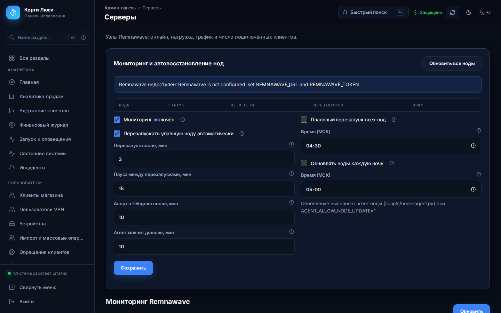 | 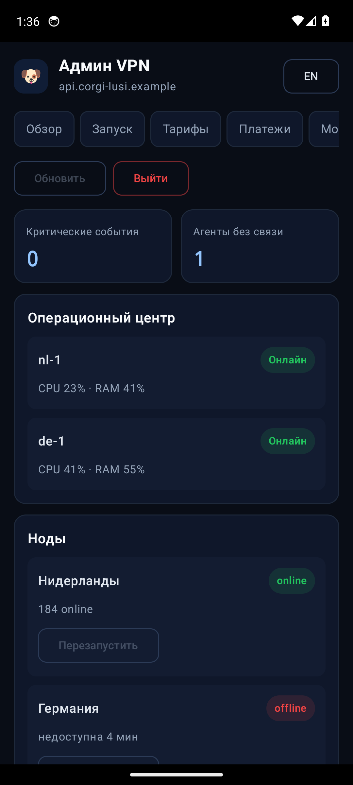 | 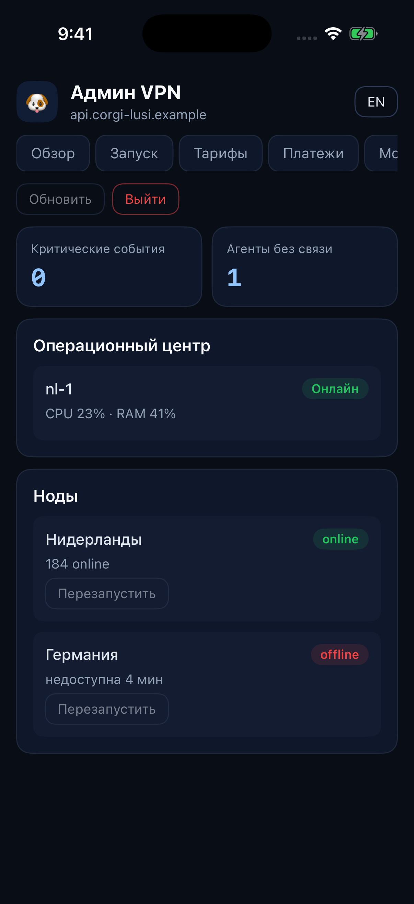 | 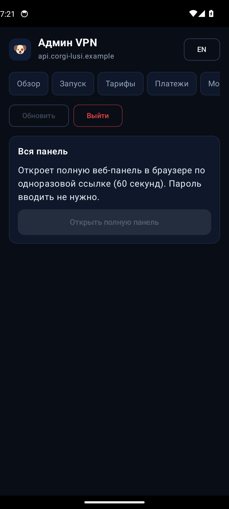 |
| **Резервные адреса API и сайты напрямую** | **Анти-шеринг** | **Копия базы в Telegram** | **Бонус днями за друга** |
| 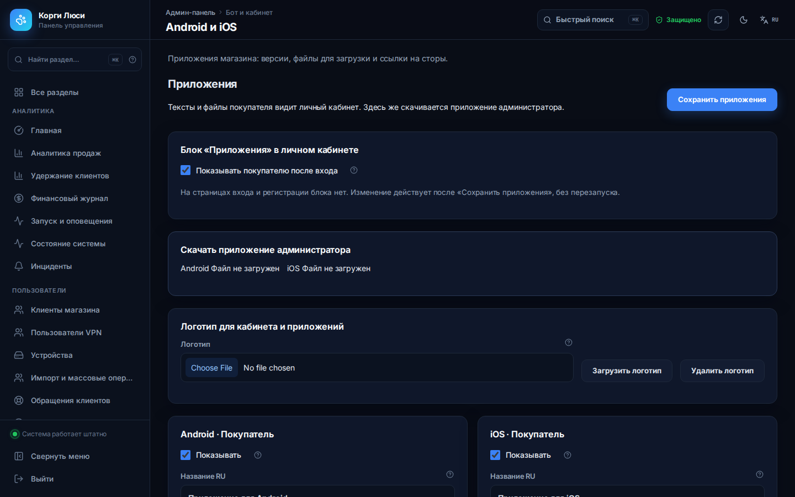 | 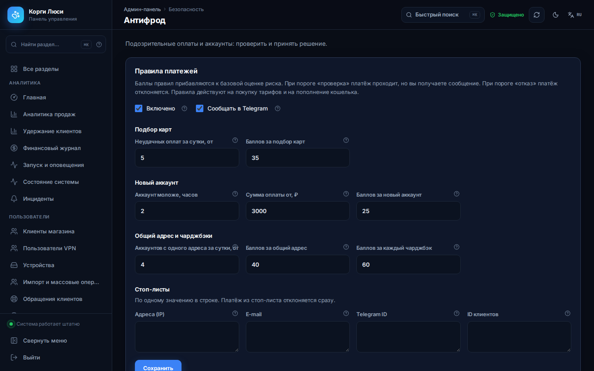 |  | 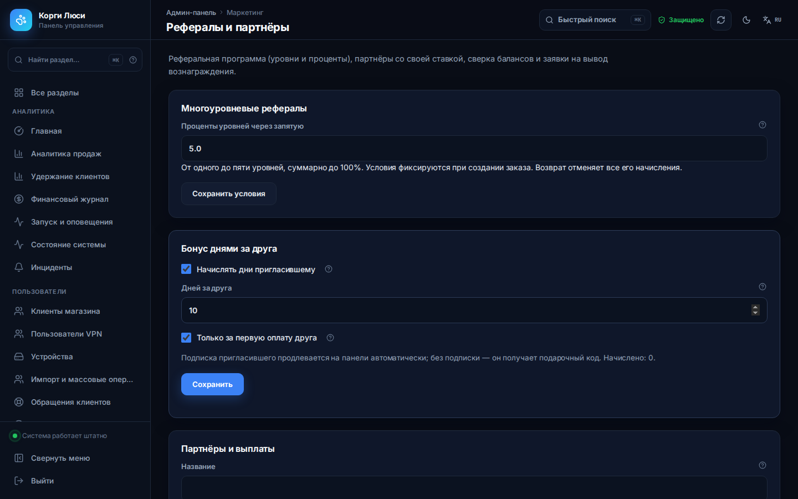 |

### 🆕 Новое в v28.34.0

<table>
<tr>
<td width="50%" valign="top">

**🔄 Автообновление с GitHub без вашего участия**

Установщик сам ставит агент обновлений. Каждую ночь (03:00 МСК) сервер проверяет новый выпуск, сверяет SHA-256, делает снимок и дамп базы, обновляется и при ошибке откатывается. Итог приходит в Telegram.

</td>
<td width="50%" valign="top">

**🛠 Управление из админ-панели**

«Выпуски → Автообновление»: включить или выключить, выбрать время, «Проверить и обновить сейчас», версии, итог последнего запуска и журнал. SSH-ключи и секреты GitHub не нужны.

</td>
</tr>
<tr>
<td valign="top">

**🧹 Чистые исходники**

Из `main.py` и скриптов сборки убраны 160 строк исторических маркеров версий, а тесты, которые проверяли эти комментарии, удалены.

</td>
<td valign="top">

**🚦 Автодеплой без ложных ошибок**

Если секреты DEPLOY_* не заданы, автоматический запуск деплоя пропускается с пояснением: выпуск ставит сам сервер.

</td>
</tr>
</table>

[Заметки к выпуску](docs/ru/RELEASE_V28_86_0.md) · [установка с нуля до продакшена](docs/INSTALLATION.md) · [архитектура модулей](docs/modules/README.md)

<details>
<summary><b>Что было в v28.33.0</b></summary>

<table>
<tr>
<td width="50%" valign="top">

**📣 Push-кампании по расписанию и A/B**

Рассылка в выбранное время по Москве, отмена до отправки. Второй вариант текста на часть сегмента и итог: кто оплатил после какого варианта, выручка и значима ли разница.

</td>
<td width="50%" valign="top">

**📈 Воронка приложений**

Установка → вход → тариф → оплата → подключение: каждая установка по порядку шагов, доля ушедших на каждом шаге, медианное время и шаг, где теряется больше всего клиентов.

</td>
</tr>
<tr>
<td valign="top">

**🧾 Сверка с «Мой налог»**

Если налоговая не ответила, магазин сам находит чек в списке доходов и отправляет его снова, только если чека там действительно нет. Двойных доходов не будет.

</td>
<td valign="top">

**📱 Встроенный VPN на iOS и push с картинками**

Network Extension на Xray-core и уведомления с картинками готовы в коде; включаются в сборке владельца с разрешением Apple, текущая подпись не меняется.

</td>
</tr>
<tr>
<td valign="top">

**🔋 VPN не отключается в фоне**

На Xiaomi, Samsung, Huawei и других прошивках приложение один раз подскажет, как разрешить работу без ограничений батареи и автозапуск. После оплаты в приложении клиент возвращается в приложение.

</td>
<td valign="top">

**🧪 Надёжность и сборка**

Вход вынесен из `main.py`, тесты поведения вместо проверок текста, интеграционные тесты оплаты и выдачи VPN, Maestro-сценарии, линтер, сборка образа backend один раз, автодеплой новых выпусков на сервер.

</td>
</tr>
</table>

[Заметки v28.33.0](docs/ru/RELEASE_V28_33_0.md)

</details>

<details>
<summary><b>Что было в v28.32.0</b></summary>

<table>
<tr>
<td width="50%" valign="top">

**🔐 Вход без адреса и пароля**

Адрес магазина вшит в сборку. Ссылка «Войти в приложение» из бота (`/app`) и кабинета, кнопки Telegram, Яндекс, VK и Google.

</td>
<td width="50%" valign="top">

**🛡 Встроенный VPN на Android**

Туннель прямо в приложении на Xray-core: «Авто» (самый быстрый сервер с переключением при сбое), выбор сервера, «Что работает без VPN» для приложений и российских сайтов.

</td>
</tr>
<tr>
<td valign="top">

**🧾 Чеки в налоговую**

Самозанятым — «Мой налог», ИП и ООО — АТОЛ Онлайн или «Чеки от ЮKassa» по 54-ФЗ. Чек формируется после оплаты, при возврате — аннулирование или возврат прихода.

</td>
<td valign="top">

**🔔 Красивые push и кампании**

Стиль push-уведомлений настраивается в админке: картинка, кнопки, цвет и раздел, который откроется. Push-кампании по сегментам: подписка заканчивается, закончилась, ещё не покупали.

</td>
</tr>
<tr>
<td valign="top">

**📈 Аналитика и розыгрыши**

Воронка «установка → вход → Подключить → оплата» и конверсия экранов. В приложениях появились раздел «Розыгрыши и бонусы» и баннер акции на главном экране.

</td>
<td valign="top">

**🧑‍💼 Админ-приложения и сторы**

Админ-приложения в стиле веб-панели (Remna Dark). Иконки, скриншоты и тексты для Google Play, RuStore и App Store, UI-тесты, привязка сертификата, Play Integrity и DeviceCheck.

</td>
</tr>
</table>

[Заметки к выпуску](docs/ru/RELEASE_V28_32_0.md) · [полный список работ](docs/ru/WORKLIST_V28_32_0.md)

</details>

</details>

## 🐶 О проекте

**VPN Shop by Corgi Lucy** — готовый магазин VPN-подписок, который работает поверх вашей панели
Remnawave. Вы устанавливаете его на свой сервер, подключаете свою панель — и получаете сервис, где клиент
сам выбирает тариф, платит и сразу получает доступ, а вы управляете всем из одной админ-панели.

**Кому это нужно.** Тем, кто продаёт доступ к VPN и не хочет собирать биллинг, кабинет, бота и админку
по частям: проект закрывает весь путь от оплаты до выдачи конфигурации.

**Что делает администратор.** Создаёт тарифы, подключает платёжные кассы, настраивает бота и Mini App,
видит клиентов, платежи, устройства и трафик, получает уведомления о сбоях и обновляется одной кнопкой.

**Что делает клиент.** Открывает бота, Mini App, кабинет или приложение, платит удобным способом,
получает ссылку-подписку или готовую конфигурацию, ставит её в свой клиент и подключается. Продлевает,
меняет тариф, докупает трафик и пишет в поддержку там же.

**Как это работает.** Магазин хранит заказы и подписки в PostgreSQL, выдаёт доступ через API Remnawave,
принимает подтверждения от платёжных провайдеров и сверяет каждую оплату с провайдером до выдачи.

## 🧰 Технологический стек

| Компонент | Технология | Назначение |
| --- | --- | --- |
| API и backend | Python 3.14, FastAPI 0.162.0, Uvicorn | REST API, выдача подписок, webhook, фоновые задачи |
| ORM и БД | SQLAlchemy 2.1.6, Alembic 1.20.1, PostgreSQL 18.6 | модели, миграции, транзакции |
| Очереди и кэш | Redis 8.10 | блокировки, идемпотентность, кэш статусов |
| Telegram-бот | aiogram 3.31.0 | `/start`, меню, покупка, поддержка, уведомления |
| Админ-панель | Next.js 16.4.4, React 19.3.1, TypeScript 7.0.2 (strict), Node.js 26 LTS | управление магазином |
| Кабинет и Mini App | Next.js 16.4.4, React 19.3.1, TypeScript 7.0.2 | личный кабинет клиента и Telegram Mini App |
| Стили и шрифты | Tailwind CSS 4.3, Inter, JetBrains Mono | тёмная тема, типографика |
| Мобильные приложения | Kotlin 2.4 + Compose, AGP 9.5, Gradle 9.8 (Android); Swift + SwiftUI (iOS) | клиентские и админские приложения |
| VPN-ядро | Xray-core | встроенный VPN на Android |
| Панель доступа | Remnawave 3.x API | пользователи, срок, трафик, устройства |
| Контейнеры | Docker Compose, Caddy 2.11, nginx 1.30 | 17 сервисов, TLS, reverse proxy |
| Тесты | pytest 9.2.0, Vitest 5.1.0, Playwright 1.64 | backend, кабинет, сценарии в браузере |

## 💻 Системные требования

| Параметр | Минимум | Рекомендуется | Зачем |
| --- | --- | --- | --- |
| ОС | Ubuntu 22.04 / Debian 12 | Ubuntu 24.04 | установщик рассчитан на apt и systemd |
| CPU | 2 ядра | 4 ядра | backend, два Next.js-приложения, PostgreSQL, Redis |
| RAM | 4 ГБ | 8 ГБ | сборка фронтендов и БД в памяти |
| Диск | 20 ГБ SSD | 40 ГБ SSD | образы, база, резервные копии |
| Docker | 24+ с плагином Compose v2 | актуальная | все сервисы запускаются в контейнерах |
| Домен | 1 (можно 3 поддомена) | 3 поддомена | панель, кабинет и Mini App на отдельных адресах |
| DNS | A-запись на сервер | A + AAAA | Caddy выпускает TLS только при верном DNS |
| Порты | 22, 80, 443/tcp, 443/udp | то же | SSH, проверка домена, HTTPS, HTTP/3 |
| Внешние сервисы | Remnawave, Telegram-бот, платёжная касса | все три | выдача доступа, продажи, приём оплаты |

Проверить сервер до установки: `bash scripts/preflight.sh` — синтаксис установщика, компиляция backend и
базовая проверка окружения. После установки полную диагностику даёт `bash scripts/doctor.sh`.

## ✨ Возможности

| | |
| --- | --- |
| 🤖 **Telegram-бот** | `/start` с меню из конструктора кнопок, `/buy`, `/subscription`, `/promo`, `/account`, `/balance`, `/payments`, `/gifts`, `/referral`, `/support`, `/devices`; баннеры разделов с корги Люси или свои; рассылки с учётом лимитов Telegram |
| 📲 **Android и iOS** | Приложения 3.1.0: встроенный VPN на Android (Xray-core) или импорт подписки в Happ/v2rayNG/Hiddify/v2RayTun, вход по ссылке, Telegram, Яндекс, VK и Google, локации, тарифы, розыгрыши, семья, поддержка, push с картинками и кнопками; **все разделы, кнопки, баннеры, тексты, цвета и стиль push редактируются в админ-панели** без обновления в сторе |
| 📱 **Mini App** | Строится из данных `GET /api/app-config`: тема, меню, баннеры с корги Люси, акции с таймером, серверы по категориям с флагами, пополнение (СБП, карта, крипта, Telegram Stars), рефералы, поддержка, документы и согласие с офертой; семейная подписка, состояние сервиса, автопродление за Stars; русский, английский и украинский. Скелетоны при загрузке, работа без сети на сохранённом конфиге |
| 🧑‍💻 **Личный кабинет** | Вход по email, Telegram, OAuth и passkey; несколько подписок, смена тарифа, докупка трафика, кошелёк, подарки, рефералы, устройства, обращения |
| 🛠 **Админ-панель** | 60+ разделов: клиенты, тарифы и конструктор, платежи и возвраты, маркетинг, автоматизация, узлы и антиабуз, почта, плагины, 2FA и роли, копии |
| 💳 **Оплата** | ЮKassa, Platega, RollyPay, Telegram Stars (разово и подпиской с автопродлением) и внутренний кошелёк. Подтверждение только после сверки с провайдером, идемпотентные webhook, финансовый журнал, возвраты с отзывом доступа — и из кабинетов провайдеров; **чеки в налоговую** («Мой налог», АТОЛ Онлайн, чеки ЮKassa) |
| 🛰 **Remnawave** | Выдача, продление, смена тарифа, трафик, Internal Squads, лимит устройств HWID, отзыв доступа; подписанные вебхуки панели — уведомления клиентам и защита пробного периода по HWID; совместимо с API 3.x |
| ⚡ **Автоматизация** | Правила «событие → условие → действие» (уведомления, Telegram, бонус на баланс, личный промокод), готовые сценарии возврата клиентов, события Remnawave и кампании по расписанию |
| 🛡 **Защита** | Антифрод платежей, антиабуз подключений с агентами узлов, распознавание торрентов и DPI, 2FA, passkeys, аудит, CSP |
| 💬 **Поддержка** | Встроенный Support Pro: обращения из бота, кабинета и email, мост Zendesk/Freshdesk |
| 📊 **Рост** | Когорты, LTV и причины отмены; партнёры с комиссией за автопродления и подарки; семейные подписки; подписанный каталог плагинов |
| 📈 **Эксплуатация** | Prometheus-метрики, состояние системы, фоновые процессы, резервные копии с двойным подтверждением восстановления, обновление из GitHub |

## 📲 Приложения Android и iOS

**Скачать Android (подписаны ключом магазина):** [клиент — APK](https://github.com/booarkz-cpu/shop-by-boo/releases/latest/download/corgi-lusi-android.apk) · [«Корги Люси: клиент» — VPN для любых подписок, APK](https://github.com/booarkz-cpu/shop-by-boo/releases/latest/download/corgi-lusi-client.apk) · [админка — APK](https://github.com/booarkz-cpu/shop-by-boo/releases/latest/download/corgi-lusi-android-admin.apk). Ссылки всегда ведут на последний выпуск; рядом лежат `.sha256` для проверки. iOS — через TestFlight или App Store, когда будет аккаунт Apple Developer.

| VPN | VPN подключён | Подписка | Премиум | Локации |
| :---: | :---: | :---: | :---: | :---: |
|  |  | 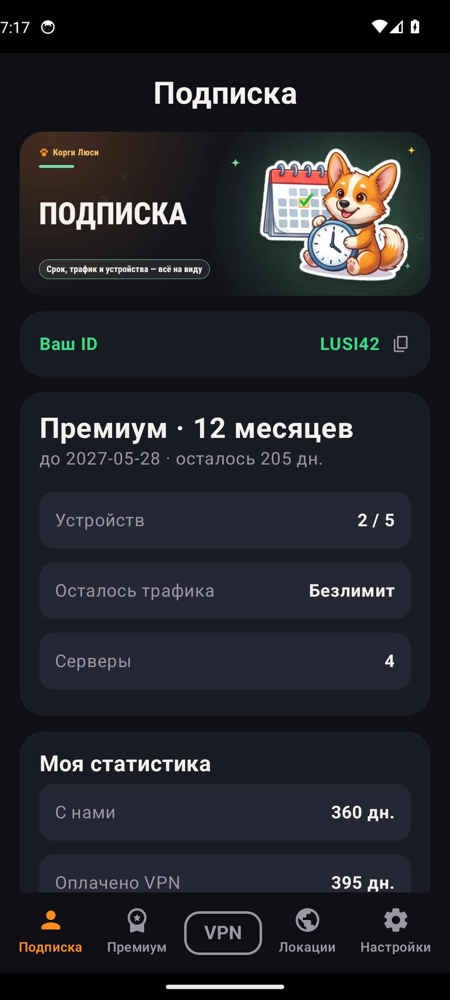 | 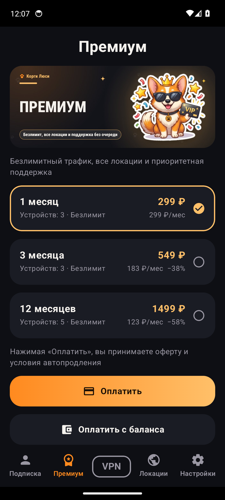 | 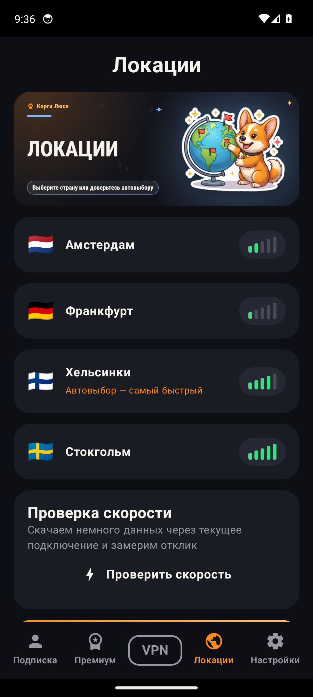 |
| 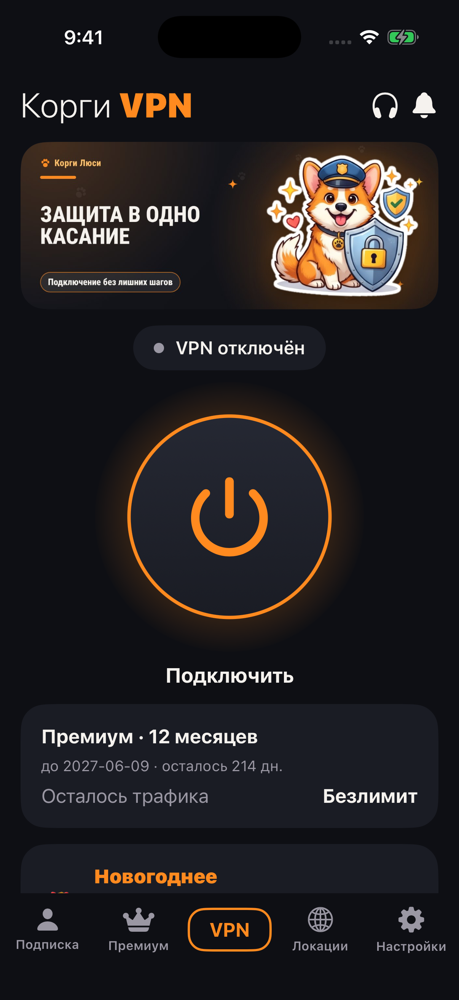 |  | 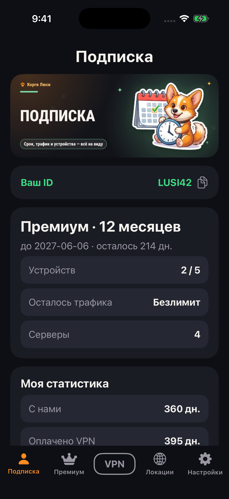 | 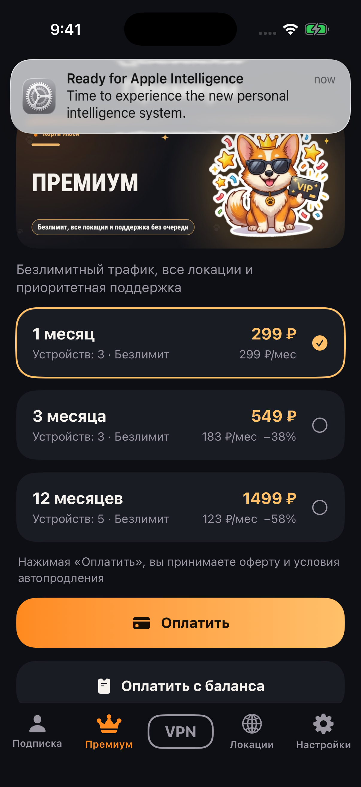 | 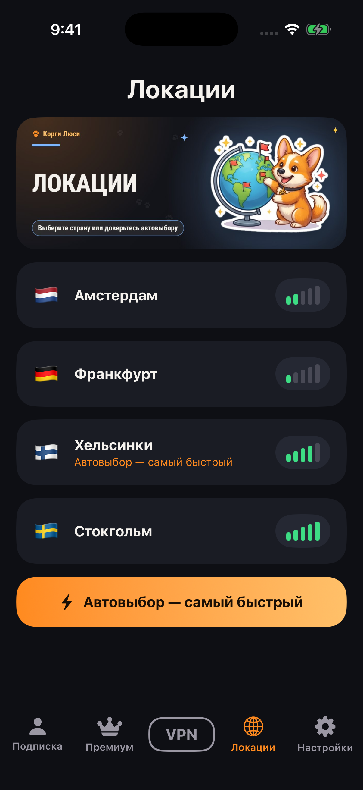 |
| **Настройки** | **Поддержка** | **Устройства** | **Семья** | **Состояние сервиса** |
| 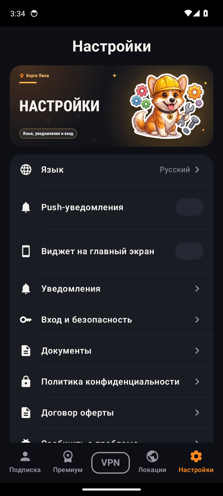 | 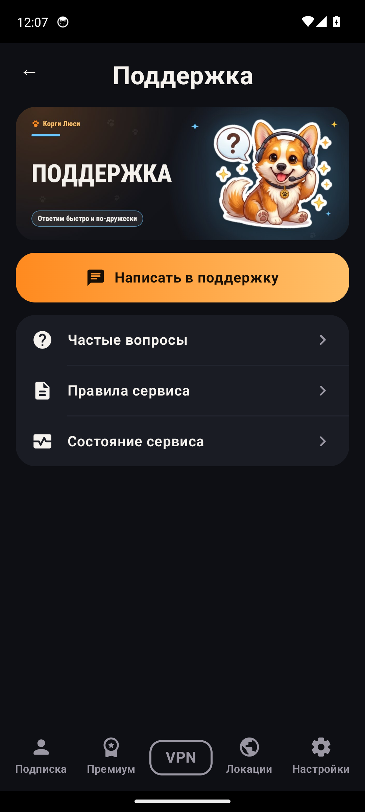 | 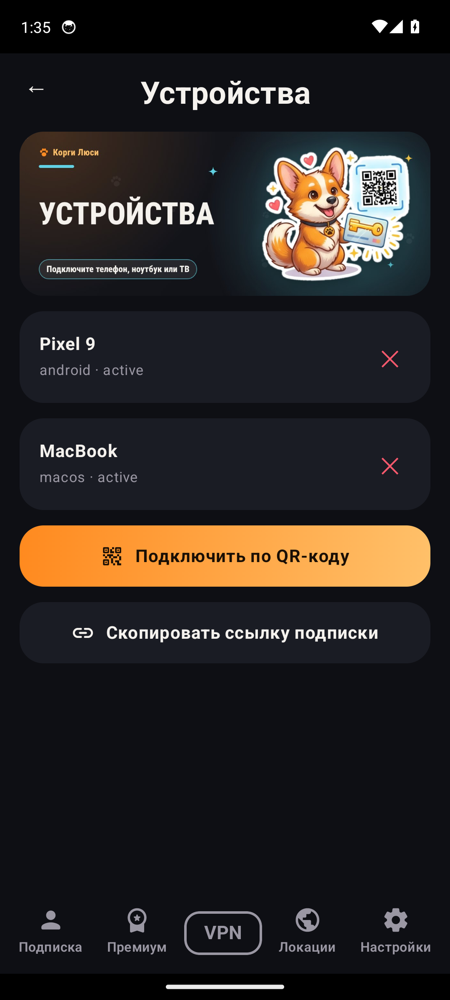 | 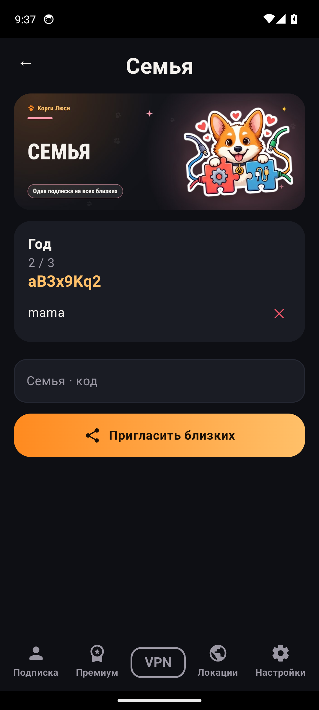 | 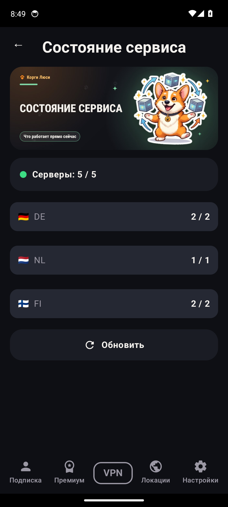 |
|  |  | 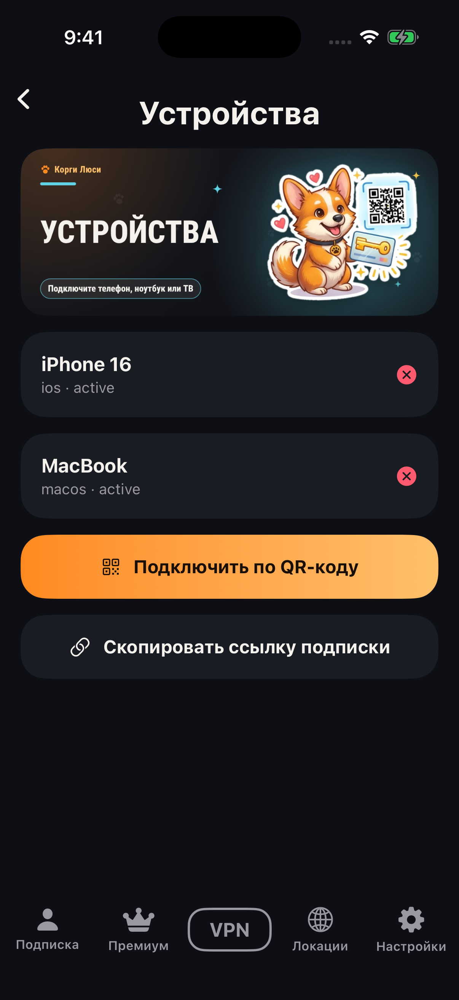 | 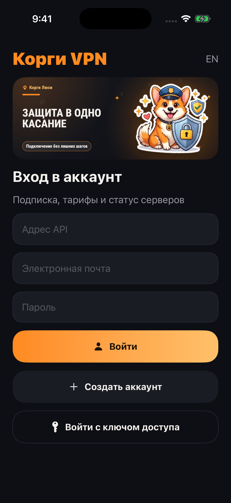 | 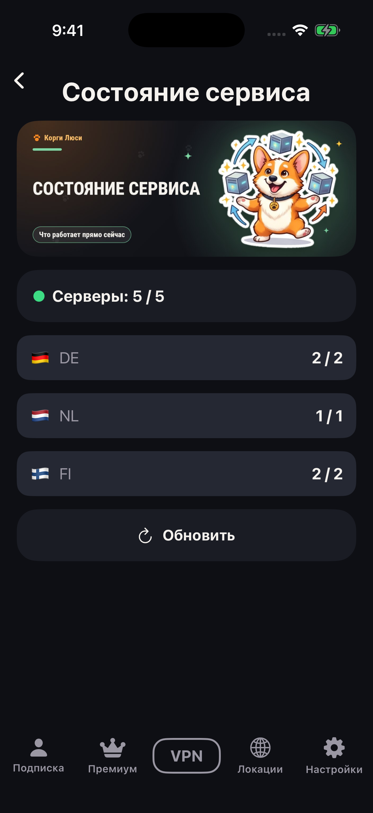 |
| **Розыгрыши** | | | | |
| 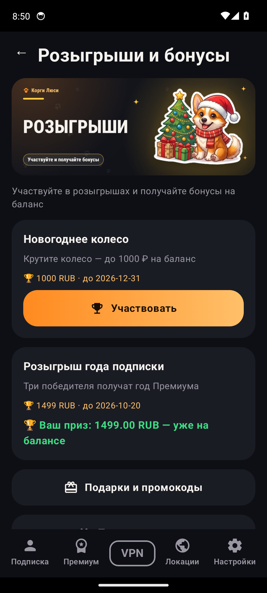 | 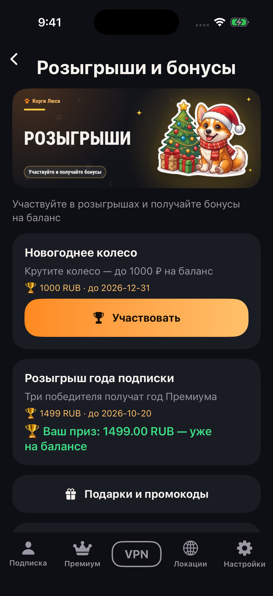 | | | |

- **Подключение в одно касание.** На Android туннель поднимается прямо в приложении (встроенный VPN на Xray-core): «Авто» выбирает самый быстрый сервер, можно выбрать сервер вручную и указать, что работает без VPN. Без встроенного движка и на iOS подписка уходит в Happ, v2rayNG, Hiddify или v2RayTun.
- **Вход без адреса и пароля:** ссылка из бота или кабинета, Telegram, Яндекс, VK, Google, ключ доступа.
- **Всё, что нужно клиенту:** тарифы с ценой в месяц, подписка, QR для другого устройства, розыгрыши и бонусы, семья, рефералы, баланс, уведомления, документы, поддержка.
- **Безопасность:** сессия в Android Keystore и Keychain, PKCE, Face ID и отпечаток, запрет снимков экрана, привязка сертификата, Play Integrity и DeviceCheck по ключам владельца.
- **Публикация:** иконки, скриншоты и тексты для Google Play, RuStore и App Store лежат в `mobile/store/`, порядок действий — в [STORE_PUBLISHING.md](docs/ru/STORE_PUBLISHING.md).
- **Готовые сборки:** APK и AAB для Android и IPA для iOS собираются в GitHub Actions и лежат на странице [Releases](https://github.com/booarkz-cpu/shop-by-boo/releases/latest) (подписанные — если в репозитории заданы ключи, иначе для подписи своими ключами).

**Админ-приложения** в стиле веб-панели (Remna Dark):

| Главная | Запуск | Платежи | Мониторинг | Обращения |
| :---: | :---: | :---: | :---: | :---: |
| 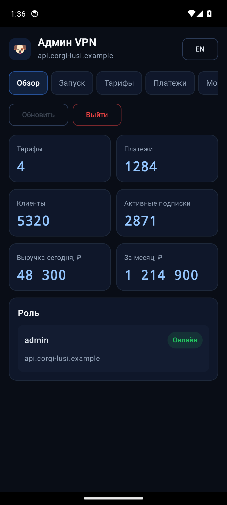 | 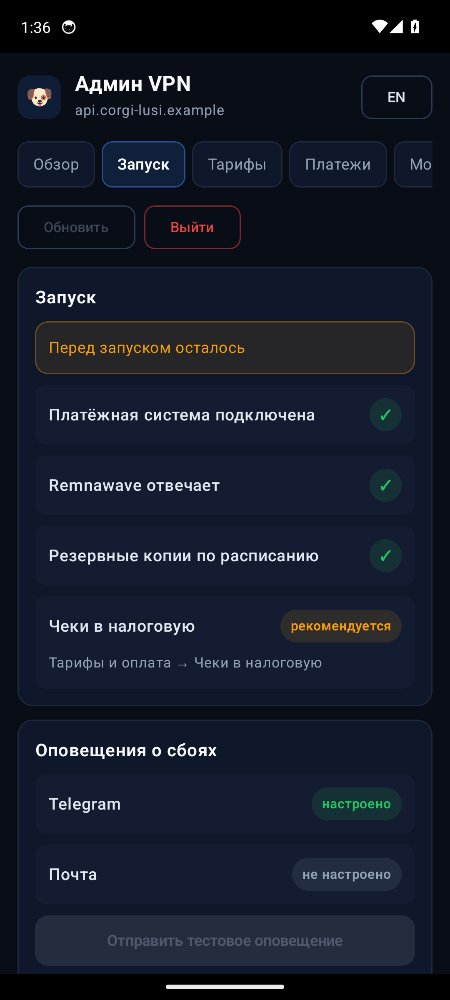 | 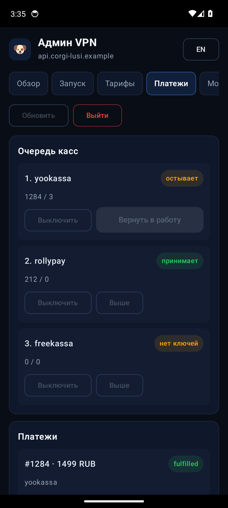 | 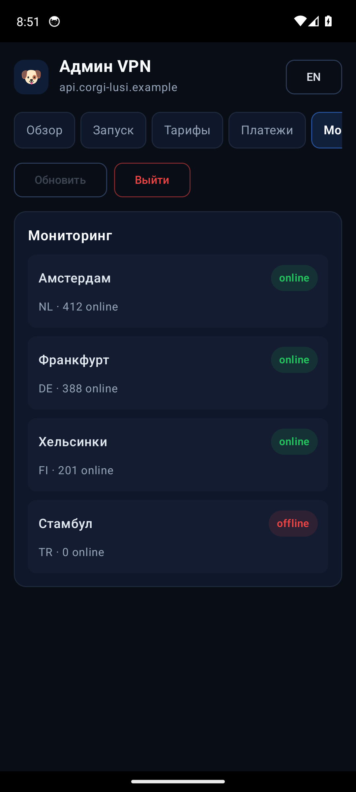 |  |
|  |  |  |  |  |

### 🐾 «Корги Люси: клиент» — VPN для любых подписок

Отдельное приложение для Android, которое подключается к **любой** подписке (не только вашего магазина): ссылки и QR, VLESS/REALITY и другие протоколы, свой JSON Xray, маршруты, прокси по приложениям, плитка в шторке, Android TV. Само обновляется: раз в сутки по Wi-Fi скачивает новую версию с новым ядром Xray, проверяет SHA-256 и предлагает установить. [Скачать APK](https://github.com/booarkz-cpu/shop-by-boo/releases/latest/download/corgi-lusi-client.apk) · [что умеет каждая версия](docs/ru/new/ANDROID_CLIENT_APP.md).

| Главная | Выбор сервера | Настройки |
| :---: | :---: | :---: |
|  |  |  |

| Статистика и скорость | Журнал сети | Geek Mode |
| :---: | :---: | :---: |
|  |  |  |

**Как подключиться за минуту:** установите APK → «Добавить» → вставьте ссылку-подписку из бота (или отсканируйте QR) → нажмите большую кнопку. Android один раз спросит разрешение на VPN — нажмите «ОК».

## 🎛 Всё настраивается из админ-панели


| Что | Где в админке | Где меняется |
| --- | --- | --- |
| Разделы, нижняя панель, кнопки (30 действий), свои страницы | Бот и кабинет → Приложения: экраны и кнопки | Android, iOS |
| Стиль push-уведомлений: картинка, кнопки, цвет, раздел, звук, группа | Бот и кабинет → Приложения: стиль push-уведомлений | Android, iOS |
| Push-кампании по сегментам и аналитика приложений | Бот и кабинет → Приложения: push-кампании / аналитика | Android, iOS |
| Чеки в налоговую: «Мой налог», АТОЛ Онлайн, чеки ЮKassa | Тарифы и оплата → Чеки в налоговую | ФНС, кабинет клиента |
| Любая строка интерфейса на ru/en/uk, блоки экранов, цвета, ссылки | там же | Android, iOS |
| Частые вопросы, правила, политика конфиденциальности, оферта + баннер | Бот и кабинет → Документы | бот, Mini App, кабинет, Android, iOS |
| Баннеры всех разделов | Бот и кабинет → Баннеры бота | бот, Mini App, кабинет, Android, iOS |
| Тема, акции, серверы, способы оплаты Mini App | Бот и кабинет → Конфигурация Mini App | Mini App, кабинет |


## 🏗 Архитектура


| Сервис (`docker-compose.yml`) | Что делает |
| --- | --- |
| `backend` | API магазина: авторизация, кабинет, админка, платежи и webhook, выдача в Remnawave |
| `worker` | Тот же код в роли фоновых процессов: очередь выдачи, повторы, автопродление, напоминания, автоматизация и кампании, сверка возвратов, копии, мониторинг |
| `bot` | Telegram-бот на aiogram 3 (long polling) и очередь рассылок с соблюдением flood control |
| `admin`, `cabinet`, `miniapp` | Статические сборки Next.js за nginx |
| `db`, `redis` | PostgreSQL 18 и Redis 7.4 магазина |
| `support_pro`, `support_worker`, `support_db`, `support_redis` | Встроенная служба поддержки |
| `caddy` | HTTPS для API, админки, кабинета, Mini App и Support Pro |
| `mail_receiver` (профиль `mail`) | Необязательный приём почты для служебных адресов |

**Стек.**
- Backend: Python 3.14, FastAPI 0.162, SQLAlchemy 2.1 (async, asyncpg), Alembic 1.20, Pydantic 2, httpx, aiogram 3.31.
- Frontend: Next.js 16, React 19, TypeScript 7 strict, Tailwind CSS 4, shadcn/Radix; сборка на Node.js 26 LTS.
- Мобильные приложения: Kotlin (Android) и Swift (iOS).
- База данных: PostgreSQL 18.6 (магазин и Support Pro), Redis 8.10.
- Инфраструктура: Docker Compose, Caddy, GitHub Actions (CI, Docker, выпуски, мобильные сборки).

### 📂 Структура репозитория

| Каталог | Что внутри |
| --- | --- |
| `backend/app` | FastAPI: `main.py` (ядро) и модули разделов — `auth_api.py`, `admin_auth_api.py`, `payments_api.py`, `push_campaigns.py`, `app_funnel.py`, `fiscal.py`, `remnawave.py`, `bot.py` и другие ([карта](docs/PROJECT_MAP_RU.md)) |
| `backend/alembic` | Миграции PostgreSQL, head `0094_store_subscriptions` |
| `backend/worker.py` | Фоновые процессы: очередь выдачи (`run_next_job`), чеки, кампании, push, автопродление |
| `admin`, `cabinet`, `miniapp` | Next.js: админ-панель, личный кабинет, Mini App |
| `mobile/android-user`, `mobile/ios-user` | Клиентские приложения (Kotlin Compose, SwiftUI); `mobile/ios-user/CorgiTunnel` — Network Extension, `CorgiNotificationService` — push с картинками |
| `mobile/android-admin`, `mobile/ios-admin` | Админ-приложения |
| `mobile/maestro`, `mobile/store` | Сценарии Maestro и материалы для сторов |
| `support-pro` | Встроенная служба поддержки |
| `deploy`, `scripts`, `install.sh` | Установка на сервер в одну команду, обновление, копии, сборки |
| `tests` | Тесты backend (pytest), e2e (Playwright) — `admin/e2e` |
| `docs` | Документация: [установка](docs/INSTALLATION.md), [архитектура модулей](docs/modules/README.md), [30 модулей для владельца](docs/ru/modules/README.md) |

### 📱 Mini App на данных

Mini App не содержит зашитых текстов, цветов, меню и картинок разделов: всё приходит одним JSON.


| Часть конфига | Что задаёт | Где меняется |
| --- | --- | --- |
| `theme.vars` | Неоновый акцент, фон, карточки, текст, скругления (CSS-переменные) | Конфигурация Mini App → Тема |
| `navigation`, `banners` | Разделы, иконки и баннер каждого раздела | Личный кабинет, Баннеры бота |
| `promos` | Карточки акций: текст, скидка, таймер, кнопка | Акции на тарифы, реклама, свои карточки |
| `servers.categories` | Группы серверов по странам или словам в имени, флаги | Конфигурация Mini App → Категории |
| `wallet` | Кнопки сумм, способы оплаты (СБП, карта, крипта, Stars), курс Stars | Конфигурация Mini App → Кошелёк |
| `referral`, `support` | Условия программы, вывод средств, кнопки связи, форма обращения | Конфигурация Mini App |
| `info`, `consent` | FAQ, правила, конфиденциальность, оферта; согласие перед оплатой | Публикации + Конфигурация Mini App |
| `texts` | Все подписи интерфейса | Конфигурация Mini App → Тексты |

Загрузка: сначала последний сохранённый конфиг (мгновенный показ), затем сеть; пока конфига нет — скелетоны; без сети — плашка «Нет связи» и кнопка «Повторить». Подробно — [модуль 14](docs/ru/modules/14-bot-miniapp.md#mini-app-на-данных).

## 🚀 Быстрый старт

### Установка на VDS одной командой

Нужен чистый сервер на Ubuntu 24.04 или Debian 12: 4 vCPU, 8 ГБ RAM, 40 ГБ диска. Нужны и DNS-записи A для пяти доменов: `api`, `admin`, `app`, `cabinet`, `support`.

```bash
curl -fsSL https://raw.githubusercontent.com/booarkz-cpu/shop-by-boo/v28.113.0/install.sh -o /root/shop-install.sh \
  && BRANCH=v28.113.0 bash /root/shop-install.sh
```

Установщик сам ставит Docker, спрашивает домены, токены и цены, создаёт `.env` со случайными секретами, собирает и запускает сервисы. После установки:

```bash
cd /opt/vpn-shop
docker compose ps                         # все сервисы running/healthy
curl -fsS https://api.ДОМЕН/health/ready  # {"ok": true, ...}
bash scripts/doctor.sh                    # сводная проверка
```

Дальше откройте `https://admin.ДОМЕН`, включите 2FA и пройдите шаги [руководства по запуску](docs/ru/LAUNCH_GUIDE.md).

### Ручная установка через Docker Compose

```bash
git clone --branch v28.113.0 https://github.com/booarkz-cpu/shop-by-boo.git /opt/vpn-shop
cd /opt/vpn-shop
cp .env.example .env
# Заполните .env: секреты, домены, BOT_TOKEN, REMNAWAVE_*, ключи провайдеров (см. таблицу ниже)
docker compose up -d --build
docker compose exec -T backend alembic upgrade head
docker compose ps
```

### Переход на PostgreSQL 18

Начиная с v28.23.0 магазин и Support Pro работают на PostgreSQL 18. Обычное обновление (`scripts/update-from-github.sh`) само переносит данные: `scripts/upgrade-postgres.sh` останавливает сервисы, снимает дамп со старой базы PostgreSQL 16, восстанавливает его в PostgreSQL 18 на новом томе и сверяет количество строк в каждой таблице. Старый том `postgres_data` не удаляется — он нужен для отката. Перед обновлением сделайте резервную копию: `bash scripts/backup.sh`.

### Локальный стенд без касс, Telegram и Remnawave

```bash
git clone --branch v28.113.0 https://github.com/booarkz-cpu/shop-by-boo.git
cd shop-by-boo
bash scripts/test-up.sh   # создаст .env.test, покажет адреса и вход
```

Обновление существующей установки: `bash scripts/backup.sh`, затем `sudo env APP_DIR=/opt/vpn-shop RELEASE_TAG=v28.113.0 bash /opt/vpn-shop/scripts/update-from-github.sh` ([регламент](docs/ru/DISTRIBUTION_UPGRADE_CURRENT.md)).

## ⚙️ Переменные окружения

Полный список с комментариями — [`.env.example`](.env.example). Большинство операционных параметров меняются без перезапуска в **Система → Настройки без перезапуска** ([реестр](docs/ru/RUNTIME_SETTINGS_CURRENT.md)).

| Переменная | Зачем | Пример |
| --- | --- | --- |
| `APP_ENV` | `production`, `staging` или `test` | `production` |
| `APP_SECRET` | Подпись сессий и шифрование секретов в базе, не меньше 32 символов | `openssl rand -hex 32` |
| `DB_PASSWORD`, `POSTGRES_PASSWORD`, `DATABASE_URL` | Доступ к PostgreSQL магазина | `postgresql+asyncpg://vpnshop:…@db:5432/vpnshop` |
| `REDIS_PASSWORD`, `REDIS_URL` | Redis: блокировки, ограничение запросов, circuit breaker | `redis://:…@redis:6379/0` |
| `ADMIN_EMAIL`, `ADMIN_PASSWORD` | Первый администратор (создаётся при запуске) | `owner@example.com` |
| `API_DOMAIN`, `ADMIN_DOMAIN`, `APP_DOMAIN`, `CABINET_DOMAIN`, `SUPPORT_PRO_DOMAIN` | Домены Caddy | `api.vpn.example.com` |
| `PUBLIC_BASE_URL`, `MINI_APP_URL`, `CABINET_URL` | Публичные адреса API, Mini App и кабинета | `https://app.vpn.example.com` |
| `CADDY_EMAIL` | Почта для сертификатов Let's Encrypt | `owner@example.com` |
| `BOT_TOKEN`, `BOT_USERNAME`, `ADMIN_TELEGRAM_ID` | Telegram-бот и владелец для `/ops` | `123456:ABC…` |
| `REMNAWAVE_URL`, `REMNAWAVE_TOKEN` | Панель Remnawave и её API-токен | `https://panel.example.com` |
| `DEFAULT_CURRENCY`, `PRICE_1/3/6/12` | Валюта и цены стартовых тарифов (создаются выключенными на пустой базе) | `RUB`, `199` |
| `YOOKASSA_SHOP_ID`, `YOOKASSA_SECRET_KEY`, `YOOKASSA_WEBHOOK_IP_ALLOWLIST` | ЮKassa | IP-адреса уведомлений ЮKassa |
| `PLATEGA_MERCHANT_ID`, `PLATEGA_SECRET` | Platega | |
| `ROLLYPAY_API_KEY`, `ROLLYPAY_SIGNING_SECRET` | RollyPay | |
| `SMTP_HOST`, `SMTP_PORT`, `SMTP_USER`, `SMTP_PASSWORD`, `SMTP_FROM` | Письма: подтверждение email, восстановление пароля | `smtp.provider.example`, `587` |
| `ALERT_TELEGRAM_CHAT_ID` | Куда слать оповещения о сбоях | `-100…` |

Адреса уведомлений у провайдеров: `https://api.ДОМЕН/api/webhooks/yookassa`, `…/platega`, `…/rollypay`. В ЮKassa включите события `payment.succeeded` и `refund.succeeded`: тогда возврат, оформленный в кабинете ЮKassa, тоже отзывает доступ.

## 📸 Скриншоты

### Баннеры бота и Mini App

Каждый раздел бота и Mini App приходит с баннером: свой стикер корги Люси и название раздела. Стандартные баннеры собирает `python3 scripts/bot-banners/render.py` (`--app` — баннеры приложений); любой можно заменить своим в **Бот и кабинет → Баннеры бота** ([как настроить](docs/ru/modules/14-bot-miniapp.md#баннеры-бота)).


### Mini App

Настоящие снимки собранного Mini App (390×844) со стандартными баннерами. Обновить: `(cd cabinet && npm run build:miniapp) && node scripts/screenshots/miniapp.mjs`.

| Главная | Пополнение | Рефералы | Поддержка |
| :---: | :---: | :---: | :---: |
|  |  |  |  |
| **Серверы** | **Информация** | **Тарифы** | |
|  |  |  | |

### Telegram-бот

Чаты бота с настоящими баннерами и текстами команд (`/start`, `/balance`, `/buy`, `/support`). Живой Telegram без аккаунта не сфотографировать, поэтому картинки собирает скрипт `python3 scripts/screenshots/bot_chat.py` в оформлении Telegram (тёмная тема, 390×844).

| `/start` | `/balance` | `/buy` | `/support` |
| :---: | :---: | :---: | :---: |
|  |  |  |  |

### Админ-панель и личный кабинет

Ниже настоящие снимки всех разделов админ-панели и кабинета (Remna Dark, 1440×900). Их снимает скрипт [`admin/scripts/screenshots-catalog.mjs`](admin/scripts/screenshots-catalog.mjs) на изолированном тестовом стенде с тестовыми тарифами и sandbox-оплатами. Поэтому серверы Remnawave на снимках недоступны, а суммы и клиенты тестовые. Описание каждого раздела — в [руководстве по админ-панели](docs/ru/ADMIN_PANEL_CURRENT.md).

| Админ-панель | Личный кабинет |
| --- | --- |
|  |  |
|  |  |

#### Админ-панель

Порядок совпадает с боковым меню панели. Разверните группу, чтобы увидеть снимки.

<details>
<summary><b>Все разделы</b> (1)</summary>

**Все разделы** — Стартовая страница: ключевые показатели и все функции панели по группам с описанием и поиском по задаче.


</details>

<details>
<summary><b>Вход</b> (1)</summary>

**Вход в панель** — Email и пароль администратора, вход по ключу доступа (passkey), выбор темы и языка.


</details>

<details>
<summary><b>Аналитика</b> (7)</summary>

**Главная** — Сводка за сутки и месяц: клиенты, подписки, выручка, серверы и то, что требует внимания.


**Аналитика продаж** — Выручка, конверсия, средний чек и динамика продаж по периодам.


**Удержание клиентов** — Когорты по месяцу первой оплаты, повторные покупки, LTV и причины отмены подписки.


**Финансовый журнал** — Неизменяемый журнал всех денежных операций: оплаты, возвраты, бонусы и выплаты.


**Запуск и оповещения** — Что осталось настроить перед приёмом оплат и куда приходят оповещения о сбоях.


**Состояние системы** — Состояние всех частей: backend, интерфейсы, база и миграции, Redis, Remnawave, узлы, Caddy и сертификаты, платежи, бот, фоновые задачи, резервные копии и обновления.


**Инциденты** — Сбои и проблемы: открыть инцидент, отметить решение, посмотреть историю.


</details>

<details>
<summary><b>Пользователи</b> (6)</summary>

**Клиенты магазина** — Поиск клиента по ID, Telegram, имени или email и полная карточка: подписка, баланс, платежи, действия.


**Пользователи VPN** — Учётные записи в Remnawave: статус, имя пользователя и дата создания.


**Устройства** — Устройства клиентов (HWID): сколько подключено и какие можно отключить.


**Импорт и массовые операции** — Перенос клиентов из другого бота и действия сразу над группой клиентов.


**Обращения клиентов** — Вопросы клиентов из бота и кабинета: ответить, назначить, закрыть.


**Support Pro** — Состояние отдельного центра поддержки: очереди, операторы, каналы и SLA.


</details>

<details>
<summary><b>Тарифы и оплата</b> (11)</summary>

**Тарифы** — Готовые тарифы: название, срок, цена, трафик и число устройств.


**Конструктор тарифов** — Тариф, который клиент собирает сам: устройства, трафик и срок с ценой за каждый пункт.


**Чеки в налоговую** — Автоматические чеки после оплаты: самозанятым — «Мой налог», ИП и ООО — АТОЛ Онлайн или чеки ЮKassa по 54-ФЗ; журнал и повтор.


**Пакеты трафика** — Дополнительные гигабайты, которые клиент докупает к действующей подписке.


**Изменения подписок** — Продления, смены тарифа и докупки: что запросил клиент и чем закончилось.


**Платежи** — Все оплаты клиентов со статусом, суммой и платёжной системой.


**Платёжные агенты** — Подключённые платёжные системы, их доступность и доля успешных оплат.


**Возвраты** — Заявки на возврат денег: проверить, одобрить или отклонить.


**Семейные подписки** — Семьи владельцев тарифов с местами: участники и их синхронизация с Remnawave.


**Подарки** — Подарочные коды на подписку: создать код, задать срок и число активаций.


**Проверка платежей** — Тестовые оплаты в sandbox платёжных систем перед запуском магазина.


</details>

<details>
<summary><b>Маркетинг</b> (7)</summary>

**Акции и рассылки** — Скидочные акции, промокоды, рекламные блоки и рассылки в Telegram.


**Группы и предложения** — Группы клиентов по условиям и персональные предложения для каждой группы.


**Конкурсы и призы** — Розыгрыши и призы: условия участия, победители и выдача наград.


**Опросы** — Вопросы клиентам в боте и кабинете и сводка ответов.


**Рефералы и партнёры** — Реферальная программа (уровни и проценты), партнёры со своей ставкой, сверка балансов и заявки на вывод вознаграждения.


**Уведомления** — Отправленные клиентам уведомления и состояние push для Android и iOS.


**Новости и страницы** — Новости, инструкции и правовые страницы для бота и кабинета.


</details>

<details>
<summary><b>Бот и кабинет</b> (13)</summary>

**Telegram-бот** — Связь бота с Telegram, токен без перезапуска, меню команд на трёх языках, тестовое сообщение, статистика и ошибки бота.


**Меню бота и Mini App** — Тексты бота, кнопки главного меню, экран Mini App и инструкции по подключению.


**Дерево кнопок** — Вложенные меню бота: порядок кнопок, подменю и действия по нажатию.


**Документы** — Частые вопросы, правила, политика конфиденциальности и публичная оферта: свой текст и баннер для Mini App, кабинета, бота и приложений Android и iOS.


**Конфигурация Mini App** — Тема, акции, серверы, способы пополнения, рефералы, поддержка, документы и оферта Mini App.


**Приложения: экраны и кнопки** — Разделы, нижняя панель, все кнопки, баннеры, тексты и цвета приложений Android и iOS.


**Приложения: стиль push-уведомлений** — Цвет, значок магазина, картинки, заголовки, тексты, кнопки, группы и звук push-уведомлений Android и iOS по типам, с предпросмотром.


**Приложения: push-кампании** — Сообщение и push сегменту клиентов: подписка заканчивается, закончилась, не покупали, давно не заходили.


**Приложения: аналитика** — Установки, вход, «Подключить», оплата и конверсия по экранам приложений Android и iOS.


**Баннеры бота** — Картинки над разделами бота, Mini App и приложений Android и iOS: стандартные с корги Люси или свои.


**Личный кабинет** — Вкладки веб-кабинета клиента: порядок, названия и собственные страницы.


**Android и iOS** — Приложения магазина: версии, файлы для загрузки и ссылки на сторы.


**Оформление** — Название магазина, логотип, иконка сайта, цвета и тема по умолчанию.


</details>

<details>
<summary><b>Серверы</b> (19)</summary>

**Серверы** — Узлы Remnawave: онлайн, нагрузка, трафик и число подключённых клиентов.


**Remnawave: панель** — Профили конфигурации, хосты и внутренние сквады панели, режим обслуживания при её недоступности и статистика вызовов API.


**Установка** — Все операции с серверами в одном каталоге: выбор сервера, простой и экспертный режим, поиск; защита и ускорение, протоколы и маскировка, порт ноды, MSS clamp, защита ноды, подкачка, бот и кабинет.


**Установка Remnawave** — Мастер установки панели, нод и страницы подписки на свои VPS по SSH: проверка сервера, план, запуск, журнал, обновление и удаление.


**Расширения Remnawave** — Профили конфигурации нод с конструктором VLESS + REALITY и SelfSteal, плагины нод (TorrentBlocker, фильтры), правила ответов подписки, лимит устройств, страница и шаблоны подписки, клиентский балансировщик.


**Пул автовыбора** — Плитка «Автовыбор» в списке серверов клиента: узлы пула, алгоритм (по задержке, по нагрузке, по кругу, случайно), скрытие узлов, состояние по данным панели.


**Смена протокола** — Починка блока: перевод inbound на другой транспорт (TCP, XHTTP, gRPC) в четыре этапа с журналом, проверкой нод и возвратом прежнего транспорта.


**SelfSteal** — Сайты-маскировки нод: что стоит на каждой ноде, проверка снаружи (11 пунктов), свой сайт из архива и каталог из 22 шаблонов — у каждой ноды своя сборка.


**Домены и сертификаты** — Домены портала подписки и серверов Remnawave: проверка DNS и сертификатов, записи в Cloudflare, адрес подписки клиентов, маршруты Caddy.


**Портал подписки** — Подписка на своём домене: страница клиента со статусом, QR-кодом и инструкциями, правила для приложений, защита от перебора, блокировка устройств, смена ссылки, журнал.


**Доступность и качество** — Проверки доступности из разных сетей и провайдеров, измерения RIPE Atlas, качество подключений и скорость у клиентов.


**Сеть узлов: ASN и репутация** — В чьих сетях стоят узлы и не попали ли их адреса в списки злоупотреблений.


**Терминал узлов** — Командная оболочка на VPN-сервере через агент: с подтверждением 2FA и записью сессии.


**Маршрутизация** — Выбор узла для клиента по задержке и нагрузке.


**Планирование мощности** — Прогноз нагрузки: когда узлам не хватит ресурсов и сколько добавить.


**Оркестратор** — Автоматическое включение и вывод узлов по правилам нагрузки.


**Торренты на узлах** — Кто из клиентов качает торренты: счётчики срабатываний Xray без адресов, отметка в антиабузе и уведомление.


**Антиабуз и агенты** — Агенты на узлах, блокировка устройств-нарушителей и вебхуки событий.


**Мониторинг** — Проверки доступности, версии компонентов, рабочие процессы и журналы контейнеров в браузере.


</details>

<details>
<summary><b>Система</b> (14)</summary>

**Админ-центр: 30 модулей** — Все модули платформы в одной таблице: какие разделы ими управляют, какие операции доступны и каких модулей пока нет.


**Настройки без перезапуска** — Параметры магазина, платёжных систем и интеграций, которые применяются сразу.


**Функции и модули** — Включение и выключение отдельных возможностей магазина.


**Плагины** — Установка подписанных плагинов, их права и журнал работы.


**Automation Center** — Всё, что магазин делает сам: автообновление магазина и Remnawave, релизы на GitHub, версия панели, резервные копии, worker, оповещения и сводка состояния системы.


**Автоматизация** — Правила «событие → действие» и автоматические кампании.


**Фоновые процессы** — Worker и планировщик: работают ли, когда последний раз отвечали.


**Очередь задач** — Фоновые задачи: ожидают, выполняются, завершились ошибкой; повтор вручную.


**Почтовый домен: SPF, DKIM, DMARC** — Доходят ли письма магазина: DNS-записи домена и отчёты DMARC о том, кто отправляет почту от его имени.


**Диагностика** — Проверка конфигурации, подключений и готовности к работе с подсказками по исправлению.


**Обновления** — Установленная версия, доступные выпуски и история обновлений.


**Развёртывания** — Постепенный выпуск новой версии: доля трафика и ошибки.


**Корпоративный контур** — Проверки, кампании и правила автоматизации для крупных установок.


**Рекомендации** — Подсказки по росту продаж и снижению нагрузки на основе данных магазина.


</details>

<details>
<summary><b>Безопасность</b> (8)</summary>

**Защита и 2FA** — Двухфакторный вход, смена пароля и правила доступа к панели.


**Ключи доступа** — Вход в панель по ключу доступа (passkey) вместо пароля.


**Роли и администраторы** — Кто имеет доступ к панели и с какими правами.


**Сессии** — Активные входы в панель, завершение чужой или всех сессий, история безопасности: входы, неудачные попытки, подтверждения опасных действий.


**Антифрод** — Подозрительные оплаты и аккаунты: проверить и принять решение.


**Журнал действий** — Кто из администраторов, когда и что изменил.


**Резервные копии** — Расписание и хранение копий базы, ручной запуск и проверка.


**Восстановление** — Восстановление из копии и проверка готовности к аварии.


</details>

<details>
<summary><b>Разделы без пункта меню</b> (8)</summary>

**Центр управления** — Сводка по узлам, устройствам и автоматизации.


**Карточка клиента** — Подробные данные клиента.


**Командный центр** — Сводка всех систем магазина в реальном времени.


**Коммерческие показатели** — Выручка и удержание клиентов.


**Интеграции** — Подключённые внешние сервисы и их состояние.


**События** — Поток событий магазина.


**Центр безопасности** — Сигналы безопасности и реакции на них.


**Статус сервиса** — Состояние компонентов для страницы статуса.


</details>

<details>
<summary><b>Поиск</b> (1)</summary>

**Быстрый поиск** — Ctrl+K (⌘K) из любого раздела: поиск по названию, описанию и синонимам, переход клавишами.


</details>

#### Личный кабинет пользователя

Вход, регистрация, оформление заказа и все разделы бокового меню кабинета.

<details>
<summary><b>Все разделы кабинета</b> (21)</summary>

**Вход** — Главная страница кабинета: блок приложений Android и iOS, вход по email и паролю, вход через Telegram.


**Регистрация** — Регистрация нового пользователя: имя, email и пароль.


**Обзор** — Статус подписки, срок действия, остаток трафика и устройства, QR-код и ссылка быстрого подключения, кошелёк, реферальный баланс и код приглашения.


**Тарифы** — Карточки тарифов, выбор подписки для продления, промокод и провайдер оплаты, оплата картой или с баланса.


**Оформление заказа** — Результат тестовой оплаты: подписка активирована и продлена, кабинет показывает новый срок.


**Пробный период** — Активация бесплатного пробного периода.


**Подключение** — Ссылка подписки и QR-код, пошаговые инструкции для Android, iOS, TV, Windows, macOS и Linux.


**Серверы** — Статус серверов. На стенде без Remnawave список пуст.


**Поддержка** — Создание обращения и список своих обращений.


**Устройства** — Устройства, подключённые к подписке, и рекомендуемый сервер.


**Партнёрский кабинет** — Раздел для партнёров магазина.


**Кошелёк** — Баланс, пополнение, активация подарочной карты и история операций кошелька.


**Моя подписка** — Подписки пользователя, статус, автопродление, смена тарифа и дополнительный трафик.


**Платежи** — История платежей и PDF-квитанции.


**Подарки** — Активация подарочного кода и покупка подписки в подарок.


**Реферальная программа** — Начисления, код приглашения, реферальная сеть по уровням и заявка на выплату.


**Уведомления** — Уведомления об оплатах и активации подписки.


**Безопасность** — Профиль, привязанные способы входа, подтверждение email, смена пароля, ключи доступа, объединение аккаунтов и сессии.


**Опросы** — Опубликованные опросы для пользователя.


**Конкурсы и призы** — Участие в конкурсах и результаты.


**Информация** — Документы магазина из публикаций: частые вопросы, правила, политика конфиденциальности и публичная оферта.


</details>

## 💳 Как устроена оплата

1. Клиент выбирает тариф в боте, Mini App или кабинете. Магазин создаёт заказ с ключом идемпотентности и открывает страницу оплаты провайдера.
2. Провайдер присылает webhook. Магазин проверяет подпись или IP и запрашивает статус платежа у провайдера: сумма, валюта и номер заказа должны совпасть.
3. Заказ становится оплаченным, worker выдаёт или продлевает доступ в Remnawave: срок, трафик, Internal Squad, лимит устройств.
4. Повтор webhook ничего не повторяет. Возврат из админки или из кабинета ЮKassa отзывает доступ и записывается в финансовый журнал.

Реальные платежи открыты сразу после установки. На случай сбоя есть аварийная кнопка «Остановить приём платежей». Подробно: [модуль «Платежи»](docs/ru/modules/07-payments.md), [три платёжных агента](docs/ru/WORKSPACE_PAYMENTS.md), [сквозная проверка на стенде](docs/ru/STAGING_E2E_V2_IMPLEMENTATION.md), [живая проверка всех касс](docs/ru/PAYMENTS_LIVE_CHECKLIST.md).

### Подключённые кассы

Все кассы реализованы в коде; конкретный способ оплаты включается заполнением его переменных в `.env`.
Отсутствие ключей одной кассы не отключает остальные: клиент видит только настроенные способы.

| Касса | Что принимает | Переменные | Статус |
| --- | --- | --- | --- |
| YooKassa | карты, СБП | `YOOKASSA_SHOP_ID`, `YOOKASSA_SECRET_KEY` | реализовано, ключи не подключены |
| Freekassa | карты, СБП | `FREEKASSA_MERCHANT_ID`, `FREEKASSA_SECRET_WORD`, `FREEKASSA_SECRET_WORD_2` | реализовано, ключи не подключены |
| CloudPayments | карты, СБП, возвраты через API | `CLOUDPAYMENTS_PUBLIC_ID`, `CLOUDPAYMENTS_API_SECRET` | реализовано, ключи не подключены |
| Platega | карты, СБП | `PLATEGA_MERCHANT_ID`, `PLATEGA_SECRET` | реализовано, ключи не подключены |
| RollyPay | карты, СБП | `ROLLYPAY_API_KEY`, `ROLLYPAY_SIGNING_SECRET` | реализовано, ключи не подключены |
| CryptoBot | криптовалюта | `CRYPTOBOT_TOKEN` | реализовано, ключи не подключены |
| Lava | карты, СБП | `LAVA_*` | реализовано, ключи не подключены |
| Pal24 (PayPalych) | карты, СБП | `PAL24_*` | реализовано, ключи не подключены |
| Mulen Pay | карты, СБП | `MULENPAY_*` | реализовано, ключи не подключены |
| WATA | карты, СБП | `WATA_*` | реализовано, ключи не подключены |
| Antilopay | карты, СБП | `ANTILOPAY_*` | реализовано, ключи не подключены |
| AuraPay | карты, СБП | `AURAPAY_*` | реализовано, ключи не подключены |
| Anore | карты, СБП | `ANORE_*` | реализовано, ключи не подключены |
| Cashera | карты, СБП | `CASHERA_*` | реализовано, ключи не подключены |
| ParityPay | карты, СБП | `PARITYPAY_*` | реализовано, ключи не подключены |
| Tribute | пополнение кошелька донатом в Telegram | `TRIBUTE_*` | реализовано, ключи не подключены |
| Telegram Stars | Stars, автопродление | `BOT_TOKEN` | реализовано, нужен токен бота |
| Sandbox | учебный платёж | `PAYMENTS_SANDBOX=true` | работает без ключей |

> **Честно о статусе.** Все 16 внешних касс и Telegram Stars реализованы и покрыты тестами на подпись,
> сверку суммы и идемпотентность. Реальная денежная операция ни через одну кассу не проводилась: в проекте
> нет действующих ключей. Подписка не выдаётся по сообщению клиента — только после проверки статуса у
> провайдера. Пошаговая проверка каждой кассы: [PAYMENTS_LIVE_CHECKLIST.md](docs/ru/PAYMENTS_LIVE_CHECKLIST.md).

## 💾 Резервное копирование и восстановление

**Копия базы.** `bash scripts/backup.sh` создаёт дамп PostgreSQL и складывает его в каталог из `.env`
(`BACKUP_DIR`, по умолчанию внутри `APP_DIR`). Модуль «Резервные копии» в админ-панели показывает список,
размер, дату и результат проверки целостности; проверка запускается и по расписанию.

**Что копировать.** Базу магазина, базу Support Pro, `.env` и загруженные файлы (`MEDIA_DIR`). `.env`
содержит секреты, поэтому копия `.env` хранится только там, куда у вас есть доступ, и никогда не попадает в git.

**Почему одной копии мало.** Копия на том же сервере исчезнет вместе с сервером. Держите хотя бы одну копию
вне хоста — в объектном хранилище или на другом сервере; в проекте для этого есть `BOTO3`-совместимая выгрузка.

**Восстановление.**

```bash
bash scripts/backup.sh                                   # 1. сначала свежая копия текущего состояния
docker compose exec -T db psql -U "$DB_USER" -d "$DB_NAME" < backup.sql   # 2. восстановление дампа
bash scripts/doctor.sh                                   # 3. проверка сервисов и /health
```

**Откат версии.** `bash scripts/rollback.sh` возвращает предыдущий выпуск: он берёт сохранённый снимок
файлов и дамп базы, сделанные перед обновлением. Откат возможен только к состоянию из последней копии —
поэтому копия создаётся автоматически перед каждым обновлением. Подробно:
[BACKUP_CURRENT.md](docs/ru/BACKUP_CURRENT.md), [модуль 30](docs/ru/modules/30-backups-recovery.md).

## 🛠 Команды администратора

Все команды выполняются на сервере из каталога проекта (`APP_DIR`, по умолчанию `/opt/vpn-shop`).

| Задача | Команда |
| --- | --- |
| Проверить сервер до установки | `bash scripts/preflight.sh` |
| Установить магазин | `bash install.sh` или `curl -fsSL …/v28.72.1/install.sh \| sudo bash` |
| Полная диагностика | `bash scripts/doctor.sh` |
| Статус контейнеров | `docker compose ps` |
| Логи всех сервисов | `docker compose logs -f` |
| Логи одного сервиса | `docker compose logs -f backend` |
| Перезапуск сервиса | `docker compose restart backend` |
| Остановить / запустить | `docker compose down` / `docker compose up -d` |
| Проверить конфигурацию Compose | `docker compose config` |
| Health-check API | `curl -s localhost:8000/health` |
| Резервная копия | `bash scripts/backup.sh` |
| Обновить до выпуска | `sudo env APP_DIR=/opt/vpn-shop RELEASE_TAG=v28.113.0 bash scripts/update-from-github.sh` |
| Откатить версию | `bash scripts/rollback.sh` |
| Включить ночные обновления | `sudo bash scripts/auto-update.sh install` |
| Состояние автообновления | `sudo bash scripts/auto-update.sh status` |
| Выключить автообновление | `sudo bash scripts/auto-update.sh disable` |
| Миграции вручную | `docker compose exec -T backend alembic upgrade head` |
| Сменить секреты | `bash scripts/rotate-secrets.sh` |
| Сканирование безопасности | `bash scripts/security-scan.sh` |
| Горячий резерв backend | `bash scripts/hot-standby.sh` |

## 🩺 Диагностика

| Ошибка | Возможная причина | Как проверить | Как исправить |
| --- | --- | --- | --- |
| `Cannot read properties of undefined (reading 'trim')` | в ответе API поле-метка пришло не объектом `{ru, en, uk}` | в консоли браузера открыть упавший запрос и посмотреть форму поля | в v28.72.1 форма закреплена тестом; на старых сборках обновиться |
| `(s \|\| []).map is not a function` | API вернул объект вместо списка | посмотреть ответ эндпоинта | панель нормализует `items` / `results` / `data`; проверить, что запрос идёт к своему backend |
| Чёрная страница админки или кабинета | сбой отрисовки без границы ошибок | консоль браузера | в v28.72.1 показывается экран ошибки с причиной и кнопкой повтора |
| `API недоступен` в панели | backend не прошёл health-check | `curl -s localhost:8000/health` | `docker compose logs backend`, проверить `.env` и `DATABASE_URL` |
| `docker compose` не запускается | нет `.env` или неверный синтаксис | `docker compose config` | скопировать `.env.example` в `.env` и заполнить обязательные поля |
| Контейнер перезапускается | падение на старте или нехватка памяти | `docker compose logs <сервис>` | исправить причину в логах; проверить `free -h` |
| Ошибка миграции | схема от другой версии | `docker compose exec -T backend alembic current` | сверить с `alembic heads`; восстановить копию и обновиться штатно |
| Не работает Telegram | неверный токен или домен не в allowlist | `getWebhookInfo` у бота | проверить `BOT_TOKEN`, `WEBAPP_URL`, HTTPS-домен |
| Webhook не приходит | касса не видит ваш адрес | панель кассы, журнал входящих | проверить `WEBHOOK_BASE_URL`, доступность извне, подпись |
| Платёж не подтверждается | сумма или подпись не совпали | `docker compose logs backend` | сверить валюту и сумму заказа, проверить секрет кассы |
| Подписка не создаётся | Remnawave недоступен или неверный токен | `curl` к API Remnawave с вашим токеном | проверить `REMNAWAVE_URL`, `REMNAWAVE_TOKEN`, Internal Squad тарифа |
| Не работает Remnawave | панель недоступна или истёк токен | `docker compose logs backend` | обновить токен, проверить сеть и сертификат |
| Не работает reverse proxy | Caddy не выпустил сертификат | `docker compose logs caddy` | проверить DNS A-запись, порты 80/443, доступность домена |
| Обновление не проходит | нет прав, места или не сошлась контрольная сумма | `sudo bash scripts/auto-update.sh status` | освободить диск, проверить права root, смотреть журнал |
| Резервная копия не создаётся | нет прав на каталог или места | `df -h`, лог `scripts/backup.sh` | поправить `BACKUP_DIR` и права, освободить место |
| Не восстанавливаются данные | дамп от другой версии схемы | `alembic current` против версии в дампе | восстановить дамп той же версии, затем обновляться по шагам |

## 📚 Документация

| Задача | Где |
| --- | --- |
| Запустить магазин с нуля | [Руководство по запуску](docs/ru/LAUNCH_GUIDE.md) |
| Работать с каждым разделом панели | [30 модулей](docs/ru/modules/README.md) |
| Установка через SSH/Termius, DNS, TLS | [Установка на VDS](docs/ru/DEPLOYMENT_CURRENT.md), [INSTALL_STEPS.md](INSTALL_STEPS.md) |
| Эксплуатация, обновление, сбои | [Регламент](docs/ru/PRODUCTION_CURRENT.md), [обновление](docs/ru/DISTRIBUTION_UPGRADE_CURRENT.md) |
| Проверить кассы настоящими деньгами | [Живая проверка всех касс](docs/ru/PAYMENTS_LIVE_CHECKLIST.md) |
| Резервные копии | [Модуль 30](docs/ru/modules/30-backups-recovery.md), [полная копия](docs/ru/BACKUP_CURRENT.md) |
| API и права | [Каталог API](docs/API_ENDPOINTS.md), [архитектура](docs/ru/WORKSPACE_ARCHITECTURE.md), [карта проекта](docs/PROJECT_MAP_RU.md) |
| Android и iOS: сборка, экраны, кнопки, строки | [Модуль 16](docs/ru/modules/16-mobile-apps.md), [мобильные приложения](docs/ru/MOBILE_GUIDE.md), [MOBILE.md](MOBILE.md) |
| Частые вопросы, правила, политика, оферта | [Документы](docs/ru/modules/13-content-pages.md) |
| Архитектура новых функций | [Автообновление и откат](docs/modules/auto_update_and_rollback.md), [без простоя](docs/modules/zero_downtime.md), [PostgreSQL и Redis](docs/modules/redis_and_postgres.md), [защита от блокировок](docs/modules/anti_blocking.md), [split tunneling](docs/modules/split_tunneling.md), [языки](docs/modules/i18n.md), [ИИ-поддержка](docs/modules/ai_support.md) |
| Что вошло в выпуск | [Заметки v28.113.0](docs/ru/RELEASE_V28_113_0.md), [CHANGELOG](CHANGELOG.md), [установка](docs/INSTALLATION.md), [архитектура модулей](docs/modules/README.md) |
| Все документы | [DOCUMENTATION.md](DOCUMENTATION.md), [указатель](docs/INDEX.md), [архив прошлых выпусков](docs/archive/root/README.md) |
| Wiki на трёх языках | [русский](docs/wiki/ru/Home.md), [English](docs/wiki/en/Home.md), [українська](docs/wiki/uk/Home.md) — готовые страницы для GitHub Wiki |
| English / Українська | [docs/en](docs/en/README.md), [docs/uk](docs/uk/README.md) |

## 🧪 Разработка и проверка

```bash
python3 -m venv .venv
.venv/bin/pip install -r backend/requirements.txt -r backend/requirements-test.txt
APP_ENV=test APP_SECRET=test-only-secret PYTHONPATH=backend .venv/bin/python -m pytest -q tests

cd admin && npm ci && npm run typecheck && npm run build
cd ../cabinet && npm ci && npm run typecheck && npm test && npm run build
cd ../admin && NEXT_BASE_PATH=/cabinet npm run build --prefix ../cabinet && npx playwright test   # Chromium под production CSP
```

Тесты с PostgreSQL и Redis включаются переменными `AUDIT_TEST_DATABASE_URL` и `REDIS_URL`. **CI** (`.github/workflows/ci.yml`) поднимает PostgreSQL 18 и Redis 7.4 и выполняет:
- миграции Alembic;
- тесты backend и Support Pro;
- typecheck, сборку и Playwright-проверки интерфейсов;
- сборку Android;
- проверки контейнеров и документации.

`docker.yml` собирает образы. `publish-release.yml` публикует выпуск после слияния в `main`. `mobile-release.yml` прикладывает мобильные пакеты.

Для разработки интерфейсов: `npm run dev` в `admin` (порт 5173) или `cabinet` (порт 5174), адрес API — `NEXT_PUBLIC_API_URL`. Mini App — это кабинет, собранный с `NEXT_PUBLIC_SURFACE=miniapp`.

## 📄 Лицензия

[LICENSE](LICENSE) (Corgi Lusi VPN Shop Source License 2.9) разрешает бесплатно использовать и менять проект для собственного магазина, включая коммерческую работу и сборку мобильных клиентов. Соблюдайте условия распространения из лицензии. [Сторонние компоненты](THIRD_PARTY_NOTICES.md).

## 🗂 История выпусков

Полная история — в [CHANGELOG.md](CHANGELOG.md): 60 версий, категории Added / Changed / Fixed / Security /
Performance / Documentation / Removed / Migration. Даты взяты из Git-тегов, описания — из записей CHANGELOG,
ссылка «заметки» ведёт на отчёт соответствующего выпуска.

| Версия | Дата | Категория | Изменения | Подробности |
| --- | --- | --- | --- | --- |
| `v28.73.0` | 2026-11-04 | Added | Этап 14: проверка касс по коду и контрактный тест всех касс, журнал уведомлений касс, проекты оферты, политики и правил по законодательству РФ |
| `v28.72.1` | 2026-11-03 | Fixed | Модуль IPv6: адрес сервера восстанавливается после повторного включения, интерфейс переключается вместе с `all` |
| `v28.72.0` | 2026-11-03 | Added | Тексты Telegram-бота на трёх языках из админки, ответ на языке клиента; сверка функций бота и Mini App (этап 13, часть Б) |
| `v28.71.0` | 2026-11-03 | Added | Telegram-бот из админки (этап 13, часть А): токен без перезапуска, связь бота с Telegram в «Состоянии системы», меню команд на трёх языках, тестовое сообщение, ошибки бота |
| `v28.70.0` | 2026-11-03 | Added | Модули серверов (этап 12, часть Б): SelfSteal (TLS + REALITY), IPv6, ядро Xray с проверкой SHA-256, WARP Native, NetBird, Xray Checker, серверный роутинг и WARP в профиле |
| `v28.69.0` | 2026-11-03 | Added | Менеджер расширений Remnawave (этап 12, часть А): профили и конструктор REALITY, плагины нод, правила ответов подписки, лимит устройств, страница и шаблоны подписки, клиентский балансировщик — через API панели |
| `v28.68.0` | 2026-11-03 | Added | Все тексты портала подписки на трёх языках (язык по браузеру), цвета шаблона, предпросмотр, тексты нейтральной страницы — из админки |
| `v28.67.0` | 2026-11-03 | Added | Портал подписки и домены (этап 11): страница клиента по ссылке подписки, домены портала с on-demand TLS, проверки DNS и сертификатов, Cloudflare, маршруты Caddy, защита от перебора, смена ссылки, закрытие доступа к панели; миграция `0091_remnawave_domains` |
| `v28.66.0` | 2026-11-03 | Added | Мастер установки Remnawave (этап 10): реестр серверов, проверка сервера по SSH, семь режимов, план с SHA-256, установка по шагам с откатом, обновление, диагностика, восстановление, переустановка, удаление; миграция `0090_remnawave_installer`; установка «панель + нода» по SSH в CI |
| `v28.65.0` | 2026-11-03 | Added | Архитектура Remnawave Manager (этап 9): 14 компонентов, 7 режимов, модель данных, API, агент развёртывания; живая проверка режимов «панель + нода» и «панель + страница подписки»; установка ноды только по типизированным полям | [заметки](docs/ru/RELEASE_V28_65_0.md) |
| `v28.64.0` | 2026-11-02 | Changed | Актуальные версии: Python 3.14, Node.js 26 LTS, Redis 8.10, Caddy 2.11, nginx 1.30, Android AGP 9.5 / Kotlin 2.4 / Gradle 9.8 / compileSdk 37, обновлённые библиотеки; перевод закреплённых образов при обновлении | [заметки](docs/ru/RELEASE_V28_64_0.md) |
| `v28.63.0` | 2026-11-02 | Added | Личный кабинет: сессии по одной, устройства под лимитом подписки (HWID Remnawave) с удалением, вход через Google без перезапуска, тарифы Lucy Mini/Max/Ultra и пробный период только на Lucy Mini; исправлено тело сброса устройств для Remnawave 3.x | [заметки](docs/ru/RELEASE_V28_63_0.md) |
| `v28.62.0` | 2026-11-02 | Added | System Control Center: «Состояние системы» показывает backend, интерфейсы, базу и миграции, Redis, Remnawave, узлы, Caddy и сертификаты TLS, платежи, бота, фоновые задачи, резервные копии и обновления со ссылкой на раздел; документы ADMIN_PANEL_GUIDE, ADMIN_MODULES, RBAC | [заметки](docs/ru/RELEASE_V28_62_0.md) |
| `v28.61.0` | 2026-11-02 | Changed | Интерфейс: разделы «Remnawave: панель», «Портал подписки», «Доступность и качество»; общие состояния блоков; ответы 503/502 при ненастроенном или недоступном Remnawave; правила интерфейса; проверка всех разделов на телефоне | [заметки](docs/ru/RELEASE_V28_61_0.md) |
| `v28.60.0` | 2026-11-02 | Added | Админ-центр: 30 модулей платформы с операциями из маршрутов API, таблица прав ролей, поиск в журнале действий, журнал изменений прослойки подписок | [заметки](docs/ru/RELEASE_V28_60_0.md) |
| `v28.59.0` | 2026-11-02 | Changed | Единая бизнес-логика: общая выдача мест семьи и компаний (`seat_access.py`), формат ошибки 500 с `request_id`, страницы списков и период аналитики, отчёт целостности, `defusedxml`, документация API и схемы базы | [заметки](docs/ru/RELEASE_V28_59_0.md) |
| `v28.58.0` | 2026-11-02 | Fixed | Исправления по техническому аудиту: ответ API не в JSON — ошибка вместо падения экрана, миграция `0090_remnawave_installer` (индексы, `operation_key`), SSRF в вебхуках и постбэках, Docker на ноде из подписанного репозитория, лимиты на ввод кодов, healthchecks | [заметки](docs/ru/RELEASE_V28_58_0.md) |
| `v28.57.0` | 2026-11-01 | Fixed | Окно месяцев в когортах и отчёте роста, стабильность теста юнит-экономики | [заметки](docs/ru/RELEASE_V28_57_0.md) |
| `v28.56.0` | 2026-10-31 | Fixed | `GET /api/me/traffic` больше не затенён вторым обработчиком: кабинет, Mini App и мобильные приложения | [заметки](docs/ru/RELEASE_V28_56_0.md) |
| `v28.55.0` | 2026-10-31 | Added | Раздел «Выпуски → Обновления» показывает фактическую установленную версию вместо заглушки | [заметки](docs/ru/RELEASE_V28_55_0.md) |
| `v28.54.0` | 2026-10-29 | Added | Фильтр рекламы и детский режим (`dns_filter.py`, миграция `0088_filter_and_regions`) | [заметки](docs/ru/RELEASE_V28_54_0.md) |
| `v28.53.0` | 2026-10-29 | Added | Проверка скорости (`speed_test.py`, миграция `0087_speed_tests`) | [заметки](docs/ru/RELEASE_V28_53_0.md) |
| `v28.52.0` | 2026-10-29 | Added | Оценка поддержки и NPS (`feedback.py`, миграция `0086_feedback`) | [заметки](docs/ru/RELEASE_V28_52_0.md) |
| `v28.51.0` | 2026-10-29 | Added | Уровни лояльности (`loyalty.py`, миграция `0085_loyalty`) | [заметки](docs/ru/RELEASE_V28_51_0.md) |
| `v28.50.0` | 2026-10-29 | Added | Заморозка подписки (`subscription_freeze.py`, миграция `0084_subscription_freeze`) | [заметки](docs/ru/RELEASE_V28_50_0.md) |
| `v28.49.0` | 2026-10-29 | Payments | Антифрод платежей (`payment_fraud.py`) | [заметки](docs/ru/RELEASE_V28_49_0.md) |
| `v28.48.0` | 2026-10-29 | Added | Корпоративные тарифы (`corporate.py`, миграция `0083_corporate_seats`) | [заметки](docs/ru/RELEASE_V28_48_0.md) |
| `v28.47.0` | 2026-10-29 | Added | Страница статуса (`status_page.py`, миграция `0082_status_subscribers`) | [заметки](docs/ru/RELEASE_V28_47_0.md) |
| `v28.46.0` | 2026-10-29 | Payments | CloudPayments, возвраты через API | [заметки](docs/ru/RELEASE_V28_46_0.md) |
| `v28.45.0` | 2026-10-29 | Payments | Пакет `backend/app/gateways/`: у каждой дополнительной кассы свой модуль, общая часть вынесена в `common.py` | [заметки](docs/ru/RELEASE_V28_45_0.md) |
| `v28.44.0` | 2026-10-28 | Payments | Tribute (`tribute.py`): пополнение кошелька донатом в Telegram | [заметки](docs/ru/RELEASE_V28_44_0.md) |
| `v28.43.0` | 2026-10-28 | Payments | Кассы Cashera и ParityPay (карты, СБП) в `payments_extra.py` | [заметки](docs/ru/RELEASE_V28_43_0.md) |
| `v28.42.0` | 2026-10-28 | Added | «География клиентов» (Мониторинг): векторная карта стран (`admin/src/worldMap.tsx`) | [заметки](docs/ru/RELEASE_V28_42_0.md) |
| `v28.41.0` | 2026-10-28 | Payments | Кассы AuraPay и Anore (карты, СБП) в `payments_extra.py` | [заметки](docs/ru/RELEASE_V28_41_0.md) |
| `v28.40.0` | 2026-10-28 | Payments | Кассы WATA и Antilopay (карты, СБП) в `payments_extra.py` | [заметки](docs/ru/RELEASE_V28_40_0.md) |
| `v28.39.0` | 2026-10-28 | Payments | Кассы Pal24 (PayPalych) и Mulen Pay (карты, СБП) в `payments_extra.py` | [заметки](docs/ru/RELEASE_V28_39_0.md) |
| `v28.38.0` | 2026-10-28 | Added | Функции remnawave-subscription-middleware своей реализацией (у проекта нет лицензии — код не копировался), сверка в `docs/ru/MIDDLEWARE_RECONCILIATION.md` | [заметки](docs/ru/RELEASE_V28_38_0.md) |
| `v28.37.0` | 2026-10-28 | Added | Сверка с картой покрытия и снимками для сравнения (Bedolaga Bot и Cabinet, Remnawave Admin, StepBot): итог в `docs/ru/SNAPSHOT_RECONCILIATION.md`, недос… | [заметки](docs/ru/RELEASE_V28_37_0.md) |
| `v28.36.0` | 2026-10-28 | Payments | Резервные кассы целиком: очередь касс в веб- и мобильных админках (порядок, включение, «Вернуть в работу»), управление всеми пятью кассами (раньше тольк… | [заметки](docs/ru/RELEASE_V28_36_0.md) |
| `v28.35.0` | 2026-10-28 | Added | Мониторинг нод: автоперезапуск упавшей ноды после 3 проверок, алерт в Telegram, если нода или агент молчат дольше 10 минут, плановый перезапуск и обновл… | [заметки](docs/ru/RELEASE_V28_35_0.md) |
| `v28.34.0` | 2026-10-27 | Added | Автообновление с GitHub: установщик ставит агент `scripts/auto_update.py` и systemd-таймеры `vpn-shop-update` (каждую ночь в 03:00 МСК ±15 минут) и `vpn… | [заметки](docs/ru/RELEASE_V28_34_0.md) |
| `v28.33.0` | 2026-10-27 | Added | Push-кампании по расписанию: «Отправить позже» по московскому времени, отмена до отправки, отправка воркером ровно один раз (`campaign_scheduler`); сегм… | [заметки](docs/ru/RELEASE_V28_33_0.md) |
| `v28.32.0` | 2026-10-27 | Added | Вход в приложения без адреса и пароля: адрес магазина вшивается в сборку (`corgi.shop_url` / `CORGI_SHOP_URL`), одноразовые ссылки `corgi://login` из бо… | [заметки](docs/ru/RELEASE_V28_32_0.md) |
| `v28.31.0` | 2026-10-26 | Added | Приложения Android и iOS 3.0.0: новый интерфейс (нижняя панель «Подписка · Премиум · VPN · Локации · Настройки», большая кнопка подключения с импортом п… | [заметки](docs/ru/RELEASE_V28_31_0.md) |
| `v28.30.0` | 2026-10-26 | Payments | `main.py` (этап 2): `customer_ops_api`, `notifications_status_api`, `operations_api`, `admin_api`, `payment_platform_api` (4352 → 3317 строк); оплата, в… | [заметки](docs/ru/RELEASE_V28_30_0.md) |
| `v28.29.0` | 2026-10-26 | Documentation | Документы: «Бот и кабинет → Документы» — частые вопросы, правила, политика конфиденциальности, публичная оферта (ru обязателен, en/uk по желанию, проста… | [заметки](docs/ru/RELEASE_V28_29_0.md) |
| `v28.28.0` | 2026-10-26 | Added | Приложения Android и iOS для клиентов: вкладки «Семья» (места, приглашение, участники, вход по коду, выход) и «Статус сервиса» (серверы по странам, комп… | [заметки](docs/ru/RELEASE_V28_28_0.md) |
| `v28.27.0` | 2026-10-26 | Payments | Исправления независимого ревью оплат: | [заметки](docs/ru/RELEASE_V28_27_0.md) |
| `v28.26.0` | 2026-10-26 | Documentation | Баннеры: все стандартные баннеры бота и Mini App пересобраны из листов стикеров корги Люси (`scripts/bot-banners/source/stickers/`) — у каждого раздела… | [заметки](docs/ru/RELEASE_V28_26_0.md) |
| `v28.25.1` | 2026-10-26 | Added | Зависимости: магазин — FastAPI 0.161, Starlette 1.9, SQLAlchemy 2.1.6 (`sqlalchemy[asyncio]`: без `greenlet` бэкенд не запускался), Alembic 1.20.1, asyn… | [заметки](docs/ru/RELEASE_V28_25_1.md) |
| `v28.25.0` | 2026-10-25 | Payments | Платежи: возвраты из кабинетов Platega и RollyPay подхватываются по уведомлению с перепроверкой через API; подписка Telegram Stars с автопродлением кажд… | [заметки](docs/ru/RELEASE_V28_25_0.md) |
| `v28.24.0` | 2026-10-25 | Added | Все 19 стандартных баннеров бота и Mini App перерисованы в фирменном стиле: корги Люси из фирменного рисунка на солнечной террасе, подпись «Корги Люси ·… | [заметки](docs/ru/RELEASE_V28_24_0.md) |
| `v28.23.0` | 2026-10-25 | Added | PostgreSQL 18.6 для магазина, Support Pro, стенда и CI (закреплённый digest, проверка в CI); `postgresql-client-18` из PGDG в backend; новые тома `postg… | [заметки](docs/ru/RELEASE_V28_23_0.md) |
| `v28.22.0` | 2026-10-25 | Added | Баннеры разделов бота: 13 стандартных баннеров с корги Люси (`backend/app/assets/bot_banners/`, генератор `scripts/bot-banners/render.py`), свои изображ… | [заметки](docs/ru/RELEASE_V28_22_0.md) |
| `v28.21.0` | 2026-10-25 | Payments | Автоматизация исполняется: правила «событие → условия → действия» (истечение подписки, оплата, новый клиент, клиент без покупки) выполняются фоновым про… | [заметки](docs/ru/RELEASE_V28_21_0.md) |
| `v28.20.0` | 2026-10-24 | Payments | Реальные платежи открыты с момента установки: оплата тарифа, пополнение кошелька и автопродление работают, как только заданы ключи провайдера | [заметки](docs/ru/RELEASE_V28_20_0.md) |
| `v28.19.0` | 2026-10-24 | Payments | Допуск реальных платежей — staging E2E v2 ([инструкция](docs/ru/STAGING_E2E_V2_IMPLEMENTATION.md)) | [заметки](docs/ru/RELEASE_V28_19_0.md) |

> Более старые выпуски описаны в [CHANGELOG.md](CHANGELOG.md) и
> [архиве документации](docs/archive/root/README.md).
