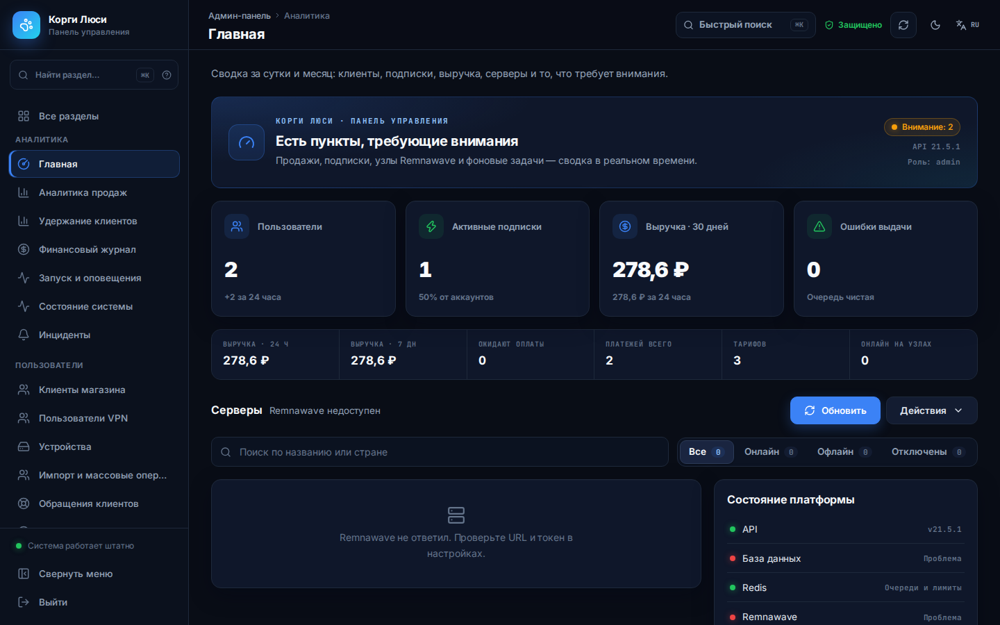

#  VPN Shop by Corgi Lucy

[Русский](README.md) · [English](README.en.md) · **Українська**

Магазин VPN-підписок на базі Remnawave. Клієнти купують доступ у Telegram, на сайті чи в застосунку. Власник керує магазином через Lucy Admin.

**[Застосунки](#завантажити-мобільні-застосунки)** · [Встановлення](#встановити-магазин) · [Відновлення](#оновлення-й-відновлення) · [Інтерфейси](#інтерфейси)

## Завантажити мобільні застосунки

### Android

| Що ви хочете зробити | Завантаження |
| --- | --- |
| **Магазин** · придбати чи продовжити підписку та під’єднатися | [Завантажити APK](https://github.com/booarkz-cpu/shop-by-boo/releases/latest/download/corgi-lusi-android.apk) · [SHA-256](https://github.com/booarkz-cpu/shop-by-boo/releases/latest/download/corgi-lusi-android.apk.sha256) |
| **Коргі Люсі: клієнт** · під’єднатися за наявним посиланням на підписку | [Завантажити APK](https://github.com/booarkz-cpu/shop-by-boo/releases/latest/download/corgi-lusi-client.apk) · [SHA-256](https://github.com/booarkz-cpu/shop-by-boo/releases/latest/download/corgi-lusi-client.apk.sha256) |
| **Lucy Admin** · керувати власним магазином | [Завантажити APK](https://github.com/booarkz-cpu/shop-by-boo/releases/latest/download/corgi-lusi-android-admin.apk) · [SHA-256](https://github.com/booarkz-cpu/shop-by-boo/releases/latest/download/corgi-lusi-android-admin.apk.sha256) |

Підписані APK для Android 8.0 і новіших версій. Посилання ведуть на останній стабільний випуск.

Відкрийте завантажений APK на телефоні й підтвердьте встановлення. Для перевірки в Linux збережіть обидва файли в одному каталозі й виконайте, наприклад, `sha256sum -c corgi-lusi-client.apk.sha256`.

### iOS

У [випуску v28.161.0](https://github.com/booarkz-cpu/shop-by-boo/releases/tag/v28.161.0) є дві збірки кожного застосунку. Файли IPA для iPhone та iPad опубліковано **без підпису**. Для встановлення на пристрій потрібні підпис Apple і відповідний профіль підготовки. ZIP містить застосунок для симулятора Xcode на Mac.

| Застосунок | Файли |
| --- | --- |
| **Магазин** | [IPA для пристрою](https://github.com/booarkz-cpu/shop-by-boo/releases/download/v28.161.0/corgi_lusi_ios_user_3_9_0_unsigned.ipa) · [SHA-256](https://github.com/booarkz-cpu/shop-by-boo/releases/download/v28.161.0/corgi_lusi_ios_user_3_9_0_unsigned.ipa.sha256)<br>[ZIP симулятора](https://github.com/booarkz-cpu/shop-by-boo/releases/download/v28.161.0/corgi_lusi_ios_user_3_9_0_simulator.zip) · [SHA-256](https://github.com/booarkz-cpu/shop-by-boo/releases/download/v28.161.0/corgi_lusi_ios_user_3_9_0_simulator.zip.sha256) |
| **Lucy Admin** | [IPA для пристрою](https://github.com/booarkz-cpu/shop-by-boo/releases/download/v28.161.0/corgi_lusi_ios_admin_3_9_0_unsigned.ipa) · [SHA-256](https://github.com/booarkz-cpu/shop-by-boo/releases/download/v28.161.0/corgi_lusi_ios_admin_3_9_0_unsigned.ipa.sha256)<br>[ZIP симулятора](https://github.com/booarkz-cpu/shop-by-boo/releases/download/v28.161.0/corgi_lusi_ios_admin_3_9_0_simulator.zip) · [SHA-256](https://github.com/booarkz-cpu/shop-by-boo/releases/download/v28.161.0/corgi_lusi_ios_admin_3_9_0_simulator.zip.sha256) |

На iPhone можна також відкрити в Safari особистий кабінет свого магазину. [Мобільні застосунки](docs/wiki/uk/Mobile.md) · [Відомості про підпис випуску](https://github.com/booarkz-cpu/shop-by-boo/releases/download/v28.161.0/mobile-production-status.json).

## Встановити магазин

Підготуйте VPS з Ubuntu 24.04 або Debian 12 і доступом root. Для збірки всіх образів орієнтуйтеся на 4 vCPU, 8 ГБ оперативної пам’яті та 40 ГБ диска. Спрямуйте DNS-записи вибраних імен на сервер. Інсталятор пропонує `api`, `admin`, `app`, `cabinet` і `support`. Для вебтрафіку й отримання сертифікатів відкрийте вхідні TCP-порти 80 і 443. [Налаштування DNS](docs/wiki/uk/Domains.md).

### Перше підключення через SSH

Відкрийте термінал і вкажіть IP свого VPS замість адреси з прикладу. На Android можна підключитися через Termux із пакетом `openssh`. [Інструкція для Termux російською](docs/ru/new/TERMUX_GUIDE.md).

```bash
ssh root@203.0.113.10
```

Під час першого входу перевірте ключ сервера. Відкрийте консоль цього VPS у панелі хостингу й виведіть там відбитки відкритих ключів.

```bash
for key in /etc/ssh/ssh_host_*_key.pub; do
  ssh-keygen -l -E sha256 -f "$key"
done
```

Зіставте відбиток SHA256 для того самого типу ключа з відбитком у вікні SSH. Якщо вони збігаються, введіть `yes`. Якщо відрізняються, натисніть Ctrl+C і перевірте адресу та відбиток у консолі хостингу.

### Встановлення стабільного випуску

Виконайте команду на VPS від імені root. Інсталятор налаштує Docker Compose, запитає домени й облікові дані та покаже адресу й дані для першого входу.

```bash
curl -fsSL https://raw.githubusercontent.com/booarkz-cpu/shop-by-boo/v28.161.0/install.sh -o /root/shop-install.sh &&
  BRANCH=v28.161.0 bash /root/shop-install.sh
```

Перевірте API, панель адміністратора, Mini App і кабінет покупця.

```bash
cd /opt/vpn-shop && bash scripts/doctor.sh
```

Увійдіть у Lucy Admin за вказаною адресою, увімкніть двофакторну автентифікацію та створіть тариф. Для надання доступу підключіть панель Remnawave й виберіть Internal Squad. Для приймання оплати налаштуйте провайдера й укажіть адресу сповіщень. [Встановлення](docs/wiki/uk/Installation.md) · [Remnawave](docs/wiki/uk/Remnawave.md) · [Платежі](docs/wiki/uk/Payments.md).

## Оновлення й відновлення

**Перед оновленням** заплануйте час на обслуговування. У стандартній інсталяції наведена команда створює повну зашифровану копію. На час копіювання скрипт призупиняє служби, які записують дані.

```bash
cd /opt/vpn-shop && sudo bash scripts/backup.sh
```

Збережіть `.vpb` і його файл `.sha256` поза сервером, а пароль — окремо. Запишіть тег і повний ідентифікатор коміту встановленої версії або SHA-256 інсталяційного архіву. Потім запустіть оновлення до вибраного опублікованого тегу.

```bash
cd /opt/vpn-shop && sudo env RELEASE_TAG=v28.161.0 bash scripts/update-from-github.sh
```

**Для відновлення** підготуйте окремий сервер тієї ж версії з порожніми томами. Звірте SHA-256, розшифруйте копію й перевірте файли за маніфестом. Відновіть оточення, базу магазину, базу Support Pro за її наявності та завантажені файли. Перед перемиканням трафіку перевірте підписки, вкладення, вхід адміністратора й `doctor.sh`. [Відновлення](docs/wiki/uk/Backup.md) · [Команди відновлення російською](docs/ru/BACKUP_CURRENT.md) · [Оновлення та відкат](docs/wiki/uk/Updates.md).

## Інтерфейси

| Кабінет покупця | Lucy Admin |
| --- | --- |
|  |  |
| Підписка, пристрої та платежі | Продажі, клієнти та звернення |

Вебінтерфейси показано на демонстраційних даних. [Галерея з підписами російською](screenshots/README.md) · [Екрани Android-клієнта](screenshots/client).

## Як влаштовано магазин

У стандартній інсталяції Caddy приймає HTTPS-запити та спрямовує їх до API й вебзастосунків. Магазин зберігає замовлення й підписки в PostgreSQL, використовує Redis для кешування й блокувань і звертається до API Remnawave для надання чи продовження доступу.

## Версії та документація

| Компонент | Випуск v28.161.0 | У гілці main |
| --- | --- | --- |
| Магазин і Lucy Admin · Android та iOS | 3.9.0 | 3.9.1 |
| Самостійний клієнт · Android | 1.10.1 | 1.10.2 |
| Backend · Python / PostgreSQL | 3.14 / 18.6 | 3.15 / 19.0 |

Версія runtime/API — `21.5.1`. Міграція бази магазину — `0094_store_subscriptions`, Support Pro — `0008`. Дистрибутив і застосунки мають окремі версії. [Маніфест випуску](https://github.com/booarkz-cpu/shop-by-boo/releases/download/v28.161.0/remnawave_vpn_shop_v28_161_0_full_release_manifest.json) · [Історія змін](CHANGELOG.md) · [Попередня редакція README](https://github.com/booarkz-cpu/shop-by-boo/blob/0bc4385ffbc1073f00cf47612b3b8ca96651b845/README.uk.md).

| Завдання | Матеріали |
| --- | --- |
| Розібратися в системі | [Архітектура](docs/architecture/README.md) · [Служби Docker, мережі й томи](docs/architecture/CONTAINER_DIAGRAM.md) (російською) |
| Налаштувати обслуговування клієнтів | [Telegram і Mini App](docs/wiki/uk/Telegram.md) · [Адмінпанель](docs/wiki/uk/Admin.md) |
| Знайти причину збою чи перевірити захист | [Діагностика](docs/wiki/uk/Troubleshooting.md) · [Безпека](docs/wiki/uk/Security.md) · [Повідомити про вразливість](SECURITY.md) |
| Знайти інструкцію чи перевірити готовність | [Посібники українською](docs/uk/guides/README.md) · [Критерії готовності російською](docs/ru/MATRIX_COMPLETION_21_5_1.md) |

Умови використання й поширення визначає [Corgi Lusi VPN Shop Source License 2.9](LICENSE). [Сторонні компоненти та ліцензії](THIRD_PARTY_NOTICES.md).

Код і документацію опубліковано для вивчення й демонстрації. Оператор відповідає за безпеку сервера, дані клієнтів і дотримання місцевого законодавства.
