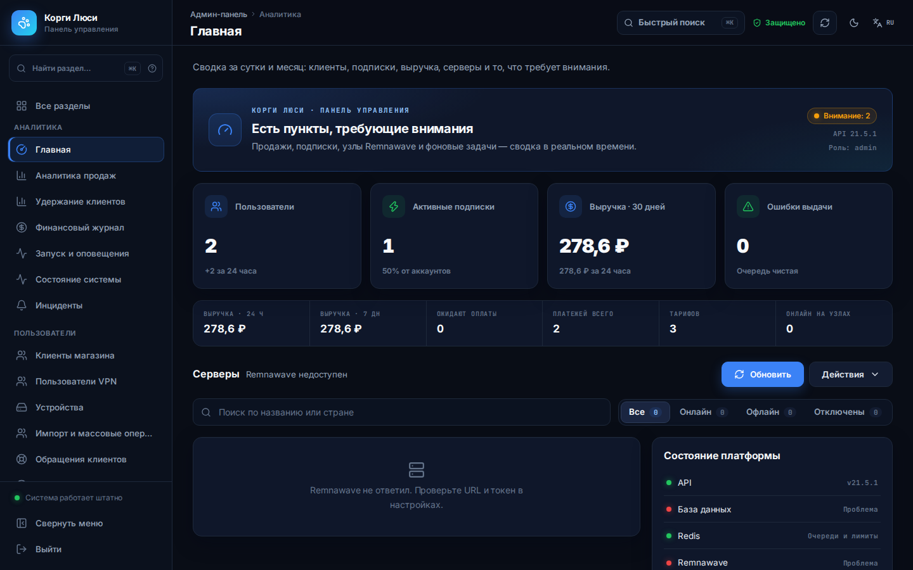
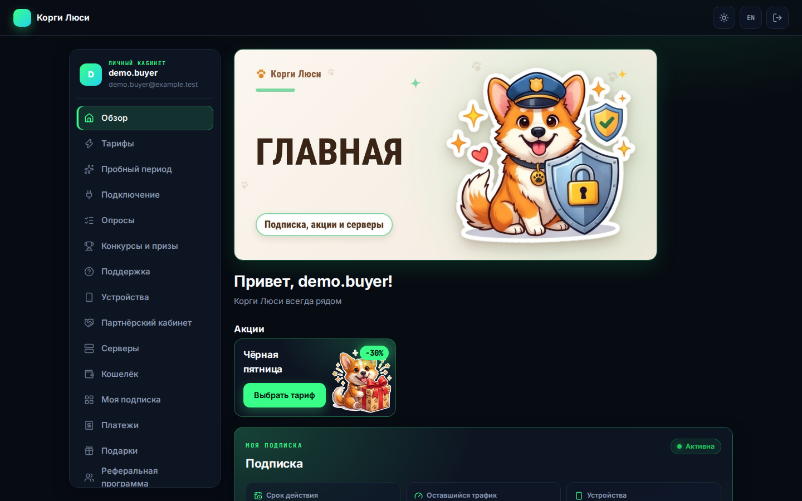
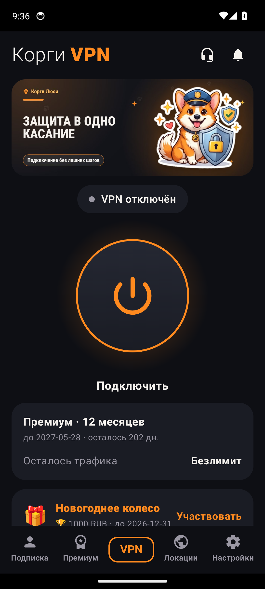
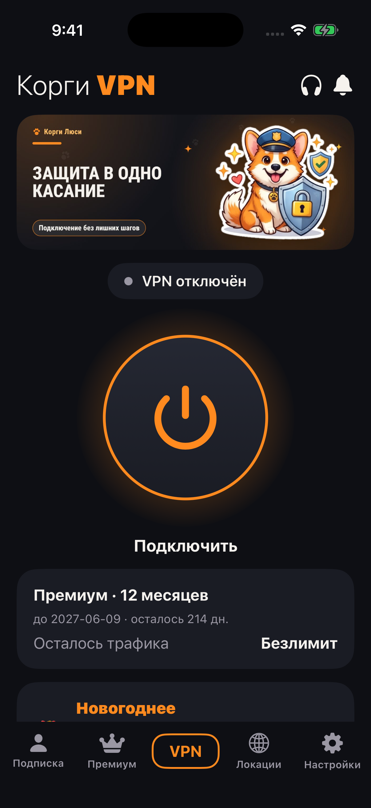

# Корги Люсі — магазин VPN-підписок на Remnawave

[Русский](README.md) · [English](README.en.md) · **Українська**

> [!WARNING]
> ‼️ **Проєкт створено лише в ознайомчих цілях.** ‼️
> Код і документацію опубліковано для вивчення та демонстрації. Використовуючи їх, ви самі відповідаєте за дотримання законів своєї країни, за безпеку серверів і даних клієнтів. Автор не дає гарантій і не відповідає за наслідки використання.


> **v28.93.0** — поточний стабільний випуск. Runtime/API `21.5.1`, міграція магазину `0094_store_subscriptions`.

**Що це.** Магазин продає VPN-підписки й видає доступ у вашій панелі Remnawave. Він:
- приймає оплату (СБП, картка, крипта, Telegram Stars);
- подовжує підписки, рахує трафік і пристрої;
- працює через Telegram-бота, Mini App, вебкабінет і застосунки Android та iOS.

Усім керують з однієї адмінки, зокрема встановленням Remnawave і нод на ваших серверах.

| | |
| --- | --- |
|  |  |
|  |  |

## З чого почати

**Завантажити для Android (підписано ключем магазину):** [клієнт — APK](https://github.com/booarkz-cpu/shop-by-boo/releases/latest/download/corgi-lusi-android.apk) · [«Коргі Люсі: клієнт» — VPN для будь-яких підписок, APK](https://github.com/booarkz-cpu/shop-by-boo/releases/latest/download/corgi-lusi-client.apk) · [адмінка — APK](https://github.com/booarkz-cpu/shop-by-boo/releases/latest/download/corgi-lusi-android-admin.apk). Посилання завжди ведуть на останній випуск.

| Завдання | Документ |
| --- | --- |
| Встановити Remnawave і налаштувати домени | [Посібник власника](docs/uk/OWNER_SETUP_GUIDE.md) |
| Розгорнути магазин | [Розгортання](docs/uk/DEPLOYMENT.md) |
| Платежі | [Платежі](docs/uk/PAYMENTS.md) |
| Уся документація | [Документація](docs/uk/DOCUMENTATION.md) · [Wiki](docs/wiki/uk/Home.md) |
| Що змінилося | [CHANGELOG](CHANGELOG.md) (російською) |

Докладні посібники українською — [встановлення, адмінпанель, Remnawave, Android-застосунки](docs/uk/guides/README.md). Повний набір російською: [DOCUMENTATION_RU](DOCUMENTATION_RU.md).

## 🐣 Для новачка: від порожнього сервера до першого продажу

Десять кроків. Нічого не треба вміти заздалегідь: де потрібна команда — її дано повністю, де потрібна кнопка — сказано, в якому розділі адмінки вона є. На кожному кроці — що має вийти; якщо не вийшло, там же сказано, куди дивитися.

<details>
<summary><b>Крок 1. Купіть сервер і домен</b></summary>

- **Сервер магазину (VDS):** Ubuntu 24.04 або Debian 12, 4 ядра, 8 ГБ пам'яті, 40 ГБ диска. Підійде будь-який хостинг.
- **Домен:** будь-який, наприклад `myvpn.com`. У реєстратора створіть п'ять записів **A** на IP сервера: `api`, `admin`, `app`, `cabinet`, `support`.
- **Має вийти:** `ping api.myvpn.com` на вашому комп'ютері показує IP сервера. DNS іноді оновлюється до години — це нормально.
</details>

<details>
<summary><b>Крок 2. Створіть Telegram-бота</b></summary>

- Напишіть [@BotFather](https://t.me/BotFather) команду `/newbot`, придумайте ім'я та адресу.
- BotFather надішле **токен** виду `123456:ABC…` — збережіть його для кроку 3 і нікому не пересилайте.
</details>

<details>
<summary><b>Крок 3. Встановіть магазин однією командою</b></summary>

Підключіться до сервера (Windows — PowerShell, macOS і Linux — Термінал): `ssh root@IP_СЕРВЕРА`. Потім:

```bash
curl -fsSL https://raw.githubusercontent.com/booarkz-cpu/shop-by-boo/v28.93.0/install.sh -o /root/shop-install.sh \
  && BRANCH=v28.93.0 bash /root/shop-install.sh
```

Інсталятор запитає домен, токен бота й ціни, сам поставить Docker, створить випадкові паролі та запустить усе (5–15 хвилин).

- **Має вийти:** наприкінці інсталятор пише адресу адмінки й логін; `bash /opt/vpn-shop/scripts/doctor.sh` показує зелені рядки.
</details>

<details>
<summary><b>Крок 4. Увійдіть в адмінку та ввімкніть 2FA</b></summary>

- Відкрийте `https://admin.ВАШ_ДОМЕН`, увійдіть логіном із кроку 3.
- **«Безопасность → Защита и 2FA»:** увімкніть двофакторний захист (застосунок-автентифікатор або passkey). Без нього небезпечні дії (видалення, завантаження копій) не виконуються.
</details>

<details>
<summary><b>Крок 5. Поставте VPN-панель і першу ноду — без консолі</b></summary>

- **«Серверы → Установка Remnawave» → «Добавить сервер»:** IP вашого VPN-сервера та SSH-ключ або пароль. Магазин перевірить сервер.
- У майстрі оберіть «Панель и нода на одном сервере», впишіть домен панелі (`panel.ВАШ_ДОМЕН`, запис A — на цей сервер). «Составить план» → прочитайте кроки → «Запустить».
- **Має вийти:** усі кроки зелені, магазин сам підключився до панелі. Якщо крок упав — зміни відкотилися, причина — в журналі.
</details>

<details>
<summary><b>Крок 6. Сховайте ноду під звичайний сайт (SelfSteal)</b></summary>

- Під час додавання ноди впишіть **домен ноди** (`node1.ВАШ_ДОМЕН`) і оберіть шаблон сайту — або пізніше в **«Серверы → SelfSteal» → «Сменить сайт»**.
- **«Проверить»** у тому ж розділі дивиться на ноду очима стороннього: 11 пунктів. Мета — «в порядке».
- **«Серверы → Установка»:** усі протоколи на одній ноді, порт ноди тільки для панелі, захист ноди — по кнопці, з планом і відкатом.
</details>

<details>
<summary><b>Крок 7. Підключіть оплату</b></summary>

- **«Тарифы и оплата → Платёжные агенты»:** оберіть касу (ЮKassa, CryptoBot, Telegram Stars та інші), вставте ключі, натисніть «Проверить».
- Перевірте покупку самі: у боті `/start` → «Купить» → тестова картка каси.
</details>

<details>
<summary><b>Крок 8. Налаштуйте тарифи</b></summary>

- **«Тарифы и оплата → Тарифы»:** строк, ціна, трафік, кількість пристроїв; пробний період — там же.
- **«Бот и кабинет»:** тексти, кнопки меню, банери — усе без перезапуску.
</details>

<details>
<summary><b>Крок 9. Увімкніть копії</b></summary>

- **«Безопасность → Резервные копии»:** задайте пароль шифрування та ввімкніть копію в Telegram — база магазину щоночі прийде вам в особистий чат.
- **«Серверы → Установка» → знімки серверів:** «Каждый день» — база панелі та файли нод.
</details>

<details>
<summary><b>Крок 10. Оновлюйтеся однією кнопкою</b></summary>

- Магазин: **«Система → Обновления»** показує новий випуск; оновлення — по кнопці, перед ним знімається копія.
- Панель і ноди: **«Автообновление Remnawave»** у тому ж розділі — за розкладом, з копією та відкатом.
- Сторонні бібліотеки оновлює Dependabot: дрібні виправлення вливаються самі після зелених перевірок.
</details>

Застрягли? [Встановлення](docs/uk/guides/INSTALLATION.md) і [адмін-панель](docs/uk/guides/ADMIN_PANEL.md) — докладніше.

## Участь і безпека

[CONTRIBUTING](CONTRIBUTING.md) · [SECURITY](SECURITY.md) · [LICENSE](LICENSE) · [Сторонні компоненти](THIRD_PARTY_NOTICES.md)
