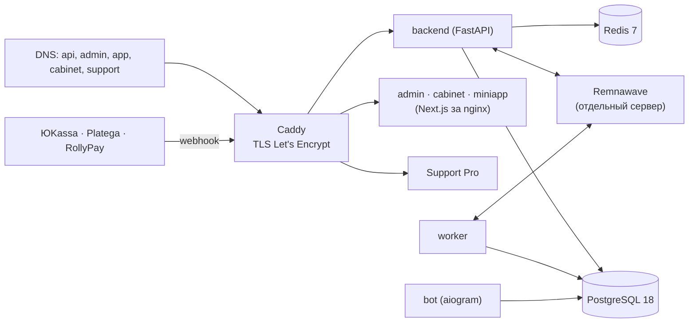

# Установка: от нуля до продакшена

Пошаговая инструкция для дистрибутива `v28.47.0` (runtime/API `21.5.1`, миграция магазина `0082_status_subscribers`, Support Pro `0008`). Она собирает в одном месте то, что подробно описано в [руководстве по запуску](ru/LAUNCH_GUIDE.md), [инструкции production](ru/PRODUCTION_CURRENT.md) и [30 инструкциях по модулям](ru/modules/README.md). Если что-то здесь расходится с ними, верны они.

## Содержание

1. [Что получится](#1-что-получится)
2. [Требования к серверу и что подготовить](#2-требования-к-серверу-и-что-подготовить)
3. [DNS и сеть](#3-dns-и-сеть)
4. [Установка одной командой](#4-установка-одной-командой)
5. [Файл .env](#5-файл-env)
6. [Миграции базы данных](#6-миграции-базы-данных)
7. [Проверка после установки](#7-проверка-после-установки)
8. [Первый вход и подключение сервисов](#8-первый-вход-и-подключение-сервисов)
9. [Обновления, автодеплой и откат](#9-обновления-автодеплой-и-откат)
10. [Мобильные приложения: Google Play и App Store](#10-мобильные-приложения-google-play-и-app-store)
11. [Решение проблем](#11-решение-проблем)

## 1. Что получится



Все сервисы работают в Docker Compose на одном сервере. Входящий трафик принимает только Caddy (80/443); базы, Redis и backend наружу не открыты. Панель Remnawave и VPN-узлы ставятся отдельно — магазин подключается к ним по API.

Reverse proxy — Caddy, а не Nginx: он сам получает и продлевает сертификаты. Внутри контейнеров админки, кабинета и Mini App работает nginx со статической сборкой.

## 2. Требования к серверу и что подготовить

| Что | Минимум |
| --- | --- |
| ОС | Ubuntu 24.04 или Debian 12, чистый сервер |
| Ресурсы | 4 vCPU, 8 ГБ RAM, 40 ГБ диска (ориентир для сборки всех образов, не нагрузочный тест) |
| Доступ | root или sudo по SSH, консоль хостера на случай ошибки firewall |
| Сеть | свободные TCP 80 и 443, исходящий доступ к apt, GitHub и Docker Hub |

Заранее подготовьте:

- домен и доступ к его DNS;
- **Telegram-бот**: токен от [@BotFather](https://t.me/BotFather), имя бота, ваш Telegram ID (для команды `/ops`);
- **Remnawave**: HTTPS-адрес панели и API-токен (Remnawave → API Tokens);
- **платёжный агент** (по желанию сразу): ЮKassa (shop id и секретный ключ), Platega или RollyPay;
- **почту для писем** (по желанию): SMTP-сервер, логин и пароль;
- почту для сертификатов Let's Encrypt.

## 3. DNS и сеть

Для домена `vpn.example.com` создайте A-записи на IPv4 сервера:

| Запись | Что там |
| --- | --- |
| `api.vpn.example.com` | API, webhook платёжных агентов, адреса возврата в приложения |
| `admin.vpn.example.com` | Админ-панель |
| `cabinet.vpn.example.com` | Личный кабинет |
| `app.vpn.example.com` | Telegram Mini App |
| `support.vpn.example.com` | Support Pro |

AAAA добавляйте только если IPv6 действительно ведёт на этот сервер. В firewall хостера откройте SSH, 80 и 443. Не открывайте 5432 (PostgreSQL), 6379 (Redis), 8000 (backend).

Проверка: `dig +short api.vpn.example.com` должен вернуть IP сервера.

## 4. Установка одной командой

```bash
curl -fsSL https://raw.githubusercontent.com/booarkz-cpu/shop-by-boo/v28.47.0/install.sh -o /root/shop-install.sh \
  && BRANCH=v28.47.0 bash /root/shop-install.sh
```

Что делает установщик (`install.sh` → `deploy/install-vps.sh`):

1. Ставит Docker и Compose, настраивает firewall и системные параметры.
2. Скачивает дистрибутив точного тега в `/opt/vpn-shop`.
3. Спрашивает домены, токены бота и Remnawave, цены стартовых тарифов, ключи платёжных агентов (любой вопрос можно пропустить Enter и заполнить позже в админке).
4. Создаёт `.env` и `support-pro/.env` со случайными секретами (права `600`).
5. Собирает образы (`scripts/compose-build.sh`: образ backend собирается один раз и используется backend, worker и mail_receiver) и запускает сервисы.
6. Ждёт, пока backend станет здоровым, и печатает адреса и данные первого входа.

Ручная установка без установщика:

```bash
git clone --branch v28.47.0 https://github.com/booarkz-cpu/shop-by-boo.git /opt/vpn-shop
cd /opt/vpn-shop
cp .env.example .env            # заполните (раздел 5)
python3 scripts/harden-env.py   # сгенерирует недостающие секреты (значения не печатаются)
bash scripts/preflight.sh       # проверит окружение до сборки
bash scripts/compose-build.sh fresh
docker compose up -d
```

Локальный стенд без касс, Telegram и Remnawave: `bash scripts/test-up.sh`.

## 5. Файл .env

Полный список с комментариями — [`.env.example`](../.env.example). Большинство операционных параметров потом меняются без перезапуска в «Система → Настройки без перезапуска» ([реестр](ru/RUNTIME_SETTINGS_CURRENT.md)).

| Группа | Переменные | Обязательно |
| --- | --- | --- |
| Ядро | `APP_ENV=production`, `APP_SECRET` (≥ 32 символа, `openssl rand -hex 32`), `TZ`, `DEFAULT_LANGUAGE` | да |
| База | `DB_USER`, `DB_NAME`, `DB_PASSWORD`, `POSTGRES_*`, `DATABASE_URL` | да (заполняет установщик) |
| Redis | `REDIS_PASSWORD`, `REDIS_URL` | да |
| Домены | `API_DOMAIN`, `ADMIN_DOMAIN`, `APP_DOMAIN`, `CABINET_DOMAIN`, `SUPPORT_PRO_DOMAIN`, `CADDY_EMAIL` | да |
| Адреса | `PUBLIC_BASE_URL`, `MINI_APP_URL`, `CABINET_URL` | да |
| Администратор | `ADMIN_EMAIL`, `ADMIN_PASSWORD` (создаётся при первом запуске) | да |
| Telegram | `BOT_TOKEN`, `BOT_USERNAME`, `ADMIN_TELEGRAM_ID`, `REQUIRED_TELEGRAM_CHANNEL` | да / по желанию |
| Remnawave | `REMNAWAVE_URL`, `REMNAWAVE_TOKEN`, `REMNAWAVE_WEBHOOK_SECRET` | да / по желанию |
| Платежи | `YOOKASSA_SHOP_ID`, `YOOKASSA_SECRET_KEY`, `YOOKASSA_WEBHOOK_IP_ALLOWLIST`, `PLATEGA_*`, `ROLLYPAY_*` | хотя бы один для продаж |
| Почта | `SMTP_HOST`, `SMTP_PORT`, `SMTP_USER`, `SMTP_PASSWORD`, `SMTP_FROM` | для писем |
| Оповещения | `ALERT_TELEGRAM_CHAT_ID`, `ALERT_EMAIL` | рекомендуется |
| Вход через сервисы | `YANDEX_*`, `VK_*`, `GOOGLE_CLIENT_ID`, `GOOGLE_CLIENT_SECRET`, `GOOGLE_REDIRECT_URI` | по желанию |
| Push в приложения | `FCM_PROJECT_ID`, `FCM_SERVICE_ACCOUNT_JSON`, `APNS_KEY_ID`, `APNS_TEAM_ID`, `APNS_BUNDLE_ID`, `APNS_PRIVATE_KEY`, `APNS_ENVIRONMENT` | для push |
| Приложения | `MOBILE_APP_SCHEME` (по умолчанию `corgi`), `MOBILE_INTEGRITY_MODE` (`off`, `report`, `enforce`), `DEVICECHECK_*` | по желанию |
| Резерв платежей | `CRYPTOBOT_TOKEN` (Crypto Pay API), `CRYPTOBOT_NETWORK` (`mainnet`/`testnet`) — принимает заказы, пока основной шлюз в остывании после сбоев | рекомендуется |
| Резерв: Freekassa | `FREEKASSA_SHOP_ID`, `FREEKASSA_SECRET1`, `FREEKASSA_SECRET2`, `FREEKASSA_API_KEY` (можно задать и в админке); URL оповещения в кабинете Freekassa — `https://api.vpn.example.com/api/webhooks/freekassa` | по желанию |
| ИИ-поддержка | `SUPPORT_AI_URL` (полный адрес эндпоинта модели), `SUPPORT_AI_KEY`, `SUPPORT_AI_MODEL` | по желанию |
| Обновление без простоя | `BACKEND_STANDBY_INGRESS_IP` (по умолчанию `172.30.84.5`, внутри `INGRESS_SUBNET`) | нет |

Чеки в налоговую («Мой налог», АТОЛ Онлайн, ЮKassa) настраиваются не в `.env`, а в админке: «Тарифы и оплата → Чеки в налоговую». Пароли там хранятся зашифрованными.

Никогда не коммитьте `.env`, дампы и ключи. После правки `.env`: `docker compose up -d` (сервисы перечитают окружение).

## 6. Миграции базы данных

Миграции применяются сами: каждый запуск контейнера backend выполняет `alembic upgrade head` до старта API (`backend/entrypoint.sh`). Проверить текущую версию схемы:

```bash
docker compose exec -T backend alembic current     # ожидается 0082_status_subscribers (head)
docker compose exec -T backend alembic heads
```

Миграция `0082_status_subscribers` добавляет источник привлечения клиента (`users.acquisition_source`), `0078_campaign_ab` — расписание и A/B-варианты push-кампаний. Откат маркетинговых миграций (`alembic downgrade 0077_app_growth`) удаляет только маркетинговую статистику; откаты миграций с деньгами и историей защищены и отказываются работать при наличии данных. Support Pro применяет свои миграции командой `python -m app.migrate` в своём контейнере (head `0008`).

Переход на PostgreSQL 18 со старых установок выполняет `scripts/upgrade-postgres.sh` при обновлении: дамп старой базы, восстановление в PostgreSQL 18, сверка строк; старый том остаётся для отката.

## 7. Проверка после установки

```bash
cd /opt/vpn-shop
docker compose ps                            # все сервисы running / healthy
curl -fsS https://api.vpn.example.com/health/ready
bash scripts/doctor.sh                       # здоровье API и ответы админки, кабинета и Mini App
```

Откройте `https://admin.vpn.example.com`, войдите данными из конца установки и сразу включите 2FA («Безопасность»).

## 8. Первый вход и подключение сервисов

Порядок — по [руководству по запуску](ru/LAUNCH_GUIDE.md):

1. **Remnawave**: проверьте подключение в «Узлы», выберите профиль (Internal Squad) для тарифов.
2. **Тарифы**: стартовые тарифы создаются выключенными — проверьте цены, сроки, трафик и устройства и включите.
3. **Бот и Mini App**: в BotFather укажите Mini App `https://app.vpn.example.com`; проверьте `/start`.
4. **Платежи**: адреса уведомлений у агентов — `https://api.vpn.example.com/api/webhooks/yookassa`, `…/platega`, `…/rollypay`. В ЮKassa включите события `payment.succeeded` и `refund.succeeded`. Проверьте тестовую покупку ([живая проверка касс](ru/PAYMENTS_LIVE_CHECKLIST.md)).
5. **Чеки** (если нужны): «Тарифы и оплата → Чеки в налоговую» → способ, ИНН, «Проверить подключение».
6. **Почта, поддержка, резервные копии, оповещения** — шаги 10–15 руководства.

## 9. Обновления, автодеплой и откат

**Ручное обновление** на новый тег:

```bash
bash /opt/vpn-shop/scripts/backup.sh
sudo env APP_DIR=/opt/vpn-shop RELEASE_TAG=v28.47.0 bash /opt/vpn-shop/scripts/update-from-github.sh
```

Скрипт скачивает архив выпуска, сверяет SHA-256 и манифест, делает копию, собирает образы, применяет миграции и проверяет здоровье ([регламент](ru/DISTRIBUTION_UPGRADE_CURRENT.md)).

**Автообновление с сервера (рекомендуется, без секретов).** Установщик спрашивает «Включить автообновление» (по умолчанию — да) и ставит агент: systemd-таймер `vpn-shop-update` проверяет GitHub каждую ночь в 03:00 по Москве (±15 минут) и запускает то же `update-from-github.sh`, а таймер `vpn-shop-update-agent` раз в минуту читает команды админ-панели. Сервер сам обращается к GitHub, поэтому SSH-ключи и секреты GitHub не нужны.

- Управление — **админ-панель → Выпуски → Автообновление**: включить или выключить, время проверки, «Проверить и обновить сейчас», установленная и последняя версии, итог и журнал последнего запуска. Смотреть может оператор, менять — только администратор; каждое действие пишется в журнал аудита.
- Панель и агент обмениваются файлами в `/opt/vpn-shop/.control` (в контейнере `/data/control`); backend не выполняет команд на сервере.
- Выпуск, который не установился (откат выполнен автоматически), ночью повторно не ставится; «Обновить сейчас» пробует снова. В режиме восстановления (`.rollback/RECOVERY_MODE`) автообновление останавливается до ручной проверки.
- Итог приходит в Telegram (`ALERT_TELEGRAM_CHAT_ID`, иначе `ADMIN_TELEGRAM_ID`). Хранятся 5 последних снимков.
- Сервер, установленный раньше, получает агент сам при обновлении до v28.34.0 и новее (сборка `deploy/build-production.sh` вызывает `auto_update.py ensure`); выключенное автообновление остаётся выключенным. Вручную: `sudo bash /opt/vpn-shop/scripts/auto-update.sh install`, а также `status`, `run` (обновить сейчас) и `disable`.

**Из GitHub Actions** (альтернатива: push-деплой по SSH) («Corgi Lusi Production Deploy»). Workflow подключается к серверу по SSH и запускает то же обновление. Настройка:

1. На сервере: `sudo bash /opt/vpn-shop/scripts/setup-auto-deploy.sh`. Скрипт создаст отдельный ключ `/root/.ssh/github_deploy`, разрешит его для root и напечатает значения секретов.
2. В GitHub: **Settings → Environments → production** (создайте окружение, если его нет) → **Environment secrets → Add environment secret**:

   | Секрет | Значение |
   | --- | --- |
   | `DEPLOY_HOST` | IP-адрес или домен сервера |
   | `DEPLOY_USER` | `root` |
   | `DEPLOY_SSH_KEY` | приватный ключ целиком, от `-----BEGIN` до `-----END … KEY-----` |
   | `DEPLOY_PATH` | `/opt/vpn-shop` |
   | `DEPLOY_PORT` | только если SSH не на 22 |

3. Проверка: **Actions → Corgi Lusi Production Deploy → Run workflow** с тегом текущего выпуска. Первым шагом workflow проверяет, что все секреты заданы, и называет недостающие.

Отозвать доступ: удалите строку `github-deploy@…` из `/root/.ssh/authorized_keys`.

**Автодеплой**: переменная репозитория `AUTO_DEPLOY=true` (Settings → Secrets and variables → Actions → Variables). Тогда каждый новый стабильный выпуск, опубликованный после зелёного CI на `main`, ставится на сервер автоматически тем же путём. Если окружению `production` назначен обязательный проверяющий, деплой ждёт его одобрения. Если секреты `DEPLOY_*` не заданы, автоматический запуск пропускается с пояснением (выпуск поставит агент на сервере); ручной запуск называет недостающие секреты и завершается ошибкой.

**Без простоя.** Любое обновление сначала запускает новую версию backend рядом со старой (`backend_standby`) и заменяет старую, только когда новая ответила `200` на `/health/ready`; Caddy на это время отправляет запросы в standby. Сломанный выпуск работающий backend не трогает. Подробно — [zero_downtime.md](modules/zero_downtime.md); выключить — `ZERO_DOWNTIME=0`.

**Откат**: `bash scripts/rollback.sh` — возвращает архив предыдущего выпуска и снимок базы из `.rollback/`, которые сохраняет обновление; без снимка базы откат отказывается работать.

## 10. Мобильные приложения: Google Play и App Store

Готовых подписанных приложений в выпуске нет: вы собираете их своими ключами. Подробно — [модуль 16](ru/modules/16-mobile-apps.md) и [публикация в сторах](ru/STORE_PUBLISHING.md).

**Сборка в GitHub Actions.** Локально собирать не нужно:

- «Mobile packages» проверяет сборку на каждом pull request;
- «Build mobile apps for a release» (`.github/workflows/build-mobile.yml`) после публикации выпуска на `main` (или вручную для любого тега) собирает APK и AAB обоих Android-приложений и неподписанный IPA плюс сборку для симулятора iOS и прикладывает их к странице выпуска на GitHub (**Releases**). С секретами из таблицы ниже пакеты подписаны и добавляется подписанный IPA; без них — неподписанные, для подписи позже.

| Секрет | Для чего |
| --- | --- |
| `ANDROID_KEYSTORE_BASE64`, `ANDROID_KEYSTORE_PASSWORD`, `ANDROID_KEY_ALIAS`, `ANDROID_KEY_PASSWORD` | Подпись Android (APK и AAB для Google Play) |
| `IOS_CERTIFICATE_BASE64`, `IOS_CERTIFICATE_PASSWORD`, `IOS_TEAM_ID` | Сертификат распространения Apple |
| `IOS_USER_PROFILE_BASE64`, `IOS_ADMIN_PROFILE_BASE64` | Профили клиентского и админского приложений |
| `IOS_USER_TUNNEL_PROFILE_BASE64` | Встроенный VPN на iOS (App ID `shop.remnawave.user.tunnel`) — по желанию |
| `IOS_USER_PUSH_PROFILE_BASE64` | Push с картинками на iOS (App ID `shop.remnawave.user.push`) — по желанию |

**Google Play Console**: создайте приложение с пакетом `shop.remnawave.user`, включите Play App Signing, загрузите AAB во внутреннее тестирование. Отпечаток ключа подписи Google укажите в `ANDROID_USER_CERT_SHA256` магазина (ключи доступа и Play Integrity). Тексты и скриншоты — `mobile/store/`. В анкете «Данные безопасности» укажите анонимную аналитику (её можно выключить в админке).

**Apple Developer**:

1. Identifiers: App ID `shop.remnawave.user` с Push Notifications и Associated Domains (`webcredentials:cabinet.ДОМЕН`).
2. Для встроенного VPN: запросите у Apple Network Extension для команды; App ID `shop.remnawave.user.tunnel` (Network Extension → Packet Tunnel Provider) и App Group `group.shop.remnawave.user` у обоих App ID.
3. Для push с картинками: App ID `shop.remnawave.user.push`.
4. Профили распространения для каждого App ID → секреты из таблицы выше. Workflow сам встроит расширения (`scripts/ios/enable-extensions.py`) и подпишет каждое своим профилем.
5. Ключ APNs (`.p8`) → `APNS_*` в `.env` магазина.

Адрес магазина можно вшить в сборку (`corgi.shop_url` / `CORGI_SHOP_URL`), тогда клиенту не нужно его вводить.

**Монитор блокировок.** Поставьте пробу на любой сервер в регионе клиентов (например, недорогой VPS в России): «Серверы → Монитор блокировок → Добавить пробу» покажет одну команду установки. Магазин сам заметит блокировку домена или ноды и среагирует ([anti_blocking.md](modules/anti_blocking.md#монитор-блокировок)).

**Прослойка подписки (зеркало).** Если домен подписки панели плохо открывается у клиентов, заведите домен зеркала (A-запись на сервер магазина), укажите его в `SUB_PROXY_DOMAINS` в `.env` и перезапустите Caddy (`docker compose up -d caddy`), затем включите «Серверы → Прослойка подписки» и задайте «Адрес зеркала» `https://<домен>`. Без своего домена зеркало работает по адресу `https://<API_DOMAIN>/sub/<shortUuid>`. Подробно — [subscription_proxy.md](modules/subscription_proxy.md).

**Резервные адреса API (защита от блокировок).** В «Приложения → Резервные адреса API и сайты напрямую» укажите запасные домены API (каждый — ещё одна A-запись на этот же сервер; перечислите их в `API_MIRROR_DOMAINS` в `.env`, Caddy сам выпустит для них сертификаты) и, по желанию, ID GitHub Gist и токен GitHub с правом `gist`. Магазин подписывает список своим ключом и сам публикует его в Gist; приложения переходят на резервный адрес, если основной недоступен. Подробно — [anti_blocking.md](modules/anti_blocking.md).

## 11. Решение проблем

| Симптом | Где смотреть | Что делать |
| --- | --- | --- |
| Сертификат не выпускается | `docker compose logs caddy` | Проверьте A-записи, открытые 80/443, что домен не за чужим прокси |
| `/health/ready` не отвечает | `docker compose logs backend` | Ошибка в `.env` или миграции; `bash scripts/preflight.sh` проверит окружение |
| Миграция не применилась | `docker compose exec -T backend alembic current` | Перезапустите backend: `docker compose up -d backend`; ошибку покажет лог |
| Бот молчит | `docker compose logs bot` | Неверный `BOT_TOKEN` или запущен второй экземпляр бота с тем же токеном |
| Оплата прошла, доступа нет | «Платежи» в админке, `docker compose logs worker` | «Повторить» выдачу; новый счёт не создавайте ([модуль 7](ru/modules/07-payments.md)) |
| Remnawave недоступна | «Узлы», `docker compose logs worker` | Проверьте `REMNAWAVE_URL` и токен; после восстановления задания выдачи повторятся сами |
| Чек «сверяем с «Мой налог»» долго | «Чеки в налоговую» | Магазин ждёт ответ списка доходов; при длительном сбое ФНС проверьте чек в «Мой налог» вручную |
| Push не приходят | «Приложения: push» в админке | Проверьте `FCM_*`/`APNS_*`, что клиент включил push в приложении |
| VPN в приложении отключается в фоне (Android) | — | Подсказка в приложении: «Без ограничений батареи» и автозапуск |
| После оплаты в приложении открылся браузер | — | Приложение старой версии; обновите его. Страница `/api/app/paid` тоже ведёт в приложение по кнопке |
| Сборка на сервере заняла весь диск | `docker system df` | `docker builder prune` удаляет старый кэш сборки |
| Обновление: «the new release did not answer /health/ready» | `docker compose --profile standby logs backend_standby` | Новый выпуск не поднялся; работающий backend не тронут, откат выполнен. Причину покажет лог standby |
| Оплаты уходят в Freekassa или CryptoBot | Флаги функций в админке, `docker compose logs backend` | Основной шлюз трижды подряд не ответил и остывает 5 минут; проверьте его ключи и доступность |
| Нода упала | «Узлы → Мониторинг» | Магазин сам перезапускает ноду после 3 неудачных проверок и пишет в Telegram, если она недоступна дольше 10 минут |

Аварийная остановка продаж — «Безопасность → Восстановление → Аварийный режим → Включить» в админке ([модуль 2](ru/modules/02-health-incidents-monitoring.md)). Подробнее — [сбой и восстановление](ru/PRODUCTION_CURRENT.md#15-сбой-и-восстановление).
