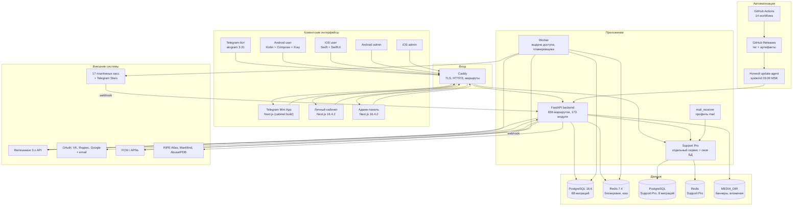
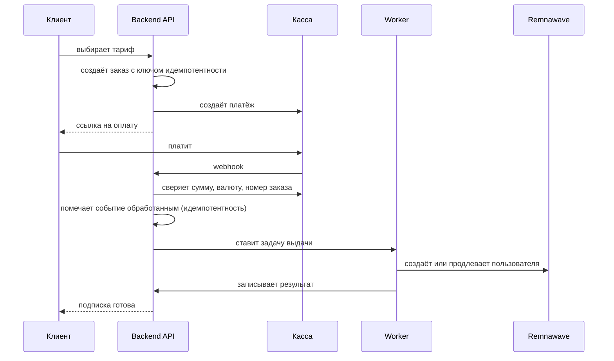
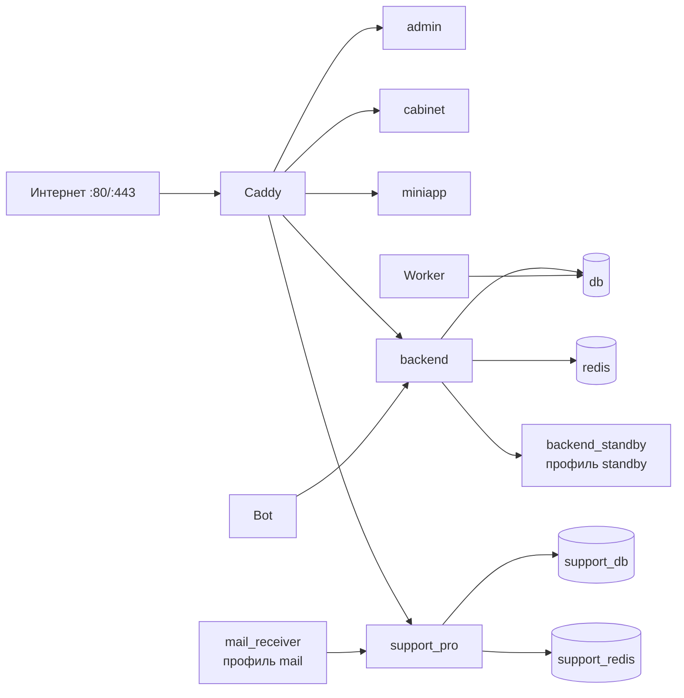
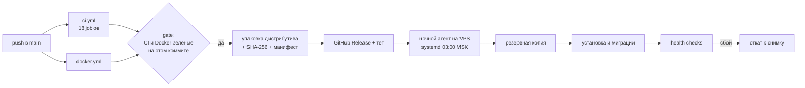

# Архитектура проекта — VPN Shop by Corgi Lucy

Дистрибутив `v28.57.0`, runtime/API `21.5.1`, миграция `0088_filter_and_regions`.
Схема построена по фактическому коду (`backend/app`, `docker-compose.yml`, таблица маршрутов),
а не по проектным описаниям.

## 1. Общая схема

## 2. Компоненты и их назначение

### Клиентские интерфейсы

| Компонент | Что делает | Где живёт |
| --- | --- | --- |
| Telegram-бот | вход, покупка, продление, поддержка, уведомления; меню и баннеры настраиваются в админке | `backend/app/bot.py` (860 строк) |
| Mini App | тот же кабинет внутри Telegram; вход по подписанному `initData` | сборка `cabinet`, отдаётся через `miniapp` |
| Личный кабинет | подписки, устройства, платежи, поддержка, рефералы | `cabinet/` (52 компонента) |
| Android / iOS user | встроенный VPN на Android (Xray-core), импорт подписки, push | `mobile/android-user`, `mobile/ios-user` |
| Android / iOS admin | админка в телефоне | `mobile/android-admin`, `mobile/ios-admin` |
| Админ-панель | 60 компонентов, 458 маршрутов API | `admin/` |

### Ядро

| Компонент | Роль | Ключевые файлы |
| --- | --- | --- |
| FastAPI backend | REST API, webhook, авторизация, RBAC | `main.py`, `security.py`, 173 модуля |
| Worker | выдача и продление доступа, планировщики, ретраи | `backend/worker.py`, `schedulers.py` |
| Support Pro | тикеты, переписка, автоответы, база знаний; отдельные БД и Redis | `support-pro/` (93 файла) |
| mail_receiver | приём почты служебных адресов (DMARC, обращения) | профиль `mail` |

### Данные

| Хранилище | Что держит | Особенности |
| --- | --- | --- |
| PostgreSQL 18.6 | клиенты, подписки, платежи, заказы, настройки | 88 миграций, head `0088_filter_and_regions` |
| Redis 7.4 | блокировки, идемпотентность, circuit breaker, кэш статусов | с паролем, отдельный инстанс для Support Pro |
| MEDIA_DIR | баннеры, аватары, вложения | том, не в git |

### Внешние системы

| Система | Назначение | Состояние проверки |
| --- | --- | --- |
| Remnawave 3.x | выдача доступа: срок, трафик, устройства, Internal Squad | код готов, живой прогон требует токена |
| 17 платёжных касс + Telegram Stars | приём денег | код готов, реальные платежи не проводились |
| OAuth (VK, Яндекс, Google) + email | вход | код готов, нужны client id/secret |
| FCM / APNs | push в приложения | код готов, нужны ключи |
| RIPE Atlas, MaxMind, AbuseIPDB | география, доступность, репутация | без ключей работают по умолчанию |

## 3. Путь оплаты — главный сценарий

Ключевые свойства, проверенные по коду:

* подписка **не** выдаётся по сообщению клиента — только после сверки с провайдером;
* повторный webhook не повторяет выдачу: событие захватывается атомарно
  (`INSERT … ON CONFLICT … RETURNING` в `register_provider_event`);
* выдача защищена блокировкой по пользователю, ретраи ограничены (`FULFILLMENT_MAX_ATTEMPTS=8`).

## 4. Разграничение доступа

| Контур | Как защищён |
| --- | --- |
| Публичные страницы | `/api/public/*` без сессии, только чтение |
| Клиент | сессия по cookie, вход через Telegram `initData`, email, OAuth, passkeys |
| Админ | сессия + роль; права проверяются `require_permission(...)` на каждом маршруте |
| Межсервисный | `/api/internal/*`, секрет Support Bridge |
| Webhook | подпись провайдера или allowlist IP (ЮKassa), HMAC, сверка суммы |
| Агент узла | `/api/agent/*`, токен узла |

Роли: `admin`, `operator`, `support`, `viewer`. Скрытие кнопки в браузере не является защитой —
сервер проверяет право отдельно на каждом административном маршруте.

## 5. Инфраструктура

17 сервисов; образы закреплены по digest. Профили: `standby` (горячий резерв backend),
`mail` (приём почты). Healthchecks у 9 сервисов, включая `backend`, `db`, `redis`, оба фронтенда,
`support_pro` и `caddy`.

## 6. CI/CD и обновления

Особенности, важные для понимания поведения:

* `publish-release.yml` публикует только при зелёных `ci.yml` **и** `docker.yml` на том же SHA;
* группы `concurrency` привязаны к коммиту (`ci-${ref}-${sha}`), поэтому перезапуск старого
  коммита больше не отменяет прогон нового;
* ночное обновление живёт на самом сервере (systemd), панель только пишет запрос и читает статус —
  отдельного сервера-планировщика нет;
* перед установкой создаётся снимок файлов и дамп базы; необратимая миграция останавливает
  автоустановку.

## 7. Связи, которые чаще всего ломаются

| Связь | Симптом при сбое | Что проверять |
| --- | --- | --- |
| Касса → webhook | платёж «оплачен», подписки нет | `WEBHOOK_BASE_URL`, доступность извне, журнал входящих |
| Backend → Remnawave | заказ оплачен, доступа нет | `REMNAWAVE_URL`, `REMNAWAVE_TOKEN`, Internal Squad тарифа |
| Caddy → backend | 502 на всех доменах | `docker compose ps`, `/health` |
| Frontend → API | пустые разделы, ошибки в консоли | `PUBLIC_BASE_URL`, `CABINET_CORS_ORIGINS` |
| Worker → БД | задачи не выполняются | `docker compose logs worker` |
| Support Pro → БД | тикеты не открываются | `support_db`, `support_migrate` |

## 8. Связанные документы

* [PROJECT_INVENTORY.md](PROJECT_INVENTORY.md) — что физически есть в репозитории;
* [TECH_STACK.md](TECH_STACK.md) — версии и назначение каждой зависимости;
* [REPOSITORY_AUDIT.md](REPOSITORY_AUDIT.md) — исследование внешних репозиториев;
* [PROJECT_MAP_RU.md](PROJECT_MAP_RU.md) — карта компонентов и границ;
* [PROJECT_FILE_MAP.md](PROJECT_FILE_MAP.md) — полный список файлов;
* [API_ENDPOINTS.md](API_ENDPOINTS.md) — каталог маршрутов;
* [MASTER_ROADMAP_VPN_SHOP.md](MASTER_ROADMAP_VPN_SHOP.md) — что сделано и что осталось.
