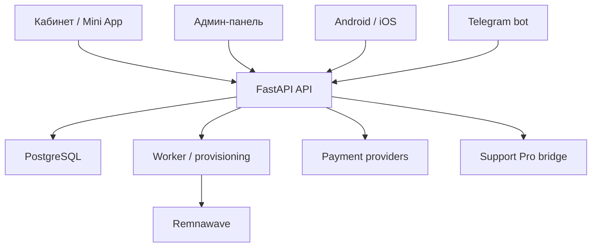

# Карта проекта Shop by Boo

Документ описывает актуальную структуру дистрибутива `v28.53.0` (runtime/API `21.5.1`, migration head `0087_speed_tests`) и границы компонентов. Карта не объявляет внешние платёжные, SMTP, VPN или mobile-signing проверки пройденными.

## Архитектура

## Каталоги

| Путь | Назначение | Вход для изменений |
| --- | --- | --- |
| `backend/app` | API, авторизация, платежи, подписки, support, админские операции | Добавляйте отдельный router/module; не расширяйте монолит без теста |
| `backend/alembic/versions` | Миграции PostgreSQL/SQLite | Только вперёд; downgrade финансовых миграций запрещён |
| `admin/src` | Админская SPA-панель | `main.tsx` — загрузка, feature-компоненты — отдельные файлы |
| `cabinet/src` | Клиентский кабинет и Mini App surface | Общие workspace-компоненты, API с cookie/CSRF |
| `miniapp/src` | Оболочка кабинета Telegram Mini App | Не дублировать бизнес-логику из `cabinet` |
| `mobile` | Android/iOS пользовательские и admin-клиенты | Подпись и публикация требуют ключей владельца |
| `desktop` | Контракты нативного WireGuard shell | Нативный engine не симулируется веб-кодом |
| `support-pro` | Изолированный сервис поддержки | SSO/bridge, отдельная миграция и backup |
| `docs` | Инструкции, матрица покрытия и архивы | Текущие документы должны ссылаться на release contract |
| `scripts` | Test/release/update/diagnostic automation | Скрипты не должны принимать секреты из URL |

## Функциональная карта

| Контур | Реализация | Основные файлы | Доказательство |
| --- | --- | --- | --- |
| Идентичности и безопасность | Telegram, email/password, OAuth, CSRF, sessions, TOTP, browser passkeys | `main.py`, `security.py`, `passkeys.py`, `customer_passkeys.py` | backend regression + HTTPS E2E |
| Коммерция | Plans, constructor, proration, traffic packages, gifts, wallet | `subscription_commerce.py`, `subscriptions.py`, `gift_orders.py` | unit/integration + provider E2E |
| Платежи | YooKassa, Platega, RollyPay, sandbox, refunds, reconciliation | `payments.py`, `payment_policy.py`, `refund_accounting.py`, `e2e_v2.py` | staging E2E v2 на стенде установки |
| Provisioning | Retry queue, absolute entitlements, Remnawave mapping | `provisioner.py`, `remnawave.py`, `subscriptions.py` | isolated VPN stand |
| Referrals/partners | Levels, snapshots, commissions, withdrawals | `referral_program.py`, `partners.py` | ledger/retry tests |
| Content/menus | Pages, legal revisions, promo audiences, nested bot/Mini App tree | `content_publishing.py`, `menu_tree.py`, `personal_offers.py` | UI E2E + publish preview |
| Support | Threads, attachments, merge/split, Support Pro mapping | `support_threads.py`, `support_bridge.py`, `support_topology.py` | replay/import/attachment tests |
| Operations | Backups, monitoring, audit, releases, bulk actions и live-config | `production_api.py`, `admin_customer_operations.py`, `runtime_settings.py` | CI + PostgreSQL race + clean restore drill |
| Native | Mobile auth/catalog/subscription selection and desktop contracts | `mobile_api.py`, `mobile_catalog.py`, `mobile/*`, `desktop/*` | owner-signed builds |

## Карта данных

- `User` — identity, wallet, referral and lifecycle.
- `Plan`, `TariffConstructor`, `TrafficPackage` — commercial catalogue.
- `Payment`, `FinancialLedger`, `RefundRequest` — immutable financial trail.
- `Subscription`, `EntitlementQuote`, `EntitlementOperation` — entitlement changes/retries.
- `SupportTicket`, `SupportMessage`, `SupportAttachment` — ordered support thread.
- `AuditLog`, `SecurityIncident`, `Notification` — operator evidence.
- `BackupJob`, `BackupVerification`, `ReleaseRecord` — operational lifecycle.
- `RuntimeSettingState`, `RuntimeSettingChange`, `AppSetting` — версия, зашифрованные staged-наборы, история и подтверждённые runtime overrides.

## Дизайн-карта

Админ-панель, кабинет и Mini App используют общую систему Remna Dark (Next.js, static export):

- глубокий тёмный фон `#090D16`, карточки `#0F172A` с тёмно-синими границами и ярко-синим акцентом основных действий;
- статусы — цветная точка или плашка с текстом (онлайн, требует внимания, ошибка);
- дашборд админки: плашка состояния, плитки 2×2 на телефоне и 4×1 на ПК, KPI-полоса, поиск и сегментированный фильтр;
- кабинет и Mini App: нижняя панель разделов на телефоне, выдвижное меню, интеграция Telegram WebApp SDK;
- светлая и тёмная темы без потери контраста;
- состояние показывается цветом и текстом, а не только цветом;
- `focus-visible` сохраняется для клавиатуры;
- sidebar превращается в drawer на узких экранах;
- таблицы прокручиваются горизонтально без обрезки действий;
- каждое редактируемое поле получает доступную контекстную подсказку;
- reduced-motion отключает декоративные переходы.

Дизайн реализован без дублирования бизнес-логики: `admin/src/theme.css`, оболочка `admin/src/admin-shell.tsx`, дашборд `admin/src/dashboard.tsx`, shadcn/Radix-компоненты `admin/src/components/ui/` и слой `cabinet/src/style.css` меняют интерфейс, а не API-контракты. Сборка выносит inline-скрипты Next.js в файлы (`cabinet/scripts/csp-externalize.mjs`), поэтому CSP `script-src 'self'` не ослаблена. Перенос истории — `backend/app/history_import.py`, миграция `0065_history_import`. Push-уведомления мобильных приложений — `backend/app/push.py` (реестр устройств, worker доставки FCM/APNs), миграция `0066_push_notifications`, `mobile/android-user/app/src/main/java/shop/remnawave/user/push/CorgiPush.kt`, `PushCenter` в `mobile/ios-user/VpnShopUser/VpnShopUserApp.swift`, карточка `admin/src/push-status.tsx`. Виджет Android — `backend/app/widget.py` (`GET /api/me/widget`) и `mobile/android-user/app/src/main/java/shop/remnawave/user/widget/CorgiWidget.kt`; профили админ-приложений — `mobile/android-admin/app/src/main/java/shop/remnawave/admin/AdminProfiles.kt` и `ProfileVault` в `mobile/ios-admin/VpnShopAdmin/VpnShopAdminApp.swift`. Email-канал поддержки — `support-pro/app/email_channel.py` (IMAP, цепочки, SMTP, удаление и срок хранения), `support-pro/app/email_admin.py` и шаблон `support-pro/app/templates/email.html`, миграция Support Pro `0007_email_channel`. Плагины — `backend/app/plugins.py` (пакеты, подписи, права, API `/api/plugin/v1`, доставка событий), миграция `0067_plugin_runtime`, раздел `admin/src/plugins.tsx`, инструмент `scripts/sign-plugin.py` (пакеты и каталоги). Рост и удержание (v28.53.0) — `backend/app/growth.py` (семейная подписка, удержание, публичный статус), `backend/app/remnawave_events.py` (вебхуки Remnawave, защита пробного периода), подписки Stars в `backend/app/telegram_stars.py`, миграция `0087_speed_tests`, разделы `admin/src/growth.tsx` и `cabinet/src/growth.tsx`. Сетевая аналитика узлов — `backend/app/network_intel.py` (DNS, RIPEstat, AbuseIPDB, кэш свежести, лимиты), миграция `0068_network_intel`, раздел `admin/src/network-intel.tsx`. Почтовый домен — `backend/app/mail_domain.py` (DNS-over-HTTPS, SPF/DKIM/DMARC/MX, разбор отчётов DMARC с ограничениями, приём из ящика IMAP только на чтение, хранение), миграция `0069_mail_domain`, раздел `admin/src/mail-domain.tsx`. Терминал узлов — `backend/app/node_terminal.py` (сессии с подтверждением 2FA, ретранслятор на Redis Streams, зашифрованный журнал), терминал в `scripts/node-agent.py`, миграция `0070_node_terminal`, раздел `admin/src/node-terminal.tsx` и эмулятор экрана `admin/src/terminal-screen.ts`. Торренты на узлах — `backend/app/torrent_detection.py` (почасовые счётчики без адресов, отметка в антиабузе, уведомление), чтение access-журнала Xray в `scripts/node-agent.py`, миграция `0071_torrent_detection`, раздел `admin/src/torrents.tsx`. Глубокий анализ трафика — классификатор потоков, захват `AF_PACKET`, режим nDPI и индекс адресов Xray в `scripts/node-agent.py`, миграция `0072_traffic_analysis`. Приём почты — `backend/app/mail_receiver.py` (SMTP только для служебных адресов, грейлистинг, лимиты, ClamAV, STARTTLS), `backend/app/mail_auth.py` (SPF, DKIM, DMARC), сервис `mail_receiver` в `docker-compose.yml`, вход `support-pro/app/email_inbound.py`. Добровольная сквозная проверка платежей — `backend/app/e2e_v2.py` (проверка staging E2E v2 на стенде, повтор и подделки webhook через приложение, подпись Ed25519, приём результата и код запуска на рабочем сервере), миграция `0087_speed_tests`, раздел `admin/src/payment-admission.tsx`. Решения антифрода — `admin/src/fraud.tsx`.

## Рабочий цикл изменения

1. Найдите контур в этой карте и профильной инструкции.
2. Проверьте API/модель/миграцию; не создавайте второй источник истины.
3. Добавьте негативный тест: replay, wrong owner, stale fingerprint, conflict или rollback.
4. Проверьте `git diff --check`, backend tests и typecheck/build соответствующего интерфейса.
5. Обновите карту, README и release notes только по фактическому поведению.
