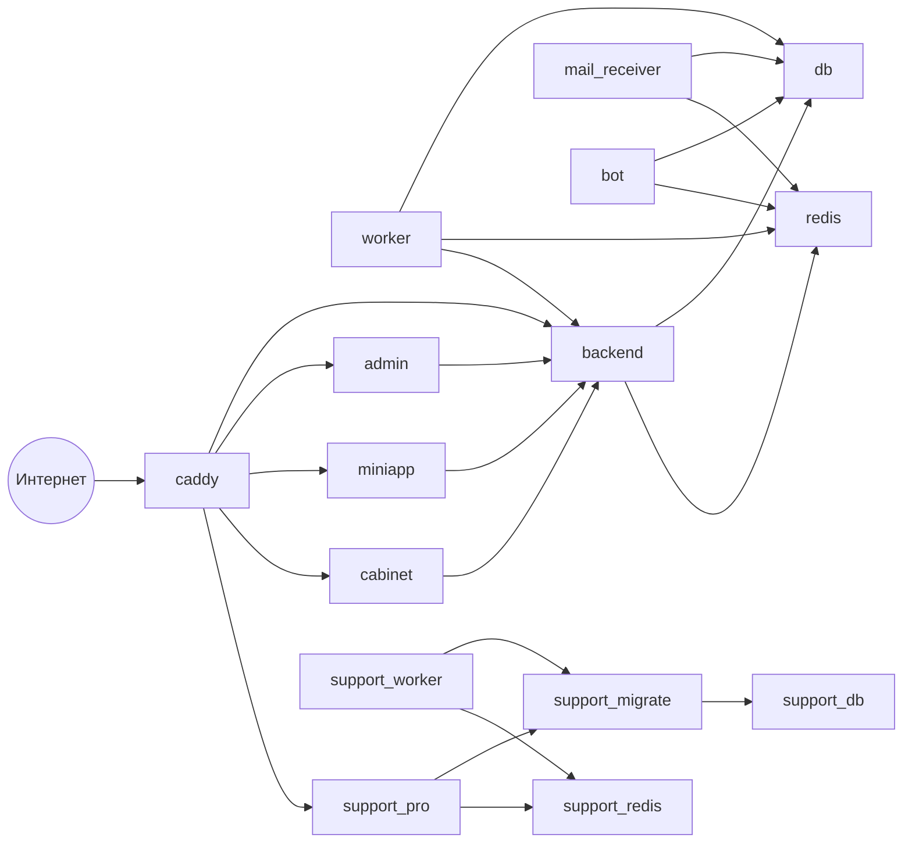

# Контейнеры

Сгенерировано из `docker-compose.yml`: `python3 scripts/generate-architecture-docs.py`. Руками не править.

Всё работает на одном сервере в Docker Compose. Наружу открыты только порты Caddy и, при включённом профиле `mail`, порт приёма почты.

| Служба | Назначение | Откуда | Порты наружу | Проверка готовности | Зависит от | Профиль |
| --- | --- | --- | --- | --- | --- | --- |
| `volume_init` | Готовит права на томах перед запуском остальных служб | образ `redis:8.10-alpine` | — | нет | — | всегда |
| `redis` | Блокировки, идемпотентность, предохранитель запросов к панели, кэш | образ `redis:8.10-alpine` | — | есть | — | всегда |
| `db` | База магазина | образ `postgres:18.6-alpine` | — | есть | — | всегда |
| `backend` | API магазина: клиенты, платежи, подписки, панель администратора | сборка `backend/Dockerfile` | — | есть | `volume_init`, `db`, `redis` | всегда |
| `backend_standby` | Запасной экземпляр API (включается профилем) | как у основной службы | — | нет | — | `standby` |
| `worker` | Фоновые задачи: выдача и продление доступа, расписания, проверки | сборка `backend/Dockerfile` | — | есть | `volume_init`, `db`, `redis`, `backend` | всегда |
| `mail_receiver` | Приём почты служебных адресов (включается профилем) | сборка `backend/Dockerfile` | `25 (по умолчанию)` | есть | `db`, `redis` | `mail` |
| `bot` | Telegram-бот | сборка `backend/Dockerfile.bot` | — | есть | `db`, `redis` | всегда |
| `admin` | Веб-панель администратора (статические файлы) | сборка `apps/lucy-admin/web/Dockerfile` | — | есть | `backend` | всегда |
| `miniapp` | Mini App Telegram (статические файлы) | сборка `apps/telegram-mini-app/Dockerfile` | — | есть | `backend` | всегда |
| `cabinet` | Личный кабинет (статические файлы) | сборка `apps/user-cabinet/Dockerfile` | — | есть | `backend` | всегда |
| `support_db` | База Support Pro | образ `postgres:18.6-alpine` | — | есть | — | всегда |
| `support_redis` | Очереди и блокировки Support Pro | образ `redis:8.10-alpine` | — | есть | — | всегда |
| `support_migrate` | Миграции базы Support Pro, выполняется и завершается | сборка `support-pro/app/Dockerfile` | — | нет | `support_db` | всегда |
| `support_pro` | API Support Pro: обращения, переписка, база знаний | сборка `support-pro/app/Dockerfile` | — | есть | `volume_init`, `support_migrate`, `support_redis` | всегда |
| `support_worker` | Фоновые задачи Support Pro | сборка `support-pro/app/Dockerfile` | — | есть | `volume_init`, `support_migrate`, `support_redis` | всегда |
| `caddy` | Единственная точка входа: HTTPS, маршрутизация по доменам, заголовки безопасности | сборка `deploy/caddy/Dockerfile` | `80`, `443`, `443/udp` | есть | `volume_init`, `backend`, `admin`, `miniapp`, `cabinet`, `support_pro` | всегда |

## Сети

| Сеть | Кто в ней |
| --- | --- |
| `default` | `volume_init`, `redis`, `db`, `backend`, `backend_standby`, `worker`, `mail_receiver`, `bot`, `admin`, `miniapp`, `cabinet`, `support_db`, `support_redis`, `support_migrate`, `support_pro`, `support_worker`, `caddy` |
| `ingress` | `backend`, `backend_standby`, `support_pro`, `caddy` |

## Тома

| Том | Кто подключает |
| --- | --- |
| `app_packages` | `volume_init`, `backend`, `worker` |
| `backup_data` | `volume_init`, `backend`, `worker` |
| `caddy_config` | `volume_init`, `caddy` |
| `caddy_data` | `volume_init`, `caddy` |
| `media_data` | `volume_init`, `backend`, `worker`, `bot` |
| `postgres18_data` | `db` |
| `redis_data` | `redis` |
| `support_postgres18_data` | `support_db` |
| `support_redis_data` | `support_redis` |
| `support_uploads` | `volume_init`, `support_pro`, `support_worker` |

## Схема

