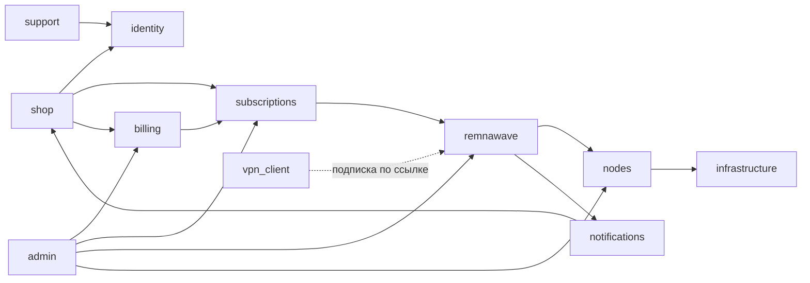

# Карта предметных областей

Мастер-промпт называет двенадцать областей. В таблице — где каждая из них находится в коде сегодня.
Области — это группы модулей одного процесса `backend`, кроме поддержки (отдельная служба) и клиента VPN (отдельное приложение).

| Область | Где в коде | Свои таблицы | С кем связана |
| --- | --- | --- | --- |
| `identity` — вход и учётные записи | `backend/app/account_*.py`, `security.py`, `passkeys.py` | Клиенты, администраторы, сессии | Все |
| `billing` — платежи | `backend/app/payment*.py`, `payments*.py`, модули провайдеров | Платежи, события провайдеров, финансовый журнал | `subscriptions`, `identity` |
| `subscriptions` — подписки и тарифы | `backend/app/subscription*.py`, `subscriptions.py`, `customer_*.py` | Тарифы, подписки, устройства | `billing`, `remnawave` |
| `shop` — витрина и клиентские интерфейсы | `backend/app/bot*.py`, `telegram_bot.py`, `cabinet_*.py`, `mobile_*.py`; `apps/user-cabinet/`, `apps/telegram-mini-app/` | Содержимое, меню, баннеры | `identity`, `subscriptions`, `billing` |
| `remnawave` — панель | `backend/app/remnawave*.py`, `rw_extensions.py`, `rw_autoselect.py`, `rw_drift.py` | События панели | `subscriptions`, `nodes` |
| `nodes` — серверы | `backend/app/rw_*.py` (установка, модули, SSH), `node_*.py` | Установки, серверы, задачи установки | `remnawave`, `infrastructure` |
| `admin` — панель администратора | `backend/app/admin_*.py`; `apps/lucy-admin/web/` | Журнал действий, настройки | Все |
| `support` — поддержка | `support-pro/`; мост `backend/app/support_*.py` | Отдельная база Support Pro | `identity` |
| `notifications` — уведомления | `backend/app/push_*.py`, `mail_*.py`, `ops_alerts.py`, `automation.py` | Очередь писем, шаблоны | `shop`, `remnawave` |
| `analytics` — аналитика | `backend/app/app_*.py` (события приложений), отчёты панели | События приложений | `shop`, `billing` |
| `infrastructure` — установка, копии, обновления | `scripts/`, `deploy/`, `backend/app/auto_update_api.py`, `rw_autoupdate.py`, `backups_api.py`, `backup_verify.py` | Настройки, снимки | `nodes`, `admin` |
| `vpn_client` — клиент VPN | `apps/vpn-client/android/` | Нет: данные на устройстве | Только выпуски на GitHub |

## Как области связаны

## Способы связи

| Связь | Способ |
| --- | --- |
| Клиентские интерфейсы → магазин | HTTP API |
| Магазин → панель Remnawave | REST API панели через один клиент `backend/app/remnawave.py` |
| Панель → магазин | Webhook с подписью |
| Провайдер → магазин | Webhook с подписью и повторной сверкой у провайдера |
| Магазин → нода | SSH с проверкой отпечатка ключа сервера |
| Магазин ↔ Support Pro | HTTP по служебному секрету |
| Области внутри `backend` | Вызовы функций модулей и общая база |

Последняя строка — главное отличие от требований промпта. Подробно: [DOMAIN_BOUNDARIES.md](DOMAIN_BOUNDARIES.md).
