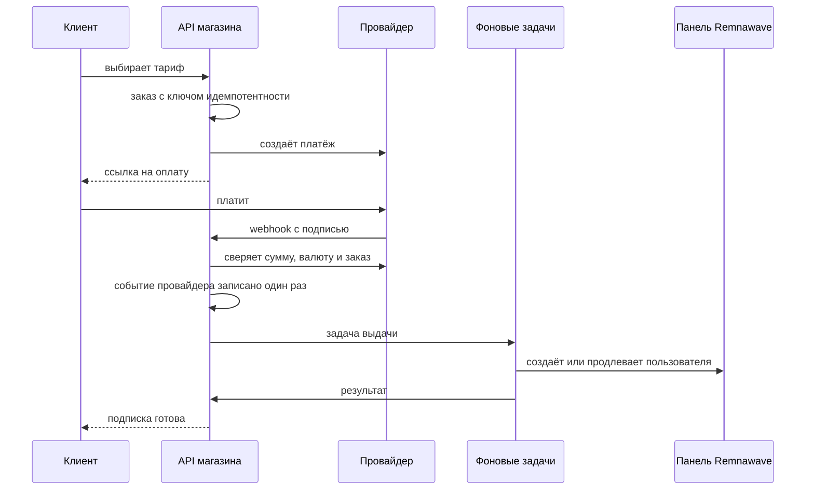

# Потоки данных

Четыре главных потока. Для каждого — кто начинает, какие данные идут и где стоит проверка.

## 1. Покупка и выдача доступа

| Шаг | Проверка |
| --- | --- |
| Webhook | Подпись провайдера; повторная сверка платежа у провайдера |
| Повтор webhook | Событие принимается один раз (`payment_provider_events`) |
| Деньги | Каждая операция — запись в финансовом журнале, добавляемая один раз |
| Выдача | Блокировка по пользователю, ограниченное число повторов |

Тесты: `tests/test_behaviour_store_and_webhooks.py`, `tests/test_behaviour_webhooks_refunded.py`.

## 2. События панели

Панель Remnawave присылает webhook о пользователе: трафик заканчивается, подписка истекла, первое подключение, новое устройство.

| Шаг | Что происходит |
| --- | --- |
| Приём | Подпись HMAC-SHA256 тела; без подписи запрос отклоняется |
| Запись | Событие сохраняется один раз (`remnawave_events`) |
| Клиент | Находится по идентификатору пользователя панели |
| Действие | Сообщение клиенту, запуск правил автоматизации, защита от повторного пробного периода |

Код: `backend/app/remnawave_events.py`.

## 3. Установка и изменение ноды

| Шаг | Что происходит |
| --- | --- |
| Администратор | Заполняет форму в панели администратора; видит план до запуска |
| Магазин | Создаёт задачу установки; ключи и пароли хранит зашифрованными |
| SSH | Подключение только при совпадении отпечатка ключа сервера; закрытый список скриптов |
| Панель | Нода и её профиль регистрируются через API панели |
| Проверка | Состояние в панели и открытый порт; при сбое — откат шага |

Код: `backend/app/rw_api.py`, `rw_steps.py`, `rw_remote.py`. Тесты: `tests/test_rw_ssh.py`, `tests/live/test_node_modules_live.py`.

## 4. Обновления

| Что обновляется | Откуда | Проверка перед установкой |
| --- | --- | --- |
| Магазин | Выпуск на GitHub | SHA-256, манифест, копия базы, откат при сбое |
| Панель и ноды | Образы версий, проверенных выпуском магазина | Копия базы панели, откат |
| Приложения Android | APK из выпуска | SHA-256; подпись проверяет Android |

Подробно: [AUTO_UPDATE.md](../AUTO_UPDATE.md).

## Какие данные где лежат

| Данные | Где | Защита |
| --- | --- | --- |
| Клиенты, заказы, платежи, подписки | База магазина | Доступ только у служб магазина; копии шифруются |
| Ключи провайдеров, токен панели, ключи SSH | База магазина и `.env` | Шифрование AES-256-GCM; `.env` с правами 600 |
| Пользователи VPN и трафик | Панель Remnawave | У панели |
| Обращения в поддержку | База Support Pro | Отдельная база |
| Ключи подписки на телефоне | Хранилище приложения | Резервное копирование выключено |
| Журнал действий администраторов | База магазина | Печати: [AUDIT_LOG_INTEGRITY.md](../AUDIT_LOG_INTEGRITY.md) |
