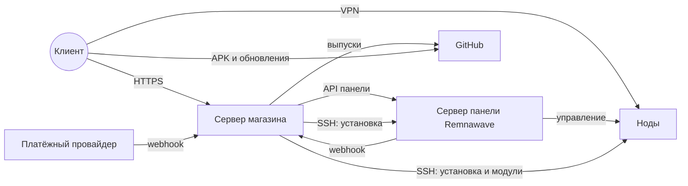

# Топология развёртывания

## Серверы

| Сервер | Что на нём | Кто ставит |
| --- | --- | --- |
| Сервер магазина | Все службы из [CONTAINER_DIAGRAM.md](CONTAINER_DIAGRAM.md) в Docker Compose | `install.sh` |
| Сервер панели Remnawave | Панель, её база, страница подписки | Мастер установки в панели администратора магазина (`backend/app/rw_api.py`) или владелец вручную |
| Ноды | Нода Remnawave с Xray, модули защиты и маскировки | Мастер установки; по SSH |
| Телефоны клиентов и администраторов | Приложения | Клиент, из выпуска на GitHub |

Панель и магазин могут стоять на одном сервере, но это разные наборы контейнеров.

## Что открыто наружу

| Сервер | Порты | Зачем |
| --- | --- | --- |
| Магазин | 80, 443 (TCP и UDP) | Caddy: HTTPS и HTTP/3 |
| Магазин | 25, только с профилем `mail` | Приём почты |
| Панель | 443 | Панель и страница подписки за обратным прокси |
| Нода | Порты inbound, порт связи с панелью | Трафик VPN; связь панели с нодой |

Остальные службы магазина наружу не опубликованы: это проверяет `tests/test_stage15_install.py`.

## Домены

Caddy выдаёт сертификаты сам и разводит запросы по доменам: API, кабинет, панель администратора, Mini App, Support Pro.
Настройка доменов панели и нод — раздел «Домены» панели администратора (`backend/app/rw_domains.py`).

## Запас и восстановление

| Что | Как |
| --- | --- |
| Запасной экземпляр API | Служба `backend_standby`, профиль `standby`, на том же сервере |
| Копии магазина | `scripts/backup.sh`; проверка восстановления на машине CI: `scripts/ci/restore-drill.sh` |
| Копии базы панели | Хранятся в магазине в зашифрованном виде (`backend/app/rw_snapshots.py`) |
| Обновление с откатом | Агент `scripts/auto_update.py`; см. [AUTO_UPDATE.md](../AUTO_UPDATE.md) |

## Чего нет

- Второго сервера магазина и балансировки между серверами.
- Окружения staging.
- Проверки этой топологии на настоящих серверах: нужны VPS.
