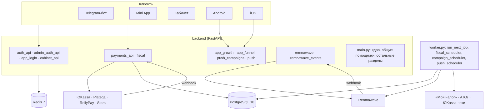

# Архитектура модулей

Технические описания для разработчика: бизнес-логика, схемы данных, контракты API и диаграммы. Инструкции для владельца магазина по каждому разделу админки — [30 модулей](../ru/modules/README.md), установка — [INSTALLATION.md](../INSTALLATION.md).

| Документ | О чём |
| --- | --- |
| [bot_auth_and_routing.md](bot_auth_and_routing.md) | Вход клиентов и администраторов (Telegram, OAuth, сессии, PKCE для приложений, 2FA), команды бота и маршрутизация запросов |
| [billing_and_taxes.md](billing_and_taxes.md) | Оплата: checkout, webhook, выдача, возвраты, возврат в приложение; чеки в налоговую и сверка «Мой налог» |
| [remnawave_integration.md](remnawave_integration.md) | Клиент Remnawave, задания выдачи и пробного периода, повторы и идемпотентность, вебхуки панели |
| [android_architecture.md](android_architecture.md) | Клиентское приложение Android: макет из админки, встроенный VPN, батарея, push, вход, оплата |
| [ios_architecture.md](ios_architecture.md) | Клиентское приложение iOS: Network Extension, push с картинками, подпись и встраивание расширений |
| [analytics.md](analytics.md) | События приложений, воронка, push-кампании по расписанию и A/B-тесты |

Общая схема:

Код backend: `main.py` — ядро и общие помощники; разделы вынесены в модули, которые читают имена ядра через `shop.<имя>` во время вызова (тесты и операторы, подменяющие `app.main`, продолжают на них влиять). Модуль, импортированный раньше `main`, передаёт свои имена в `main`, когда загрузится (`tests/test_main_split.py`).
