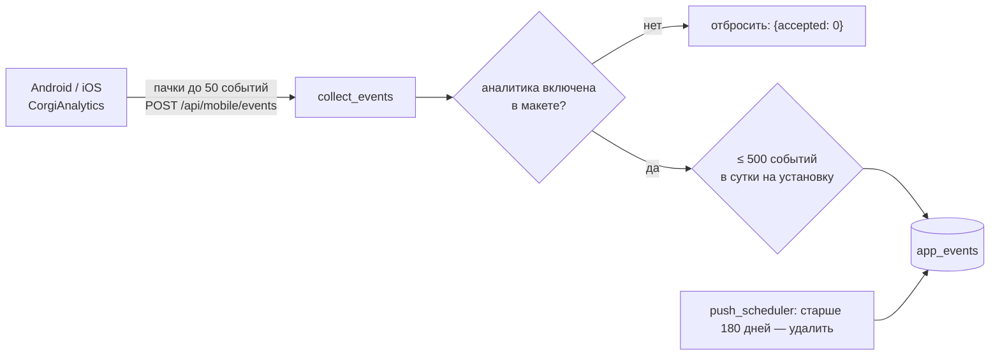
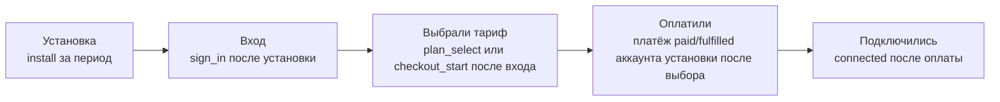
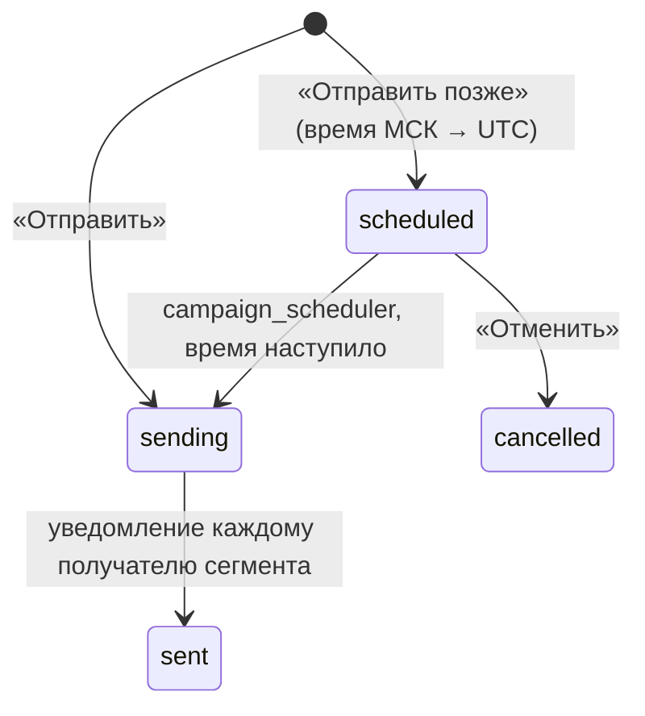

# Аналитика приложений и push-кампании

Код: `backend/app/app_growth.py` (события, сводка, сегменты), `app_funnel.py` (воронка), `push_campaigns.py` (кампании, расписание, A/B), `push.py` (доставка). Админка: `admin/src/appGrowth.tsx`. Инструкции владельцу — [модуль 12](../ru/modules/12-notifications-push.md) и [модуль 16](../ru/modules/16-mobile-apps.md). Тесты: `tests/test_app_growth.py`, `tests/test_push_campaigns.py`.

## События приложений



| Поле `app_events` | Что хранится |
| --- | --- |
| `install_hash` | HMAC-SHA256 случайного номера установки на `APP_SECRET`; сам номер не хранится |
| `user_id` | аккаунт, если запрос пришёл с действующей сессией |
| `platform`, `app_version` | `android` / `ios`, версия приложения |
| `event` | `install` (один раз на установку), `open`, `sign_in_view`, `sign_in`, `screen`, `connect_tap`, `connected`, `trial_tap`, `plan_select`, `checkout_start`, `checkout_done`, `promo_tap`, `giveaway_enter` |
| `screen` | только для `screen` |
| `created_at` | время |

IP-адрес, модель устройства и рекламные идентификаторы не собираются. Неизвестные события отбрасываются.

## Воронка



`funnel(db, days, platform)`:

1. Когорта — установки с событием `install` за период (и платформу, если задана).
2. Для каждой установки шаги ищутся строго по порядку и по времени: шаг засчитывается, только если он случился после предыдущего.
3. «Оплатили» берётся из `payments` (статус `paid` или `fulfilled`, `paid_at` после выбора тарифа) аккаунтов, вошедших на этой установке.
4. Для каждого шага: число установок, доля от установок, доля от прошлого шага, доля ушедших, медианное время от установки в минутах.
5. `biggest_drop` — шаг с наибольшей долей ушедших (при равенстве — более ранний).

Ответ `GET /api/admin/app-analytics?days=&platform=` (`analytics.read`):

```json
{
  "funnel": {
    "cohort": 5,
    "steps": [
      {"step": "install", "title": "Установка", "count": 5, "of_installs": 100.0, "from_previous": 100.0, "drop_off": 0.0, "median_minutes": null},
      {"step": "sign_in", "title": "Вход", "count": 4, "of_installs": 80.0, "from_previous": 80.0, "drop_off": 20.0, "median_minutes": 1.5}
    ],
    "biggest_drop": "plan",
    "truncated": false
  },
  "active_installs": 5, "events": {"install": 5}, "screens": [], "platforms": {}, "daily": [], "versions": []
}
```

## Push-кампании



- **Сегменты** (`segment_users`, считаются в момент отправки): `all`, `app_users` (есть push), `expiring` (заканчивается за N дней и нет более длинной подписки), `expired` (закончилась за N дней и нет действующей), `no_subscription`, `inactive` (с push, без сессии N дней). Удалённые и слитые аккаунты не получают рассылки.
- **Доставка.** Каждому получателю создаётся уведомление `kind=campaign` в приложении, кабинете и Mini App; `push_scheduler` рассылает его на все устройства клиента с включённым push.
- **Расписание.** `send_at` — московское время, не дальше 60 дней; прошедшее время означает «сейчас». `campaign_scheduler` (worker, раз в минуту) берёт наступившие кампании `FOR UPDATE SKIP LOCKED` — каждая уходит ровно один раз при любом числе worker'ов.
- **Защита от повтора.** Та же кампания (заголовок, текст, сегмент) в течение 10 минут отклоняется (409), в том числе запланированная.

### A/B-тест

- Вариант B — второй заголовок и текст и доля `b_percent` (1–90). Вариант получателя: `sha256("campaign:{id}:{user_id}")` по модулю 100 меньше доли — B, иначе A. Один клиент всегда видит один вариант кампании.
- Получатели и варианты — в `push_campaign_recipients`.
- Итог (`campaign_results`): для каждого варианта — получатели, сколько из них оплатили в окне `conversion_days` после отправки (уникальные клиенты с платежом `paid`/`fulfilled`), конверсия, выручка.
- Значимость — двусторонний z-тест двух долей: `p = erfc(|p_a − p_b| / sqrt(p(1−p)(1/n_a + 1/n_b)) / √2)`. Победитель назначается при `p < 0,05` и не меньше 30 получателях в каждом варианте; `complete` — окно закрыто.

| Таблица | Поля |
| --- | --- |
| `push_campaigns` | `title`, `body`, `segment`, `days`, `status` (`scheduled`, `sending`, `sent`, `cancelled`), `recipients`, `with_push`, `created_by`, `created_at`, `scheduled_at`, `sent_at`, `title_b`, `body_b`, `b_percent`, `conversion_days` |
| `push_campaign_recipients` | `campaign_id`, `user_id` (уникально в кампании), `variant` (`a`/`b`), `created_at` |
| `notifications` | `kind=campaign`, `dedupe_key=campaign:{id}`, `push_fanout_at` |

### Контракты API

| Метод | Путь | Право | Тело / ответ |
| --- | --- | --- | --- |
| GET | `/api/admin/push-campaigns` | `marketing.read` | сегменты, готовность FCM/APNs, `now_msk`, 50 последних кампаний (у A/B — `results`) |
| POST | `/api/admin/push-campaigns/preview` | `marketing.read` | `{segment, days}` → `{recipients, with_push}` |
| POST | `/api/admin/push-campaigns` | `manage_broadcasts` | `{segment, days, title, body, title_b?, body_b?, b_percent?, send_at?: "YYYY-MM-DDTHH:MM", conversion_days?}` |
| GET | `/api/admin/push-campaigns/{id}/results` | `marketing.read` | `{campaign, variants[], winner, p_value, window_days, complete}` |
| POST | `/api/admin/push-campaigns/{id}/cancel` | `manage_broadcasts` | только `scheduled`, иначе 409 |
| POST | `/api/mobile/events` | приложение | `{install_id, platform, app_version, events: [{event, screen}]}` |
| GET | `/api/admin/app-analytics` | `analytics.read` | сводка и воронка |
