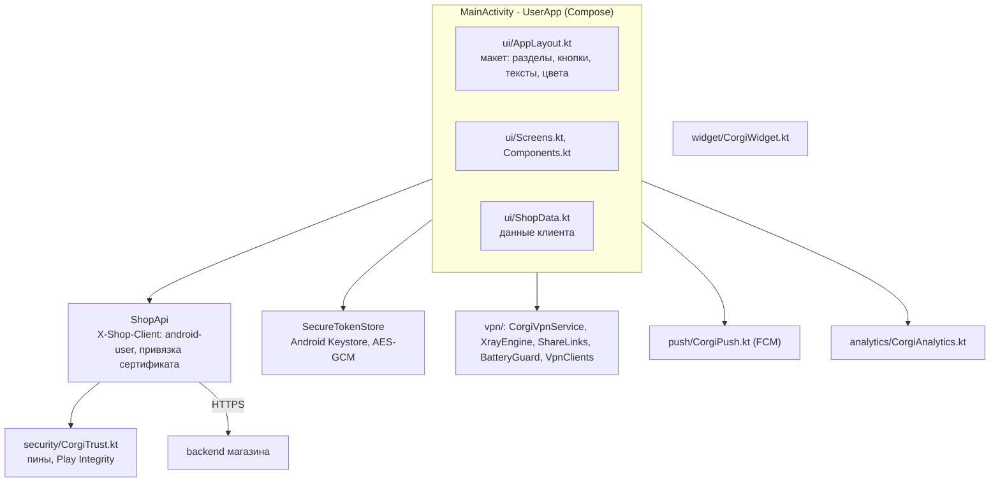
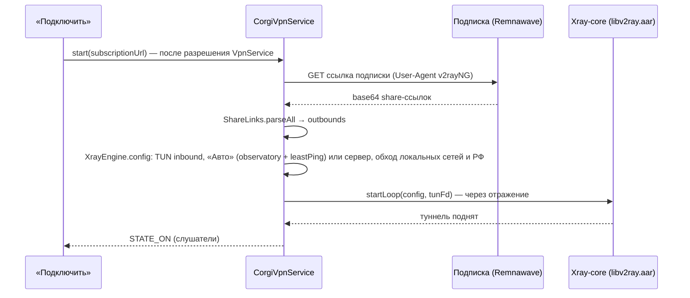
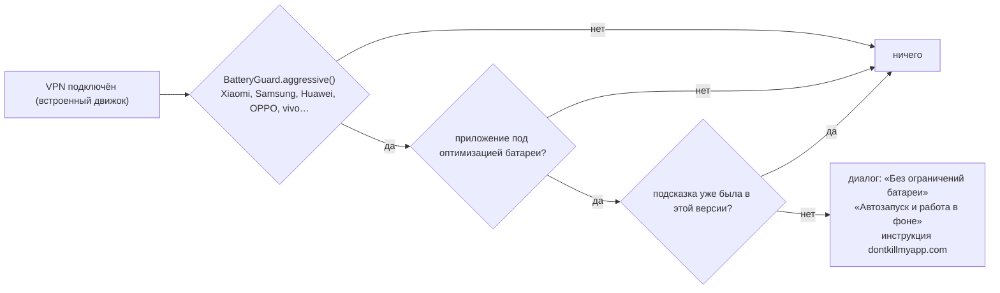

# Android: клиентское приложение

Каталог `mobile/android-user` (Kotlin, Jetpack Compose, minSdk 26, targetSdk 35). Пакет `shop.remnawave.user`, отладочная сборка — `shop.remnawave.user.preview`. Инструкция владельцу — [модуль 16](../ru/modules/16-mobile-apps.md). Админ-приложение — `mobile/android-admin` (те же принципы, оформление Remna Dark).

## Устройство

- **Макет из админки.** Разделы, нижняя панель, каждая кнопка (действие, вид, иконка, кому показывать), тексты ru/en/uk, баннеры и цвета приходят из `GET /api/mobile/layout` (ETag). Стандартный макет (`default_layout.json`) и баннеры встроены — экраны работают без сети. Действия кнопок перечислены в `KNOWN_ACTIONS`; неизвестное действие не показывается.
- **Данные.** `refresh()` читает `/api/me/dashboard`, `/api/me/subscriptions`, `/api/me/connection-info`, `/api/plans`, `/api/me/servers`, `/api/me/giveaways`, уведомления и состояние сервиса.
- **Сессия.** Bearer-токен хранится зашифрованным ключом Android Keystore (AES-GCM, адрес магазина как AAD); вход по биометрии; снимки экрана запрещены (`FLAG_SECURE`) вне демо-режима.
- **Адрес магазина** можно вшить в сборку: `-Pcorgi.shop_url=…` или `CORGI_SHOP_URL` → `BuildConfig.SHOP_URL`. **Пины сертификата** — `corgi.pins` / `CORGI_PINS`: соединение проверяется до отправки токена.

## Встроенный VPN

- `libv2ray.aar` (Xray-core через AndroidLibXrayLite) собирает `scripts/mobile/build-xray-aar.sh` из закреплённой ревизии; приложение находит его отражением, поэтому без библиотеки сборка работает и передаёт подписку в Happ, v2rayNG или Hiddify (`VpnClients`).
- Сервис — foreground `systemExempted` с уведомлением и кнопкой «Отключить». Исключённые приложения и «Сервер VPN» хранятся в настройках `shop_vpn`, смена перезапускает туннель.

### Батарея и прошивки производителей

- Производитель определяется по `Build.MANUFACTURER` и `Build.BRAND`.
- «Без ограничений батареи» открывает системный список (`ACTION_IGNORE_BATTERY_OPTIMIZATION_SETTINGS`), запасной вариант — экран приложения. Разрешение `REQUEST_IGNORE_BATTERY_OPTIMIZATIONS` не запрашивается: клиент переключает сам.
- «Автозапуск» пробует экраны производителя по очереди (MIUI Security Center, Samsung Device care, Huawei Startup manager, ColorOS, vivo и др.) без `resolveActivity` — пакеты производителей скрыты видимостью пакетов Android 11+.

## Вход, оплата, push, аналитика

- **Ссылки** `corgi://`: `login?base&code` (вход), `payment?order` (возврат после оплаты), `connect`, `support`. Вход и PKCE — [вход и маршрутизация](bot_auth_and_routing.md#вход-в-приложения).
- **Оплата** открывает страницу агента в браузере; адрес возврата `/api/app/paid` ведёт обратно (`corgi://payment`), приложение до 6 раз спрашивает статус заказа и показывает итог ([оплата](billing_and_taxes.md#возврат-в-приложение-после-оплаты)).
- **Push** (FCM, только data-сообщения): `CorgiPush.show` рисует уведомление по стилю из админки — большая картинка, до двух кнопок с разделом, цвет, группа (каналы `important`, `service`, `promo`).
- **Аналитика**: случайный номер установки, события копятся в памяти и уходят пачками в `POST /api/mobile/events`; ничего не отправляется, если магазин выключил аналитику. Событие `plan_select` — нажатие на тариф ([аналитика](analytics.md)).
- **Подлинность**: при обмене кода на сессию — Play Integrity (nonce из `POST /api/mobile/integrity/challenge`).

## Сборка и проверки

| Что | Как |
| --- | --- |
| Отладочная сборка | `cd mobile/android-user && ./gradlew assembleDebug` |
| Подписанные APK и AAB | `scripts/build-android-apk.sh` с `ANDROID_KEYSTORE*` (workflow «Mobile packages») |
| Движок VPN | `bash scripts/mobile/build-xray-aar.sh` → `app/libs/libv2ray.aar` |
| UI-тесты | `app/src/androidTest`: экраны в демо-режиме, подсказка о батарее (`BatteryGuardTest`); CI «Android • UI tests» |
| Сценарии Maestro | `mobile/maestro/flows`, `bash scripts/mobile/maestro-screens.sh`; CI «Android journeys (Maestro)» |
| Скриншоты | workflow «Mobile screenshots» (демо-режим: `--ez corgi_demo true --es corgi_tab …`) |
