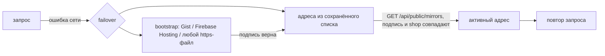

# Защита от блокировок: ротация адресов API

Если основной домен API заблокируют, Android- и iOS-приложения сами переходят на резервный адрес и
возвращаются, когда основной снова доступен. Настройка — «Приложения → Резервные адреса API и сайты напрямую».

## Подписанный список

`GET /api/public/mirrors` (без входа, кешируется 5 минут):

```json
{"payload": "{\"shop\":\"https://api.example.com\",\"mirrors\":[...],\"bootstrap\":[...],\"direct\":[...],\"issued_at\":\"…\",\"expires_at\":\"…\"}",
 "signature": "<base64 DER ECDSA>", "key": "<base64 SubjectPublicKeyInfo>", "alg": "ES256"}
```

* Ключ ECDSA P-256 создаётся при первом обращении и хранится в базе зашифрованным (`mobile.mirrors.signing_key`).
* `payload` — строка: подпись проверяется по точным байтам, без канонизации JSON.
* Документ действует 30 дней; магазин переподписывает его при каждом изменении и раз в сутки.

## Доверие при первом входе

Приложение запоминает `key` из ответа адреса, на котором клиент вошёл (trust on first use), и дальше принимает
списки только с этим ключом — из магазина, из Gist или любого другого места. Поэтому подмена Gist, DNS или
зеркала не уведёт приложения и их сессии на чужой сервер. Сессионный токен остаётся привязан к «домашнему»
адресу; меняется только сетевой адрес запросов.

## Переключение



* Повторяется только `GET` или запрос, который точно не ушёл на сервер (DNS, отказ соединения, TLS-рукопожатие):
  оплата или другое действие не выполнится дважды.
* Поиск не чаще раза в 30 секунд; после успешного ответа «домашнего» адреса активный адрес сбрасывается.
* Привязка сертификата (`CORGI_PINS`) продолжает действовать для домашнего хоста.

## Автопубликация в GitHub Gist

Резервные домены перечисляются в `API_MIRROR_DOMAINS` (`.env`): Caddy обслуживает их тем же API и сам выпускает сертификаты. Укажите ID Gist и токен GitHub (только право `gist`). Магазин обновляет файл `corgi-mirrors.json` при каждом
сохранении и раз в сутки, а постоянная raw-ссылка сама добавляется в `bootstrap`. Токен хранится зашифрованным и
не возвращается в API. Firebase Hosting или любой статический хостинг подключаются как ещё один `bootstrap`-адрес
с копией того же файла.

Код: `backend/app/mobile_mirrors.py`, `mobile/android-user/…/security/CorgiMirrors.kt`,
`mobile/ios-user/VpnShopUser/VpnShopUserApp.swift` (`enum CorgiMirrors`). Тесты: `tests/test_mobile_mirrors.py`.
