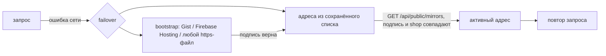

# Защита от блокировок: ротация адресов API

Если основной домен API заблокируют, Android- и iOS-приложения сами переходят на резервный адрес и
возвращаются, когда основной снова доступен. Настройка — «Приложения → Резервные адреса API и сайты напрямую».

## Подписанный список

`GET /api/public/mirrors` (без входа, кешируется 5 минут):

```json
{"payload": "{\"shop\":\"https://api.example.com\",\"mirrors\":[...],\"bootstrap\":[...],\"direct\":[...],\"issued_at\":\"…\",\"expires_at\":\"…\"}",
 "signature": "<base64 DER ECDSA>", "key": "<base64 SubjectPublicKeyInfo>", "alg": "ES256"}
```

* Ключ ECDSA P-256 создаётся при первом обращении и хранится в базе зашифрованным (`mobile.mirrors.signing_key`).
* `payload` — строка: подпись проверяется по точным байтам, без канонизации JSON.
* Документ действует 30 дней; магазин переподписывает его при каждом изменении и раз в сутки.

## Доверие при первом входе

Приложение запоминает `key` из ответа адреса, на котором клиент вошёл (trust on first use), и дальше принимает
списки только с этим ключом — из магазина, из Gist или любого другого места. Поэтому подмена Gist, DNS или
зеркала не уведёт приложения и их сессии на чужой сервер. Сессионный токен остаётся привязан к «домашнему»
адресу; меняется только сетевой адрес запросов.

## Переключение



* Повторяется только `GET` или запрос, который точно не ушёл на сервер (DNS, отказ соединения, TLS-рукопожатие):
  оплата или другое действие не выполнится дважды.
* Поиск не чаще раза в 30 секунд; после успешного ответа «домашнего» адреса активный адрес сбрасывается.
* Привязка сертификата (`CORGI_PINS`) продолжает действовать для домашнего хоста.

## Автопубликация в GitHub Gist

Резервные домены перечисляются в `API_MIRROR_DOMAINS` (`.env`): Caddy обслуживает их тем же API и сам выпускает сертификаты. Укажите ID Gist и токен GitHub (только право `gist`). Магазин обновляет файл `corgi-mirrors.json` при каждом
сохранении и раз в сутки, а постоянная raw-ссылка сама добавляется в `bootstrap`. Токен хранится зашифрованным и
не возвращается в API. Firebase Hosting или любой статический хостинг подключаются как ещё один `bootstrap`-адрес
с копией того же файла.

Код: `backend/app/mobile_mirrors.py`, `mobile/android-user/…/security/CorgiMirrors.kt`,
`mobile/ios-user/VpnShopUser/VpnShopUserApp.swift` (`enum CorgiMirrors`). Тесты: `tests/test_mobile_mirrors.py`.

## Монитор блокировок

«Серверы → Монитор блокировок». Пробы (`scripts/block-probe.py`, только стандартная библиотека Python, systemd-таймер
раз в 5 минут) ставятся на любые серверы в регионах клиентов — например недорогой VPS в России — и проверяют адреса,
которые им отдаёт магазин: основной и резервные домены API (`/health/live`, TLS и HTTP-ответ) и ноды (TCP на порты из
настроек, по умолчанию 443).

* **Блокировка** — все свежие пробы региона (отчёт за последние 30 минут) не смогли подключиться к адресу N раз подряд
  (по умолчанию 3), а магазин видит адрес работающим: API отвечает, Remnawave показывает ноду в сети. Нода, которая
  лежит для всех, — это сбой, а не блокировка, и монитор её не трогает.
* **Что происходит само:** сообщение в Telegram с адресом и регионом («Запуск и оповещения», повтор, пока длится,
  и отметка, когда закончилось); заблокированный адрес API уходит в конец подписанного списка зеркал, список
  переподписывается и публикуется в Gist; по желанию, пока заблокирована хотя бы одна нода, всем клиентам добавляется
  резервный Internal Squad (например, ноды с Reality или XHTTP) — в подписке появляются рабочие профили, режим «Авто»
  в приложении выберет их сам. Когда блокировки нет, резервный Squad снимается.
* **Проба** добавляется в админке: токен показывается один раз (хранится только его хеш) вместе с командой установки
  `curl … -o /usr/local/bin/corgi-probe && sudo SHOP_URL=… PROBE_TOKEN=… python3 /usr/local/bin/corgi-probe install`.
  Токен даёт пробе только два действия: получить список адресов и прислать результаты. `corgi-probe run` — проверка
  вручную, `corgi-probe uninstall` — удалить.
* Резервный Squad добавляется через Remnawave (`/api/internal-squads/{uuid}/bulk-actions/add-users`); если панель
  отказала, ошибка видна в карточке, а сообщение о блокировке всё равно уходит.

API: `GET /api/probe/targets`, `POST /api/probe/report` (Bearer-токен пробы), `GET`/`PUT /api/admin/block-monitor`,
`POST`/`DELETE /api/admin/block-monitor/probes`. Тесты: `tests/test_block_monitor.py`.
