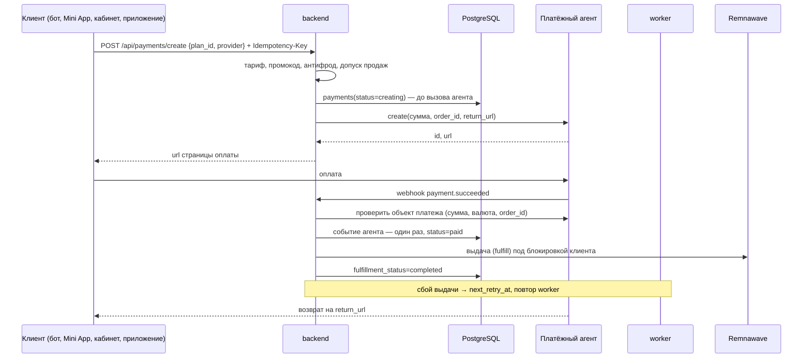
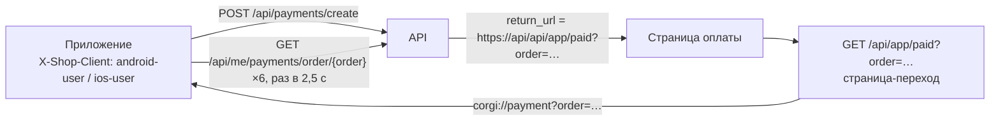
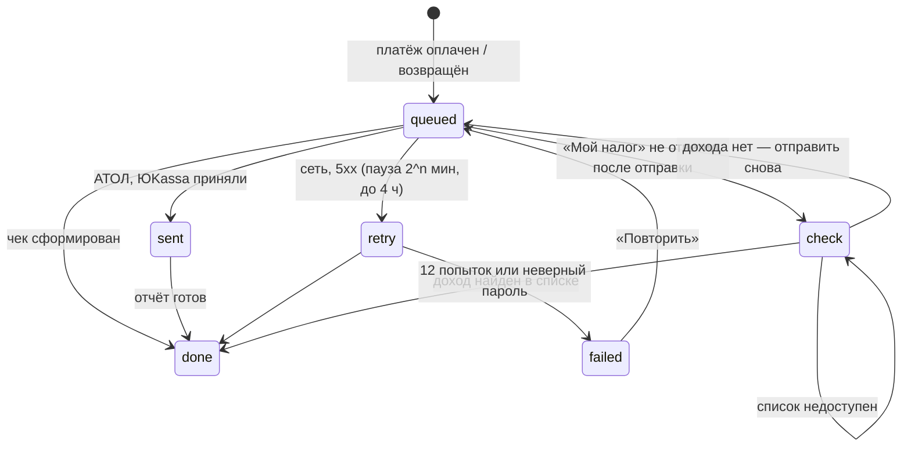

# Оплата и чеки в налоговую

Код: `backend/app/payments_api.py` (checkout, webhook, выдача, возвраты), `main.py` (кошелёк, `_return_url`, статус заказа), `subscription_commerce.py` (смена тарифа и докупки), `fiscal.py` (чеки), `app_login.py` (возврат в приложение). Инструкции владельцу — [модуль 7](../ru/modules/07-payments.md). Тесты: `tests/test_behaviour_payments*.py`, `tests/test_fiscal.py`, `tests/test_integration_billing_vpn.py`.

## Платёж от заказа до выдачи

Главные правила:

- **Намерение раньше агента.** Строка `payments` со статусом `creating` записывается до вызова агента. Если агент не ответил, статус `creation_unknown`, и магазин не переходит к другому агенту — иначе клиент мог бы заплатить дважды.
- **Идемпотентность.** `Idempotency-Key` обязателен; повтор с тем же ключом возвращает тот же заказ. Событие агента учитывается один раз на агента (`register_provider_event`).
- **Webhook не доверяют.** ЮKassa — только с адресов из `YOOKASSA_WEBHOOK_IP_ALLOWLIST`, и объект платежа перечитывается у агента (сумма, валюта, `order_id`) до подтверждения. Возврат, оформленный в кабинете агента (`refund.succeeded`), тоже отзывает доступ.
- **Выдача последовательна по клиенту.** `fulfill` берёт распределённую блокировку клиента, затем платежа (Redis); без Redis выдача не идёт.
- **Повторы.** Ошибка выдачи ставит `next_retry_at` с паузой; после `fulfillment_max_attempts` — `fulfillment_terminal`. Продление в Remnawave идемпотентно ([интеграция](remnawave_integration.md)).

## Резервный шлюз и автоплатежи

* **Порядок шлюзов** — «Платёжные агенты → Очередь касс» в веб-админке и вкладка «Платежи» в мобильных админках: порядок (↑/↓), включение каждой кассы, состояние «принимает / остывает / нет ключей», кнопка «Вернуть в работу» (`POST /api/admin/v41/providers/{provider}/reset`). По умолчанию: ЮKassa → RollyPay → Platega → CryptoBot → Freekassa. Шлюз
  участвует, только если включён, настроен и не в «остывании». Три ошибки создания платежа подряд включают
  остывание на 5 минут: новые заказы уходят в следующий по приоритету шлюз — Freekassa (карты, СБП) или CryptoBot.
  Сам заказ, создание которого закончилось ошибкой, в другой шлюз не переносится: его результат неизвестен,
  повторное списание заблокировано до сверки.
* **CryptoBot** (`payments.CryptoBotProvider`): счёт в рублях (`currency_type=fiat`), номер заказа в `payload`;
  webhook `/api/webhooks/cryptobot` с подписью HMAC-SHA256 (ключ — SHA-256 токена); оплата подтверждается
  только запросом самого счёта (сумма, валюта, заказ).
* **Freekassa** (`payments.FreekassaProvider`): ссылка на оплату `pay.fk.money` подписана MD5 с секретным словом 1
  (создание платежа не обращается к сети); оповещение `/api/webhooks/freekassa` (GET или POST) принимается только с
  адресов Freekassa (`FREEKASSA_WEBHOOK_IP_ALLOWLIST`) и с подписью секретным словом 2; перед выдачей заказ
  перечитывается через API v1 (`/v1/orders`, HMAC-SHA256 с API-ключом): статус «оплачен», сумма, валюта. Ответ —
  `YES`, повтор оповещения не выдаёт подписку второй раз. Ключи — в «Настройки без перезапуска → freekassa».
* **Автоплатёж ЮKassa** (`schedulers.run_auto_renew_pass`): списание за несколько дней до конца подписки.
  Ответ «ожидает подтверждения» — не отказ: тот же платёж перепроверяется через 15 минут. Отклонённое
  списание повторяется с новым ключом идемпотентности и нарастающей паузой; после **третьего** отказа
  автопродление выключается и больше ничего не списывается.
* Сквозная проверка — `tests/test_e2e_journeys.py` и вся цепочка из пяти касс — `tests/test_payment_failover_chain.py`. Касса ушла в остывание или вернулась — сообщение в Telegram («Запуск и оповещения»); если готовая касса одна, там же предупреждение.

## Способы оплаты: своя очередь касс у СБП, карты и крипты

«Платёжные агенты → Способы оплаты» (веб-админка и карточка «Способы оплаты» в мобильных админках, раздел «Операции»).
Включённый режим показывает клиенту в кабинете, Mini App и приложениях выбор «СБП / Банковская карта / Криптовалюта» —
только те способы, у которых сейчас есть рабочая касса (`payment_methods` в `/api/public/config`). Заказ идёт по
очереди касс выбранного способа (`POST /api/payments/create` с `method`), отказавшая или остывающая касса передаёт
заказ следующей того же способа. Какие кассы принимают какой способ — `CAPABILITIES` в `payment_methods.py`
(ЮKassa, RollyPay, Platega, Freekassa — СБП и карты; CryptoBot — крипта). ЮKassa сразу открывается на выбранном
способе (`payment_method_data.type` = `sbp` / `bank_card`); Platega, RollyPay и Freekassa показывают свою страницу,
где клиент подтверждает способ. Выключенный режим — прежняя общая «Очередь касс». API: `GET/PUT /api/admin/payments/methods`.
Тесты: `tests/test_payment_methods.py`.

## CloudPayments и Lava (v28.38)

Ещё две кассы для карт и СБП (`payments_extra.py`). Они встают в очередь касс и в маршрутизацию способов оплаты, как только в «Настройках» заданы ключи (секреты хранятся зашифрованно). Автоплатежей и возвратов через API у них нет: возврат делается в кабинете кассы.

| Касса | Ключи | Адрес уведомлений | Как магазин проверяет оплату |
| --- | --- | --- | --- |
| CloudPayments | `CLOUDPAYMENTS_PUBLIC_ID`, `CLOUDPAYMENTS_API_SECRET` | `https://<API_DOMAIN>/api/webhooks/cloudpayments` (уведомление «Pay») | подпись `Content-HMAC` (base64 HMAC-SHA256 тела паролем API) или `X-Content-HMAC`, затем `POST /payments/find` по `InvoiceId`: статус Completed, та же сумма и валюта |
| Lava Business | `LAVA_SHOP_ID`, `LAVA_SECRET_KEY`, `LAVA_WEBHOOK_SECRET` | `https://<API_DOMAIN>/api/webhooks/lava` (передаётся в каждом счёте) | подпись `Authorization` дополнительным ключом (тела как пришло или JSON с отсортированными ключами), затем `POST /business/invoice/status`: статус success и та же сумма |

Страница оплаты: CloudPayments — `POST https://api.cloudpayments.ru/orders/create` (HTTP Basic, Public ID и пароль API); Lava — `POST https://api.lava.ru/business/invoice/create` (заголовок `Signature`: HMAC-SHA256 hex тела секретным ключом). Номер заказа магазина передаётся как `InvoiceId` или `orderId`. Повтор уведомления не выдаёт подписку второй раз. Боевая проверка — на ваших договорах и ключах; в CI запросы к кассам проверяются на моках (`tests/test_payments_extra.py`).

### CloudPayments: возвраты и автопродление (v28.46)

**Возврат.** «Возвраты → Выполнить» отправляет возврат в CloudPayments через API:
1. магазин находит транзакцию по номеру заказа (`/payments/find`);
2. вызывает `POST /payments/refund` с заголовком `X-Request-ID: refund-<заказ>` — повторный вызов не вернёт деньги дважды;
3. снимает подписку, как при любом возврате.

Состояние возврата сверяется через `/payments/get`.

**Автопродление.**
- Если у клиента включено автопродление, магазин сохраняет токен карты, который CloudPayments присылает в уведомлении «Pay», в зашифрованном виде вместе с `AccountId`.
- Сохранённая карта ЮKassa остаётся главной, токен CloudPayments её не заменяет.
- За несколько дней до окончания подписки магазин списывает сумму через `POST /payments/tokens/charge`; `X-Request-ID` равен номеру заказа продления.
- Правила те же, что у ЮKassa: три отказа банка подряд — и автопродление выключается, а клиенту приходят напоминания.
- Рекуррентные платежи должны быть включены в договоре с CloudPayments.

У остальных дополнительных касс возврат по-прежнему делается в кабинете кассы и отмечается в админке. Автоплатежи через подписки самой кассы (Cashera, Lava) работают по расписанию кассы, а не магазина, поэтому в этот выпуск не вошли.

## Pal24 и Mulen Pay (v28.39)

Ещё две кассы для карт и СБП в том же модуле `payments_extra.py` и по тем же правилам: в очереди касс и в выборе способа оплаты — как только в «Настройках без перезапуска» заданы ключи; автоплатежей и возвратов через API нет; подписка выдаётся только после повторной проверки платежа в API кассы.

| Касса | Ключи | Адрес уведомлений | Как магазин проверяет оплату |
| --- | --- | --- | --- |
| Pal24 (PayPalych) | `PAL24_SHOP_ID`, `PAL24_API_TOKEN`, `PAL24_SIGNATURE_TOKEN` (необязательно) | `https://<API_DOMAIN>/api/webhooks/pal24` — укажите как Result URL магазина | `SignatureValue` = MD5 `OutSum:InvId:токен` в верхнем регистре (токен подписи, иначе API-токен), затем `GET /bill/status?id=<bill_id>`: статус SUCCESS или OVERPAID, тот же заказ, сумма не меньше цены |
| Mulen Pay | `MULENPAY_SHOP_ID`, `MULENPAY_API_KEY`, `MULENPAY_SECRET_KEY` | `https://<API_DOMAIN>/api/webhooks/mulenpay` — укажите в настройках магазина | поле `sign` (SHA-1 всех значений по порядку и секретного ключа) — неверное отклоняется, отсутствующее допустимо; затем `GET /v2/payments/<id>`: статус 3 (оплачен), тот же `uuid` и сумма |

Страница оплаты: Pal24 — `POST https://pal24.pro/api/v1/bill/create` (Bearer API-токен; для СБП и карты передаётся `payment_method` SBP или BANK_CARD), магазин запоминает `bill_id`; Mulen Pay — `POST https://mulenpay.ru/api/v2/payments` (Bearer API-ключ, `sign` = SHA-1 `валюта + сумма + shopId + секретный ключ`, позиция чека с НДС «без НДС»), магазин запоминает номер платежа. Номер заказа магазина передаётся как `order_id` или `uuid`. Тесты на моках: `tests/test_payments_pal24_mulenpay.py`.

## WATA и Antilopay (v28.40)

Ещё две кассы для карт и СБП в `payments_extra.py`, правила те же: касса встаёт в очередь касс и в выбор способа оплаты, как только заданы ключи. Автоплатежей и возвратов через API нет. Подписка выдаётся только после повторной проверки платежа в API кассы. Подписи — RSA, поэтому ключи можно вставить как base64 (DER) или PEM; переводы строк в `.env` допустимы как `\n`.

| Касса | Ключи | Адрес уведомлений | Как магазин проверяет оплату |
| --- | --- | --- | --- |
| WATA | `WATA_ACCESS_TOKEN` | `https://<API_DOMAIN>/api/webhooks/wata` — укажите в настройках терминала | `X-Signature`: base64 RSA SHA-512 (PKCS#1 v1.5) тела. Открытый ключ магазин берёт из `GET /public-key` и хранит час. Затем `GET /transactions?orderId=…&statuses=Paid`: транзакция Paid с той же суммой и валютой |
| Antilopay | `ANTILOPAY_PROJECT_ID`, `ANTILOPAY_SECRET_ID`, `ANTILOPAY_PRIVATE_KEY`, `ANTILOPAY_PUBLIC_KEY`, `ANTILOPAY_CUSTOMER_EMAIL` (необязательно) | `https://<API_DOMAIN>/api/webhooks/antilopay` — укажите как callback проекта | `X-Apay-Callback`: RSA SHA-256 тела ключом Antilopay (открытый ключ из кабинета). Затем `POST /payment/check`: статус SUCCESS, тот же заказ, `original_amount` равен цене |

Страница оплаты:
- WATA — `POST https://api.wata.pro/api/h2h/links` (Bearer токен, тип OneTime, возврат на страницу кабинета).
- Antilopay — `POST https://lk.antilopay.com/api/v2/payment/create`. Каждое тело запроса подписано закрытым ключом магазина: заголовки `X-Apay-Sign` (RSA SHA-256), `X-Apay-Secret-Id` и `X-Apay-Sign-Version: 1`. Поле `customer` у Antilopay обязательно: подставляется e-mail по умолчанию. Для СБП и карты передаётся `prefer_methods`.

Тесты на моках с настоящими RSA-подписями: `tests/test_payments_wata_antilopay.py`.

## AuraPay и Anore (v28.41)

Ещё две кассы для карт и СБП в `payments_extra.py`, правила те же:
- касса встаёт в очередь касс и в выбор способа оплаты, как только заданы её ключи;
- автоплатежей и возвратов через API нет;
- подписка выдаётся только после повторной проверки платежа в API кассы.

| Касса | Ключи | Адрес уведомлений | Как магазин проверяет оплату |
| --- | --- | --- | --- |
| AuraPay | `AURAPAY_SHOP_ID`, `AURAPAY_API_KEY`, `AURAPAY_SECRET_KEY` (секретный ключ №2) | `https://<API_DOMAIN>/api/webhooks/aurapay` — передаётся в каждом счёте | `X-SIGNATURE`: HMAC-SHA256 hex значений по алфавиту ключей (null — пустая строка). Затем `POST /invoice/status` по заказу: статус PAID, тот же заказ и сумма |
| Anore | `ANORE_API_KEY`, `ANORE_SECRET_KEY`, `ANORE_SHOP_ID` (для ключа аккаунта `an_…`) | `https://<API_DOMAIN>/api/webhooks/anore` — передаётся в каждом платеже | `Anore-Signature`: HMAC-SHA256 hex тела; `Anore-Event` совпадает с полем `event`. Затем `GET /payments/{id}`: статус paid, тот же заказ, валюта, `amount` и `rubAmount` |

Страница оплаты:
- AuraPay — `POST https://app.aurapay.tech/invoice/create` с заголовками `X-ApiKey` и `X-ShopId`. Ссылка — `payment_data.url`. Для СБП и карты передаётся `service`.
- Anore — `POST https://api.anore.cc/v1/payments` с Bearer-ключом. Тело подписано в `Anore-Signature`. Для СБП и карты передаётся `methods`. Ссылка принимается только по HTTPS и только для того же заказа.

Тесты на моках: `tests/test_payments_aurapay_anore.py`.

## Cashera и ParityPay (v28.43)

Ещё две кассы для карт и СБП в `payments_extra.py`, правила те же, что у остальных резервных касс:
- касса встаёт в очередь касс и в выбор способа оплаты, как только заданы её ключи;
- только разовые платежи: подписки Cashera и ParityPay не используются;
- возвратов через API нет;
- подписка выдаётся только после повторной проверки платежа в API кассы.

| Касса | Ключи | Адрес уведомлений | Как магазин проверяет оплату |
| --- | --- | --- | --- |
| Cashera | `CASHERA_API_KEY`, `CASHERA_API_SECRET` | `https://<API_DOMAIN>/api/webhooks/cashera` — передаётся в каждой транзакции | Заголовки `X-Api-Key` и `X-Secret` сверяются в постоянном времени, неверные — ответ 401. Затем `GET /integration/transactions/{uuid}`: статус paid, тот же `external_id`, валюта и сумма в копейках |
| ParityPay | `PARITYPAY_SHOP_ID`, `PARITYPAY_SECRET_KEY` (ключ №1), `PARITYPAY_CALLBACK_SECRET` (ключ №2) | `https://<API_DOMAIN>/api/webhooks/paritypay` — передаётся в каждом счёте | `X-SIGNATURE`: HMAC-SHA256 значений по алфавиту ключей (ключ №2). Затем `GET /v2/invoice/status?order_id=`: статус PAID, тот же заказ и сумма |

Страница оплаты:
- Cashera — `POST https://api.cashera.cash/api/v1/integration/transactions`, сумма в копейках, `external_id` равен номеру заказа магазина. Если ссылка пришла без схемы, магазин добавляет `https://`.
- ParityPay — `POST https://api.paritypay.net/v2/invoice/create` с заголовками `X-ShopId` и `X-SecretKey`. Ссылка на оплату приходит в поле `link`.

Подписи AuraPay и ParityPay считаются по значениям тела ровно в том виде, в каком их прислала касса. Магазин разбирает тело, не переписывая числа (`1200` не превращается в `1200.0`), а логические значения записывает как `true` и `false`. Тесты на моках: `tests/test_payments_cashera_paritypay.py`.

## Tribute: пополнение кошелька донатом в Telegram (v28.44)

Tribute принимает донаты внутри Telegram, а не оплату счёта на сумму заказа. Поэтому Tribute не входит в очередь касс, а только пополняет кошелёк (`backend/app/tribute.py`); с баланса клиент покупает тарифы как обычно.

1. Владелец создаёт в Tribute донат-ссылку и задаёт в «Настройках без перезапуска» `TRIBUTE_DONATE_LINK` и `TRIBUTE_API_KEY`.
2. В кошельке кабинета и Mini App появляется кнопка «Пополнить донатом в Telegram», в команде бота `/balance` — кнопка Tribute. Ссылку также отдаёт `GET /api/me/wallet/tribute` для бота и приложений.
3. Tribute присылает уведомление на `https://<API_DOMAIN>/api/webhooks/tribute`. Магазин проверяет подпись `trbt-signature` (HMAC-SHA256 тела API-ключом), находит клиента по `telegram_user_id` и пополняет его кошелёк на сумму доната.

Зачисляются только события `new_donation` и `recurrent_donation` в валюте магазина. Каждый донат зачисляется один раз: ключ события составляется из ссылки, плательщика, суммы и времени. Донат от Telegram-аккаунта, которого нет среди клиентов, не зачисляется и пишется в журнал — его зачисляют вручную. API для повторной проверки доната у Tribute нет, поэтому доказательством служит подпись. Тесты: `tests/test_tribute.py`.

## Возврат денег, которые почти пришли

* **Брошенная оплата** и **неудачное автопродление** — события движка автоматизации `payment.abandoned` и
  `auto_renew.failed` с готовыми сценариями («Автоматизация → Готовые сценарии», [модуль 25](../ru/modules/25-automation-jobs.md#готовые-сценарии-и-личные-промокоды)):
  подсказка выбрать другую кассу через 15 минут, промокод через сутки; после третьего отказа банка — серия из трёх
  напоминаний, на третий день со скидкой. Каждое сообщение — один раз, и никогда после того, как клиент заплатил.
* **«Кассы за период»** («Платёжные агенты», `GET /api/admin/payments/providers-report?days=30`): заказы, оплаты,
  конверсия, выручка и медианное время до оплаты по каждой кассе; касса с лучшей конверсией (от 10 заказов) отмечена —
  её стоит поднять в очереди.

## Возврат в приложение после оплаты

- `_return_url(order_id, base, request)` выбирает адрес возврата: приложение — `/api/app/paid`, кабинет и Mini App — их адрес с `?order=`.
- `/api/app/paid` принимает только идентификатор заказа (`[A-Za-z0-9_.:-]{6,128}`), отдаёт страницу без кэша и с запретом всего, кроме встроенного скрипта перехода. Номер заказа не секрет: статус заказа читается только сессией его владельца.
- `GET /api/me/payments/order/{order_id}` → `state`: `paid` (оплачен и выдан), `processing`, `pending`, `failed`, `refunded`.

## Данные

| Таблица | Ключевые поля |
| --- | --- |
| `payments` | `order_id`, `idempotency_key`, `provider`, `provider_payment_id`, `amount`, `original_amount`, `discount_amount`, `currency`, `status`, `fulfillment_status`, `fulfillment_attempts`, `next_retry_at`, `fulfillment_terminal`, снимки тарифа (`duration_days_snapshot`, `traffic_limit_gb_snapshot`, `device_limit_snapshot`, `remnawave_profile_id_snapshot`), `purpose`, `paid_at` |
| `refund_requests` | `payment_id`, `amount`, `status`, `provider_refund_id` |
| `fiscal_receipts` | `payment_id` + `kind` (`income`/`refund`, уникально), `provider`, `status`, `amount`, `name`, `external_id`, `receipt_url`, `fiscal_data`, `attempts`, `last_error`, `next_attempt_at` |

Снимки тарифа в платеже означают: клиент получает ровно то, за что заплатил, даже если администратор потом изменит тариф.

## Контракты API

| Метод | Путь | Кто | Назначение |
| --- | --- | --- | --- |
| POST | `/api/payments/create` | клиент | Заказ и ссылка на оплату (`Idempotency-Key`) |
| GET | `/api/me/payments/order/{order_id}` | клиент | Статус своего заказа |
| GET | `/api/me/payments` | клиент | История платежей |
| POST | `/api/me/wallet/topup` | клиент | Пополнение кошелька |
| POST | `/api/webhooks/yookassa`, `/platega`, `/rollypay` | агент | Уведомления |
| GET | `/api/app/paid` | браузер | Переход обратно в приложение |
| GET/PUT | `/api/admin/fiscal` | админ | Настройки чеков (секреты зашифрованы, наружу не отдаются) |
| POST | `/api/admin/fiscal/test` | админ | Проверка подключения |
| POST | `/api/admin/fiscal/receipts/{id}/retry` | админ | Повтор чека |
| GET | `/api/me/receipts` | клиент | Ссылки на свои чеки |

Полный каталог — [API_ENDPOINTS.md](../API_ENDPOINTS.md).

## Чеки в налоговую

`fiscal_scheduler` (worker, раз в минуту) ставит в очередь чеки новых платежей выбранных агентов (`enqueue_due`) и отправляет готовые (`process_due`, `FOR UPDATE SKIP LOCKED`).

| Способ | Для кого | Отправка | Возврат |
| --- | --- | --- | --- |
| «Мой налог» (`npd`) | самозанятые | `POST /income` (ИНН и пароль, как веб-кабинет) | `POST /cancel` — аннулирование |
| АТОЛ Онлайн v5 (`atol`) | ИП, ООО | `sell` по `external_id` `corgi-income-<id>`, затем `report` | `sell_refund` |
| Чеки ЮKassa (`yookassa`) | ИП, ООО с ЮKassa | `POST /v3/receipts` с `Idempotence-Key` | чек возврата |

**Сверка «Мой налог».** У API «Мой налог» нет ключа идемпотентности: ответ, потерянный после отправки, мог означать уже зарегистрированный доход. Поэтому:

1. Потеря ответа после отправки (`ReadTimeout` и прочие ошибки после соединения) переводит чек в `check`. Отказ соединения до отправки — обычный `retry`.
2. Любая следующая попытка (и ручное «Повторить») сначала читает `GET /incomes?from&to&offset&limit&sortBy=operation_time:desc` в окне ±1 минута от времени продажи.
3. Подходит доход с тем же названием и суммой, той же секундой продажи, не аннулированный и не записанный за другим чеком магазина. Найден — чек `done` с его номером. Не найден — доход отправляется снова.
4. Если список не читается, чек остаётся в `check` с паузой и вслепую не отправляется.

НДС 2026 для АТОЛ и ЮKassa: `none`, `vat0`, `vat5`, `vat7`, `vat10`, `vat22` и расчётные `vat105`, `vat107`, `vat110`, `vat122` (ЮKassa `vat_code` 11 для 22 %, 12 для 22/122). Время чеков — московское. Адреса сервисов — только https.
