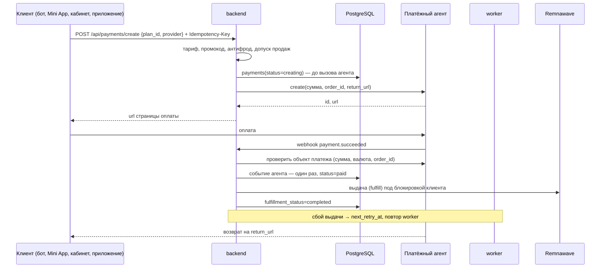
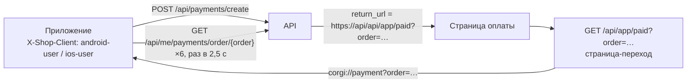
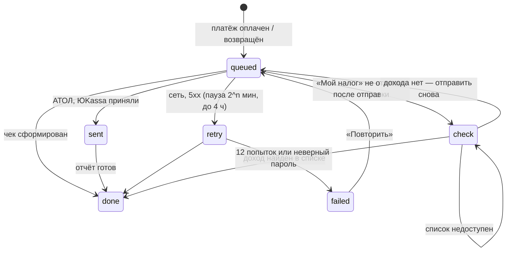

# Оплата и чеки в налоговую

Код: `backend/app/payments_api.py` (checkout, webhook, выдача, возвраты), `main.py` (кошелёк, `_return_url`, статус заказа), `subscription_commerce.py` (смена тарифа и докупки), `fiscal.py` (чеки), `app_login.py` (возврат в приложение). Инструкции владельцу — [модуль 7](../ru/modules/07-payments.md). Тесты: `tests/test_behaviour_payments*.py`, `tests/test_fiscal.py`, `tests/test_integration_billing_vpn.py`.

## Платёж от заказа до выдачи

Главные правила:

- **Намерение раньше агента.** Строка `payments` со статусом `creating` записывается до вызова агента. Если агент не ответил, статус `creation_unknown`, и магазин не переходит к другому агенту — иначе клиент мог бы заплатить дважды.
- **Идемпотентность.** `Idempotency-Key` обязателен; повтор с тем же ключом возвращает тот же заказ. Событие агента учитывается один раз на агента (`register_provider_event`).
- **Webhook не доверяют.** ЮKassa — только с адресов из `YOOKASSA_WEBHOOK_IP_ALLOWLIST`, и объект платежа перечитывается у агента (сумма, валюта, `order_id`) до подтверждения. Возврат, оформленный в кабинете агента (`refund.succeeded`), тоже отзывает доступ.
- **Выдача последовательна по клиенту.** `fulfill` берёт распределённую блокировку клиента, затем платежа (Redis); без Redis выдача не идёт.
- **Повторы.** Ошибка выдачи ставит `next_retry_at` с паузой; после `fulfillment_max_attempts` — `fulfillment_terminal`. Продление в Remnawave идемпотентно ([интеграция](remnawave_integration.md)).

## Резервный шлюз и автоплатежи

* **Порядок шлюзов** — по приоритету в таблице `payment_provider_health` (раздел флагов функций в админке). Шлюз
  участвует, только если включён, настроен и не в «остывании». Три ошибки создания платежа подряд включают
  остывание на 5 минут: новые заказы уходят в следующий шлюз — обычно CryptoBot (`CRYPTOBOT_TOKEN`).
  Сам заказ, создание которого закончилось ошибкой, в другой шлюз не переносится: его результат неизвестен,
  повторное списание заблокировано до сверки.
* **CryptoBot** (`payments.CryptoBotProvider`): счёт в рублях (`currency_type=fiat`), номер заказа в `payload`;
  webhook `/api/webhooks/cryptobot` с подписью HMAC-SHA256 (ключ — SHA-256 токена); оплата подтверждается
  только запросом самого счёта (сумма, валюта, заказ).
* **Автоплатёж ЮKassa** (`schedulers.run_auto_renew_pass`): списание за несколько дней до конца подписки.
  Ответ «ожидает подтверждения» — не отказ: тот же платёж перепроверяется через 15 минут. Отклонённое
  списание повторяется с новым ключом идемпотентности и нарастающей паузой; после **третьего** отказа
  автопродление выключается и больше ничего не списывается.
* Сквозная проверка обоих сценариев — `tests/test_e2e_journeys.py`.

## Возврат в приложение после оплаты

- `_return_url(order_id, base, request)` выбирает адрес возврата: приложение — `/api/app/paid`, кабинет и Mini App — их адрес с `?order=`.
- `/api/app/paid` принимает только идентификатор заказа (`[A-Za-z0-9_.:-]{6,128}`), отдаёт страницу без кэша и с запретом всего, кроме встроенного скрипта перехода. Номер заказа не секрет: статус заказа читается только сессией его владельца.
- `GET /api/me/payments/order/{order_id}` → `state`: `paid` (оплачен и выдан), `processing`, `pending`, `failed`, `refunded`.

## Данные

| Таблица | Ключевые поля |
| --- | --- |
| `payments` | `order_id`, `idempotency_key`, `provider`, `provider_payment_id`, `amount`, `original_amount`, `discount_amount`, `currency`, `status`, `fulfillment_status`, `fulfillment_attempts`, `next_retry_at`, `fulfillment_terminal`, снимки тарифа (`duration_days_snapshot`, `traffic_limit_gb_snapshot`, `device_limit_snapshot`, `remnawave_profile_id_snapshot`), `purpose`, `paid_at` |
| `refund_requests` | `payment_id`, `amount`, `status`, `provider_refund_id` |
| `fiscal_receipts` | `payment_id` + `kind` (`income`/`refund`, уникально), `provider`, `status`, `amount`, `name`, `external_id`, `receipt_url`, `fiscal_data`, `attempts`, `last_error`, `next_attempt_at` |

Снимки тарифа в платеже означают: клиент получает ровно то, за что заплатил, даже если администратор потом изменит тариф.

## Контракты API

| Метод | Путь | Кто | Назначение |
| --- | --- | --- | --- |
| POST | `/api/payments/create` | клиент | Заказ и ссылка на оплату (`Idempotency-Key`) |
| GET | `/api/me/payments/order/{order_id}` | клиент | Статус своего заказа |
| GET | `/api/me/payments` | клиент | История платежей |
| POST | `/api/me/wallet/topup` | клиент | Пополнение кошелька |
| POST | `/api/webhooks/yookassa`, `/platega`, `/rollypay` | агент | Уведомления |
| GET | `/api/app/paid` | браузер | Переход обратно в приложение |
| GET/PUT | `/api/admin/fiscal` | админ | Настройки чеков (секреты зашифрованы, наружу не отдаются) |
| POST | `/api/admin/fiscal/test` | админ | Проверка подключения |
| POST | `/api/admin/fiscal/receipts/{id}/retry` | админ | Повтор чека |
| GET | `/api/me/receipts` | клиент | Ссылки на свои чеки |

Полный каталог — [API_ENDPOINTS.md](../API_ENDPOINTS.md).

## Чеки в налоговую

`fiscal_scheduler` (worker, раз в минуту) ставит в очередь чеки новых платежей выбранных агентов (`enqueue_due`) и отправляет готовые (`process_due`, `FOR UPDATE SKIP LOCKED`).

| Способ | Для кого | Отправка | Возврат |
| --- | --- | --- | --- |
| «Мой налог» (`npd`) | самозанятые | `POST /income` (ИНН и пароль, как веб-кабинет) | `POST /cancel` — аннулирование |
| АТОЛ Онлайн v5 (`atol`) | ИП, ООО | `sell` по `external_id` `corgi-income-<id>`, затем `report` | `sell_refund` |
| Чеки ЮKassa (`yookassa`) | ИП, ООО с ЮKassa | `POST /v3/receipts` с `Idempotence-Key` | чек возврата |

**Сверка «Мой налог».** У API «Мой налог» нет ключа идемпотентности: ответ, потерянный после отправки, мог означать уже зарегистрированный доход. Поэтому:

1. Потеря ответа после отправки (`ReadTimeout` и прочие ошибки после соединения) переводит чек в `check`. Отказ соединения до отправки — обычный `retry`.
2. Любая следующая попытка (и ручное «Повторить») сначала читает `GET /incomes?from&to&offset&limit&sortBy=operation_time:desc` в окне ±1 минута от времени продажи.
3. Подходит доход с тем же названием и суммой, той же секундой продажи, не аннулированный и не записанный за другим чеком магазина. Найден — чек `done` с его номером. Не найден — доход отправляется снова.
4. Если список не читается, чек остаётся в `check` с паузой и вслепую не отправляется.

НДС 2026 для АТОЛ и ЮKassa: `none`, `vat0`, `vat5`, `vat7`, `vat10`, `vat22` и расчётные `vat105`, `vat107`, `vat110`, `vat122` (ЮKassa `vat_code` 11 для 22 %, 12 для 22/122). Время чеков — московское. Адреса сервисов — только https.
