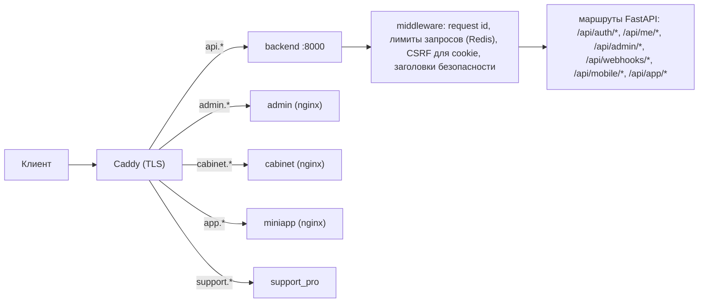
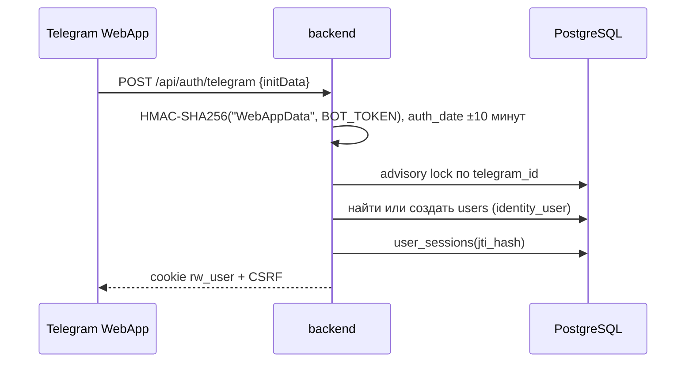
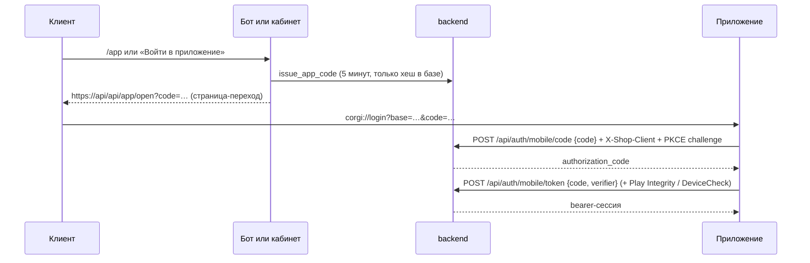

# Вход, бот и маршрутизация

Код: `backend/app/auth_api.py` (клиенты), `admin_auth_api.py` (администраторы), `app_login.py` (вход в приложения), `cabinet_api.py` (почта, VK, обмен кода приложений), `mobile_auth.py` (PKCE и доказательство клиента), `mobile_integrity.py`, `bot.py`. Тесты поведения: `tests/test_behaviour_auth.py`, `tests/test_app_login.py`.

## Маршрутизация запросов

- Лимиты запросов — словарь путей и числа запросов в минуту в `main.py` (например, `/api/auth/mobile/code`: 20, `/api/app/open` и `/api/app/paid`: 30), счётчики в Redis.
- Запросы с cookie-сессией проверяют CSRF (`rw_csrf`); webhook, мобильные bearer-запросы и публичные страницы-переходы исключены явно.
- IP клиента берётся из заголовков только от доверенного прокси (`TRUSTED_PROXY_CIDRS`).

## Сессии клиентов

| Таблица | Поля | Смысл |
| --- | --- | --- |
| `users` | `telegram_id`, `yandex_id`, `vk_id`, `email`, `email_verified_at`, `deleted_at`, `restricted_at`, `merged_into_user_id` | Аккаунт; удалённый и ограниченный не получают сессию |
| `user_sessions` | `jti_hash`, `user_agent`, `ip`, `expires_at`, `revoked_at`, `last_seen_at` | Серверная запись сессии; в токене только `jti`, в базе — его SHA-256 |
| `auth_exchange_codes` | `code_hash`, `user_id`, `expires_at`, `used_at` | Одноразовые коды OAuth и входа в приложение (только хеш) |

Токен — JWT HS256 (`APP_SECRET`) с `sub`, `type=user`, `jti`, `exp` (60 минут). `user_from_token` принимает его из `Authorization: Bearer` или cookie `rw_user` и отклоняет, если:

- сессии с таким `jti` нет, она отозвана или истекла;
- пришёл другой `User-Agent` (сессия сразу отзывается — украденный токен с другого устройства не работает);
- аккаунт удалён или ограничен.

`POST /api/auth/logout` отзывает текущую сессию, `POST /api/me/security/revoke-all` — все сессии клиента.

## Способы входа

| Способ | Вход | Как проверяется |
| --- | --- | --- |
| Telegram Mini App | `POST /api/auth/telegram` | Подпись `initData` по `BOT_TOKEN`, срок 10 минут, обязательный `user.id`; одна запись на Telegram ID под блокировкой |
| Яндекс ID | `GET /api/auth/yandex` → `/api/auth/yandex/callback` | Подписанный `state` в cookie, стабильный id профиля; результат — код обмена (1 минута для веба, 5 минут для приложения) |
| VK ID | `cabinet_api.py` | Так же, `?app=1` возвращает в приложение |
| Google | `GET /api/auth/google` → `/callback` | Только подтверждённая почта; неподтверждённая регистрация с той же почтой не связывается (409) |
| Почта и пароль, passkey | `cabinet_api.py`, `customer_passkeys.py` | Хеш пароля, WebAuthn |
| Код обмена | `POST /api/auth/exchange` | Одноразовый, срок, затем сессия |

### Вход в приложения

- Код меняется только нативным клиентом (`X-Shop-Client: android-user|ios-user`, не браузер) и только с PKCE; отказ не «сжигает» код.
- Удалённый аккаунт по коду не входит.
- Если адрес магазина вшит в сборку, ссылка другого магазина отклоняется в приложении.
- `MOBILE_INTEGRITY_MODE=report|enforce` проверяет Play Integrity или DeviceCheck на обмене кода — через него проходят все способы входа в приложение.

## Администраторы

| Таблица | Поля |
| --- | --- |
| `admin_users` | `email`, `password_hash`, `role`, `totp_secret_encrypted`, `recovery_codes_encrypted`, `mfa_enabled`, `disabled` |
| `admin_sessions` | `jti_hash`, `expires_at` (30 минут), `revoked_at` |

- `POST /api/admin/auth/login`: пароль, затем TOTP или код восстановления, если 2FA включена. Не больше 8 попыток за 15 минут на пару IP + почта (429), успешный вход сбрасывает счётчик. Отключённый администратор не входит.
- `POST /api/admin/auth/mfa/setup|enable|disable`, `GET /api/admin/auth/mfa/status`; отключение 2FA требует пароль.
- Права — `require_permission("<право>")` на каждом маршруте; роли и права — [модуль 28](../ru/modules/28-admin-security.md).

## Telegram-бот

`bot.py` (aiogram 3, long polling) работает с той же базой.

| Команда | Что делает |
| --- | --- |
| `/start` | Меню из конструктора кнопок; параметры: `ref_<код>` (реферал), `app_login` (ссылка входа в приложение), приглашение в семью |
| `/buy` | Тарифы и оплата через Mini App |
| `/subscription` | Ссылка подписки основной подписки (тот же ряд `subscriptions`, что видят кабинет и приложения) |
| `/promo` | Промокод |
| `/info` | Документы магазина |
| `/app` | Ссылка «Войти в приложение» |
| `/ops` | Сводка для владельца (`ADMIN_TELEGRAM_ID`) |

Каждый раздел бота отправляется с баннером раздела (`bot_banners.send_section`); меню и кнопки редактируются в админке ([модуль 14](../ru/modules/14-bot-miniapp.md)).
