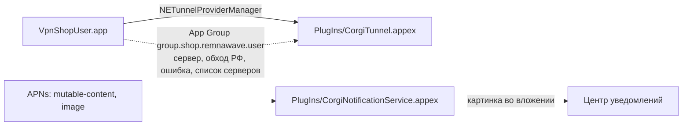
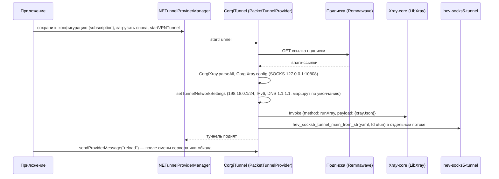
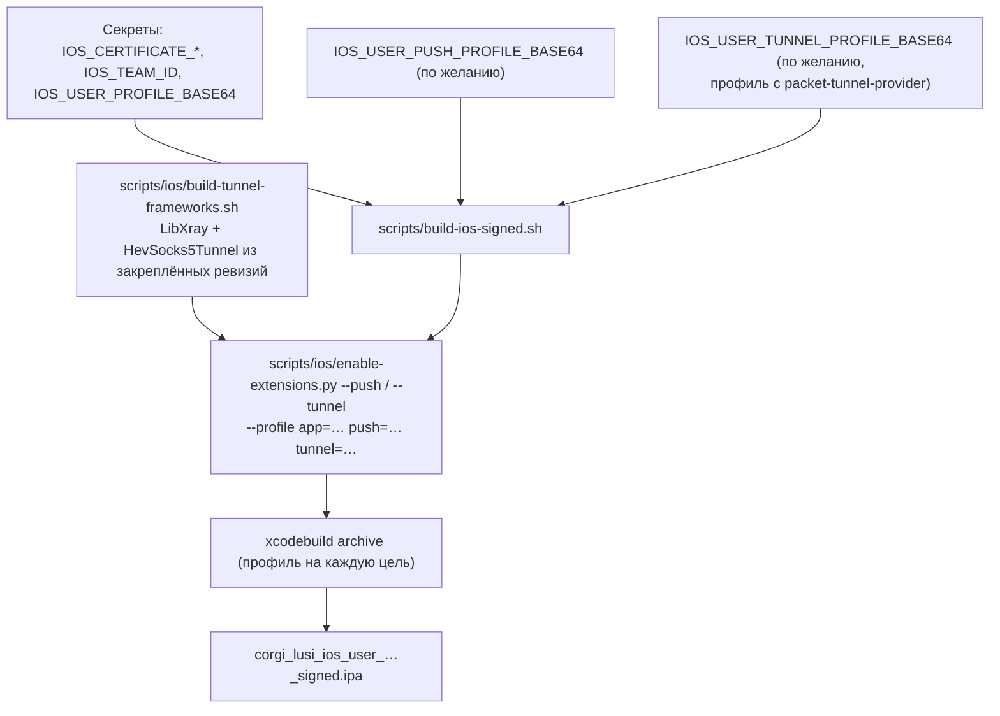

# iOS: клиентское приложение и расширения

Каталог `mobile/ios-user` (SwiftUI, iOS 16+). Bundle ID `shop.remnawave.user`. Инструкция владельцу — [модуль 16](../ru/modules/16-mobile-apps.md). Админ-приложение — `mobile/ios-admin`.

## Цели проекта

| Цель | Тип | Bundle ID | Встроена по умолчанию |
| --- | --- | --- | --- |
| `VpnShopUser` | приложение | `shop.remnawave.user` | — |
| `VpnShopUserUITests` | UI-тесты (XCUITest) | `shop.remnawave.user.uitests` | — |
| `CorgiTunnel` | Network Extension (packet tunnel) | `shop.remnawave.user.tunnel` | нет |
| `CorgiNotificationService` | Notification Service Extension | `shop.remnawave.user.push` | нет |

Расширения лежат в проекте, но не встроены в приложение: каждое — отдельный App ID с собственным профилем, а packet tunnel требует разрешения Network Extension, которое Apple выдаёт команде по запросу. Обычная сборка и её подпись не меняются. `scripts/ios/enable-extensions.py` встраивает их, когда у владельца есть профили.

## Приложение

- **Макет из админки** (`LayoutUI.swift`, `GET /api/mobile/layout`), встроенный стандартный макет и баннеры; тексты ru/en/uk.
- **ShopClient** (`VpnShopUserApp.swift`): `X-Shop-Client: ios-user`, проверка пинов SPKI (`CorgiPins` / `CORGI_PINS`) в делегате сессии, DeviceCheck при обмене кода на сессию. Сессия — в Keychain.
- **Ссылки** `corgi://login` и `corgi://payment` (`onOpenURL`): вход по одноразовому коду и возврат после оплаты с проверкой статуса заказа.
- **Push**: `PushCenter` регистрирует категории (кнопки) по стилю push из `GET /api/mobile/push-style`; нажатие открывает раздел.
- **«Подключить»**: если сборка встраивает туннель (`CorgiTunnelEnabled = YES` в Info.plist из настройки `CORGI_TUNNEL`), запускается `CorgiTunnelManager`; иначе подписка передаётся в Happ, v2RayTun или Streisand (`VpnClients`).

## Встроенный VPN: CorgiTunnel

- `Shared/CorgiXray.swift` компилируется в приложение и расширение: share-ссылки vless, vmess, trojan, shadowsocks (Reality, TLS; tcp, ws, grpc, xhttp, httpupgrade) → outbounds; «Авто» — observatory и балансировщик leastPing, или выбранный сервер; локальные сети и по желанию российские сайты идут напрямую. Правила те же, что на Android.
- Дескриптор utun берётся из `packetFlow` (старые iOS) или поиском управляющего сокета `com.apple.net.utun_control`.
- Без `LibXray.xcframework` и `HevSocks5Tunnel.xcframework` расширение компилируется (`#if canImport`) и отказывается запускаться с понятным сообщением.
- Ошибка запуска записывается в App Group (`vpn_error`), приложение показывает её клиенту.
- Память расширения ограничена iOS (до 50 МБ): Xray запускается с одним SOCKS-входом, без геобаз.

Лицензии: libXray — MIT, Xray-core — MPL-2.0, hev-socks5-tunnel — MIT ([THIRD_PARTY_NOTICES](../../THIRD_PARTY_NOTICES.md)).

## Push с картинками: CorgiNotificationService

APNs-сообщение стилизованного push (`push.py send_apns`) несёт `mutable-content: 1`, категорию с кнопками, `thread-id` и адрес картинки `image`. Расширение скачивает картинку (только https, jpeg/png/gif/webp, до 10 МБ) и прикладывает её. При любой ошибке или по окончании времени iOS уведомление показывается как пришло.

## Подпись и встраивание

`enable-extensions.py`:

- добавляет фазу «Embed App Extensions» и зависимости целей;
- для туннеля — `CORGI_TUNNEL = YES`, права Network Extension и App Group в `VpnShopUser.entitlements`, линковку фреймворков из `mobile/ios-user/Frameworks`;
- для ручной подписи — `PROVISIONING_PROFILE_SPECIFIER` в каждой цели (профиль в командной строке применился бы ко всем целям);
- повторный запуск ничего не меняет.

Профиль туннеля проверяется: в нём должно быть `packet-tunnel-provider`.

## Проверки

| Что | Где |
| --- | --- |
| Сборка приложения | CI «iOS • ios-user PKCE build» |
| UI-тесты | `VpnShopUserUITests`, CI «iOS • UI tests» (демо-режим `-CorgiDemo -CorgiTab …`) |
| Расширения и движок | CI «iOS • tunnel and rich push extensions»: собирает фреймворки (кэш по скрипту), встраивает оба расширения, проверяет, что они в `PlugIns` и движок слинкован |
| Скриншоты | workflow «Mobile screenshots» |

Работу туннеля нужно проверить на реальном iPhone с подписанной сборкой: симулятор не поднимает Network Extension.
