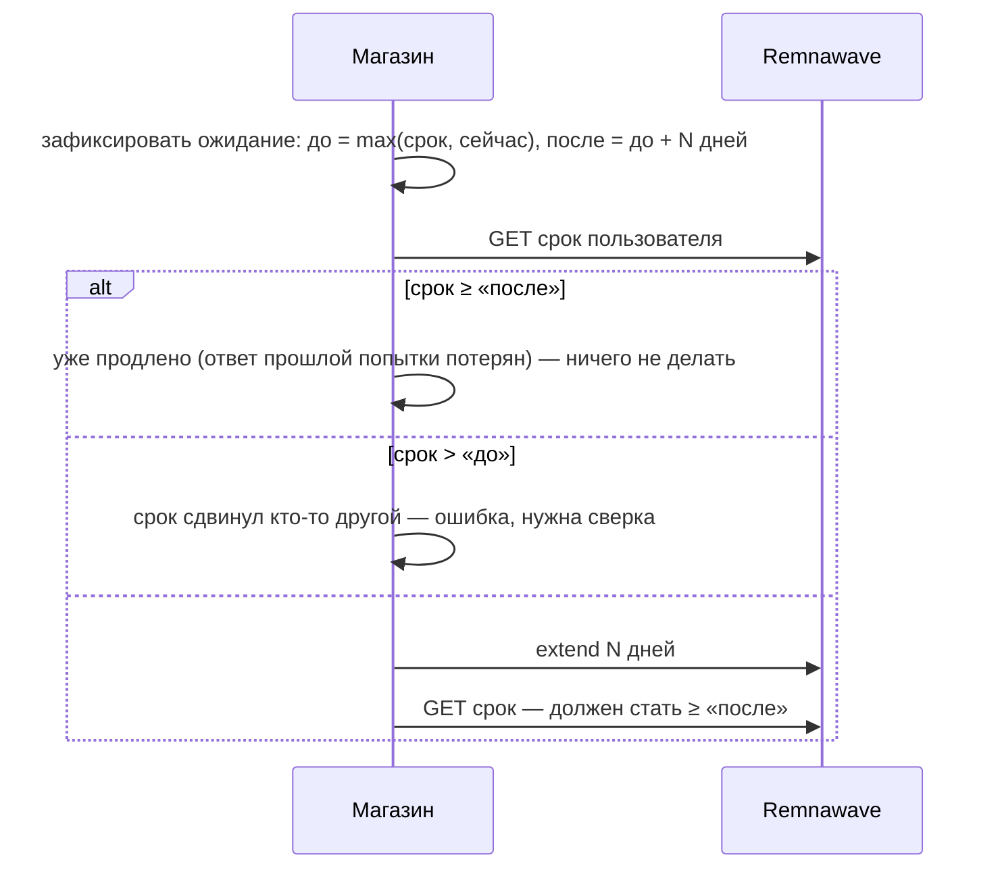
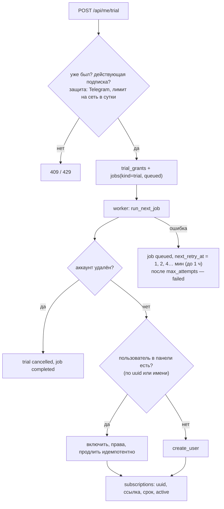

# Интеграция с Remnawave

Код: `backend/app/remnawave.py` (HTTP-клиент), `payments_api.py` (`fulfill`, выдача после оплаты), `backend/worker.py` (`run_next_job`: пробный период и выдача), `remnawave_events.py` (вебхуки панели, защита пробного периода), `subscription_commerce.py` (смена тарифа, докупка трафика). Инструкция владельцу — [модуль 18](../ru/modules/18-nodes-routing.md). Тесты: `tests/test_integration_billing_vpn.py` (панель в памяти за `httpx.MockTransport`), `tests/test_behaviour_payments.py`.

## Клиент

`RemnawaveClient` — один общий `httpx.AsyncClient` на процесс (тайм-аут 15 с, соединение 5 с, до 50 соединений), заголовок `Authorization: Bearer REMNAWAVE_TOKEN`. Ответы панели вида `{"response": …}` разворачиваются (`unwrap`). Ошибка HTTP — `RemnawaveError`.

**Предохранитель.** Каждая неудача увеличивает счётчик в Redis (`rw:cb:fail`, 5 минут). После `REMNAWAVE_CB_FAILURES` подряд предохранитель открывается на `REMNAWAVE_CB_COOLDOWN` секунд (`rw:cb:open`): вызовы сразу отклоняются (`RemnawaveCircuitOpen`), панель не засыпают повторами. Успех сбрасывает счётчик.

| Метод клиента | Запрос к панели |
| --- | --- |
| `get_user(id)` | `GET /api/users/{id}` |
| `get_user_by_username(name)` | `GET /api/users/by-username/{name}` |
| `create_user(...)` | `POST /api/users` (`expireAt`, `trafficLimitBytes`, `activeInternalSquads`, `telegramId`, `hwidDeviceLimit`) |
| `update_entitlements(...)` | `PATCH /api/users` (трафик, сквады, лимит устройств) |
| `extend_user(id, days)` | `POST /api/users/{id}/actions/extend` |
| `enable_user` / `disable_user` | `POST /api/users/{id}/actions/enable|disable` |
| `get_subscription(id)` | `GET /api/subscriptions/by-id/{id}` |

## Выдача без двойного продления

`extend_idempotent(id, days, before, after)` сохраняет ожидаемые «до» и «после» на операции до внешнего вызова (`trial_grants.expected_*`, `provisioning_operations.expected_*`). Повтор после потерянного ответа видит, что панель уже продлила, и не продлевает второй раз. Это проверяет тест «продление, ответ на которое потерян, не применяется дважды».

## Пробный период через очередь

- Блокировка клиента (Redis) на время выдачи: пробный период, оплата и удаление аккаунта не пересекаются.
- Потерянный ответ на `create_user`: повтор находит пользователя по имени (`remote_username`) и не создаёт второго.
- Задание, брошенное упавшим worker'ом, возвращается в очередь через 10 минут; свежую аренду другого worker'а не отбирают.

| Таблица | Ключевые поля |
| --- | --- |
| `subscriptions` | `remnawave_uuid`, `subscription_url`, `expires_at`, `lifecycle_status`, `plan_id`, снимки трафика, устройств и профиля, `is_primary` |
| `jobs` | `job_key`, `kind` (`trial`, `fulfillment`), `status`, `attempts`, `max_attempts`, `next_retry_at`, `locked_at`, `worker_id`, `error` |
| `trial_grants` | `user_id`, `plan_id`, `days`, снимки, `status`, `ip_hash`, `expected_before_expires_at`, `expected_after_expires_at` |
| `provisioning_operations` | `payment_id`, `operation_key`, `action`, `status`, `remote_user_id`, `expected_*` |

## Одно состояние для всех каналов

Бот (`/subscription`), кабинет (`GET /api/me/subscription`), Mini App и приложения (`GET /api/me/connection-info`, `/api/me/subscriptions`) читают одну и ту же основную строку `subscriptions`. Ссылку подписки и срок туда пишет только выдача по ответу панели, поэтому после оплаты или пробного периода все каналы показывают одно и то же. Это проверяет интеграционный тест «бот, кабинет и приложение показывают одну подписку».

## Вебхуки панели

`POST /api/webhooks/remnawave` (подпись `X-Remnawave-Signature` по `REMNAWAVE_WEBHOOK_SECRET`, до 256 КБ):

| Событие | Что делает магазин |
| --- | --- |
| `user.bandwidth_usage_threshold_reached` | Уведомление «Трафик заканчивается» |
| `user.limited` | «Трафик закончился» |
| `user.expired`, `user.expiration` | «Подписка закончилась / скоро закончится» |
| `user.first_connected`, `user.not_connected` | «VPN подключён» / помощь с подключением |
| `user_hwid_devices.added` | Учёт устройства, защита пробного периода по HWID |

События уходят и в движок автоматизации ([модуль 25](../ru/modules/25-automation-jobs.md)).
