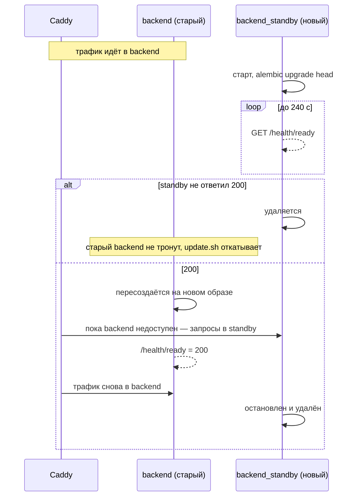

# Обновление backend без простоя

При обновлении старый backend продолжает отвечать клиентам, пока новая версия не ответит `200` на
`/health/ready`. Механизм включён по умолчанию (`ZERO_DOWNTIME=1`) и работает при любом обновлении через
`deploy/build-production.sh`: автообновление, «Обновить сейчас», ручной `update.sh`, GitHub Actions deploy.

## Как это устроено

| Компонент | Роль |
| --- | --- |
| `backend_standby` в `docker-compose.yml` | Копия сервиса `backend` (`extends`) со своим адресом `BACKEND_STANDBY_INGRESS_IP` (по умолчанию `172.30.84.5`) в сети ingress; профиль `standby`, обычным `up` не запускается |
| `BACKEND_UPSTREAM` у Caddy | Два адреса: backend и standby |
| Сниппет `(backend_lb)` в `deploy/Caddyfile` | `lb_policy first` (всегда backend, если он жив), активная проверка `/health/live` каждые 3 с, повтор недоставленных запросов до 20 с |
| `scripts/zero-downtime-backend.sh` | Порядок переключения |

## Гарантии и ограничения

* Сломанный выпуск не трогает работающий backend: ошибка проявляется до замены.
* Повторяются только запросы, которые не удалось доставить ни одному адресу (ошибка соединения), поэтому
  платёж или списание не выполнится дважды.
* Миграции выполняются в standby, пока старая версия ещё работает. Они должны быть **совместимы назад**:
  сначала добавить (колонку, таблицу), потом перейти, удалять — в следующем выпуске. Все миграции проекта
  следуют этому правилу.
* `worker`, бот и фронтенды перезапускаются обычным `docker compose up -d`: у них нет входящих запросов клиентов
  (фронтенды отдают статику и поднимаются за секунды).
* Отключить: `ZERO_DOWNTIME=0` в окружении запуска `build-production.sh`.

Тесты: `tests/test_zero_downtime_deploy.py` (порядок шагов на поддельном `docker`, сломанный выпуск, отказ нового
backend, конфигурация Caddy и Compose).
