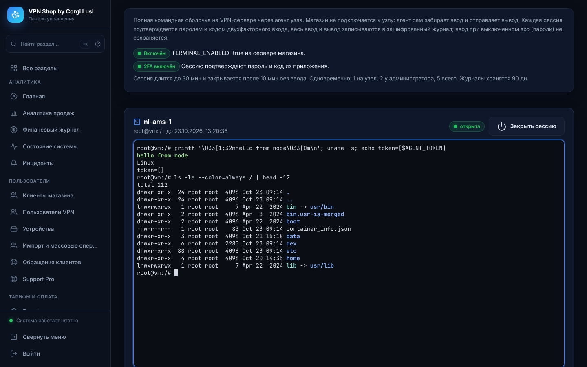

> Актуальная инструкция дистрибутива v28.25.1. Runtime/API `21.5.1`, head магазина `0076_growth`, Support Pro `0008`.

# Терминал узлов



Раздел **Серверы → Терминал узлов** открывает полную командную оболочку на VPN-сервере прямо в админ-панели: проверить журнал xray, перезапустить службу, посмотреть `top`, поправить конфигурацию. Подключение идёт через агент узла, а не через SSH: магазин не хранит SSH-ключи и не подключается к узлам сам.

Это полноценная оболочка: на узле можно выполнить любую команду, на которую хватает прав пользователя терминала. Поэтому включение двухступенчатое, каждая сессия подтверждается вторым фактором и полностью записывается.

## Как устроена защита

| Мера | Как работает |
| --- | --- |
| Два ключа | Терминал работает, только если его разрешил магазин (`TERMINAL_ENABLED=true` в `.env` сервера) **и** владелец узла (агент запущен с `AGENT_TERMINAL=1`). Из панели включить терминал нельзя. |
| Кто может | Только роль «Администратор» (право `nodes.terminal`). Нужен включённый двухфакторный вход. Каждая сессия подтверждается паролем и свежим кодом 2FA; один код открывает одну сессию; после 5 неверных подтверждений — пауза 15 минут. |
| Короткие полномочия | Узел должен подключиться к сессии за 2 минуты. Агент получает ключ этой сессии (в базе только его хэш); ключ перестаёт действовать при закрытии. Закрытую сессию нельзя открыть снова. |
| Время | Сессия длится не дольше `TERMINAL_MAX_MINUTES` (по умолчанию 30, максимум 120) и закрывается после `TERMINAL_IDLE_MINUTES` без ввода (по умолчанию 10). |
| Ограничения | Одна сессия на узел, две у администратора, пять всего. Фрагмент ввода до 8 КБ, вывода до 64 КБ; при журнале больше 8 МБ сессия закрывается. |
| Повторы | Ввод и вывод пронумерованы: повторённый после сбоя сети запрос не набирает команду второй раз. |
| Обрыв | Если закрыта сессия, отключён агент, выключен терминал на сервере или завершилась оболочка, агент завершает **все** процессы сессии оболочки, включая фоновые задания. |
| Окружение | Оболочка запускается с чистым окружением: токен агента и его переменные в неё не попадают. |
| Сеть | Агент сам опрашивает магазин по HTTPS, как и heartbeat. На узле не открывается ни один порт. |
| Журнал | Весь ввод и вывод хранится зашифрованным (AES-GCM) вместе с сессией. Ввод, набранный, пока терминал читает секрет — эхо выключено в построчном режиме (запросы пароля `sudo`, `passwd`, `read -s`), — записывается только как длина: «[скрытый ввод: N байт]». Bash, `vim` и `top` тоже выключают эхо, но работают в посимвольном режиме и рисуют ввод сами, поэтому команды в них записываются. Начало, закрытие сессии и просмотр журнала попадают в журнал действий. |

Чего защита не делает:

- Внутри сессии пользователь терминала может всё, что разрешают его права на узле: например, запустить процесс, отвязанный от сессии (`setsid`, `systemd-run`).
- Вывод команд записывается как есть. Если вывести на экран файл с секретами, он попадёт в зашифрованный журнал.

Ограничивайте права пользователем терминала (см. ниже) и не печатайте секреты на экран.

## Включение

### 1. Сервер магазина

```dotenv
TERMINAL_ENABLED=true
TERMINAL_MAX_MINUTES=30
TERMINAL_IDLE_MINUTES=10
TERMINAL_TRANSCRIPT_DAYS=90
```

1. Примените миграцию `0070_node_terminal` и перезапустите backend и worker: `docker compose up -d backend worker`.
2. Для нескольких процессов backend нужен Redis из стандартного `docker-compose.yml`: через него ввод и вывод передаются между процессами.

Переменные — настройки развёртывания: панель их не меняет. Реестр настроек — 180 полей: 96 live, 82 deployment, 2 workflow.

### 2. Узел

Агент — `scripts/node-agent.py`, создаётся в разделе **Серверы → Антиабуз и агенты** (там выдаётся токен). Рекомендуется отдельный пользователь для терминала:

```bash
useradd --create-home --shell /bin/bash corgi-term
# права — по необходимости, например только просмотр журналов и перезапуск xray:
echo 'corgi-term ALL=(root) /usr/bin/systemctl restart xray, /usr/bin/journalctl' > /etc/sudoers.d/corgi-term

SHOP_API_BASE=https://api.ДОМЕН AGENT_TOKEN=... \
AGENT_TERMINAL=1 AGENT_TERMINAL_USER=corgi-term \
python3 /opt/corgi/node-agent.py
```

| Переменная агента | Значение |
| --- | --- |
| `AGENT_TERMINAL` | `1` — разрешить терминал на этом узле; иначе агент сессии не принимает |
| `AGENT_TERMINAL_USER` | пользователь оболочки. Если агент работает от root, оболочка запускается через `runuser` от этого пользователя. Если агент работает от другого пользователя, сессия не откроется. Пусто — оболочка от пользователя агента |
| `AGENT_TERMINAL_SHELL` | оболочка, по умолчанию `/bin/bash` (или `/bin/sh`) |

Агент сообщает в heartbeat, что терминал разрешён. Кнопка **Открыть терминал** появляется у узла, если агент на связи последние 3 минуты.

### 3. Администратор

Включите двухфакторный вход в разделе **Безопасность → Защита и 2FA**, выйдите и войдите снова с кодом.

## Работа в терминале

1. Нажмите **Открыть терминал** у узла.
2. Укажите причину доступа (она попадает в журнал), пароль и код 2FA.
3. Через несколько секунд узел подключится и появится приглашение оболочки. Щёлкните по экрану, чтобы вводить команды.

Возможности экрана:

- работают Ctrl+C и другие сочетания с Ctrl (на любой раскладке), стрелки, Home/End, F1–F12, вставка из буфера;
- работают полноэкранные программы (`top`, `htop`, `less`, `vim`) с цветами;
- размер экрана подстраивается под окно.

**Сниппеты** — сохранённые команды. Они вставляются в сессию без Enter, чтобы их можно было проверить перед запуском.

**Закрыть сессию** завершает оболочку на узле. Администратор с правом управления безопасностью может закрыть и чужую сессию.

**Журнал** в таблице сессий показывает запись сессии: ввод выделен цветом, скрытый ввод показан только длиной. Просмотр журнала записывается в журнал действий.

## API

| Метод | Путь | Кто | Назначение |
| --- | --- | --- | --- |
| `GET` | `/api/admin/terminal` | `nodes.terminal` | узлы, сессии, сниппеты, ограничения |
| `POST` | `/api/admin/terminal/sessions` | `nodes.terminal` + 2FA | открыть сессию (`agent_id`, `reason`, `password`, `code`, `cols`, `rows`) |
| `GET` | `/api/admin/terminal/sessions/{id}/output` | владелец сессии | вывод узла (long polling, `cursor`, `wait` до 25 с) |
| `POST` | `/api/admin/terminal/sessions/{id}/input` | владелец сессии | ввод (`seq`, `data`) или размер (`seq`, `cols`, `rows`) |
| `POST` | `/api/admin/terminal/sessions/{id}/close` | владелец или `security.manage` | закрыть |
| `GET` | `/api/admin/terminal/sessions/{id}/transcript` | `nodes.terminal` + `security.manage` | расшифрованная запись сессии |
| `POST` | `/api/admin/terminal/snippets`, `/snippets/{id}/delete` | `nodes.terminal` | сниппеты |
| `GET` | `/api/agent/terminal/pending` | токен агента | ожидание и захват запрошенной сессии |
| `GET` | `/api/agent/terminal/{id}/input` | токен агента + ключ сессии | ввод для оболочки |
| `POST` | `/api/agent/terminal/{id}/output` | токен агента + ключ сессии | вывод оболочки, состояние эхо, завершение |

Ожидающие запросы не держат соединение с базой: ввод и вывод передаются через Redis Streams, а без Redis — через очередь в памяти процесса (только для разработки).

## Проверка

`tests/test_node_terminal.py` (SQLite и PostgreSQL) проверяет:

- **полный цикл:** захват сессии один раз; ключ хранится только хэшем; повтор ввода и вывода не дублируется; передача размера экрана;
- **скрытый ввод** при выключенном эхо не попадает в журнал; журнал зашифрован; закрытие гасит ключ агента; аудит без паролей;
- **ожидание агента** просыпается сразу после запроса сессии;
- **отказы:** терминал выключен, неверный пароль, повтор кода 2FA, нет 2FA, узел без `AGENT_TERMINAL=1` или не на связи, лимиты сессий, блокировка после 5 ошибок;
- **ключи и владельцы:** чужой ключ, чужой агент, ввод в чужую сессию, закрытие чужой сессии;
- **закрытие:** по ожиданию узла, простою, длительности, выходу из оболочки с кодом, отключению агента, лимиту журнала, выключению терминала; срок хранения журналов;
- **агент с настоящим pty:** нет токена в окружении оболочки, размер экрана, сообщение о выключенном эхо, различение пароля и readline по построчному режиму, код выхода, завершение фоновых заданий при закрытии;
- **ретранслятор** на настоящем Redis.

`tests/terminal-screen.test.mjs` проверяет эмулятор экрана: перенос и прокрутку, позиционирование и стирание, цвета (16, 256, truecolor), альтернативный экран, область прокрутки, заголовок, ответ на запрос позиции курсора, изменение размера и коды клавиш (Ctrl на русской раскладке).

`tests/test_matrix_extension_migrations.py` проверяет roundtrip миграции `0070_node_terminal` и запрет отката, пока есть записи сессий.

Работу на ваших узлах (пользователь терминала, права `sudo`, сеть до API магазина) проверяет оператор.
