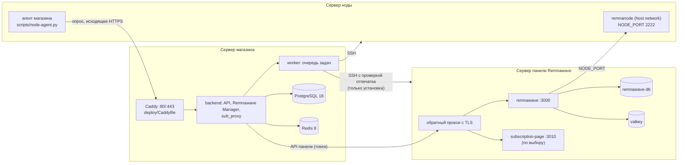

# Архитектура Remnawave Manager

Этап 9 мастер-задания. Документ описывает, как магазин управляет установкой, узлами, доменами, подпиской, модулями, копиями и обновлениями Remnawave из админ-панели. Цель — один backend и типизированные операции; команд из браузера нет.

Связанные документы:
- [REMNAWAVE_DATA_MODEL](REMNAWAVE_DATA_MODEL.md) — данные;
- [REMNAWAVE_API_DESIGN](REMNAWAVE_API_DESIGN.md) — API;
- [DEPLOYMENT_AGENT_ARCHITECTURE](DEPLOYMENT_AGENT_ARCHITECTURE.md) — как команды попадают на серверы.

Что уже есть в коде, а что только запланировано, отмечено в каждой таблице. Пометка «этап N» значит, что функции пока нет и в панели нет её кнопок.

## 1. Правила

1. **Один backend.** Remnawave Manager — часть backend магазина (`backend/app`), а не отдельный сервис. Права (`require_permission`), журнал действий (`audit_logs`), очередь задач (`jobs`) и состояние системы общие ([RBAC](RBAC.md), [ADMIN_PANEL_GUIDE](ADMIN_PANEL_GUIDE.md)).
2. **Никаких команд из браузера.** Браузер отправляет только типизированные значения: адрес, порт, домен, выбранный режим. Сервер сам строит из них файлы и шаги. Шаги — заранее известные, версионированные, с проверкой контрольной суммы ([DEPLOYMENT_AGENT_ARCHITECTURE](DEPLOYMENT_AGENT_ARCHITECTURE.md)).
3. **Без второго прокси и второй подписки на сервере магазина.** Порты 80/443 сервера магазина держит Caddy (`deploy/Caddyfile`). Свой домен подписки — это существующая прослойка `backend/app/sub_proxy.py` за тем же Caddy. На отдельных серверах Remnawave свой обратный прокси допустим: там нет Caddy магазина.
4. **Только проверенный API Remnawave.** Вызовы панели берутся из `@remnawave/backend-contract` и проверяются на настоящей панели последней версии в CI (`tests/live/test_remnawave_live.py`). Пока функция не прошла такую проверку, она не считается поддерживаемой.
5. **Каждое действие — задача.** Долгие операции идут через очередь задач с шагами и журналом, а не внутри HTTP-запроса. Исключение — существующие быстрые вызовы API панели.

## 2. Что известно о последней версии Remnawave

Сверено 2026-11-03:
- с официальными репозиториями `remnawave/backend`, `remnawave/node`, `remnawave/subscription-page`;
- с пакетом `@remnawave/backend-contract` в npm.

Официальный сайт документации docs.rw из рабочей среды недоступен. Поэтому источник — файлы `docker-compose-prod.yml`, `.env.sample` и схемы конфигурации в самих репозиториях.

| Компонент | Версия | Образ | Как запускается официально |
| --- | --- | --- | --- |
| Панель (backend + встроенный frontend) | 3.4.8 | `remnawave/backend:3` | `remnawave` слушает `127.0.0.1:3000` (API и интерфейс) и `127.0.0.1:3001` (метрики, `/health`). Рядом — PostgreSQL 18 (`remnawave-db`) и Valkey 9 по unix-сокету (`remnawave-redis`), сеть `remnawave-network` |
| Нода | 3.4.4 | `remnawave/node:latest` | `network_mode: host`, `cap_add: NET_ADMIN`, переменные `NODE_PORT=2222` и `SECRET_KEY`. Ключ выдаёт панель (`GET /api/keygen`) |
| Страница подписки | 8.0.1 | `remnawave/subscription-page:latest` | `127.0.0.1:3010`, в сети `remnawave-network`. Переменные: `REMNAWAVE_PANEL_URL`, `REMNAWAVE_API_TOKEN`, `INTERNAL_JWT_SECRET`, `SUBPAGE_CONFIG_UUID` и необязательные |
| Контракт API | 3.4.15 | npm `@remnawave/backend-contract` | 28 контроллеров, в том числе `nodes`, `hosts`, `internal-squads`, `hwid`, `node-plugins`, `node-ssh`, `infra-billing`, `subscription-page-configs`, `keygen`, `system` |

Требования панели, важные для архитектуры:
- **HTTPS через прокси.** В production панель обрывает соединение без заголовков `X-Forwarded-For` и `X-Forwarded-Proto: https` (`proxy-check.middleware.ts`), поэтому перед ней нужен обратный прокси с TLS. Страница подписки устроена так же — это показал живой тест. Обращаясь к панели по `http://` внутри своей сети, она ставит эти заголовки сама.
- **Домены.** Панель знает свои адреса из переменных `PANEL_DOMAIN`, `SUB_PUBLIC_DOMAIN` и `FRONT_END_DOMAIN`. Поэтому домены задаются до первого запуска.
- **Связь с нодой.** Панель подключается к ноде по `NODE_PORT`. Нода открывает этот порт на хосте; доступ к нему стоит ограничить адресом панели.
- **Возможности самой панели.** У панели есть свои плагины нод (`node-plugins`), доступ по SSH к нодам из её интерфейса (`node-ssh`) и учёт расходов на серверы (`infra-billing`). Магазин эти функции не дублирует: на этапе 12 менеджер расширений использует API плагинов панели, а не строит свой.

Что проверяется на настоящей панели последней версии (`scripts/ci/remnawave-live.sh`, workflow «Remnawave live contract»: на каждый PR, затрагивающий клиент панели или живые тесты, при каждом слиянии в `main` и каждый понедельник):
- пользователи, ноды, ключ ноды, сквады, хосты, устройства HWID, лимиты тарифов Lucy, подписка через `sub_proxy`;
- с v28.65.0 — режимы «Панель + нода» и «Панель + страница подписки». Нода и страница подписки запускаются так, как их запускает официальный compose: нода должна подключиться к панели, а страница подписки — отдать подписку VPN-клиенту. Показывать ли браузеру веб-страницу, решают правила ответа подписки в панели (SRR). На свежей панели страница браузеру не показывается: в журнале страницы — «Webpage access is not allowed by Remnawave's SRR».

## 3. Серверы и роли

- **Сервер магазина** не превращается в сервер Remnawave. Здесь остаются Caddy, backend, worker, базы и прослойка подписки.
- **Серверы Remnawave** — отдельные VPS. На них панель, нода и страница подписки в официальных контейнерах. Магазин связан с ними тремя путями:
  - API панели с токеном;
  - SSH — только для первичной установки, с проверкой отпечатка ключа хоста;
  - агент на узле — сам опрашивает магазин, входящих портов не открывает.

## 4. Четырнадцать компонентов

| № | Компонент | За что отвечает | Что уже есть в коде | Чего нет и когда появится |
| --- | --- | --- | --- | --- |
| 1 | Remnawave Manager | Связь с панелью: адрес, токен, проверка совместимости, профили, хосты, сквады | `backend/app/remnawave.py` (клиент 3.x, обрыв цепи при сбоях), `backend/app/panel_admin.py`, `backend/app/panel_guard.py`, `backend/app/panel_api_stats.py`, вебхуки `backend/app/remnawave_events.py` | Проверка версии панели против проверенной в CI — этап 10 |
| 2 | Deployment Manager | План установки по режиму, его выполнение по шагам, откат | `backend/app/provisioner.py`: установка ноды по SSH с проверкой отпечатка, Docker из подписанного репозитория. `POST /api/admin/provision-node` с v28.65.0 принимает только типизированные значения | Сделано в v28.66.0: мастер `backend/app/rw_api.py`, план `backend/app/rw_plan.py`, шаги `backend/app/rw_steps.py`, исполнитель `backend/app/rw_jobs.py` ([REMNAWAVE_INSTALLATION_WIZARD](REMNAWAVE_INSTALLATION_WIZARD.md)) |
| 3 | Server Registry | Список серверов: адрес, порт SSH, отпечаток, назначение, ресурсы, состояние | Частично: агенты узлов `node_agents` (`backend/app/platform_api.py`), серверы автомасштабирования Hetzner (`backend/app/node_autoscale.py`) | Сделано в v28.66.0: таблица `remnawave_servers`, раздел «Установка Remnawave» (`admin/src/rw-installer.tsx`) |
| 4 | Node Manager | Ноды панели: создание, перезапуск, обновление, нагрузка, терминал | `backend/app/node_health.py`, `backend/app/node_autoscale.py`, `backend/app/node_forecast.py`, `backend/app/node_terminal.py`, `scripts/node-agent.py` | Сделано в v28.66.0: режимы «Только нода» и «Добавить ноду» |
| 5 | Domain Manager | Домены панели, подписки, нод; DNS-проверка | Нет. Домены магазина задаются в `.env` | Этап 11 |
| 6 | Certificate Manager | Сертификаты доменов, сроки, продление | Сертификаты сервера магазина выпускает Caddy; срок и проверку цепочки показывает «Состояние системы» (`backend/app/system_status.py`) | Сертификаты серверов Remnawave и управление ими — этап 11 |
| 7 | Proxy Manager | Маршруты обратного прокси | `deploy/Caddyfile` (общий Caddy магазина) | Маршруты доменов из админки через общий Caddy — этап 11 |
| 8 | Subscription Manager | Выдача подписки: свой домен, правила приложений, блокировка устройств | `backend/app/sub_proxy.py`, `backend/app/client_versions.py`, `backend/app/subscriptions.py` | Официальная страница подписки на сервере Remnawave (режимы 4 и 5) — этапы 10–11 |
| 9 | Module Manager | Расширения нод: SelfSteal, WARP, IPv6, маршрутизация и др. | Нет | Этап 12, через плагины нод панели (`node-plugins`) |
| 10 | Backup Manager | Копии магазина и Remnawave | Копии магазина: `backend/app/backups_api.py`, `backend/app/backup_verify.py`, `backend/app/telegram_backup.py`, `backend/app/hot_standby.py` | v28.66.0: шаг `backup_panel` — копия на сервере панели перед обновлением и удалением. Передача в хранилище магазина — этап 15 |
| 11 | Update Manager | Обновления магазина, панели и нод | Магазин: `backend/app/auto_update_api.py`, `backend/app/github_update.py`, `scripts/update.sh`. Ноды: `POST /api/admin/nodes/update` | v28.66.0: «Обновить» в мастере (закреплённые образы). Автообновление по расписанию — этап 15 |
| 12 | Health Manager | Состояние всех частей | `backend/app/system_status.py` (14 проверок), `backend/app/node_health.py`, `backend/app/ops_alerts.py`, `backend/app/block_monitor.py` | Проверки серверов Remnawave (TLS, ресурсы) — этапы 10–11 |
| 13 | Job Manager | Очередь, повторы, состояние шагов | `jobs` и `backend/worker.py`; раздел «Очередь задач» | Сделано в v28.66.0: `remnawave_installations` и `remnawave_deployment_steps`, свой цикл в worker |
| 14 | Audit Manager | Кто, что и когда изменил | `audit()` в `backend/app/main.py`, `GET /api/admin/audit` с фильтрами | — (используется всеми компонентами) |

## 5. Семь режимов

| Режим | Где что работает | Что вводит администратор | Проверено на последнем выпуске |
| --- | --- | --- | --- |
| Panel + Node | Один VPS: панель, нода, обратный прокси с TLS | VPS, домен панели, домен подписки | Связь панели и ноды — да, в CI с v28.65.0. Установка мастером по SSH — да, в CI с v28.66.0 (сервер CI вместо VPS). Настоящий VPS — BLOCKED_EXTERNAL |
| Panel Only | VPS с панелью; ноды добавляются позже | VPS, домены | Панель — да (каждый прогон CI). Установка мастером — mock-тест; на VPS — BLOCKED_EXTERNAL |
| Node Only | VPS с нодой для существующей панели | VPS, панель (из настроек магазина) | Связь с панелью — да. Установка: `backend/app/provisioner.py` уже ставит ноду по SSH; на настоящем VPS не проверена |
| Panel + Subscription Page | Панель и официальная страница подписки на одном VPS | VPS, домен панели, домен страницы | Страница отдаёт подписку VPN-клиенту — да, в CI с v28.65.0. Веб-страница для браузера — по правилам SRR панели (этап 11) |
| Subscription Page Only | Только страница подписки | VPS или сервер магазина. На сервере магазина эту роль играет `sub_proxy` за общим Caddy, второго сервиса нет | Страница — да; `sub_proxy` — да |
| Distributed Deployment | Панель, страница подписки и ноды на разных VPS | Несколько VPS и назначение каждого | По частям — да. Как целое — mock-тест v28.66.0; на нескольких VPS — BLOCKED_EXTERNAL |
| Add Node to Existing Panel | Новая нода к уже работающей панели | VPS | Как Node Only. Ключ ноды выдаёт панель (`GET /api/keygen`) |

Режим — это не отдельный код, а набор ролей на серверах: `panel`, `node`, `subscription_page`. Deployment Manager превращает выбранные роли в план шагов. Каждый шаг выполняет агент развёртывания ([DEPLOYMENT_AGENT_ARCHITECTURE](DEPLOYMENT_AGENT_ARCHITECTURE.md)).

## 6. Основные потоки

**Установка (v28.66.0, [REMNAWAVE_INSTALLATION_WIZARD](REMNAWAVE_INSTALLATION_WIZARD.md)).**
1. Администратор добавляет сервер: адрес, порт SSH, способ входа, отпечаток ключа хоста.
2. Preflight по SSH: ОС, архитектура, ресурсы, Docker, занятые порты, DNS. Сервер получает отчёт, а не текст в браузер.
3. Администратор выбирает режим и домены. Сервер строит план: шаги, файлы, какие порты займутся, что изменится.
4. После подтверждения плана — задача в очереди. Шаги выполняются по одному, каждый пишется в журнал. При ошибке выполняется откат, предусмотренный для этого шага.
5. В конце — проверка: панель отвечает через HTTPS, нода подключилась, страница подписки отвечает. Те же проверки, что в CI.

**Добавление ноды (есть частично).**
1. Ключ берётся у панели (`GET /api/keygen`).
2. Compose ноды строит сервер (`provisioner.node_compose`), SSH-установка ставит Docker из подписанного репозитория.
3. Нода регистрируется в панели с профилем конфигурации.

**Обновление.** Версии образов закрепляются. Сначала обновление проверяется в CI на последнем выпуске Remnawave, затем доступно в админке. Перед обновлением панели — копия её базы.

**Копии.** Копия магазина — как сейчас. Копия панели (v28.66.0): `pg_dump` базы `remnawave-db` на сервере панели перед обновлением и удалением, хранятся 5 последних. Шифрование и передача в хранилище магазина (S3 или Telegram) — этап 15.

## 7. Границы безопасности

- **Права.**
  - установка и ноды — `provision_nodes`;
  - терминал узлов — `nodes.terminal`;
  - восстановление — `backups.restore`;
  - изменение настроек — `settings.runtime.write`.
- **SSH.**
  - только с проверенным отпечатком ключа хоста (`_FingerprintPolicy`), без доверия при первом подключении;
  - `POST /api/admin/provision-node` ключи не хранит: они передаются на одну установку;
  - реестр мастера (v28.66.0) хранит ключ или пароль зашифрованным (`security.encrypt_secret`) и наружу не отдаёт: обновление и удаление идут по SSH;
  - рекомендуется вход по ключу.
- **Агент.** Принимает только действия из списка (`throttle`, `clear`, `update_node`, `restart_node` и новые типы этапа 10). Неизвестное действие отклоняется на стороне магазина (`backend/app/platform_api.py`).
- **Секреты Remnawave** не попадают в браузер и журнал: токен API, `SECRET_KEY` нод, пароли баз. Ответы панели клиенту не передаются (`backend/app/errors.py`).

## 8. Найдено при проектировании

`POST /api/admin/provision-node` принимал из запроса текст compose-файла и разворачивал его на сервере от root. Проверялось только, что в тексте есть `remnawave/node`. Значит, любой контейнер с любыми правами можно было запустить, добавив строку с этим образом. Это противоречило правилу «никаких команд из браузера».

Исправлено в v28.65.0:
- запрос принимает только типизированные поля (`NodeProvisionIn`), лишние поля отклоняются;
- compose строит сервер по официальному образцу (`provisioner.node_compose`), ключ ноды берётся у панели;
- отпечаток ключа хоста обязателен;
- SSH выполняется вне цикла событий API.

Раздела панели у этого маршрута не было, вызывался он только через API.

## 9. Что не проверено

- **Установка на настоящий VPS** не проверялась: тестового VPS нет. С v28.66.0 мастер ставит «панель + ноду» по SSH на сервер CI (`tests/live/test_install_live.py`); настоящий VPS, Let's Encrypt и сеть между серверами — `BLOCKED_EXTERNAL`.
- **Выпуск TLS-сертификатов** для серверов Remnawave требует настоящих доменов — этап 11.
- **Обновление панели между мажорными версиями** (3.x → 4.x) не проверялось: такой версии ещё нет.
