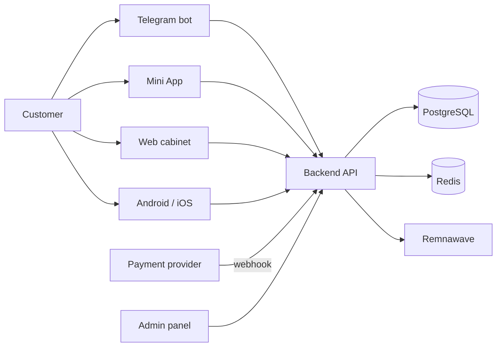

# Corgi Lucy — free internet without the extra woof!

A VPN subscription shop on top of your Remnawave panel: a customer pays and receives access at once, and you
run everything from one admin panel.

> Current release **v28.56.0**, runtime/API `21.5.1`, shop migration `0088_filter_and_regions`.

## Where to start

| Task | Page |
| --- | --- |
| Install the shop on a server | [Installation](Installation.md) |
| Connect payments | [Payments](Payments.md) |
| Set up the bot and Mini App | [Telegram](Telegram.md) |
| Learn the admin panel | [Admin panel](Admin.md) |
| Keep the shop updated | [Updates](Updates.md) |
| Back up and restore data | [Backups](Backup.md) |
| Something is broken | [Troubleshooting](Troubleshooting.md) |

## What you need first

1. **A server** — a VDS on Ubuntu 22.04+ with 2 cores, 4 GB RAM, 20 GB SSD.
2. **A domain** — an A record pointing at the server IP. Three subdomains are convenient for three surfaces.
3. **A Remnawave panel** — address and API token. Without it the shop cannot deliver access.
4. **A Telegram bot** — a token from [@BotFather](https://t.me/BotFather).
5. **A payment provider** — keys from any supported provider. Without keys the shop runs, but cannot take money.

## How it works

The customer pays → the provider sends a webhook → the shop verifies the signature and re-reads the amount from
the provider → a worker grants access in Remnawave → the customer receives a subscription link.

## Full documentation

The repository holds all documentation: [README](https://github.com/booarkz-cpu/shop-by-boo#readme),
[document index](https://github.com/booarkz-cpu/shop-by-boo/blob/main/docs/INDEX.md),
[API catalogue](https://github.com/booarkz-cpu/shop-by-boo/blob/main/docs/API_ENDPOINTS.md).

## Languages

[Русский](../ru/Home.md) · [English](Home.md) · [Українська](../uk/Home.md)
