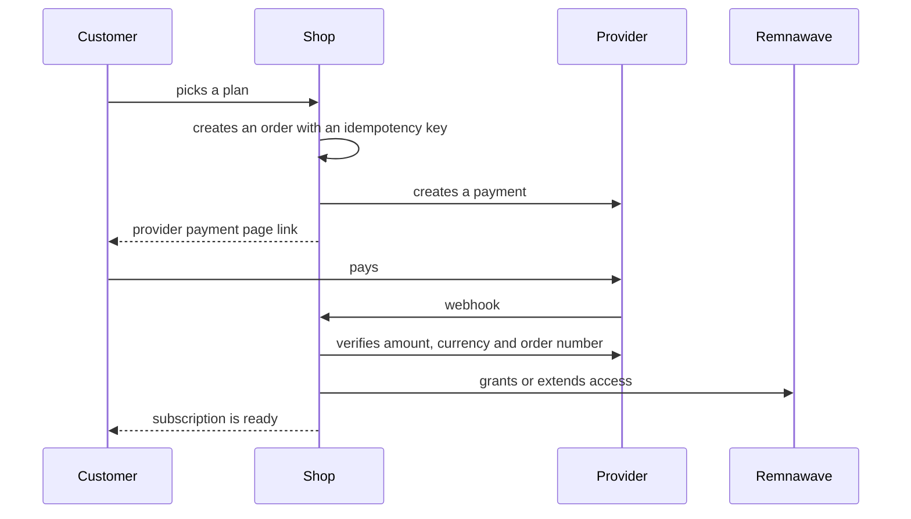

# Payments

The shop takes money through 16 external providers and Telegram Stars. All of them are implemented in code; a
method appears for a customer only after you fill in its variables in `.env`.

## How a payment flows



A repeated webhook never repeats the grant: the event is marked as processed and delivery is guarded by a
per-customer lock. A subscription is **never** granted from a customer message — only after the provider
confirms the status.

## Connecting a provider

1. Register with the provider and get the keys.
2. Fill in the variables in `.env` (table below).
3. In the provider dashboard set the webhook address:
   `https://your-domain/api/webhooks/<provider>` — the exact path is listed with the provider.
4. Restart the backend: `docker compose restart backend`.
5. Check: under "Payments" in the admin panel the provider must show "configured".

## Providers and variables

| Provider | Accepts | Variables |
| --- | --- | --- |
| YooKassa | cards, SBP | `YOOKASSA_SHOP_ID`, `YOOKASSA_SECRET_KEY`, `YOOKASSA_WEBHOOK_IP_ALLOWLIST` |
| Freekassa | cards, SBP | `FREEKASSA_MERCHANT_ID`, `FREEKASSA_SECRET_WORD`, `FREEKASSA_SECRET_WORD_2` |
| CloudPayments | cards, SBP, refunds | `CLOUDPAYMENTS_PUBLIC_ID`, `CLOUDPAYMENTS_API_SECRET` |
| Platega | cards, SBP | `PLATEGA_MERCHANT_ID`, `PLATEGA_SECRET` |
| RollyPay | cards, SBP | `ROLLYPAY_API_KEY`, `ROLLYPAY_SIGNING_SECRET` |
| CryptoBot | crypto | `CRYPTOBOT_TOKEN`, `CRYPTOBOT_NETWORK` |
| Lava | cards, SBP | `LAVA_*` |
| Pal24 | cards, SBP | `PAL24_*` |
| Mulen Pay | cards, SBP | `MULENPAY_*` |
| WATA | cards, SBP | `WATA_*` |
| Antilopay | cards, SBP | `ANTILOPAY_*` |
| AuraPay | cards, SBP | `AURAPAY_*` |
| Anore | cards, SBP | `ANORE_*` |
| Cashera | cards, SBP | `CASHERA_*` |
| ParityPay | cards, SBP | `PARITYPAY_*` |
| Tribute | wallet top-up | `TRIBUTE_*` |
| Telegram Stars | Stars, auto-renewal | `BOT_TOKEN` |

The shared webhook address is set by `WEBHOOK_BASE_URL`.

## Testing without money

```bash
PAYMENTS_SANDBOX=true docker compose up -d backend
```

Sandbox mode runs an order through the internal logic without a real provider. It verifies the code, **not** the
ability to take money.

## Emergency stop

The admin panel has a "Stop accepting payments" button: new orders are not created, already paid orders finish
normally. It applies immediately, without a restart.

## Honest status

No real money has moved through any provider: the project has no live keys. The signature, amount verification
and idempotency paths are covered by tests. Step-by-step live verification for every provider:
[PAYMENTS_LIVE_CHECKLIST.md](https://github.com/booarkz-cpu/shop-by-boo/blob/main/docs/ru/PAYMENTS_LIVE_CHECKLIST.md).

[← Back to home](Home.md)
