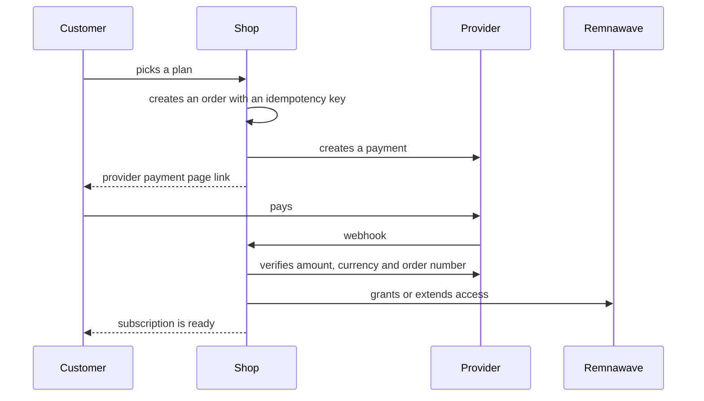

# Payments

The shop can route checkout orders to 15 external payment providers. Availability depends on the provider’s settings, credentials and current status. Tribute handles wallet top-ups separately. Telegram Stars payments and subscriptions use Telegram invoices.

## How a payment flows



When the shop receives a notification, it verifies the payment and checks whether it has already processed the event. Customers can check the result in their account.

## Connecting a provider

1. Obtain credentials from the provider and set the corresponding variables in the server’s `.env` file.
2. Enter the HTTPS notification URL in the provider’s dashboard. For example, YooKassa uses `/api/webhooks/yookassa` on your API domain.
3. In a standard Compose installation, run `docker compose up -d backend worker` to apply the `.env` changes. If you changed `BOT_TOKEN`, also update the `bot` service.
4. In the admin panel, check that the provider is configured, enabled and available for the selected payment method.

## Providers and variables

| Provider | Accepts | Variables |
| --- | --- | --- |
| YooKassa | cards, SBP | `YOOKASSA_SHOP_ID`, `YOOKASSA_SECRET_KEY`, `YOOKASSA_WEBHOOK_IP_ALLOWLIST` |
| Freekassa | cards, SBP | `FREEKASSA_SHOP_ID`, `FREEKASSA_SECRET1`, `FREEKASSA_SECRET2`, `FREEKASSA_API_KEY`, `FREEKASSA_WEBHOOK_IP_ALLOWLIST` |
| CloudPayments | cards, SBP, refunds | `CLOUDPAYMENTS_PUBLIC_ID`, `CLOUDPAYMENTS_API_SECRET` |
| Platega | cards, SBP | `PLATEGA_MERCHANT_ID`, `PLATEGA_SECRET` |
| RollyPay | cards, SBP | `ROLLYPAY_API_KEY`, `ROLLYPAY_SIGNING_SECRET` |
| CryptoBot | crypto | `CRYPTOBOT_TOKEN`, `CRYPTOBOT_NETWORK` |
| Lava | cards, SBP | `LAVA_SHOP_ID`, `LAVA_SECRET_KEY`, `LAVA_WEBHOOK_SECRET` |
| Pal24 | cards, SBP | `PAL24_*` |
| Mulen Pay | cards, SBP | `MULENPAY_SHOP_ID`, `MULENPAY_API_KEY`, `MULENPAY_SECRET_KEY` |
| WATA | cards, SBP | `WATA_ACCESS_TOKEN` |
| Antilopay | cards, SBP | `ANTILOPAY_PROJECT_ID`, `ANTILOPAY_SECRET_ID`, `ANTILOPAY_PRIVATE_KEY`, `ANTILOPAY_PUBLIC_KEY`, `ANTILOPAY_CUSTOMER_EMAIL` |
| AuraPay | cards, SBP | `AURAPAY_SHOP_ID`, `AURAPAY_API_KEY`, `AURAPAY_SECRET_KEY` |
| Anore | cards, SBP | `ANORE_SHOP_ID`, `ANORE_API_KEY`, `ANORE_SECRET_KEY` |
| Cashera | cards, SBP | `CASHERA_API_KEY`, `CASHERA_API_SECRET` |
| ParityPay | cards, SBP | `PARITYPAY_SHOP_ID`, `PARITYPAY_SECRET_KEY`, `PARITYPAY_CALLBACK_SECRET` |
| Tribute | wallet top-up | `TRIBUTE_DONATE_LINK`, `TRIBUTE_API_KEY` |
| Telegram Stars | Stars, auto-renewal | `BOT_TOKEN` |

`WEBHOOK_BASE_URL` sets the public base URL. The notification path depends on the provider.

## Testing without money

On a separate local machine with Docker and Compose, run the command below from the project root. On the first run, the script creates `.env.test` from the test template. If the file already exists, check that it sets `APP_ENV=development` and `PAYMENTS_SANDBOX=true`. Leave payment provider and Remnawave credentials empty.

```bash
COMPOSE_PROJECT_NAME=corgi-sandbox bash scripts/test-up.sh
```

The script checks API health and places an order using the `sandbox` provider. Open the customer account at `http://127.0.0.1:18082`. This order exercises local subscription fulfillment. Live payments require separate verification for each provider.

## Emergency stop

An administrator can stop new payments in the admin panel. The shop continues processing orders that have already been paid.

## Provider verification

The inventory lists each adapter’s capabilities and verification status. `IMPLEMENTED` means an adapter exists in the code. Provider-side tests and live payment results are recorded separately.

[Provider inventory (Russian)](https://github.com/booarkz-cpu/shop-by-boo/blob/main/docs/PAYMENT_PROVIDER_INVENTORY.md) · [Live provider verification guide (Russian)](https://github.com/booarkz-cpu/shop-by-boo/blob/main/docs/ru/PAYMENTS_LIVE_CHECKLIST.md)

[← Back to home](Home.md)
