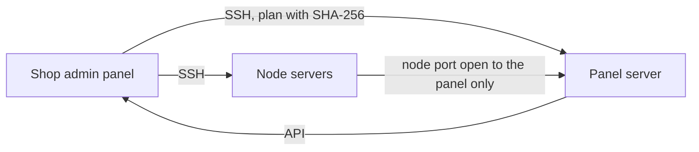

# Remnawave from the admin panel

The shop installs and maintains the Remnawave panel and nodes over SSH — no commands on the servers.

| Step | Where |
| --- | --- |
| Add a server, check the host key fingerprint, «Проверить» | «Серверы → Установка Remnawave» |
| Rotate to the shop's own key | «Сменить ключ» button |
| Pick a mode and domains, make and run the plan (with a 2FA code) | same place |
| Connect the shop to the panel | «Подключить магазин к этой панели» |
| Node modules: IPv6, Xray core, WARP, NetBird, Xray Checker | «Серверы → Расширения Remnawave» |
| Panel and node updates | «Обновления → Автообновление Remnawave» |

Step by step: [owner setup guide](https://github.com/booarkz-cpu/shop-by-boo/blob/main/docs/en/OWNER_SETUP_GUIDE.md) (English), [installation guide](https://github.com/booarkz-cpu/shop-by-boo/blob/main/docs/ru/new/REMNAWAVE_INSTALLATION_GUIDE.md) (Russian).
