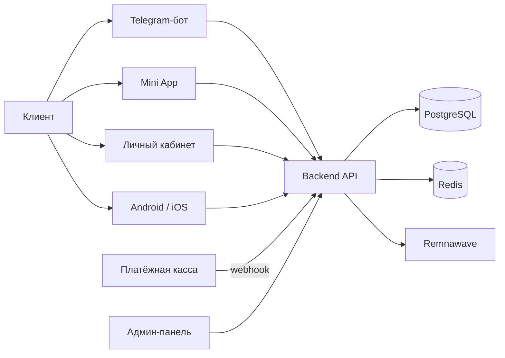

# Корги Люси — Свободный интернет без лишнего Гав!

Магазин VPN-подписок поверх вашей панели Remnawave: клиент платит и сразу получает доступ, вы управляете
всем из одной админ-панели.

> Текущий выпуск **v28.161.0**, runtime/API `21.5.1`, миграция магазина `0094_store_subscriptions`.

## С чего начать

| Задача | Страница |
| --- | --- |
| Поставить магазин на сервер | [Установка](Installation.md) |
| Подключить приём денег | [Платежи](Payments.md) |
| Настроить бота и Mini App | [Telegram](Telegram.md) |
| Разобраться в админ-панели | [Админ-панель](Admin.md) |
| Обновлять магазин | [Обновления](Updates.md) |
| Сохранить и восстановить данные | [Резервные копии](Backup.md) |
| Поставить Remnawave и ноды из админки | [Remnawave](Remnawave.md) |
| Направить домены и получить сертификаты | [Домены и TLS](Domains.md) |
| Приложения Android и iOS | [Приложения](Mobile.md) |
| 2FA, история входов, секреты | [Безопасность](Security.md) |
| Что-то не работает | [Диагностика](Troubleshooting.md) |

## Что нужно заранее

1. **Сервер.** Для чистого VPS рекомендуется Ubuntu 24.04 или Debian 12 с доступом root. Для сборки всех образов ориентируйтесь на 4 vCPU, 8 ГБ памяти и 40 ГБ диска.
2. **DNS.** Направьте выбранные имена на сервер. Для API, админки, Mini App, кабинета и поддержки установщик предлагает поддомены `api`, `admin`, `app`, `cabinet` и `support`.
3. **Панель Remnawave** — адрес и API-токен. Без неё магазин не сможет выдать доступ.
4. **Telegram-бот** — токен от [@BotFather](https://t.me/BotFather).
5. **Платёжная касса** — ключи любого провайдера. Без ключей магазин работает, но деньги принять не сможет.

## Как это устроено

Клиент платит → касса присылает webhook → магазин сверяет подпись и сумму у провайдера → worker выдаёт
доступ в Remnawave → клиент получает ссылку-подписку.

## Где полная документация

Репозиторий содержит всю документацию: [README](https://github.com/booarkz-cpu/shop-by-boo#readme),
[руководства по задачам](../../INDEX.md#руководства-по-задачам),
[каталог API](https://github.com/booarkz-cpu/shop-by-boo/blob/main/docs/API_ENDPOINTS.md).

## Языки

[Русский](Home.md) · [English](../en/Home.md) · [Українська](../uk/Home.md)
