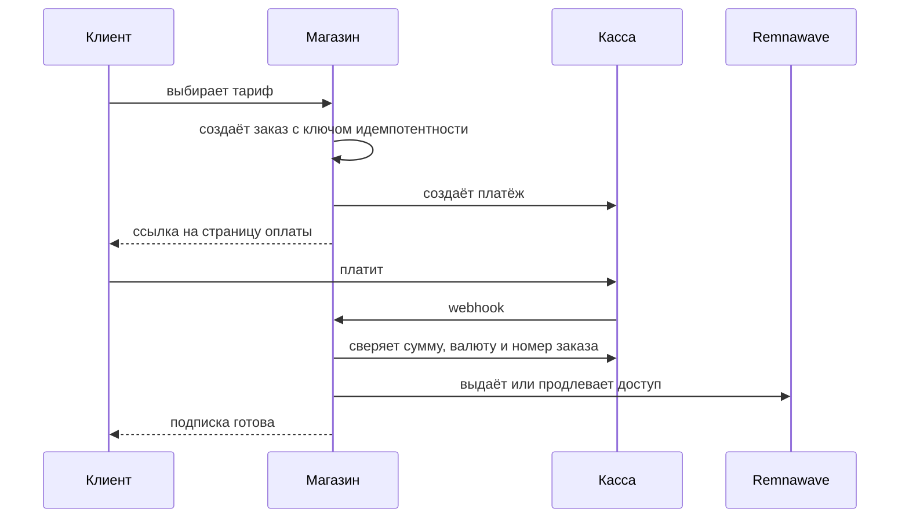

# Платежи

Для оформления заказа магазин выбирает из 15 внешних касс. Доступность зависит от настроек, реквизитов и текущего состояния кассы. Через Tribute можно отдельно пополнить кошелёк. Для платежей и подписок в Telegram Stars используются счета Telegram.

## Как проходит оплата



Получив уведомление от кассы, магазин проверяет платёж и учитывает повторную доставку события. Покупатель может посмотреть результат в кабинете.

## Подключение кассы

1. Получите реквизиты у выбранной кассы и заполните соответствующие переменные в серверном `.env`.
2. Укажите в настройках кассы HTTPS-адрес для уведомлений. Например, для YooKassa путь на домене API — `/api/webhooks/yookassa`.
3. Чтобы применить изменения `.env` в стандартной установке Compose, выполните `docker compose up -d backend worker`. При изменении `BOT_TOKEN` обновите также сервис `bot`.
4. В админ-панели проверьте, что касса настроена, включена и доступна для выбранного способа оплаты.

## Провайдеры и переменные

| Касса | Что принимает | Переменные |
| --- | --- | --- |
| YooKassa | карты, СБП | `YOOKASSA_SHOP_ID`, `YOOKASSA_SECRET_KEY`, `YOOKASSA_WEBHOOK_IP_ALLOWLIST` |
| Freekassa | карты, СБП | `FREEKASSA_SHOP_ID`, `FREEKASSA_SECRET1`, `FREEKASSA_SECRET2`, `FREEKASSA_API_KEY`, `FREEKASSA_WEBHOOK_IP_ALLOWLIST` |
| CloudPayments | карты, СБП, возвраты | `CLOUDPAYMENTS_PUBLIC_ID`, `CLOUDPAYMENTS_API_SECRET` |
| Platega | карты, СБП | `PLATEGA_MERCHANT_ID`, `PLATEGA_SECRET` |
| RollyPay | карты, СБП | `ROLLYPAY_API_KEY`, `ROLLYPAY_SIGNING_SECRET` |
| CryptoBot | криптовалюта | `CRYPTOBOT_TOKEN`, `CRYPTOBOT_NETWORK` |
| Lava | карты, СБП | `LAVA_SHOP_ID`, `LAVA_SECRET_KEY`, `LAVA_WEBHOOK_SECRET` |
| Pal24 | карты, СБП | `PAL24_*` |
| Mulen Pay | карты, СБП | `MULENPAY_SHOP_ID`, `MULENPAY_API_KEY`, `MULENPAY_SECRET_KEY` |
| WATA | карты, СБП | `WATA_ACCESS_TOKEN` |
| Antilopay | карты, СБП | `ANTILOPAY_PROJECT_ID`, `ANTILOPAY_SECRET_ID`, `ANTILOPAY_PRIVATE_KEY`, `ANTILOPAY_PUBLIC_KEY`, `ANTILOPAY_CUSTOMER_EMAIL` |
| AuraPay | карты, СБП | `AURAPAY_SHOP_ID`, `AURAPAY_API_KEY`, `AURAPAY_SECRET_KEY` |
| Anore | карты, СБП | `ANORE_SHOP_ID`, `ANORE_API_KEY`, `ANORE_SECRET_KEY` |
| Cashera | карты, СБП | `CASHERA_API_KEY`, `CASHERA_API_SECRET` |
| ParityPay | карты, СБП | `PARITYPAY_SHOP_ID`, `PARITYPAY_SECRET_KEY`, `PARITYPAY_CALLBACK_SECRET` |
| Tribute | пополнение кошелька | `TRIBUTE_DONATE_LINK`, `TRIBUTE_API_KEY` |
| Telegram Stars | Stars, автопродление | `BOT_TOKEN` |

`WEBHOOK_BASE_URL` задаёт публичный базовый адрес. Путь для уведомлений зависит от кассы.

## Проверка без денег

На отдельной локальной машине с Docker и Compose выполните команду из корня проекта. При первом запуске скрипт создаст `.env.test` из тестового шаблона. Если файл уже существует, проверьте значения `APP_ENV=development` и `PAYMENTS_SANDBOX=true`. Оставьте пустыми реквизиты касс и подключения к Remnawave.

```bash
COMPOSE_PROJECT_NAME=corgi-sandbox bash scripts/test-up.sh
```

Скрипт проверяет доступность API и оформляет заказ через `sandbox`. Кабинет можно открыть по адресу `http://127.0.0.1:18082`. Заказ проверяет выдачу локальной подписки. Приём денег каждой кассой требует отдельного подтверждения.

## Аварийная остановка

Администратор может остановить приём новых платежей в админ-панели. Магазин продолжит обработку уже оплаченных заказов.

## Подтверждение работы кассы

В реестре провайдеров указаны возможности каждого адаптера и статус проверки. `IMPLEMENTED` означает, что адаптер есть в коде. Результаты испытаний у провайдера и в рабочей среде учитываются отдельно.

[Реестр провайдеров](https://github.com/booarkz-cpu/shop-by-boo/blob/main/docs/PAYMENT_PROVIDER_INVENTORY.md) · [Порядок проверки подключённой кассы](https://github.com/booarkz-cpu/shop-by-boo/blob/main/docs/ru/PAYMENTS_LIVE_CHECKLIST.md)

[← На главную](Home.md)
