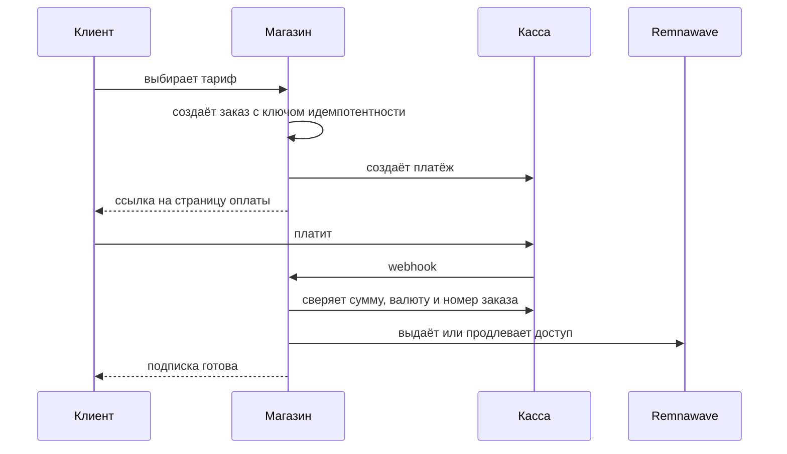

# Платежи

Магазин принимает оплату через 16 внешних касс и Telegram Stars. Все они реализованы в коде; способ оплаты
появляется у клиента только после того, как вы заполнили его переменные в `.env`.

## Как проходит оплата



Повторный webhook ничего не повторяет: событие помечается как обработанное, а выдача защищена блокировкой по
пользователю. Подписка **не** выдаётся по сообщению клиента — только после проверки статуса у провайдера.

## Подключение кассы

1. Зарегистрируйтесь у провайдера и получите ключи.
2. Заполните переменные в `.env` (таблица ниже).
3. В панели кассы укажите адрес webhook:
   `https://ваш-домен/api/webhooks/<провайдер>` — точный путь указан в описании кассы.
4. Перезапустите backend: `docker compose restart backend`.
5. Проверьте: в разделе «Платежи» админ-панели касса должна показать статус «настроена».

## Провайдеры и переменные

| Касса | Что принимает | Переменные |
| --- | --- | --- |
| YooKassa | карты, СБП | `YOOKASSA_SHOP_ID`, `YOOKASSA_SECRET_KEY`, `YOOKASSA_WEBHOOK_IP_ALLOWLIST` |
| Freekassa | карты, СБП | `FREEKASSA_MERCHANT_ID`, `FREEKASSA_SECRET_WORD`, `FREEKASSA_SECRET_WORD_2` |
| CloudPayments | карты, СБП, возвраты | `CLOUDPAYMENTS_PUBLIC_ID`, `CLOUDPAYMENTS_API_SECRET` |
| Platega | карты, СБП | `PLATEGA_MERCHANT_ID`, `PLATEGA_SECRET` |
| RollyPay | карты, СБП | `ROLLYPAY_API_KEY`, `ROLLYPAY_SIGNING_SECRET` |
| CryptoBot | криптовалюта | `CRYPTOBOT_TOKEN`, `CRYPTOBOT_NETWORK` |
| Lava | карты, СБП | `LAVA_*` |
| Pal24 | карты, СБП | `PAL24_*` |
| Mulen Pay | карты, СБП | `MULENPAY_*` |
| WATA | карты, СБП | `WATA_*` |
| Antilopay | карты, СБП | `ANTILOPAY_*` |
| AuraPay | карты, СБП | `AURAPAY_*` |
| Anore | карты, СБП | `ANORE_*` |
| Cashera | карты, СБП | `CASHERA_*` |
| ParityPay | карты, СБП | `PARITYPAY_*` |
| Tribute | пополнение кошелька | `TRIBUTE_*` |
| Telegram Stars | Stars, автопродление | `BOT_TOKEN` |

Общий адрес для webhook задаётся в `WEBHOOK_BASE_URL`.

## Проверка без денег

```bash
PAYMENTS_SANDBOX=true docker compose up -d backend
```

Sandbox-режим проводит заказ по внутренней логике без реальной кассы. Это проверка кода, **не** проверка
приёма денег.

## Аварийная остановка

В админ-панели есть кнопка «Остановить приём платежей»: новые заказы не создаются, уже оплаченные
обрабатываются до конца. Включается мгновенно, без перезапуска.

## Что честно сказать про статус

Ни одна реальная денежная операция через кассы не проводилась: в проекте нет действующих ключей. Код
подписи, сверки суммы и идемпотентности покрыт тестами. Пошаговая проверка каждой кассы с реальными деньгами:
[PAYMENTS_LIVE_CHECKLIST.md](https://github.com/booarkz-cpu/shop-by-boo/blob/main/docs/ru/PAYMENTS_LIVE_CHECKLIST.md).

[← На главную](Home.md)
