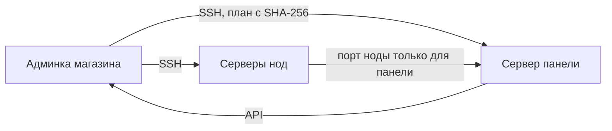

# Remnawave из админки

Магазин сам ставит и обслуживает панель Remnawave и ноды по SSH — без команд на серверах.

| Шаг | Где |
| --- | --- |
| Добавить сервер, сверить отпечаток ключа, «Проверить» | «Серверы → Установка Remnawave» |
| Сменить ключ на ключ магазина | кнопка «Сменить ключ» |
| Выбрать режим, домены, составить и запустить план (с кодом 2FA) | там же |
| Подключить магазин к панели | «Подключить магазин к этой панели» |
| Модули нод: IPv6, ядро Xray, WARP, NetBird, Xray Checker | «Серверы → Расширения Remnawave» |
| Обновления панели и нод | «Обновления → Автообновление Remnawave» |

Пошагово: [установка Remnawave с нуля](https://github.com/booarkz-cpu/shop-by-boo/blob/main/docs/ru/new/REMNAWAVE_INSTALLATION_GUIDE.md), [мастер установки](https://github.com/booarkz-cpu/shop-by-boo/blob/main/docs/ru/new/REMNAWAVE_INSTALLATION_WIZARD.md).
