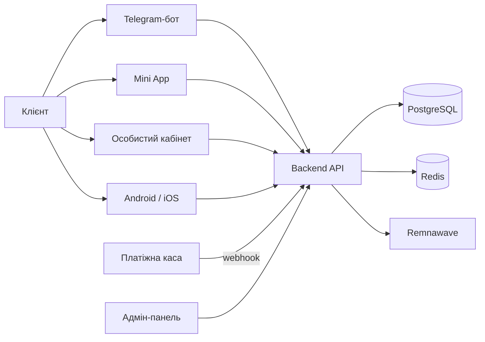

# Коргі Люсі — Вільний інтернет без зайвого Гав!

Магазин VPN-підписок поверх вашої панелі Remnawave: клієнт платить і одразу отримує доступ, а ви керуєте
всім з однієї адмін-панелі.

> Поточний випуск **v28.161.0**, runtime/API `21.5.1`, міграція магазину `0094_store_subscriptions`.

## З чого почати

| Завдання | Сторінка |
| --- | --- |
| Встановити магазин на сервер | [Встановлення](Installation.md) |
| Підключити приймання платежів | [Платежі](Payments.md) |
| Налаштувати бота і Mini App | [Telegram](Telegram.md) |
| Розібратися в адмін-панелі | [Адмін-панель](Admin.md) |
| Докладні посібники | [Встановлення, адмінпанель, Remnawave, Android-застосунки](../../uk/guides/README.md) |
| Оновлювати магазин | [Оновлення](Updates.md) |
| Зберегти й відновити дані | [Резервні копії](Backup.md) |
| Встановити Remnawave і ноди з адмінки | [Remnawave](Remnawave.md) |
| Спрямувати домени й отримати сертифікати | [Домени й TLS](Domains.md) |
| Застосунки Android і iOS | [Застосунки](Mobile.md) |
| 2FA, історія входів, секрети | [Безпека](Security.md) |
| Щось не працює | [Діагностика](Troubleshooting.md) |

## Що потрібно заздалегідь

1. **Сервер.** Для чистого VPS рекомендовано Ubuntu 24.04 або Debian 12 із доступом root. Для збирання всіх образів орієнтуйтеся на 4 vCPU, 8 ГБ оперативної пам’яті та 40 ГБ диска.
2. **DNS.** Спрямуйте вибрані імена на сервер. Для API, адмінпанелі, Mini App, кабінету й підтримки інсталятор пропонує піддомени `api`, `admin`, `app`, `cabinet` і `support`.
3. **Панель Remnawave** — адреса й API-токен. Без неї магазин не зможе видати доступ.
4. **Telegram-бот** — токен від [@BotFather](https://t.me/BotFather).
5. **Платіжна каса** — ключі будь-якого провайдера. Без ключів магазин працює, але гроші прийняти не зможе.

## Як це влаштовано

Клієнт платить → каса надсилає webhook → магазин звіряє підпис і суму в провайдера → worker видає доступ у
Remnawave → клієнт отримує посилання-підписку.

## Повна документація

Репозиторій містить усю документацію: [README](https://github.com/booarkz-cpu/shop-by-boo#readme),
[посібники за завданнями російською](../../INDEX.md#руководства-по-задачам),
[каталог API](https://github.com/booarkz-cpu/shop-by-boo/blob/main/docs/API_ENDPOINTS.md).

## Мови

[Русский](../ru/Home.md) · [English](../en/Home.md) · [Українська](Home.md)
