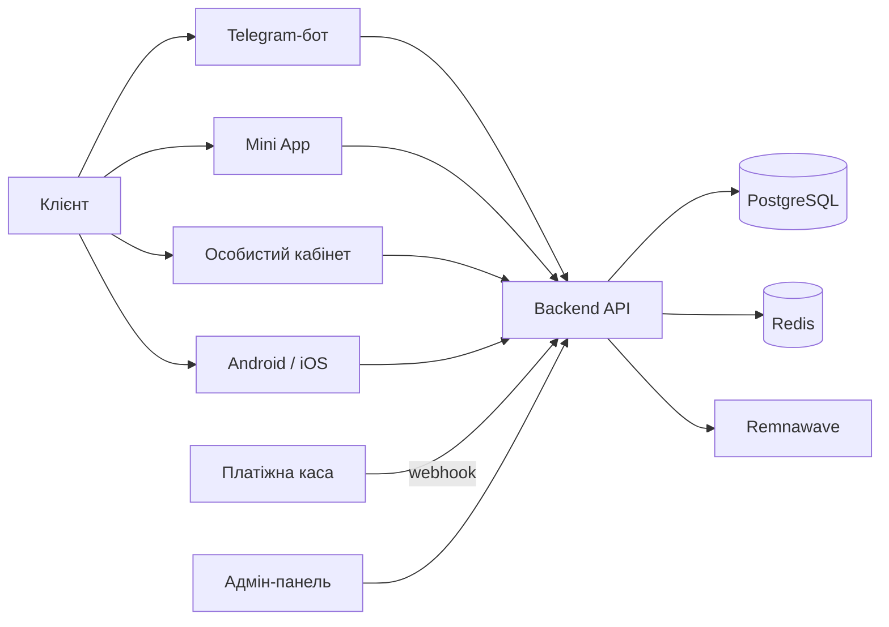

# Коргі Люсі — Вільний інтернет без зайвого Гав!

Магазин VPN-підписок поверх вашої панелі Remnawave: клієнт платить і одразу отримує доступ, а ви керуєте
всім з однієї адмін-панелі.

> Поточний випуск **v28.56.0**, runtime/API `21.5.1`, міграція магазину `0088_filter_and_regions`.

## З чого почати

| Завдання | Сторінка |
| --- | --- |
| Встановити магазин на сервер | [Встановлення](Installation.md) |
| Підключити приймання платежів | [Платежі](Payments.md) |
| Налаштувати бота і Mini App | [Telegram](Telegram.md) |
| Розібратися в адмін-панелі | [Адмін-панель](Admin.md) |
| Оновлювати магазин | [Оновлення](Updates.md) |
| Зберегти й відновити дані | [Резервні копії](Backup.md) |
| Щось не працює | [Діагностика](Troubleshooting.md) |

## Що потрібно заздалегідь

1. **Сервер** — VDS на Ubuntu 22.04+ з 2 ядрами, 4 ГБ RAM, 20 ГБ SSD.
2. **Домен** — A-запис на IP сервера. Для трьох інтерфейсів зручно три піддомени.
3. **Панель Remnawave** — адреса й API-токен. Без неї магазин не зможе видати доступ.
4. **Telegram-бот** — токен від [@BotFather](https://t.me/BotFather).
5. **Платіжна каса** — ключі будь-якого провайдера. Без ключів магазин працює, але гроші прийняти не зможе.

## Як це влаштовано

Клієнт платить → каса надсилає webhook → магазин звіряє підпис і суму в провайдера → worker видає доступ у
Remnawave → клієнт отримує посилання-підписку.

## Повна документація

Репозиторій містить усю документацію: [README](https://github.com/booarkz-cpu/shop-by-boo#readme),
[покажчик документів](https://github.com/booarkz-cpu/shop-by-boo/blob/main/docs/INDEX.md),
[каталог API](https://github.com/booarkz-cpu/shop-by-boo/blob/main/docs/API_ENDPOINTS.md).

## Мови

[Русский](../ru/Home.md) · [English](../en/Home.md) · [Українська](Home.md)
