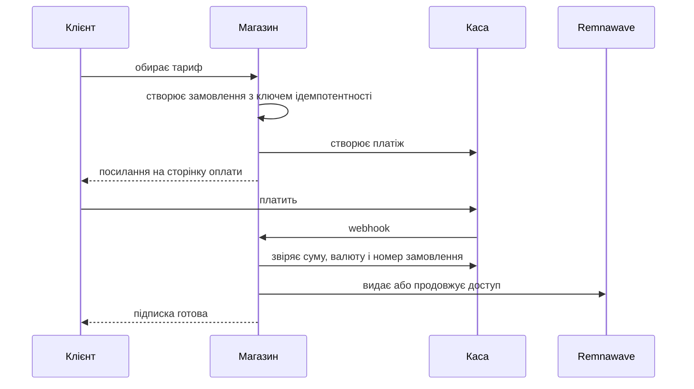

# Платежі

Для оплати замовлень магазин може вибирати з 15 зовнішніх платіжних сервісів. Доступність залежить від налаштувань, реквізитів і поточного стану сервісу. Через Tribute можна окремо поповнити гаманець. Для оплати й підписок у Telegram Stars використовуються рахунки Telegram.

## Як проходить оплата



Отримавши сповіщення від платіжного сервісу, магазин перевіряє платіж і з’ясовує, чи вже оброблено подію. Покупець може переглянути результат у кабінеті.

## Підключення каси

1. Отримайте реквізити у вибраного платіжного сервісу та заповніть відповідні змінні в серверному файлі `.env`.
2. У налаштуваннях сервісу вкажіть HTTPS-адресу для сповіщень. Наприклад, для YooKassa шлях на домені API — `/api/webhooks/yookassa`.
3. Щоб застосувати зміни `.env` у стандартній інсталяції Compose, виконайте `docker compose up -d backend worker`. Якщо змінили `BOT_TOKEN`, оновіть також сервіс `bot`.
4. На панелі адміністратора перевірте, чи налаштовано й увімкнено касу та чи доступна вона для вибраного способу оплати.

## Провайдери та змінні

| Каса | Що приймає | Змінні |
| --- | --- | --- |
| YooKassa | картки, СБП | `YOOKASSA_SHOP_ID`, `YOOKASSA_SECRET_KEY`, `YOOKASSA_WEBHOOK_IP_ALLOWLIST` |
| Freekassa | картки, СБП | `FREEKASSA_SHOP_ID`, `FREEKASSA_SECRET1`, `FREEKASSA_SECRET2`, `FREEKASSA_API_KEY`, `FREEKASSA_WEBHOOK_IP_ALLOWLIST` |
| CloudPayments | картки, СБП, повернення | `CLOUDPAYMENTS_PUBLIC_ID`, `CLOUDPAYMENTS_API_SECRET` |
| Platega | картки, СБП | `PLATEGA_MERCHANT_ID`, `PLATEGA_SECRET` |
| RollyPay | картки, СБП | `ROLLYPAY_API_KEY`, `ROLLYPAY_SIGNING_SECRET` |
| CryptoBot | криптовалюта | `CRYPTOBOT_TOKEN`, `CRYPTOBOT_NETWORK` |
| Lava | картки, СБП | `LAVA_SHOP_ID`, `LAVA_SECRET_KEY`, `LAVA_WEBHOOK_SECRET` |
| Pal24 | картки, СБП | `PAL24_*` |
| Mulen Pay | картки, СБП | `MULENPAY_SHOP_ID`, `MULENPAY_API_KEY`, `MULENPAY_SECRET_KEY` |
| WATA | картки, СБП | `WATA_ACCESS_TOKEN` |
| Antilopay | картки, СБП | `ANTILOPAY_PROJECT_ID`, `ANTILOPAY_SECRET_ID`, `ANTILOPAY_PRIVATE_KEY`, `ANTILOPAY_PUBLIC_KEY`, `ANTILOPAY_CUSTOMER_EMAIL` |
| AuraPay | картки, СБП | `AURAPAY_SHOP_ID`, `AURAPAY_API_KEY`, `AURAPAY_SECRET_KEY` |
| Anore | картки, СБП | `ANORE_SHOP_ID`, `ANORE_API_KEY`, `ANORE_SECRET_KEY` |
| Cashera | картки, СБП | `CASHERA_API_KEY`, `CASHERA_API_SECRET` |
| ParityPay | картки, СБП | `PARITYPAY_SHOP_ID`, `PARITYPAY_SECRET_KEY`, `PARITYPAY_CALLBACK_SECRET` |
| Tribute | поповнення гаманця | `TRIBUTE_DONATE_LINK`, `TRIBUTE_API_KEY` |
| Telegram Stars | Stars, автопродовження | `BOT_TOKEN` |

`WEBHOOK_BASE_URL` задає публічну базову адресу. Шлях для сповіщень залежить від каси.

## Перевірка без грошей

На окремому локальному комп’ютері з Docker і Compose виконайте команду з кореневого каталогу проєкту. Під час першого запуску скрипт створить `.env.test` із тестового шаблону. Якщо файл уже є, перевірте значення `APP_ENV=development` і `PAYMENTS_SANDBOX=true`. Залиште порожніми реквізити кас і підключення до Remnawave.

```bash
COMPOSE_PROJECT_NAME=corgi-sandbox bash scripts/test-up.sh
```

Скрипт перевіряє доступність API й оформлює замовлення через `sandbox`. Кабінет можна відкрити за адресою `http://127.0.0.1:18082`. Таке замовлення перевіряє надання локальної підписки. Приймання коштів кожним сервісом потребує окремого підтвердження.

## Аварійна зупинка

Адміністратор може зупинити приймання нових платежів на панелі керування. Магазин продовжить обробляти вже оплачені замовлення.

## Перевірка платіжного сервісу

У реєстрі провайдерів вказано можливості й стан перевірки кожного адаптера. Статус `IMPLEMENTED` означає, що в коді є адаптер. Результати випробувань у провайдера й у робочому середовищі обліковуються окремо.

[Реєстр провайдерів (російською)](https://github.com/booarkz-cpu/shop-by-boo/blob/main/docs/PAYMENT_PROVIDER_INVENTORY.md) · [Порядок перевірки підключеної каси (російською)](https://github.com/booarkz-cpu/shop-by-boo/blob/main/docs/ru/PAYMENTS_LIVE_CHECKLIST.md)

[← На головну](Home.md)
