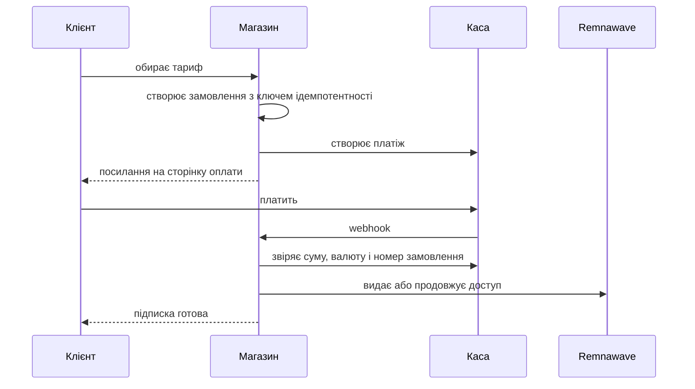

# Платежі

Магазин приймає оплату через 16 зовнішніх кас і Telegram Stars. Усі вони реалізовані в коді; спосіб оплати
з'являється у клієнта лише після того, як ви заповнили його змінні в `.env`.

## Як проходить оплата



Повторний webhook нічого не повторює: подія позначається як оброблена, а видача захищена блокуванням по
користувачу. Підписка **не** видається за повідомленням клієнта — лише після перевірки статусу в провайдера.

## Підключення каси

1. Зареєструйтеся у провайдера й отримайте ключі.
2. Заповніть змінні в `.env` (таблиця нижче).
3. У панелі каси вкажіть адресу webhook:
   `https://ваш-домен/api/webhooks/<провайдер>` — точний шлях вказано в описі каси.
4. Перезапустіть backend: `docker compose restart backend`.
5. Перевірте: у розділі «Платежі» адмін-панелі каса має показати статус «налаштована».

## Провайдери та змінні

| Каса | Що приймає | Змінні |
| --- | --- | --- |
| YooKassa | картки, СБП | `YOOKASSA_SHOP_ID`, `YOOKASSA_SECRET_KEY`, `YOOKASSA_WEBHOOK_IP_ALLOWLIST` |
| Freekassa | картки, СБП | `FREEKASSA_MERCHANT_ID`, `FREEKASSA_SECRET_WORD`, `FREEKASSA_SECRET_WORD_2` |
| CloudPayments | картки, СБП, повернення | `CLOUDPAYMENTS_PUBLIC_ID`, `CLOUDPAYMENTS_API_SECRET` |
| Platega | картки, СБП | `PLATEGA_MERCHANT_ID`, `PLATEGA_SECRET` |
| RollyPay | картки, СБП | `ROLLYPAY_API_KEY`, `ROLLYPAY_SIGNING_SECRET` |
| CryptoBot | криптовалюта | `CRYPTOBOT_TOKEN`, `CRYPTOBOT_NETWORK` |
| Lava | картки, СБП | `LAVA_*` |
| Pal24 | картки, СБП | `PAL24_*` |
| Mulen Pay | картки, СБП | `MULENPAY_*` |
| WATA | картки, СБП | `WATA_*` |
| Antilopay | картки, СБП | `ANTILOPAY_*` |
| AuraPay | картки, СБП | `AURAPAY_*` |
| Anore | картки, СБП | `ANORE_*` |
| Cashera | картки, СБП | `CASHERA_*` |
| ParityPay | картки, СБП | `PARITYPAY_*` |
| Tribute | поповнення гаманця | `TRIBUTE_*` |
| Telegram Stars | Stars, автопродовження | `BOT_TOKEN` |

Спільна адреса для webhook задається в `WEBHOOK_BASE_URL`.

## Перевірка без грошей

```bash
PAYMENTS_SANDBOX=true docker compose up -d backend
```

Sandbox-режим проводить замовлення внутрішньою логікою без реальної каси. Це перевірка коду, **не** перевірка
приймання грошей.

## Аварійна зупинка

В адмін-панелі є кнопка «Зупинити приймання платежів»: нові замовлення не створюються, уже оплачені
обробляються до кінця. Вмикається одразу, без перезапуску.

## Що чесно сказати про статус

Жодна реальна грошова операція через каси не проводилася: у проєкті немає дійсних ключів. Код підпису, звірки
суми та ідемпотентності покритий тестами. Покрокова перевірка кожної каси з реальними грошима:
[PAYMENTS_LIVE_CHECKLIST.md](https://github.com/booarkz-cpu/shop-by-boo/blob/main/docs/ru/PAYMENTS_LIVE_CHECKLIST.md).

[← На головну](Home.md)
