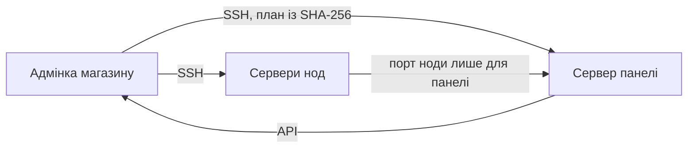

# Remnawave з адмінки

Магазин сам встановлює й обслуговує панель Remnawave і ноди через SSH — без команд на серверах.

| Крок | Де |
| --- | --- |
| Додати сервер, звірити відбиток ключа, «Проверить» | «Серверы → Установка Remnawave» |
| Змінити ключ на ключ магазину | кнопка «Сменить ключ» |
| Обрати режим і домени, скласти й запустити план (з кодом 2FA) | там само |
| Підключити магазин до панелі | «Подключить магазин к этой панели» |
| Модулі нод: IPv6, ядро Xray, WARP, NetBird, Xray Checker | «Серверы → Расширения Remnawave» |
| Оновлення панелі й нод | «Обновления → Автообновление Remnawave» |

Покроково: [посібник власника](https://github.com/booarkz-cpu/shop-by-boo/blob/main/docs/uk/OWNER_SETUP_GUIDE.md), [установка Remnawave](https://github.com/booarkz-cpu/shop-by-boo/blob/main/docs/ru/new/REMNAWAVE_INSTALLATION_GUIDE.md) (російською).
